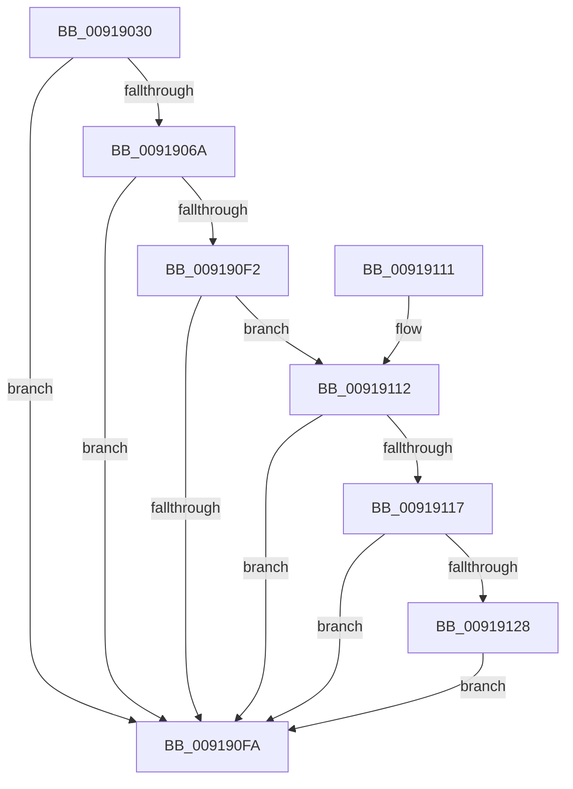

# PspEnforceLimitsProcessCallback

- RVA: `0x00919030`–`0x0091912E` (길이 `254` bytes)
- VA: `0x0000000140919030`
- 실행 섹션: `PAGE`
- PDB 이름 있음: `예`; PDB Function 태그: `아니요`
- unwind 정보 RVA: `0x0008AC7C`
- 디코드: `67`개 명령, `254/254` bytes 표시
- 미해석 바이트: `0` (있으면 어셈블리에 `.byte`로 보존)

> 이 문서는 커널 이미지의 기계어와 PDB 기호를 분석해 생성했습니다. 4번과 5번은 함수 원형과 자료형을 바이너리 사용 방식에서 추정한 C 해석이며 원본 소스 복구 결과는 아닙니다.

## 1. Dependencies

- 직접 호출 지점: **3**; 고유 호출 대상: **3**
- 직접 호출자로 확인된 함수: **1**
- RIP 상대 이미지 참조: **0**

### Outgoing calls
- `0x00919057` → [memset](../../text/6C/memset_function_006C6C40.md) (function, `0x006C6C40`)
- `0x00919071` → [PsQueryStatisticsProcess](PsQueryStatisticsProcess_function_00919350.md) (function, `0x00919350`)
- `0x0091911F` → [ObReferenceObjectSafeWithTag](../../text/21/ObReferenceObjectSafeWithTag_function_00210EE0.md) (function, `0x00210EE0`)

### Direct callers
- [PspCallJobHierarchyCallbacks](PspCallJobHierarchyCallbacks_function_00918A34.md) at `0x00918B81`

### Static image references
- 디코드된 RIP-relative 메모리 참조가 없습니다.

## 2. Other-region calls and transfers

- 다른 실행 섹션으로 향하는 call: **2**
  - `0x00919057` → [memset](../../text/6C/memset_function_006C6C40.md) (`PAGE` → `.text`)
  - `0x0091911F` → [ObReferenceObjectSafeWithTag](../../text/21/ObReferenceObjectSafeWithTag_function_00210EE0.md) (`PAGE` → `.text`)
- 별도 외부 분기/꼬리 이동을 확인하지 못했습니다.

## 3. Assembly (complete function range)

```asm
00919030  48 89 5C 24 08                  mov qword ptr [rsp + 8], rbx
00919035  48 89 7C 24 10                  mov qword ptr [rsp + 0x10], rdi
0091903A  55                              push rbp
0091903B  48 8D 6C 24 A9                  lea rbp, [rsp - 0x57]
00919040  48 81 EC 90 00 00 00            sub rsp, 0x90
00919047  48 8B FA                        mov rdi, rdx
0091904A  48 8B D9                        mov rbx, rcx
0091904D  33 D2                           xor edx, edx
0091904F  48 8D 4D E7                     lea rcx, [rbp - 0x19]
00919053  44 8D 42 68                     lea r8d, [rdx + 0x68]
00919057  E8 E4 DB DA FF                  call 0x1406c6c40
0091905C  8B 83 F0 01 00 00               mov eax, dword ptr [rbx + 0x1f0]
00919062  A8 02                           test al, 2
00919064  0F 85 90 00 00 00               jne 0x1409190fa
0091906A  48 8D 55 E7                     lea rdx, [rbp - 0x19]
0091906E  48 8B CB                        mov rcx, rbx
00919071  E8 DA 02 00 00                  call 0x140919350
00919076  48 8B 93 A0 02 00 00            mov rdx, qword ptr [rbx + 0x2a0]
0091907D  48 8B 45 E7                     mov rax, qword ptr [rbp - 0x19]
00919081  48 81 C2 48 05 00 00            add rdx, 0x548
00919088  48 8B 4D EF                     mov rcx, qword ptr [rbp - 0x11]
0091908C  48 01 02                        add qword ptr [rdx], rax
0091908F  48 8B 45 FF                     mov rax, qword ptr [rbp - 1]
00919093  48 01 42 18                     add qword ptr [rdx + 0x18], rax
00919097  48 8B 45 F7                     mov rax, qword ptr [rbp - 9]
0091909B  48 01 42 10                     add qword ptr [rdx + 0x10], rax
0091909F  48 8B 45 3F                     mov rax, qword ptr [rbp + 0x3f]
009190A3  48 01 42 58                     add qword ptr [rdx + 0x58], rax
009190A7  48 8B 45 47                     mov rax, qword ptr [rbp + 0x47]
009190AB  48 01 42 60                     add qword ptr [rdx + 0x60], rax
009190AF  48 8B 45 07                     mov rax, qword ptr [rbp + 7]
009190B3  48 01 42 20                     add qword ptr [rdx + 0x20], rax
009190B7  48 8B 45 0F                     mov rax, qword ptr [rbp + 0xf]
009190BB  48 01 42 28                     add qword ptr [rdx + 0x28], rax
009190BF  48 8B 45 17                     mov rax, qword ptr [rbp + 0x17]
009190C3  48 01 42 30                     add qword ptr [rdx + 0x30], rax
009190C7  48 8B 45 1F                     mov rax, qword ptr [rbp + 0x1f]
009190CB  48 01 42 38                     add qword ptr [rdx + 0x38], rax
009190CF  48 8B 45 27                     mov rax, qword ptr [rbp + 0x27]
009190D3  48 01 42 40                     add qword ptr [rdx + 0x40], rax
009190D7  48 8B 45 2F                     mov rax, qword ptr [rbp + 0x2f]
009190DB  48 01 42 48                     add qword ptr [rdx + 0x48], rax
009190DF  48 8B 45 37                     mov rax, qword ptr [rbp + 0x37]
009190E3  48 01 42 50                     add qword ptr [rdx + 0x50], rax
009190E7  48 01 4A 08                     add qword ptr [rdx + 8], rcx
009190EB  48 83 7F 10 00                  cmp qword ptr [rdi + 0x10], 0
009190F0  75 08                           jne 0x1409190fa
009190F2  48 8B 07                        mov rax, qword ptr [rdi]
009190F5  48 85 C0                        test rax, rax
009190F8  75 18                           jne 0x140919112
009190FA  4C 8D 9C 24 90 00 00 00         lea r11, [rsp + 0x90]
00919102  33 C0                           xor eax, eax
00919104  49 8B 5B 10                     mov rbx, qword ptr [r11 + 0x10]
00919108  49 8B 7B 18                     mov rdi, qword ptr [r11 + 0x18]
0091910C  49 8B E3                        mov rsp, r11
0091910F  5D                              pop rbp
00919110  C3                              ret
00919111  CC                              int3
00919112  48 3B C8                        cmp rcx, rax
00919115  76 E3                           jbe 0x1409190fa
00919117  BA 50 73 4A 62                  mov edx, 0x624a7350
0091911C  48 8B CB                        mov rcx, rbx
0091911F  E8 BC 7D 8F FF                  call 0x140210ee0
00919124  84 C0                           test al, al
00919126  74 D2                           je 0x1409190fa
00919128  48 89 5F 10                     mov qword ptr [rdi + 0x10], rbx
0091912C  EB CC                           jmp 0x1409190fa
```

## 4. C-style interpretation (structured pseudocode)

```c
__int64 __fastcall PspEnforceLimitsProcessCallback(__int64 a1, __int64 a2)
{
    __int64 result;
    __int64 v_rsp;
    unsigned __int64 v_stack_m18;
    unsigned __int64 v_stack_m20;
    unsigned __int64 v_stack_m28;
    unsigned __int64 v_stack_m30;
    unsigned __int64 v_stack_m38;
    unsigned __int64 v_stack_m40;
    unsigned __int64 v_stack_m48;
    unsigned __int64 v_stack_m50;
    unsigned __int64 v_stack_m58;
    unsigned __int64 v_stack_m5F;
    unsigned __int64 v_stack_m60;
    unsigned __int64 v_stack_m68;
    unsigned __int64 v_stack_m70;
    unsigned __int64 v_stack_m78;
    unsigned __int64 v_stack_m8;
    unsigned __int64 v_stack_p10;
    unsigned __int64 v_stack_p8;

    v_stack_p8 = v_rbx;
    v_stack_p10 = v_rdi;
    v_rsp = (v_rsp) - (144);
    a2 = 0;
    result = memset(v_stack_m78, a2, a2 + 104, a4);
    if ((((unsigned __int8)((unsigned int)(*(unsigned int *)(a1 + 496)))) & (2)) != 0) goto loc_009190FA;
    result = PsQueryStatisticsProcess(a1, v_stack_m78, a2 + 104, a4);
    a2 = (*(unsigned __int64 *)(a1 + 672)) + (0x548ULL);
    if ((*(unsigned __int64 *)(a2 + 16)) != 0) goto loc_009190FA;
    if (*(unsigned __int64 *)(a2) != 0) goto loc_00919112;
loc_009190FA:
    result = 0;
    return result;
loc_00919112:
    if (v_stack_m70 <= 0) goto loc_009190FA;
    result = ObReferenceObjectSafeWithTag(*(unsigned __int64 *)(v_stack_m8 + 16), (unsigned int)(0x624A7350ULL), a2 + 104, a4);
    if ((unsigned __int8)(result) == 0) goto loc_009190FA;
    *(unsigned __int64 *)(*(unsigned __int64 *)(v_stack_m8 + 24) + 16) = *(unsigned __int64 *)(v_stack_m8 + 16);
    goto loc_009190FA;
}
```

## 5. (Beta) C Style

```c
int64_t PspEnforceLimitsProcessCallback(void *Arg1, void *Arg2)
{
    uint8_t *arg1 = (uint8_t *)Arg1;
    uint8_t *arg2 = (uint8_t *)Arg2;

    int64_t result;
    int64_t local_rsp;
    uint64_t v_stack_m18;
    uint64_t v_stack_m20;
    uint64_t v_stack_m28;
    uint64_t v_stack_m30;
    uint64_t v_stack_m38;
    uint64_t v_stack_m40;
    uint64_t v_stack_m48;
    uint64_t v_stack_m50;
    uint64_t v_stack_m58;
    uint64_t v_stack_m5F;
    uint64_t v_stack_m60;
    uint64_t v_stack_m68;
    uint64_t v_stack_m70;
    uint64_t v_stack_m78;
    uint64_t v_stack_m8;
    uint64_t v_stack_p10;
    uint64_t v_stack_p8;

    v_stack_p8 = local_rbx;
    v_stack_p10 = local_rdi;
    local_rsp = (local_rsp) - (144);
    Arg2 = 0;
    result = memset(v_stack_m78, Arg2, Arg2 + 104, a4);
    if ((((uint8_t)((uint32_t)(*(uint32_t *)(arg1 + 0x1F0)))) & (2)) != 0) goto loc_009190FA;
    result = PsQueryStatisticsProcess(Arg1, v_stack_m78, Arg2 + 104, a4);
    Arg2 = (*(uint64_t *)(arg1 + 0x2A0)) + (0x548ULL);
    if ((*(uint64_t *)(arg2 + 0x10)) != 0) goto loc_009190FA;
    if (*(uint64_t *)(arg2) != 0) goto loc_00919112;
loc_009190FA:
    result = 0;
    return result;
loc_00919112:
    if (v_stack_m70 <= 0) goto loc_009190FA;
    result = ObReferenceObjectSafeWithTag(*(uint64_t *)(v_stack_m8 + 0x10), (uint32_t)(0x624A7350ULL), Arg2 + 104, a4);
    if ((uint8_t)(result) == 0) goto loc_009190FA;
    *(uint64_t *)(*(uint64_t *)(v_stack_m8 + 0x18) + 0x10) = *(uint64_t *)(v_stack_m8 + 0x10);
    goto loc_009190FA;
}
```

### 관측된 메모리 오프셋

구조체 형식이 확인되지 않은 접근은 인자 기준의 오프셋으로만 기록했습니다.

| 기준 인자 | 오프셋 표현 | 폭 (bit) | 접근 |
|---|---:|---:|---|
| `Arg1` | `+ 0x1F0` | `32` | `R` |
| `Arg1` | `+ 0x2A0` | `64` | `R` |
| `Arg2` | `+ 0x0` | `64` | `R` |
| `Arg2` | `+ 0x10` | `64` | `R` |
| `Arg2` | `+ 0x10` | `64` | `W` |

## 6. Execution-region graph

[열기: 2D/3D 그래프와 함수 탐색 컨트롤 패널](../../../control-panel.html?section=page&rva=0x00919030&view=graph)

- 2D 그래프는 위에서 아래로 흐르고, 3D 그래프는 빈 공간을 드래그해 회전합니다. Shift+드래그는 이동, 휠은 확대·축소, 함수 노드 선택은 대상 보고서 이동입니다.

### Static fallback


