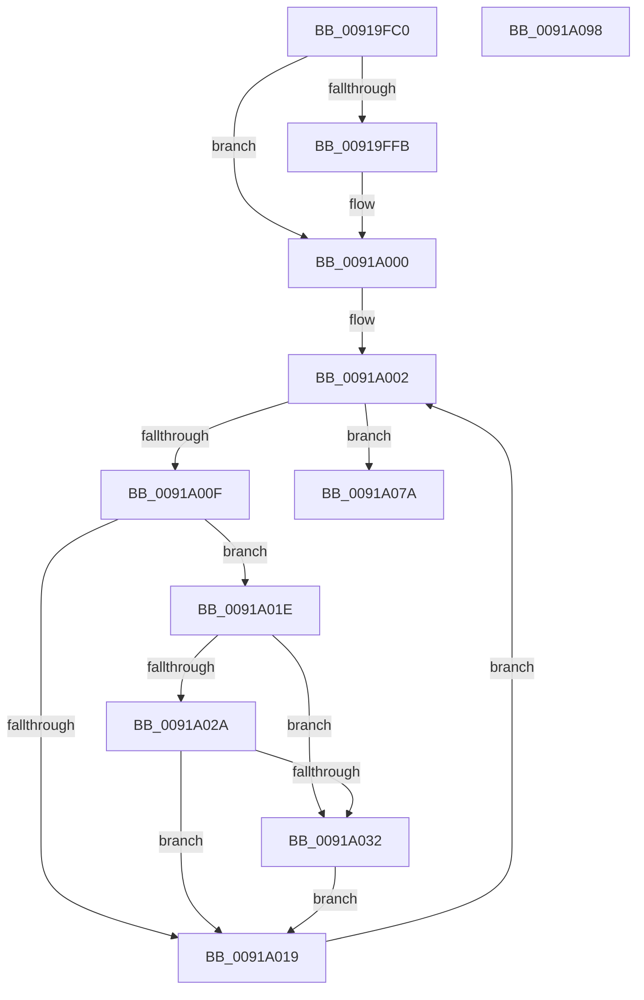

# PspEnforceLimits

- RVA: `0x00919FC0`–`0x0091A099` (길이 `217` bytes)
- VA: `0x0000000140919FC0`
- 실행 섹션: `PAGE`
- PDB 이름 있음: `예`; PDB Function 태그: `아니요`
- unwind 정보 RVA: `0x0008AD68`
- 디코드: `51`개 명령, `217/217` bytes 표시
- 미해석 바이트: `0` (있으면 어셈블리에 `.byte`로 보존)

> 이 문서는 커널 이미지의 기계어와 PDB 기호를 분석해 생성했습니다. 4번과 5번은 함수 원형과 자료형을 바이너리 사용 방식에서 추정한 C 해석이며 원본 소스 복구 결과는 아닙니다.

## 1. Dependencies

- 직접 호출 지점: **6**; 고유 호출 대상: **5**
- 직접 호출자로 확인된 함수: **1**
- RIP 상대 이미지 참조: **5**

### Outgoing calls
- `0x00919FEA` → [memset](../../text/6C/memset_function_006C6C40.md) (function, `0x006C6C40`)
- `0x00919FFB` → [PspClearNoWakeChargeLimitNotification](PspClearNoWakeChargeLimitNotification_function_00918378.md) (function, `0x00918378`)
- `0x0091A002` → [PspGetNextJob](PspGetNextJob_function_0091A0A0.md) (function, `0x0091A0A0`)
- `0x0091A044` → [memset](../../text/6C/memset_function_006C6C40.md) (function, `0x006C6C40`)
- `0x0091A073` → [PspEnumJobsAndProcessesInJobHierarchy](PspEnumJobsAndProcessesInJobHierarchy_function_0091A1EC.md) (function, `0x0091A1EC`)
- `0x0091A082` → [_security_check_cookie](../../text/6A/_security_check_cookie_function_006AC640.md) (function, `0x006AC640`)

### Direct callers
- [PspJobTimeLimitsWork](PspJobTimeLimitsWork_function_009183E0.md) at `0x00918414`

### Static image references
- `0x00919FCD` → RVA `0x00E0A740` (`.data`; read)
- `0x00919FEF` → RVA `0x00FD9C70` (`PAGEDATA`; read/write)
- `0x0091A056` → RVA `0x00919030` (`PspEnforceLimitsProcessCallback`; read)
- `0x0091A062` → RVA `0x00919720` (`PspEnforceLimitsJobPostCallback`; read)
- `0x0091A06C` → RVA `0x00918C10` (`PspEnforceLimitsJobPreCallback`; read)

## 2. Other-region calls and transfers

- 다른 실행 섹션으로 향하는 call: **3**
  - `0x00919FEA` → [memset](../../text/6C/memset_function_006C6C40.md) (`PAGE` → `.text`)
  - `0x0091A044` → [memset](../../text/6C/memset_function_006C6C40.md) (`PAGE` → `.text`)
  - `0x0091A082` → [_security_check_cookie](../../text/6A/_security_check_cookie_function_006AC640.md) (`PAGE` → `.text`)
- 별도 외부 분기/꼬리 이동을 확인하지 못했습니다.

## 3. Assembly (complete function range)

```asm
00919FC0  48 89 5C 24 08                  mov qword ptr [rsp + 8], rbx
00919FC5  57                              push rdi
00919FC6  48 81 EC 80 00 00 00            sub rsp, 0x80
00919FCD  48 8B 05 6C 07 4F 00            mov rax, qword ptr [rip + 0x4f076c]
00919FD4  48 33 C4                        xor rax, rsp
00919FD7  48 89 44 24 70                  mov qword ptr [rsp + 0x70], rax
00919FDC  33 D2                           xor edx, edx
00919FDE  40 8A F9                        mov dil, cl
00919FE1  48 8D 4C 24 30                  lea rcx, [rsp + 0x30]
00919FE6  44 8D 42 40                     lea r8d, [rdx + 0x40]
00919FEA  E8 51 CC DA FF                  call 0x1406c6c40
00919FEF  F0 FF 05 7A FC 6B 00            lock inc dword ptr [rip + 0x6bfc7a]
00919FF6  40 84 FF                        test dil, dil
00919FF9  75 05                           jne 0x14091a000
00919FFB  E8 78 E3 FF FF                  call 0x140918378
0091A000  33 C9                           xor ecx, ecx
0091A002  E8 99 00 00 00                  call 0x14091a0a0
0091A007  48 8B D8                        mov rbx, rax
0091A00A  48 85 C0                        test rax, rax
0091A00D  74 6B                           je 0x14091a07a
0091A00F  48 83 B8 18 05 00 00 00         cmp qword ptr [rax + 0x518], 0
0091A017  74 05                           je 0x14091a01e
0091A019  48 8B CB                        mov rcx, rbx
0091A01C  EB E4                           jmp 0x14091a002
0091A01E  48 8D 8B 10 06 00 00            lea rcx, [rbx + 0x610]
0091A025  40 84 FF                        test dil, dil
0091A028  74 08                           je 0x14091a032
0091A02A  F7 01 00 00 10 00               test dword ptr [rcx], 0x100000
0091A030  74 E7                           je 0x14091a019
0091A032  F0 81 21 FF FF EF FF            lock and dword ptr [rcx], 0xffefffff
0091A039  33 D2                           xor edx, edx
0091A03B  48 8D 4C 24 30                  lea rcx, [rsp + 0x30]
0091A040  44 8D 42 40                     lea r8d, [rdx + 0x40]
0091A044  E8 F7 CB DA FF                  call 0x1406c6c40
0091A049  48 8D 44 24 30                  lea rax, [rsp + 0x30]
0091A04E  C7 44 24 28 06 00 00 00         mov dword ptr [rsp + 0x28], 6
0091A056  4C 8D 0D D3 EF FF FF            lea r9, [rip - 0x102d]
0091A05D  48 89 44 24 20                  mov qword ptr [rsp + 0x20], rax
0091A062  4C 8D 05 B7 F6 FF FF            lea r8, [rip - 0x949]
0091A069  48 8B CB                        mov rcx, rbx
0091A06C  48 8D 15 9D EB FF FF            lea rdx, [rip - 0x1463]
0091A073  E8 74 01 00 00                  call 0x14091a1ec
0091A078  EB 9F                           jmp 0x14091a019
0091A07A  48 8B 4C 24 70                  mov rcx, qword ptr [rsp + 0x70]
0091A07F  48 33 CC                        xor rcx, rsp
0091A082  E8 B9 25 D9 FF                  call 0x1406ac640
0091A087  48 8B 9C 24 90 00 00 00         mov rbx, qword ptr [rsp + 0x90]
0091A08F  48 81 C4 80 00 00 00            add rsp, 0x80
0091A096  5F                              pop rdi
0091A097  C3                              ret
0091A098  CC                              int3
```

## 4. C-style interpretation (structured pseudocode)

```c
__int64 __fastcall PspEnforceLimits(unsigned __int8 a1, int a2)
{
    __int64 result;
    __int64 v_rsp;
    unsigned __int64 v_stack_m18;
    unsigned __int64 v_stack_m58;
    unsigned int v_stack_m60;
    unsigned __int64 v_stack_m68;
    unsigned __int64 v_stack_p8;

    v_stack_p8 = v_rbx;
    v_rsp = (v_rsp) - (128);
    result = (*(unsigned __int64 *)(v_rip + 5179244)) ^ (v_rsp);
    v_stack_m18 = result;
    a2 = 0;
    result = memset(v_stack_m58, a2, a2 + 64, a4);
    if (a1 == 0) {
        result = PspClearNoWakeChargeLimitNotification(v_stack_m58, a2, a2 + 64, a4);
    }
    a1 = 0;
loc_0091A002:
    result = PspGetNextJob(a1, a2, a2 + 64, a4);
    if (result == 0) goto loc_0091A07A;
    if ((*(unsigned __int64 *)(result + 1304)) == 0) goto loc_0091A01E;
loc_0091A019:
    goto loc_0091A002;
loc_0091A01E:
    if (0 == 0) goto loc_0091A032;
    if (((*(unsigned int *)(result + 1552)) & (0x100000ULL)) == 0) goto loc_0091A019;
loc_0091A032:
    a2 = 0;
    result = memset(v_stack_m58, a2, a2 + 64, a4);
    v_stack_m60 = 6;
    v_stack_m68 = v_stack_m58;
    result = PspEnumJobsAndProcessesInJobHierarchy(result, v_rip - 5219, v_rip - 2377, v_rip - 4141);
    goto loc_0091A019;
loc_0091A07A:
    a1 = (v_stack_m18) ^ (v_rsp);
    result = _security_check_cookie(a1, v_rip - 5219, v_rip - 2377, v_rip - 4141);
    v_rsp = (v_rsp) + (128);
    return result;
}
```

## 5. (Beta) C Style

```c
int64_t PspEnforceLimits(uint8_t Arg1, int32_t Arg2)
{
    int64_t result;
    int64_t local_rsp;
    uint64_t v_stack_m18;
    uint64_t v_stack_m58;
    uint32_t v_stack_m60;
    uint64_t v_stack_m68;
    uint64_t v_stack_p8;

    v_stack_p8 = local_rbx;
    local_rsp = (local_rsp) - (128);
    result = (*(uint64_t *)(v_rip + 0x4F076C)) ^ (local_rsp);
    v_stack_m18 = result;
    Arg2 = 0;
    result = memset(v_stack_m58, Arg2, Arg2 + 64, a4);
    if (Arg1 == 0) {
        result = PspClearNoWakeChargeLimitNotification(v_stack_m58, Arg2, Arg2 + 64, a4);
    }
    Arg1 = 0;
loc_0091A002:
    result = PspGetNextJob(Arg1, Arg2, Arg2 + 64, a4);
    if (result == 0) goto loc_0091A07A;
    if ((*(uint64_t *)(result + 0x518)) == 0) goto loc_0091A01E;
loc_0091A019:
    goto loc_0091A002;
loc_0091A01E:
    if (0 == 0) goto loc_0091A032;
    if (((*(uint32_t *)(result + 0x610)) & (0x100000ULL)) == 0) goto loc_0091A019;
loc_0091A032:
    Arg2 = 0;
    result = memset(v_stack_m58, Arg2, Arg2 + 64, a4);
    v_stack_m60 = 6;
    v_stack_m68 = v_stack_m58;
    result = PspEnumJobsAndProcessesInJobHierarchy(result, v_rip - 5219, v_rip - 2377, v_rip - 4141);
    goto loc_0091A019;
loc_0091A07A:
    Arg1 = (v_stack_m18) ^ (local_rsp);
    result = _security_check_cookie(Arg1, v_rip - 5219, v_rip - 2377, v_rip - 4141);
    local_rsp = (local_rsp) + (128);
    return result;
}
```

## 6. Execution-region graph

[열기: 2D/3D 그래프와 함수 탐색 컨트롤 패널](../../../control-panel.html?section=page&rva=0x00919FC0&view=graph)

- 2D 그래프는 위에서 아래로 흐르고, 3D 그래프는 빈 공간을 드래그해 회전합니다. Shift+드래그는 이동, 휠은 확대·축소, 함수 노드 선택은 대상 보고서 이동입니다.

### Static fallback


