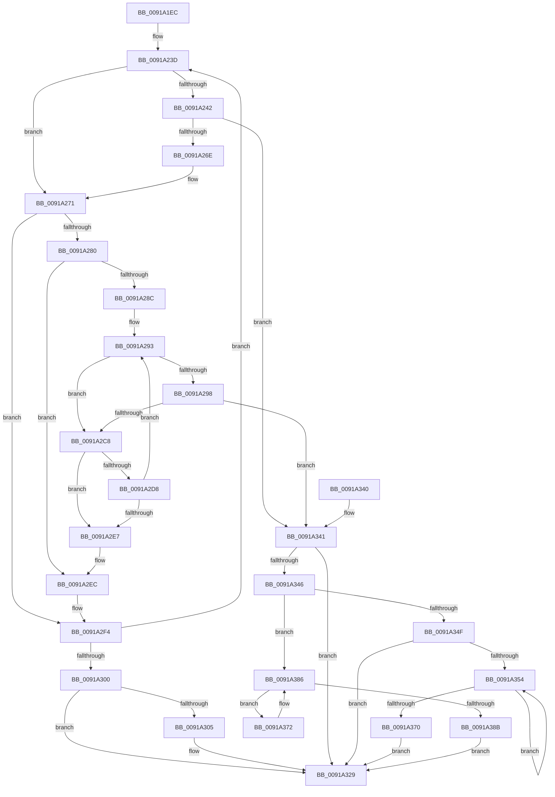

# PspEnumJobsAndProcessesInJobHierarchy

- RVA: `0x0091A1EC`–`0x0091A38D` (길이 `417` bytes)
- VA: `0x000000014091A1EC`
- 실행 섹션: `PAGE`
- PDB 이름 있음: `예`; PDB Function 태그: `아니요`
- unwind 정보 RVA: `0x0008AE04`
- 디코드: `122`개 명령, `417/417` bytes 표시
- 미해석 바이트: `0` (있으면 어셈블리에 `.byte`로 보존)

> 이 문서는 커널 이미지의 기계어와 PDB 기호를 분석해 생성했습니다. 4번과 5번은 함수 원형과 자료형을 바이너리 사용 방식에서 추정한 C 해석이며 원본 소스 복구 결과는 아닙니다.

## 1. Dependencies

- 직접 호출 지점: **8**; 고유 호출 대상: **4**
- 직접 호출자로 확인된 함수: **22**
- RIP 상대 이미지 참조: **0**

### Outgoing calls
- `0x0091A25F` → [PspCallJobHierarchyCallbacks](PspCallJobHierarchyCallbacks_function_00918A34.md) (function, `0x00918A34`)
- `0x0091A276` → [PspGetNextChildJob](../9F/PspGetNextChildJob_function_009F66A4.md) (function, `0x009F66A4`)
- `0x0091A2BD` → [PspCallJobHierarchyCallbacks](PspCallJobHierarchyCallbacks_function_00918A34.md) (function, `0x00918A34`)
- `0x0091A2CE` → [PspGetNextChildJob](../9F/PspGetNextChildJob_function_009F66A4.md) (function, `0x009F66A4`)
- `0x0091A322` → [PspCallJobHierarchyCallbacks](PspCallJobHierarchyCallbacks_function_00918A34.md) (function, `0x00918A34`)
- `0x0091A346` → [Feature_689067323__private_IsEnabledDeviceUsageNoInline](../../text/5E/Feature_689067323__private_IsEnabledDeviceUsageNoInline_function_005E4EE8.md) (function, `0x005E4EE8`)
- `0x0091A363` → [ObfDereferenceObjectWithTag](../../text/2F/ObfDereferenceObjectWithTag_function_002F78E0.md) (function, `0x002F78E0`)
- `0x0091A37A` → [ObfDereferenceObjectWithTag](../../text/2F/ObfDereferenceObjectWithTag_function_002F78E0.md) (function, `0x002F78E0`)

### Direct callers
- [PspDoesJobHierarchyPermitUILimits](../6F/PspDoesJobHierarchyPermitUILimits_function_006FD328.md) at `0x006FD383`
- [PspTerminateSiloSubsystemProcesses](../78/PspTerminateSiloSubsystemProcesses_function_00780918.md) at `0x0078095D`
- [PspQueryJobHierarchyInterferenceCount](../78/PspQueryJobHierarchyInterferenceCount_function_00785110.md) at `0x00785172`
- [PspRemoveRateControl](../78/PspRemoveRateControl_function_00785318.md) at `0x00785374`
- [PspSendNoWakeChargeLimitNotification](../78/PspSendNoWakeChargeLimitNotification_function_007853B0.md) at `0x007853F3`
- [PspSetIoPriorityLimitJobTree](../78/PspSetIoPriorityLimitJobTree_function_007854C4.md) at `0x0078551C`
- [PspSetJobRateControl](../78/PspSetJobRateControl_function_0078572C.md) at `0x007857FB`
- [PspSetJobRateControl](../78/PspSetJobRateControl_function_0078572C.md) at `0x00785886`
- [PspSetPagePriorityLimitJobTree](../78/PspSetPagePriorityLimitJobTree_function_00785C10.md) at `0x00785C5B`
- [PspEstablishJobHierarchy](../87/PspEstablishJobHierarchy_function_0087E17C.md) at `0x0087E481`
- [PspTerminateAllProcessesInJobHierarchy](PspTerminateAllProcessesInJobHierarchy_function_00917B7C.md) at `0x00917BD6`
- [PspAllocateAndQueryNotificationChannel](PspAllocateAndQueryNotificationChannel_function_00917EE4.md) at `0x0091828A`
- [PspQueryJobHierarchyProcessIdList](PspQueryJobHierarchyProcessIdList_function_0091854C.md) at `0x009185CD`
- [PspQueryJobHierarchyAccountingInformation](PspQueryJobHierarchyAccountingInformation_function_0091864C.md) at `0x009186F2`
- [PspEnforceLimits](PspEnforceLimits_function_00919FC0.md) at `0x0091A073`
- [PspAddSchedulingGroupToJobChain](../99/PspAddSchedulingGroupToJobChain_function_0099DE5C.md) at `0x0099E019`
- [PspAddSchedulingGroupToJobChain](../99/PspAddSchedulingGroupToJobChain_function_0099DE5C.md) at `0x0099E046`
- [PspSetJobIoAttribution](../9F/PspSetJobIoAttribution_function_009F7C50.md) at `0x009F7DB4`
- [PspIsSetJobIoAttribution](../9F/PspIsSetJobIoAttribution_function_009F7F0C.md) at `0x009F7F59`
- [PspRemoveIoAttribution](../9F/PspRemoveIoAttribution_function_009F8014.md) at `0x009F8087`
- [NtSetInformationJobObject](../9F/NtSetInformationJobObject_function_009F84C0.md) at `0x009F8A06`
- [NtSetInformationJobObject](../9F/NtSetInformationJobObject_function_009F84C0.md) at `0x009F9151`
- [NtSetInformationJobObject](../9F/NtSetInformationJobObject_function_009F84C0.md) at `0x009F9429`
- [NtSetInformationJobObject](../9F/NtSetInformationJobObject_function_009F84C0.md) at `0x009F949A`
- [NtSetInformationJobObject](../9F/NtSetInformationJobObject_function_009F84C0.md) at `0x009F9872`
- [NtSetInformationJobObject](../9F/NtSetInformationJobObject_function_009F84C0.md) at `0x009F99F4`
- [NtSetInformationJobObject](../9F/NtSetInformationJobObject_function_009F84C0.md) at `0x009F9B66`
- [NtSetInformationJobObject](../9F/NtSetInformationJobObject_function_009F84C0.md) at `0x009F9C38`
- [NtSetInformationJobObject](../9F/NtSetInformationJobObject_function_009F84C0.md) at `0x009FA0CB`
- [NtSetInformationJobObject](../9F/NtSetInformationJobObject_function_009F84C0.md) at `0x009FA7A9`
- [PspFreezeJobTree](../9F/PspFreezeJobTree_function_009FB074.md) at `0x009FB162`
- [PspFreezeJobTree](../9F/PspFreezeJobTree_function_009FB074.md) at `0x009FB1F5`
- [PspSetEnergyTrackingStateJobTree](../9F/PspSetEnergyTrackingStateJobTree_function_009FE5AC.md) at `0x009FE615`
- [PspSetBackgroundJobTree](../A6/PspSetBackgroundJobTree_function_00A6FCF0.md) at `0x00A6FD82`

### Static image references
- 디코드된 RIP-relative 메모리 참조가 없습니다.

## 2. Other-region calls and transfers

- 다른 실행 섹션으로 향하는 call: **3**
  - `0x0091A346` → [Feature_689067323__private_IsEnabledDeviceUsageNoInline](../../text/5E/Feature_689067323__private_IsEnabledDeviceUsageNoInline_function_005E4EE8.md) (`PAGE` → `.text`)
  - `0x0091A363` → [ObfDereferenceObjectWithTag](../../text/2F/ObfDereferenceObjectWithTag_function_002F78E0.md) (`PAGE` → `.text`)
  - `0x0091A37A` → [ObfDereferenceObjectWithTag](../../text/2F/ObfDereferenceObjectWithTag_function_002F78E0.md) (`PAGE` → `.text`)
- 별도 외부 분기/꼬리 이동을 확인하지 못했습니다.

## 3. Assembly (complete function range)

```asm
0091A1EC  48 89 5C 24 08                  mov qword ptr [rsp + 8], rbx
0091A1F1  4C 89 44 24 18                  mov qword ptr [rsp + 0x18], r8
0091A1F6  48 89 54 24 10                  mov qword ptr [rsp + 0x10], rdx
0091A1FB  55                              push rbp
0091A1FC  56                              push rsi
0091A1FD  57                              push rdi
0091A1FE  41 54                           push r12
0091A200  41 55                           push r13
0091A202  41 56                           push r14
0091A204  41 57                           push r15
0091A206  48 83 EC 30                     sub rsp, 0x30
0091A20A  8B 9C 24 98 00 00 00            mov ebx, dword ptr [rsp + 0x98]
0091A211  4D 8B E9                        mov r13, r9
0091A214  8B C3                           mov eax, ebx
0091A216  44 8B E3                        mov r12d, ebx
0091A219  83 C8 01                        or eax, 1
0091A21C  41 83 E4 FE                     and r12d, 0xfffffffe
0091A220  0F BA E3 03                     bt ebx, 3
0091A224  4D 8B F0                        mov r14, r8
0091A227  4C 8B FA                        mov r15, rdx
0091A22A  48 8B E9                        mov rbp, rcx
0091A22D  44 0F 42 E0                     cmovb r12d, eax
0091A231  48 8B F9                        mov rdi, rcx
0091A234  33 F6                           xor esi, esi
0091A236  0F BA E3 03                     bt ebx, 3
0091A23A  0F 42 D8                        cmovb ebx, eax
0091A23D  F6 C3 02                        test bl, 2
0091A240  75 2F                           jne 0x14091a271
0091A242  48 8B 84 24 90 00 00 00         mov rax, qword ptr [rsp + 0x90]
0091A24A  4D 8B CD                        mov r9, r13
0091A24D  89 5C 24 28                     mov dword ptr [rsp + 0x28], ebx
0091A251  4D 8B C6                        mov r8, r14
0091A254  49 8B D7                        mov rdx, r15
0091A257  48 89 44 24 20                  mov qword ptr [rsp + 0x20], rax
0091A25C  48 8B CF                        mov rcx, rdi
0091A25F  E8 D0 E7 FF FF                  call 0x140918a34
0091A264  8B F0                           mov esi, eax
0091A266  85 C0                           test eax, eax
0091A268  0F 88 D3 00 00 00               js 0x14091a341
0091A26E  41 8B DC                        mov ebx, r12d
0091A271  33 D2                           xor edx, edx
0091A273  48 8B CF                        mov rcx, rdi
0091A276  E8 29 C4 0D 00                  call 0x1409f66a4
0091A27B  48 85 C0                        test rax, rax
0091A27E  75 74                           jne 0x14091a2f4
0091A280  4C 8B B7 18 05 00 00            mov r14, qword ptr [rdi + 0x518]
0091A287  48 3B FD                        cmp rdi, rbp
0091A28A  74 60                           je 0x14091a2ec
0091A28C  44 8B FB                        mov r15d, ebx
0091A28F  41 83 E7 02                     and r15d, 2
0091A293  45 85 FF                        test r15d, r15d
0091A296  74 30                           je 0x14091a2c8
0091A298  48 8B 84 24 90 00 00 00         mov rax, qword ptr [rsp + 0x90]
0091A2A0  4D 8B CD                        mov r9, r13
0091A2A3  4C 8B 84 24 80 00 00 00         mov r8, qword ptr [rsp + 0x80]
0091A2AB  48 8B CF                        mov rcx, rdi
0091A2AE  48 8B 54 24 78                  mov rdx, qword ptr [rsp + 0x78]
0091A2B3  44 89 64 24 28                  mov dword ptr [rsp + 0x28], r12d
0091A2B8  48 89 44 24 20                  mov qword ptr [rsp + 0x20], rax
0091A2BD  E8 72 E7 FF FF                  call 0x140918a34
0091A2C2  8B F0                           mov esi, eax
0091A2C4  85 C0                           test eax, eax
0091A2C6  78 79                           js 0x14091a341
0091A2C8  48 8B D7                        mov rdx, rdi
0091A2CB  49 8B CE                        mov rcx, r14
0091A2CE  E8 D1 C3 0D 00                  call 0x1409f66a4
0091A2D3  48 85 C0                        test rax, rax
0091A2D6  75 0F                           jne 0x14091a2e7
0091A2D8  49 8B FE                        mov rdi, r14
0091A2DB  4D 8B B6 18 05 00 00            mov r14, qword ptr [r14 + 0x518]
0091A2E2  48 3B FD                        cmp rdi, rbp
0091A2E5  75 AC                           jne 0x14091a293
0091A2E7  4C 8B 7C 24 78                  mov r15, qword ptr [rsp + 0x78]
0091A2EC  4C 8B B4 24 80 00 00 00         mov r14, qword ptr [rsp + 0x80]
0091A2F4  48 8B F8                        mov rdi, rax
0091A2F7  48 85 C0                        test rax, rax
0091A2FA  0F 85 3D FF FF FF               jne 0x14091a23d
0091A300  F6 C3 02                        test bl, 2
0091A303  74 24                           je 0x14091a329
0091A305  48 8B 84 24 90 00 00 00         mov rax, qword ptr [rsp + 0x90]
0091A30D  4D 8B CD                        mov r9, r13
0091A310  89 5C 24 28                     mov dword ptr [rsp + 0x28], ebx
0091A314  4D 8B C6                        mov r8, r14
0091A317  49 8B D7                        mov rdx, r15
0091A31A  48 89 44 24 20                  mov qword ptr [rsp + 0x20], rax
0091A31F  48 8B CD                        mov rcx, rbp
0091A322  E8 0D E7 FF FF                  call 0x140918a34
0091A327  8B F0                           mov esi, eax
0091A329  48 8B 5C 24 70                  mov rbx, qword ptr [rsp + 0x70]
0091A32E  8B C6                           mov eax, esi
0091A330  48 83 C4 30                     add rsp, 0x30
0091A334  41 5F                           pop r15
0091A336  41 5E                           pop r14
0091A338  41 5D                           pop r13
0091A33A  41 5C                           pop r12
0091A33C  5F                              pop rdi
0091A33D  5E                              pop rsi
0091A33E  5D                              pop rbp
0091A33F  C3                              ret
0091A340  CC                              int3
0091A341  48 85 FF                        test rdi, rdi
0091A344  74 E3                           je 0x14091a329
0091A346  E8 9D AB CC FF                  call 0x1405e4ee8
0091A34B  85 C0                           test eax, eax
0091A34D  74 37                           je 0x14091a386
0091A34F  48 3B FD                        cmp rdi, rbp
0091A352  74 D5                           je 0x14091a329
0091A354  48 8B 9F 18 05 00 00            mov rbx, qword ptr [rdi + 0x518]
0091A35B  BA 50 73 45 6E                  mov edx, 0x6e457350
0091A360  48 8B CF                        mov rcx, rdi
0091A363  E8 78 D5 9D FF                  call 0x1402f78e0
0091A368  48 8B FB                        mov rdi, rbx
0091A36B  48 3B DD                        cmp rbx, rbp
0091A36E  75 E4                           jne 0x14091a354
0091A370  EB B7                           jmp 0x14091a329
0091A372  BA 50 73 45 6E                  mov edx, 0x6e457350
0091A377  48 8B CF                        mov rcx, rdi
0091A37A  E8 61 D5 9D FF                  call 0x1402f78e0
0091A37F  48 8B BF 18 05 00 00            mov rdi, qword ptr [rdi + 0x518]
0091A386  48 3B FD                        cmp rdi, rbp
0091A389  75 E7                           jne 0x14091a372
0091A38B  EB 9C                           jmp 0x14091a329
```

## 4. C-style interpretation (structured pseudocode)

```c
__int64 __fastcall PspEnumJobsAndProcessesInJobHierarchy(__int64 a1, __int64 a2, __int64 a3, __int64 a4, __int64 a5, unsigned int a6)
{
    __int64 result;
    __int64 v_r12;
    __int64 v_r15;
    __int64 v_rbx;
    __int64 v_rsi;
    __int64 v_rsp;
    unsigned int v_stack_m40;
    unsigned __int64 v_stack_m48;
    unsigned __int64 v_stack_p10;
    unsigned __int64 v_stack_p18;
    unsigned __int64 v_stack_p8;

    v_stack_p8 = v_rbx;
    v_stack_p18 = a3;
    v_stack_p10 = a2;
    v_rsp = (v_rsp) - (48);
    result = (unsigned int)(((unsigned int)((unsigned int)((unsigned int)(a6)))) | (1));
    v_r12 = (unsigned int)(((unsigned int)((unsigned int)((unsigned int)(a6)))) & (0xFFFFFFFEULL));
    if (condition_is_below) { v_r12 = (unsigned int)(result); }
    v_rsi = 0;
    v_rbx = (unsigned int)(a6);
    if (condition_is_below) { v_rbx = (unsigned int)(result); }
loc_0091A23D:
    if ((((unsigned __int8)(v_rbx)) & (2)) != 0) goto loc_0091A271;
    v_stack_m40 = (unsigned int)(v_rbx);
    v_stack_m48 = a5;
    result = PspCallJobHierarchyCallbacks(a1, a2, a3, a4);
    if (sign_flag) goto loc_0091A341;
loc_0091A271:
    a2 = 0;
    result = PspGetNextChildJob(a1, a2, a3, a4);
    if (result != 0) goto loc_0091A2F4;
    if (a1 == a1) goto loc_0091A2EC;
    v_r15 = (unsigned int)(((unsigned int)((unsigned int)((unsigned int)((unsigned int)(v_r12))))) & (2));
loc_0091A293:
    if ((unsigned int)(v_r15) == 0) goto loc_0091A2C8;
    v_stack_m40 = (unsigned int)(v_r12);
    v_stack_m48 = a5;
    result = PspCallJobHierarchyCallbacks(a1, v_stack_p10, v_stack_p18, a4);
    if (sign_flag) goto loc_0091A341;
loc_0091A2C8:
    result = PspGetNextChildJob(*(unsigned __int64 *)(a1 + 1304), a1, v_stack_p18, a4);
    if (result != 0) goto loc_0091A2E7;
    if ((*(unsigned __int64 *)(a1 + 1304)) != a1) goto loc_0091A293;
loc_0091A2E7:
loc_0091A2EC:
loc_0091A2F4:
    if (result != 0) goto loc_0091A23D;
    v_rsi = (unsigned int)((unsigned int)(result));
    if ((((unsigned __int8)((unsigned int)((unsigned int)(v_r12)))) & (2)) != 0) {
        result = a5;
        a4 = a4;
        v_stack_m40 = (unsigned int)((unsigned int)((unsigned int)(v_r12)));
        a3 = v_stack_p18;
        a2 = v_stack_p10;
        v_stack_m48 = result;
        a1 = a1;
        result = PspCallJobHierarchyCallbacks(a1, a2, a3, a4);
        v_rsi = (unsigned int)(result);
    }
    v_rsp = (v_rsp) + (48);
    return (unsigned int)((unsigned int)(v_rsi));
loc_0091A341:
    if (result == 0) goto loc_0091A329;
    result = Feature_689067323__private_IsEnabledDeviceUsageNoInline(a1, a2, a3, a4);
    if ((unsigned int)(result) == 0) goto loc_0091A386;
    if (result == a1) goto loc_0091A329;
loc_0091A354:
    result = ObfDereferenceObjectWithTag(result, (unsigned int)(0x6E457350ULL), a3, a4);
    if ((*(unsigned __int64 *)(result + 1304)) != a1) goto loc_0091A354;
    goto loc_0091A329;
loc_0091A372:
    result = ObfDereferenceObjectWithTag(*(unsigned __int64 *)(result + 1304), (unsigned int)(0x6E457350ULL), a3, a4);
loc_0091A386:
    if ((*(unsigned __int64 *)(*(unsigned __int64 *)(result + 1304) + 1304)) != a1) goto loc_0091A372;
    goto loc_0091A329;
}
```

## 5. (Beta) C Style

```c
int64_t PspEnumJobsAndProcessesInJobHierarchy(int64_t Arg1, int64_t Arg2, int64_t Arg3, int64_t Arg4, int64_t Arg5, uint32_t Arg6)
{
    int64_t result;
    int64_t local_r12;
    int64_t local_r15;
    int64_t local_rbx;
    int64_t local_rsi;
    int64_t local_rsp;
    uint32_t v_stack_m40;
    uint64_t v_stack_m48;
    uint64_t v_stack_p10;
    uint64_t v_stack_p18;
    uint64_t v_stack_p8;

    v_stack_p8 = local_rbx;
    v_stack_p18 = Arg3;
    v_stack_p10 = Arg2;
    local_rsp = (local_rsp) - (48);
    result = (uint32_t)(((uint32_t)((uint32_t)((uint32_t)(Arg6)))) | (1));
    local_r12 = (uint32_t)(((uint32_t)((uint32_t)((uint32_t)(Arg6)))) & (0xFFFFFFFEULL));
    if (condition_is_below) { local_r12 = (uint32_t)(result); }
    local_rsi = 0;
    local_rbx = (uint32_t)(Arg6);
    if (condition_is_below) { local_rbx = (uint32_t)(result); }
loc_0091A23D:
    if ((((uint8_t)(local_rbx)) & (2)) != 0) goto loc_0091A271;
    v_stack_m40 = (uint32_t)(local_rbx);
    v_stack_m48 = Arg5;
    result = PspCallJobHierarchyCallbacks(Arg1, Arg2, Arg3, Arg4);
    if (sign_flag) goto loc_0091A341;
loc_0091A271:
    Arg2 = 0;
    result = PspGetNextChildJob(Arg1, Arg2, Arg3, Arg4);
    if (result != 0) goto loc_0091A2F4;
    if (Arg1 == Arg1) goto loc_0091A2EC;
    local_r15 = (uint32_t)(((uint32_t)((uint32_t)((uint32_t)((uint32_t)(local_r12))))) & (2));
loc_0091A293:
    if ((uint32_t)(local_r15) == 0) goto loc_0091A2C8;
    v_stack_m40 = (uint32_t)(local_r12);
    v_stack_m48 = Arg5;
    result = PspCallJobHierarchyCallbacks(Arg1, v_stack_p10, v_stack_p18, Arg4);
    if (sign_flag) goto loc_0091A341;
loc_0091A2C8:
    result = PspGetNextChildJob(*(uint64_t *)(Arg1 + 0x518), Arg1, v_stack_p18, Arg4);
    if (result != 0) goto loc_0091A2E7;
    if ((*(uint64_t *)(Arg1 + 0x518)) != Arg1) goto loc_0091A293;
loc_0091A2E7:
loc_0091A2EC:
loc_0091A2F4:
    if (result != 0) goto loc_0091A23D;
    local_rsi = (uint32_t)((uint32_t)(result));
    if ((((uint8_t)((uint32_t)((uint32_t)(local_r12)))) & (2)) != 0) {
        result = Arg5;
        Arg4 = Arg4;
        v_stack_m40 = (uint32_t)((uint32_t)((uint32_t)(local_r12)));
        Arg3 = v_stack_p18;
        Arg2 = v_stack_p10;
        v_stack_m48 = result;
        Arg1 = Arg1;
        result = PspCallJobHierarchyCallbacks(Arg1, Arg2, Arg3, Arg4);
        local_rsi = (uint32_t)(result);
    }
    local_rsp = (local_rsp) + (48);
    return (uint32_t)((uint32_t)(local_rsi));
loc_0091A341:
    if (result == 0) goto loc_0091A329;
    result = Feature_689067323__private_IsEnabledDeviceUsageNoInline(Arg1, Arg2, Arg3, Arg4);
    if ((uint32_t)(result) == 0) goto loc_0091A386;
    if (result == Arg1) goto loc_0091A329;
loc_0091A354:
    result = ObfDereferenceObjectWithTag(result, (uint32_t)(0x6E457350ULL), Arg3, Arg4);
    if ((*(uint64_t *)(result + 0x518)) != Arg1) goto loc_0091A354;
    goto loc_0091A329;
loc_0091A372:
    result = ObfDereferenceObjectWithTag(*(uint64_t *)(result + 0x518), (uint32_t)(0x6E457350ULL), Arg3, Arg4);
loc_0091A386:
    if ((*(uint64_t *)(*(uint64_t *)(result + 0x518) + 0x518)) != Arg1) goto loc_0091A372;
    goto loc_0091A329;
}
```

## 6. Execution-region graph

[열기: 2D/3D 그래프와 함수 탐색 컨트롤 패널](../../../control-panel.html?section=page&rva=0x0091A1EC&view=graph)

- 2D 그래프는 위에서 아래로 흐르고, 3D 그래프는 빈 공간을 드래그해 회전합니다. Shift+드래그는 이동, 휠은 확대·축소, 함수 노드 선택은 대상 보고서 이동입니다.

### Static fallback


