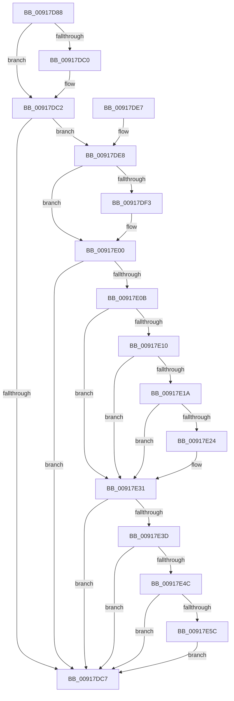

# PspEvaluateAndNotifyEmptyJob

- RVA: `0x00917D88`–`0x00917E69` (길이 `225` bytes)
- VA: `0x0000000140917D88`
- 실행 섹션: `PAGE`
- PDB 이름 있음: `예`; PDB Function 태그: `아니요`
- unwind 정보 RVA: `0x0008AAE8`
- 디코드: `54`개 명령, `225/225` bytes 표시
- 미해석 바이트: `0` (있으면 어셈블리에 `.byte`로 보존)

> 이 문서는 커널 이미지의 기계어와 PDB 기호를 분석해 생성했습니다. 4번과 5번은 함수 원형과 자료형을 바이너리 사용 방식에서 추정한 C 해석이며 원본 소스 복구 결과는 아닙니다.

## 1. Dependencies

- 직접 호출 지점: **5**; 고유 호출 대상: **5**
- 직접 호출자로 확인된 함수: **2**
- RIP 상대 이미지 참조: **0**

### Outgoing calls
- `0x00917DB0` → [PspLockJobExclusive](PspLockJobExclusive_function_0091A4B8.md) (function, `0x0091A4B8`)
- `0x00917DCD` → [PspUnlockJob](PspUnlockJob_function_00919E00.md) (function, `0x00919E00`)
- `0x00917DFB` → [KeSetEvent](../../text/33/KeSetEvent_function_0033F310.md) (function, `0x0033F310`)
- `0x00917E2C` → [PspSendReliableJobNotification](PspSendReliableJobNotification_function_009171D4.md) (function, `0x009171D4`)
- `0x00917E5F` → [PspHardDereferenceSiloWorker](../../text/38/PspHardDereferenceSiloWorker_function_0038F740.md) (function, `0x0038F740`)

### Direct callers
- [PspNotifyEmptyJobsInJobChain](../90/PspNotifyEmptyJobsInJobChain_function_00906D04.md) at `0x00906D2D`
- [PspTerminateAllProcessesInJobHierarchy](PspTerminateAllProcessesInJobHierarchy_function_00917B7C.md) at `0x00917BEB`

### Static image references
- 디코드된 RIP-relative 메모리 참조가 없습니다.

## 2. Other-region calls and transfers

- 다른 실행 섹션으로 향하는 call: **2**
  - `0x00917DFB` → [KeSetEvent](../../text/33/KeSetEvent_function_0033F310.md) (`PAGE` → `.text`)
  - `0x00917E5F` → [PspHardDereferenceSiloWorker](../../text/38/PspHardDereferenceSiloWorker_function_0038F740.md) (`PAGE` → `.text`)
- 별도 외부 분기/꼬리 이동을 확인하지 못했습니다.

## 3. Assembly (complete function range)

```asm
00917D88  48 89 5C 24 08                  mov qword ptr [rsp + 8], rbx
00917D8D  48 89 6C 24 10                  mov qword ptr [rsp + 0x10], rbp
00917D92  48 89 74 24 18                  mov qword ptr [rsp + 0x18], rsi
00917D97  57                              push rdi
00917D98  48 83 EC 20                     sub rsp, 0x20
00917D9C  65 48 8B 34 25 88 01 00 00      mov rsi, qword ptr gs:[0x188]
00917DA5  8A DA                           mov bl, dl
00917DA7  48 8B D6                        mov rdx, rsi
00917DAA  41 8A E8                        mov bpl, r8b
00917DAD  48 8B F9                        mov rdi, rcx
00917DB0  E8 03 27 00 00                  call 0x14091a4b8
00917DB5  48 8D 8F B0 05 00 00            lea rcx, [rdi + 0x5b0]
00917DBC  84 DB                           test bl, bl
00917DBE  74 02                           je 0x140917dc2
00917DC0  FF 09                           dec dword ptr [rcx]
00917DC2  83 39 00                        cmp dword ptr [rcx], 0
00917DC5  74 21                           je 0x140917de8
00917DC7  48 8B D6                        mov rdx, rsi
00917DCA  48 8B CF                        mov rcx, rdi
00917DCD  E8 2E 20 00 00                  call 0x140919e00
00917DD2  48 8B 5C 24 30                  mov rbx, qword ptr [rsp + 0x30]
00917DD7  48 8B 6C 24 38                  mov rbp, qword ptr [rsp + 0x38]
00917DDC  48 8B 74 24 40                  mov rsi, qword ptr [rsp + 0x40]
00917DE1  48 83 C4 20                     add rsp, 0x20
00917DE5  5F                              pop rdi
00917DE6  C3                              ret
00917DE7  CC                              int3
00917DE8  F0 0F BA B7 10 06 00 00 07      lock btr dword ptr [rdi + 0x610], 7
00917DF1  73 0D                           jae 0x140917e00
00917DF3  45 33 C0                        xor r8d, r8d
00917DF6  33 D2                           xor edx, edx
00917DF8  48 8B CF                        mov rcx, rdi
00917DFB  E8 10 75 A2 FF                  call 0x14033f310
00917E00  F0 0F BA AF 10 06 00 00 15      lock bts dword ptr [rdi + 0x610], 0x15
00917E09  72 BC                           jb 0x140917dc7
00917E0B  40 84 ED                        test bpl, bpl
00917E0E  74 21                           je 0x140917e31
00917E10  48 83 BF 28 02 00 00 00         cmp qword ptr [rdi + 0x228], 0
00917E18  74 17                           je 0x140917e31
00917E1A  8B 87 50 04 00 00               mov eax, dword ptr [rdi + 0x450]
00917E20  A8 10                           test al, 0x10
00917E22  74 0D                           je 0x140917e31
00917E24  BA 04 00 00 00                  mov edx, 4
00917E29  48 8B CF                        mov rcx, rdi
00917E2C  E8 A3 F3 FF FF                  call 0x1409171d4
00917E31  F7 87 00 01 00 00 00 00 40 00   test dword ptr [rdi + 0x100], 0x400000
00917E3B  74 8A                           je 0x140917dc7
00917E3D  F0 0F BA AF 10 06 00 00 1D      lock bts dword ptr [rdi + 0x610], 0x1d
00917E46  0F 82 7B FF FF FF               jb 0x140917dc7
00917E4C  F7 87 10 06 00 00 00 00 00 40   test dword ptr [rdi + 0x610], 0x40000000
00917E56  0F 84 6B FF FF FF               je 0x140917dc7
00917E5C  48 8B CF                        mov rcx, rdi
00917E5F  E8 DC 78 A7 FF                  call 0x14038f740
00917E64  E9 5E FF FF FF                  jmp 0x140917dc7
```

## 4. C-style interpretation (structured pseudocode)

```c
__int64 __fastcall PspEvaluateAndNotifyEmptyJob(__int64 a1, unsigned __int8 a2, int a3)
{
    __int64 result;
    __int64 v_rsp;
    unsigned __int64 v_stack_p10;
    unsigned __int64 v_stack_p18;
    unsigned __int64 v_stack_p8;

    v_stack_p8 = v_rbx;
    v_stack_p10 = v_rbp;
    v_stack_p18 = v_rsi;
    v_rsp = (v_rsp) - (32);
    result = PspLockJobExclusive(a1, *(unsigned __int64 *)(gs_base + (0 + 392)), a3, a4);
    if (a2 != 0) {
    }
    if ((*(unsigned int *)(a1 + 1456)) == 0) goto loc_00917DE8;
loc_00917DC7:
    result = PspUnlockJob(a1, *(unsigned __int64 *)(gs_base + (0 + 392)), a3, a4);
    v_rsp = (v_rsp) + (32);
    return result;
loc_00917DE8:
    if (!(condition_is_above_or_equal)) {
        a3 = 0;
        a2 = 0;
        a1 = a1;
        result = KeSetEvent(a1, a2, a3, a4);
    }
    if (condition_is_below) goto loc_00917DC7;
    if ((unsigned __int8)(v_stack_p10) == 0) goto loc_00917E31;
    if ((*(unsigned __int64 *)(a1 + 552)) == 0) goto loc_00917E31;
    result = (unsigned int)(*(unsigned int *)(a1 + 1104));
    if ((((unsigned __int8)((unsigned int)(*(unsigned int *)(a1 + 1104)))) & (16)) != 0) {
        a2 = 4;
        a1 = a1;
        result = PspSendReliableJobNotification(a1, a2, a3, a4);
    }
    if (((*(unsigned int *)(a1 + 256)) & (0x400000ULL)) == 0) goto loc_00917DC7;
    if (condition_is_below) goto loc_00917DC7;
    if (((*(unsigned int *)(a1 + 1552)) & (0x40000000ULL)) == 0) goto loc_00917DC7;
    result = PspHardDereferenceSiloWorker(a1, a2, a3, a4);
    goto loc_00917DC7;
}
```

## 5. (Beta) C Style

```c
int64_t PspEvaluateAndNotifyEmptyJob(void *Arg1, uint8_t Arg2, int32_t Arg3)
{
    uint8_t *arg1 = (uint8_t *)Arg1;

    int64_t result;
    int64_t local_rsp;
    uint64_t v_stack_p10;
    uint64_t v_stack_p18;
    uint64_t v_stack_p8;

    v_stack_p8 = local_rbx;
    v_stack_p10 = local_rbp;
    v_stack_p18 = local_rsi;
    local_rsp = (local_rsp) - (32);
    result = PspLockJobExclusive(Arg1, *(uint64_t *)(gs_base + (0 + 0x188)), Arg3, a4);
    if (Arg2 != 0) {
    }
    if ((*(uint32_t *)(arg1 + 0x5B0)) == 0) goto loc_00917DE8;
loc_00917DC7:
    result = PspUnlockJob(Arg1, *(uint64_t *)(gs_base + (0 + 0x188)), Arg3, a4);
    local_rsp = (local_rsp) + (32);
    return result;
loc_00917DE8:
    if (!(condition_is_above_or_equal)) {
        Arg3 = 0;
        Arg2 = 0;
        Arg1 = Arg1;
        result = KeSetEvent(Arg1, Arg2, Arg3, a4);
    }
    if (condition_is_below) goto loc_00917DC7;
    if ((uint8_t)(v_stack_p10) == 0) goto loc_00917E31;
    if ((*(uint64_t *)(arg1 + 0x228)) == 0) goto loc_00917E31;
    result = (uint32_t)(*(uint32_t *)(arg1 + 0x450));
    if ((((uint8_t)((uint32_t)(*(uint32_t *)(arg1 + 0x450)))) & (16)) != 0) {
        Arg2 = 4;
        Arg1 = Arg1;
        result = PspSendReliableJobNotification(Arg1, Arg2, Arg3, a4);
    }
    if (((*(uint32_t *)(arg1 + 0x100)) & (0x400000ULL)) == 0) goto loc_00917DC7;
    if (condition_is_below) goto loc_00917DC7;
    if (((*(uint32_t *)(arg1 + 0x610)) & (0x40000000ULL)) == 0) goto loc_00917DC7;
    result = PspHardDereferenceSiloWorker(Arg1, Arg2, Arg3, a4);
    goto loc_00917DC7;
}
```

### 관측된 메모리 오프셋

구조체 형식이 확인되지 않은 접근은 인자 기준의 오프셋으로만 기록했습니다.

| 기준 인자 | 오프셋 표현 | 폭 (bit) | 접근 |
|---|---:|---:|---|
| `Arg1` | `+ 0x0` | `32` | `R` |
| `Arg1` | `+ 0x0` | `32` | `R/W` |
| `Arg1` | `+ 0x100` | `32` | `R` |
| `Arg1` | `+ 0x228` | `64` | `R` |
| `Arg1` | `+ 0x450` | `32` | `R` |
| `Arg1` | `+ 0x5B0` | `64` | `R` |
| `Arg1` | `+ 0x610` | `32` | `R` |
| `Arg1` | `+ 0x610` | `32` | `R/W` |

## 6. Execution-region graph

[열기: 2D/3D 그래프와 함수 탐색 컨트롤 패널](../../../control-panel.html?section=page&rva=0x00917D88&view=graph)

- 2D 그래프는 위에서 아래로 흐르고, 3D 그래프는 빈 공간을 드래그해 회전합니다. Shift+드래그는 이동, 휠은 확대·축소, 함수 노드 선택은 대상 보고서 이동입니다.

### Static fallback


