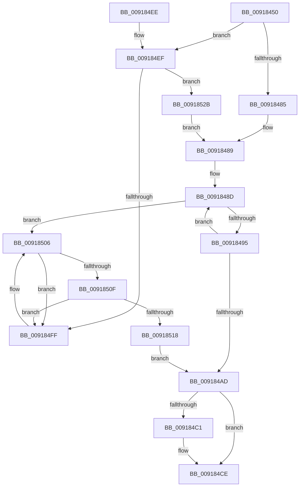

# PspGetNextJobProcess

- RVA: `0x00918450`–`0x00918546` (길이 `246` bytes)
- VA: `0x0000000140918450`
- 실행 섹션: `PAGE`
- PDB 이름 있음: `예`; PDB Function 태그: `아니요`
- unwind 정보 RVA: `0x0008AB5C`
- 디코드: `74`개 명령, `246/246` bytes 표시
- 미해석 바이트: `0` (있으면 어셈블리에 `.byte`로 보존)

> 이 문서는 커널 이미지의 기계어와 PDB 기호를 분석해 생성했습니다. 4번과 5번은 함수 원형과 자료형을 바이너리 사용 방식에서 추정한 C 해석이며 원본 소스 복구 결과는 아닙니다.

## 1. Dependencies

- 직접 호출 지점: **4**; 고유 호출 대상: **4**
- 직접 호출자로 확인된 함수: **6**
- RIP 상대 이미지 참조: **0**

### Outgoing calls
- `0x00918478` → [PspLockJobExclusive](PspLockJobExclusive_function_0091A4B8.md) (function, `0x0091A4B8`)
- `0x009184A4` → [ObReferenceObjectSafeWithTag](../../text/21/ObReferenceObjectSafeWithTag_function_00210EE0.md) (function, `0x00210EE0`)
- `0x009184B7` → [PspUnlockJob](PspUnlockJob_function_00919E00.md) (function, `0x00919E00`)
- `0x009184C9` → [ObfDereferenceObjectWithTag](../../text/2F/ObfDereferenceObjectWithTag_function_002F78E0.md) (function, `0x002F78E0`)

### Direct callers
- [PspExecuteJobFreezeThawCallback](../../text/4E/PspExecuteJobFreezeThawCallback_function_004E9850.md) at `0x004E98B2`
- [PspTerminateSiloSubsystemProcesses](../78/PspTerminateSiloSubsystemProcesses_function_00780918.md) at `0x007809BD`
- [PspWaitOnAllProcessesJobCallback](../78/PspWaitOnAllProcessesJobCallback_function_00785DE0.md) at `0x00785E4D`
- [PspTerminateProcessesJobCallback](PspTerminateProcessesJobCallback_function_00917430.md) at `0x0091748E`
- [PspAssignProcessToJob](../A2/PspAssignProcessToJob_function_00A23370.md) at `0x00A233F0`
- [PspSetCpuRateControlJobPostCallback](../A6/PspSetCpuRateControlJobPostCallback_function_00A66C80.md) at `0x00A66CC9`

### Static image references
- 디코드된 RIP-relative 메모리 참조가 없습니다.

## 2. Other-region calls and transfers

- 다른 실행 섹션으로 향하는 call: **2**
  - `0x009184A4` → [ObReferenceObjectSafeWithTag](../../text/21/ObReferenceObjectSafeWithTag_function_00210EE0.md) (`PAGE` → `.text`)
  - `0x009184C9` → [ObfDereferenceObjectWithTag](../../text/2F/ObfDereferenceObjectWithTag_function_002F78E0.md) (`PAGE` → `.text`)
- 별도 외부 분기/꼬리 이동을 확인하지 못했습니다.

## 3. Assembly (complete function range)

```asm
00918450  48 89 5C 24 08                  mov qword ptr [rsp + 8], rbx
00918455  48 89 6C 24 10                  mov qword ptr [rsp + 0x10], rbp
0091845A  48 89 74 24 18                  mov qword ptr [rsp + 0x18], rsi
0091845F  57                              push rdi
00918460  41 54                           push r12
00918462  41 55                           push r13
00918464  41 56                           push r14
00918466  41 57                           push r15
00918468  48 83 EC 20                     sub rsp, 0x20
0091846C  4D 8B F9                        mov r15, r9
0091846F  49 8B D8                        mov rbx, r8
00918472  4C 8B E2                        mov r12, rdx
00918475  48 8B E9                        mov rbp, rcx
00918478  E8 3B 20 00 00                  call 0x14091a4b8
0091847D  45 33 ED                        xor r13d, r13d
00918480  4D 85 FF                        test r15, r15
00918483  74 6A                           je 0x1409184ef
00918485  4C 8D 75 28                     lea r14, [rbp + 0x28]
00918489  48 8B 7B 10                     mov rdi, qword ptr [rbx + 0x10]
0091848D  48 8B 3F                        mov rdi, qword ptr [rdi]
00918490  49 3B FE                        cmp rdi, r14
00918493  74 71                           je 0x140918506
00918495  48 8D B7 A8 FC FF FF            lea rsi, [rdi - 0x358]
0091849C  BA 50 73 4A 62                  mov edx, 0x624a7350
009184A1  48 8B CE                        mov rcx, rsi
009184A4  E8 37 8A 8F FF                  call 0x140210ee0
009184A9  84 C0                           test al, al
009184AB  74 E0                           je 0x14091848d
009184AD  49 8B D4                        mov rdx, r12
009184B0  48 89 7B 10                     mov qword ptr [rbx + 0x10], rdi
009184B4  48 8B CD                        mov rcx, rbp
009184B7  E8 44 19 00 00                  call 0x140919e00
009184BC  4D 85 FF                        test r15, r15
009184BF  74 0D                           je 0x1409184ce
009184C1  BA 50 73 4A 62                  mov edx, 0x624a7350
009184C6  49 8B CF                        mov rcx, r15
009184C9  E8 12 F4 9D FF                  call 0x1402f78e0
009184CE  48 8B 5C 24 50                  mov rbx, qword ptr [rsp + 0x50]
009184D3  48 8B C6                        mov rax, rsi
009184D6  48 8B 74 24 60                  mov rsi, qword ptr [rsp + 0x60]
009184DB  48 8B 6C 24 58                  mov rbp, qword ptr [rsp + 0x58]
009184E0  48 83 C4 20                     add rsp, 0x20
009184E4  41 5F                           pop r15
009184E6  41 5E                           pop r14
009184E8  41 5D                           pop r13
009184EA  41 5C                           pop r12
009184EC  5F                              pop rdi
009184ED  C3                              ret
009184EE  CC                              int3
009184EF  48 8D 85 28 05 00 00            lea rax, [rbp + 0x528]
009184F6  48 8B 08                        mov rcx, qword ptr [rax]
009184F9  48 39 41 08                     cmp qword ptr [rcx + 8], rax
009184FD  74 2C                           je 0x14091852b
009184FF  B9 03 00 00 00                  mov ecx, 3
00918504  CD 29                           int 0x29
00918506  48 8B 0B                        mov rcx, qword ptr [rbx]
00918509  48 39 59 08                     cmp qword ptr [rcx + 8], rbx
0091850D  75 F0                           jne 0x1409184ff
0091850F  48 8B 43 08                     mov rax, qword ptr [rbx + 8]
00918513  48 39 18                        cmp qword ptr [rax], rbx
00918516  75 E7                           jne 0x1409184ff
00918518  48 3B C1                        cmp rax, rcx
0091851B  48 89 08                        mov qword ptr [rax], rcx
0091851E  49 8B F5                        mov rsi, r13
00918521  48 89 41 08                     mov qword ptr [rcx + 8], rax
00918525  49 0F 45 F5                     cmovne rsi, r13
00918529  EB 82                           jmp 0x1409184ad
0091852B  48 89 0B                        mov qword ptr [rbx], rcx
0091852E  4C 8D 75 28                     lea r14, [rbp + 0x28]
00918532  48 89 43 08                     mov qword ptr [rbx + 8], rax
00918536  48 89 59 08                     mov qword ptr [rcx + 8], rbx
0091853A  48 89 18                        mov qword ptr [rax], rbx
0091853D  4C 89 73 10                     mov qword ptr [rbx + 0x10], r14
00918541  E9 43 FF FF FF                  jmp 0x140918489
```

## 4. C-style interpretation (structured pseudocode)

```c
__int64 __fastcall PspGetNextJobProcess(__int64 a1, __int64 a2, __int64 a3, __int64 a4)
{
    __int64 result;
    __int64 v_r13;
    __int64 v_rsi;
    __int64 v_rsp;
    unsigned __int64 v_stack_p10;
    unsigned __int64 v_stack_p18;
    unsigned __int64 v_stack_p8;

    v_stack_p8 = v_rbx;
    v_stack_p10 = v_rbp;
    v_stack_p18 = v_rsi;
    v_rsp = (v_rsp) - (32);
    result = PspLockJobExclusive(a1, a2, a3, a4);
    v_r13 = 0;
    if (a4 == 0) goto loc_009184EF;
loc_00918489:
loc_0091848D:
    if ((*(unsigned __int64 *)(*(unsigned __int64 *)(a3 + 16))) == (a1 + 40)) goto loc_00918506;
    result = ObReferenceObjectSafeWithTag(*(unsigned __int64 *)(*(unsigned __int64 *)(a3 + 16)) - 856, (unsigned int)(0x624A7350ULL), a3, a4);
    if ((unsigned __int8)(result) == 0) goto loc_0091848D;
loc_009184AD:
    *(unsigned __int64 *)(a3 + 16) = *(unsigned __int64 *)(*(unsigned __int64 *)(a3 + 16));
    result = PspUnlockJob(a1, a2, a3, a4);
    if (a4 != 0) {
        a2 = 0x624A7350ULL;
        a1 = a4;
        result = ObfDereferenceObjectWithTag(a1, a2, a3, a4);
    }
    v_rsp = (v_rsp) + (32);
    return *(unsigned __int64 *)(*(unsigned __int64 *)(a3 + 16)) - 856;
loc_009184EF:
    if ((*(unsigned __int64 *)(*(unsigned __int64 *)(v_stack_p10 + 1320) + 8)) == (v_stack_p10 + 1320)) goto loc_0091852B;
loc_009184FF:
loc_00918506:
    if ((*(unsigned __int64 *)(*(unsigned __int64 *)(v_stack_p8) + 8)) != v_stack_p8) goto loc_009184FF;
    if ((*(unsigned __int64 *)(*(unsigned __int64 *)(v_stack_p8 + 8))) != v_stack_p8) goto loc_009184FF;
    *(unsigned __int64 *)(*(unsigned __int64 *)(v_stack_p8 + 8)) = *(unsigned __int64 *)(v_stack_p8);
    *(unsigned __int64 *)(*(unsigned __int64 *)(v_stack_p8) + 8) = *(unsigned __int64 *)(v_stack_p8 + 8);
    v_rsi = 0;
    if ((*(unsigned __int64 *)(v_stack_p8 + 8)) != (*(unsigned __int64 *)(v_stack_p8))) { v_rsi = 0; }
    goto loc_009184AD;
loc_0091852B:
    *(unsigned __int64 *)(v_stack_p8) = *(unsigned __int64 *)(v_stack_p8);
    *(unsigned __int64 *)(v_stack_p8 + 8) = *(unsigned __int64 *)(v_stack_p8 + 8);
    *(unsigned __int64 *)(*(unsigned __int64 *)(v_stack_p8) + 8) = v_stack_p8;
    *(unsigned __int64 *)(*(unsigned __int64 *)(v_stack_p8 + 8)) = v_stack_p8;
    *(unsigned __int64 *)(v_stack_p8 + 16) = v_stack_p10 + 40;
    goto loc_00918489;
}
```

## 5. (Beta) C Style

```c
int64_t PspGetNextJobProcess(void *Arg1, int64_t Arg2, void *Arg3, int64_t Arg4)
{
    uint8_t *arg1 = (uint8_t *)Arg1;
    uint8_t *arg3 = (uint8_t *)Arg3;

    int64_t result;
    int64_t local_r13;
    int64_t local_rsi;
    int64_t local_rsp;
    uint64_t v_stack_p10;
    uint64_t v_stack_p18;
    uint64_t v_stack_p8;

    v_stack_p8 = local_rbx;
    v_stack_p10 = local_rbp;
    v_stack_p18 = local_rsi;
    local_rsp = (local_rsp) - (32);
    result = PspLockJobExclusive(Arg1, Arg2, Arg3, Arg4);
    local_r13 = 0;
    if (Arg4 == 0) goto loc_009184EF;
loc_00918489:
loc_0091848D:
    if ((*(uint64_t *)(*(uint64_t *)(arg3 + 0x10))) == (Arg1 + 40)) goto loc_00918506;
    result = ObReferenceObjectSafeWithTag(*(uint64_t *)(*(uint64_t *)(arg3 + 0x10)) - 856, (uint32_t)(0x624A7350ULL), Arg3, Arg4);
    if ((uint8_t)(result) == 0) goto loc_0091848D;
loc_009184AD:
    *(uint64_t *)(arg3 + 0x10) = *(uint64_t *)(*(uint64_t *)(arg3 + 0x10));
    result = PspUnlockJob(Arg1, Arg2, Arg3, Arg4);
    if (Arg4 != 0) {
        Arg2 = 0x624A7350ULL;
        Arg1 = Arg4;
        result = ObfDereferenceObjectWithTag(Arg1, Arg2, Arg3, Arg4);
    }
    local_rsp = (local_rsp) + (32);
    return *(uint64_t *)(*(uint64_t *)(arg3 + 0x10)) - 856;
loc_009184EF:
    if ((*(uint64_t *)(*(uint64_t *)(v_stack_p10 + 0x528) + 0x8)) == (v_stack_p10 + 1320)) goto loc_0091852B;
loc_009184FF:
loc_00918506:
    if ((*(uint64_t *)(*(uint64_t *)(v_stack_p8) + 0x8)) != v_stack_p8) goto loc_009184FF;
    if ((*(uint64_t *)(*(uint64_t *)(v_stack_p8 + 0x8))) != v_stack_p8) goto loc_009184FF;
    *(uint64_t *)(*(uint64_t *)(v_stack_p8 + 0x8)) = *(uint64_t *)(v_stack_p8);
    *(uint64_t *)(*(uint64_t *)(v_stack_p8) + 0x8) = *(uint64_t *)(v_stack_p8 + 0x8);
    local_rsi = 0;
    if ((*(uint64_t *)(v_stack_p8 + 0x8)) != (*(uint64_t *)(v_stack_p8))) { local_rsi = 0; }
    goto loc_009184AD;
loc_0091852B:
    *(uint64_t *)(v_stack_p8) = *(uint64_t *)(v_stack_p8);
    *(uint64_t *)(v_stack_p8 + 0x8) = *(uint64_t *)(v_stack_p8 + 0x8);
    *(uint64_t *)(*(uint64_t *)(v_stack_p8) + 0x8) = v_stack_p8;
    *(uint64_t *)(*(uint64_t *)(v_stack_p8 + 0x8)) = v_stack_p8;
    *(uint64_t *)(v_stack_p8 + 0x10) = v_stack_p10 + 40;
    goto loc_00918489;
}
```

### 관측된 메모리 오프셋

구조체 형식이 확인되지 않은 접근은 인자 기준의 오프셋으로만 기록했습니다.

| 기준 인자 | 오프셋 표현 | 폭 (bit) | 접근 |
|---|---:|---:|---|
| `Arg1` | `+ 0x0` | `64` | `R` |
| `Arg1` | `+ 0x0` | `64` | `W` |
| `Arg1` | `+ 0x28` | `64` | `R` |
| `Arg1` | `+ 0x528` | `64` | `R` |
| `Arg3` | `+ 0x0` | `64` | `R` |
| `Arg3` | `+ 0x0` | `64` | `W` |
| `Arg3` | `+ 0x8` | `64` | `R` |
| `Arg3` | `+ 0x8` | `64` | `W` |
| `Arg3` | `+ 0x10` | `64` | `R` |
| `Arg3` | `+ 0x10` | `64` | `W` |

## 6. Execution-region graph

[열기: 2D/3D 그래프와 함수 탐색 컨트롤 패널](../../../control-panel.html?section=page&rva=0x00918450&view=graph)

- 2D 그래프는 위에서 아래로 흐르고, 3D 그래프는 빈 공간을 드래그해 회전합니다. Shift+드래그는 이동, 휠은 확대·축소, 함수 노드 선택은 대상 보고서 이동입니다.

### Static fallback


