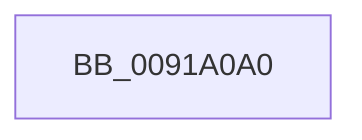

# PspGetNextJob

- RVA: `0x0091A0A0`–`0x0091A0A7` (길이 `7` bytes)
- VA: `0x000000014091A0A0`
- 실행 섹션: `PAGE`
- PDB 이름 있음: `예`; PDB Function 태그: `아니요`
- unwind 정보 RVA: `0x0008AD80`
- 디코드: `3`개 명령, `7/7` bytes 표시
- 미해석 바이트: `0` (있으면 어셈블리에 `.byte`로 보존)

> 이 문서는 커널 이미지의 기계어와 PDB 기호를 분석해 생성했습니다. 4번과 5번은 함수 원형과 자료형을 바이너리 사용 방식에서 추정한 C 해석이며 원본 소스 복구 결과는 아닙니다.

## 1. Dependencies

- 직접 호출 지점: **0**; 고유 호출 대상: **0**
- 직접 호출자로 확인된 함수: **3**
- RIP 상대 이미지 참조: **0**

### Outgoing calls
- 직접 디코드된 call 명령이 없습니다.

### Direct callers
- [PspGetNextSilo](PspGetNextSilo_function_00919F78.md) at `0x00919F80`
- [PspEnforceLimits](PspEnforceLimits_function_00919FC0.md) at `0x0091A002`
- [EtwpUpdateGlobalGroupMasks](../A4/EtwpUpdateGlobalGroupMasks_function_00A4F55C.md) at `0x00A4F62C`
- [EtwpUpdateGlobalGroupMasks](../A4/EtwpUpdateGlobalGroupMasks_function_00A4F55C.md) at `0x00A4F663`

### Static image references
- 디코드된 RIP-relative 메모리 참조가 없습니다.

## 2. Other-region calls and transfers

- 다른 실행 섹션으로 향하는 call: **0**
- 별도 외부 분기/꼬리 이동을 확인하지 못했습니다.

## 3. Assembly (complete function range)

```asm
0091A0A0  40 53                           push rbx
0091A0A2  55                              push rbp
0091A0A3  48 83 EC 38                     sub rsp, 0x38
```

## 4. C-style interpretation (structured pseudocode)

```c
void __fastcall PspGetNextJob(void)
{
    __int64 v_rsp;

    v_rsp = (v_rsp) - (56);
    return;
}
```

## 5. (Beta) C Style

```c
void PspGetNextJob(void)
{
    int64_t local_rsp;

    local_rsp = (local_rsp) - (56);
    return;
}
```

## 6. Execution-region graph

[열기: 2D/3D 그래프와 함수 탐색 컨트롤 패널](../../../control-panel.html?section=page&rva=0x0091A0A0&view=graph)

- 2D 그래프는 위에서 아래로 흐르고, 3D 그래프는 빈 공간을 드래그해 회전합니다. Shift+드래그는 이동, 휠은 확대·축소, 함수 노드 선택은 대상 보고서 이동입니다.

### Static fallback


