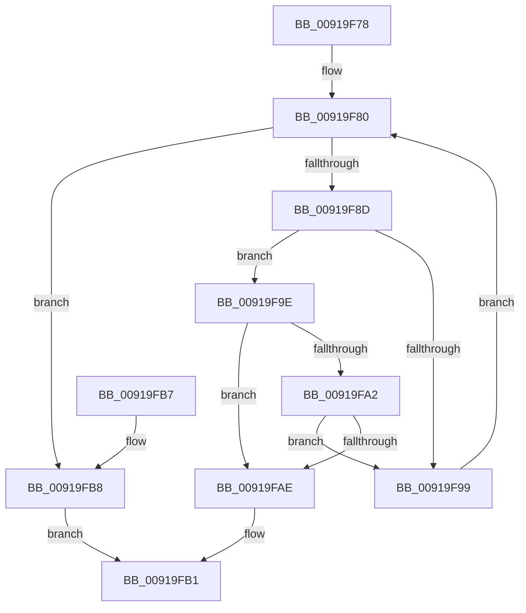

# PspGetNextSilo

- RVA: `0x00919F78`–`0x00919FBA` (길이 `66` bytes)
- VA: `0x0000000140919F78`
- 실행 섹션: `PAGE`
- PDB 이름 있음: `예`; PDB Function 태그: `아니요`
- unwind 정보 RVA: `0x0008AD5C`
- 디코드: `23`개 명령, `66/66` bytes 표시
- 미해석 바이트: `0` (있으면 어셈블리에 `.byte`로 보존)

> 이 문서는 커널 이미지의 기계어와 PDB 기호를 분석해 생성했습니다. 4번과 5번은 함수 원형과 자료형을 바이너리 사용 방식에서 추정한 C 해석이며 원본 소스 복구 결과는 아닙니다.

## 1. Dependencies

- 직접 호출 지점: **2**; 고유 호출 대상: **2**
- 직접 호출자로 확인된 함수: **6**
- RIP 상대 이미지 참조: **0**

### Outgoing calls
- `0x00919F80` → [PspGetNextJob](PspGetNextJob_function_0091A0A0.md) (function, `0x0091A0A0`)
- `0x00919FA5` → [PsIsServerSilo](../../text/22/PsIsServerSilo_function_00225828.md) (function, `0x00225828`)

### Direct callers
- [EtwpAdjustTraceBuffers](../../text/3E/EtwpAdjustTraceBuffers_function_003EB5F0.md) at `0x003EB620`
- [PsFreeSiloContextSlot](../77/PsFreeSiloContextSlot_function_0077F360.md) at `0x0077F376`
- [PsRootSiloInformation](../77/PsRootSiloInformation_function_0077F510.md) at `0x0077F55B`
- [PsShutdownSystem](../78/PsShutdownSystem_function_00785E94.md) at `0x00785F2A`
- [PsStartSiloMonitor](../78/PsStartSiloMonitor_function_007867C0.md) at `0x0078681F`
- [PsStartSiloMonitor](../78/PsStartSiloMonitor_function_007867C0.md) at `0x007868F9`
- [PsStartSiloMonitor](../78/PsStartSiloMonitor_function_007867C0.md) at `0x0078698B`
- [PsUnregisterSiloMonitor](../78/PsUnregisterSiloMonitor_function_00786A00.md) at `0x00786A84`

### Static image references
- 디코드된 RIP-relative 메모리 참조가 없습니다.

## 2. Other-region calls and transfers

- 다른 실행 섹션으로 향하는 call: **1**
  - `0x00919FA5` → [PsIsServerSilo](../../text/22/PsIsServerSilo_function_00225828.md) (`PAGE` → `.text`)
- 별도 외부 분기/꼬리 이동을 확인하지 못했습니다.

## 3. Assembly (complete function range)

```asm
00919F78  40 53                           push rbx
00919F7A  48 83 EC 20                     sub rsp, 0x20
00919F7E  8A DA                           mov bl, dl
00919F80  E8 1B 01 00 00                  call 0x14091a0a0
00919F85  4C 8B C0                        mov r8, rax
00919F88  48 85 C0                        test rax, rax
00919F8B  74 2B                           je 0x140919fb8
00919F8D  F7 80 10 06 00 00 00 00 00 40   test dword ptr [rax + 0x610], 0x40000000
00919F97  75 05                           jne 0x140919f9e
00919F99  49 8B C8                        mov rcx, r8
00919F9C  EB E2                           jmp 0x140919f80
00919F9E  84 DB                           test bl, bl
00919FA0  74 0C                           je 0x140919fae
00919FA2  49 8B C8                        mov rcx, r8
00919FA5  E8 7E B8 90 FF                  call 0x140225828
00919FAA  84 C0                           test al, al
00919FAC  74 EB                           je 0x140919f99
00919FAE  49 8B C0                        mov rax, r8
00919FB1  48 83 C4 20                     add rsp, 0x20
00919FB5  5B                              pop rbx
00919FB6  C3                              ret
00919FB7  CC                              int3
00919FB8  EB F7                           jmp 0x140919fb1
```

## 4. C-style interpretation (structured pseudocode)

```c
__int64 __fastcall PspGetNextSilo(__int64 a1, unsigned __int8 a2)
{
    __int64 result;
    __int64 v_rsp;

    v_rsp = (v_rsp) - (32);
loc_00919F80:
    result = PspGetNextJob(a1, a2, a3, a4);
    if (result == 0) goto loc_00919FB8;
    if (((*(unsigned int *)(result + 1552)) & (0x40000000ULL)) != 0) goto loc_00919F9E;
loc_00919F99:
    goto loc_00919F80;
loc_00919F9E:
    if (a2 == 0) goto loc_00919FAE;
    result = PsIsServerSilo(result, a2, result, a4);
    if ((unsigned __int8)(result) == 0) goto loc_00919F99;
loc_00919FAE:
loc_00919FB1:
    v_rsp = (v_rsp) + (32);
    return result;
loc_00919FB8:
    goto loc_00919FB1;
}
```

## 5. (Beta) C Style

```c
int64_t PspGetNextSilo(int64_t Arg1, uint8_t Arg2)
{
    int64_t result;
    int64_t local_rsp;

    local_rsp = (local_rsp) - (32);
loc_00919F80:
    result = PspGetNextJob(Arg1, Arg2, a3, a4);
    if (result == 0) goto loc_00919FB8;
    if (((*(uint32_t *)(result + 0x610)) & (0x40000000ULL)) != 0) goto loc_00919F9E;
loc_00919F99:
    goto loc_00919F80;
loc_00919F9E:
    if (Arg2 == 0) goto loc_00919FAE;
    result = PsIsServerSilo(result, Arg2, result, a4);
    if ((uint8_t)(result) == 0) goto loc_00919F99;
loc_00919FAE:
loc_00919FB1:
    local_rsp = (local_rsp) + (32);
    return result;
loc_00919FB8:
    goto loc_00919FB1;
}
```

## 6. Execution-region graph

[열기: 2D/3D 그래프와 함수 탐색 컨트롤 패널](../../../control-panel.html?section=page&rva=0x00919F78&view=graph)

- 2D 그래프는 위에서 아래로 흐르고, 3D 그래프는 빈 공간을 드래그해 회전합니다. Shift+드래그는 이동, 휠은 확대·축소, 함수 노드 선택은 대상 보고서 이동입니다.

### Static fallback


