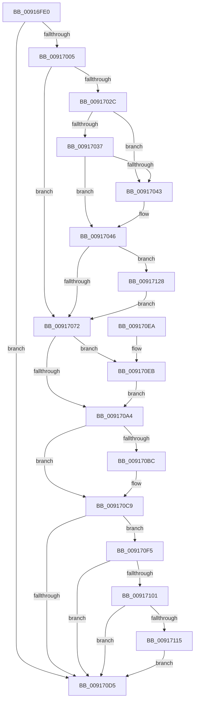

# PspJobClose

- RVA: `0x00916FE0`–`0x00917135` (길이 `341` bytes)
- VA: `0x0000000140916FE0`
- 실행 섹션: `PAGE`
- PDB 이름 있음: `예`; PDB Function 태그: `아니요`
- unwind 정보 RVA: `0x0008A980`
- 디코드: `84`개 명령, `341/341` bytes 표시
- 미해석 바이트: `0` (있으면 어셈블리에 `.byte`로 보존)

> 이 문서는 커널 이미지의 기계어와 PDB 기호를 분석해 생성했습니다. 4번과 5번은 함수 원형과 자료형을 바이너리 사용 방식에서 추정한 C 해석이며 원본 소스 복구 결과는 아닙니다.

## 1. Dependencies

- 직접 호출 지점: **13**; 고유 호출 대상: **11**
- 직접 호출자로 확인된 함수: **0**
- RIP 상대 이미지 참조: **0**

### Outgoing calls
- `0x0091701B` → [PspLockJobExclusive](PspLockJobExclusive_function_0091A4B8.md) (function, `0x0091A4B8`)
- `0x0091704C` → [PspUnlockJob](PspUnlockJob_function_00919E00.md) (function, `0x00919E00`)
- `0x00917059` → [PspTerminateAllProcessesInJobHierarchy](PspTerminateAllProcessesInJobHierarchy_function_00917B7C.md) (function, `0x00917B7C`)
- `0x00917064` → [PspLockJobExclusive](PspLockJobExclusive_function_0091A4B8.md) (function, `0x0091A4B8`)
- `0x0091707A` → [PspLockJobMemoryLimitsExclusive](PspLockJobMemoryLimitsExclusive_function_00916990.md) (function, `0x00916990`)
- `0x009170A7` → [KeAbPostRelease](../../text/2E/KeAbPostRelease_function_002E1600.md) (function, `0x002E1600`)
- `0x009170B2` → [PspUnlockJob](PspUnlockJob_function_00919E00.md) (function, `0x00919E00`)
- `0x009170C4` → [ObfDereferenceObjectWithTag](../../text/2F/ObfDereferenceObjectWithTag_function_002F78E0.md) (function, `0x002F78E0`)
- `0x009170EE` → [ExfTryToWakePushLock](../../text/26/ExfTryToWakePushLock_function_00265DD0.md) (function, `0x00265DD0`)
- `0x009170F8` → [PsIsServerSilo](../../text/22/PsIsServerSilo_function_00225828.md) (function, `0x00225828`)
- `0x00917101` → [PsGetServerSiloGlobals](../../text/22/PsGetServerSiloGlobals_function_002250A0.md) (function, `0x002250A0`)
- `0x00917117` → [ExFreePoolWithTag](../../poolcode/B8/ExFreePoolWithTag_function_00B82870.md) (function, `0x00B82870`)
- `0x0091712B` → [PspHardDereferenceSiloWorker](../../text/38/PspHardDereferenceSiloWorker_function_0038F740.md) (function, `0x0038F740`)

### Direct callers
- 이 함수 시작 RVA로 연결되는 직접 call은 확인되지 않았습니다. 간접 호출은 완전히 역산할 수 없습니다.

### Static image references
- 디코드된 RIP-relative 메모리 참조가 없습니다.

## 2. Other-region calls and transfers

- 다른 실행 섹션으로 향하는 call: **7**
  - `0x009170A7` → [KeAbPostRelease](../../text/2E/KeAbPostRelease_function_002E1600.md) (`PAGE` → `.text`)
  - `0x009170C4` → [ObfDereferenceObjectWithTag](../../text/2F/ObfDereferenceObjectWithTag_function_002F78E0.md) (`PAGE` → `.text`)
  - `0x009170EE` → [ExfTryToWakePushLock](../../text/26/ExfTryToWakePushLock_function_00265DD0.md) (`PAGE` → `.text`)
  - `0x009170F8` → [PsIsServerSilo](../../text/22/PsIsServerSilo_function_00225828.md) (`PAGE` → `.text`)
  - `0x00917101` → [PsGetServerSiloGlobals](../../text/22/PsGetServerSiloGlobals_function_002250A0.md) (`PAGE` → `.text`)
  - `0x00917117` → [ExFreePoolWithTag](../../poolcode/B8/ExFreePoolWithTag_function_00B82870.md) (`PAGE` → `POOLCODE`)
  - `0x0091712B` → [PspHardDereferenceSiloWorker](../../text/38/PspHardDereferenceSiloWorker_function_0038F740.md) (`PAGE` → `.text`)
- 별도 외부 분기/꼬리 이동을 확인하지 못했습니다.

## 3. Assembly (complete function range)

```asm
00916FE0  48 89 5C 24 08                  mov qword ptr [rsp + 8], rbx
00916FE5  48 89 6C 24 10                  mov qword ptr [rsp + 0x10], rbp
00916FEA  48 89 74 24 18                  mov qword ptr [rsp + 0x18], rsi
00916FEF  57                              push rdi
00916FF0  48 83 EC 20                     sub rsp, 0x20
00916FF4  BF 01 00 00 00                  mov edi, 1
00916FF9  48 8B DA                        mov rbx, rdx
00916FFC  4C 3B CF                        cmp r9, rdi
00916FFF  0F 87 D0 00 00 00               ja 0x1409170d5
00917005  65 48 8B 34 25 88 01 00 00      mov rsi, qword ptr gs:[0x188]
0091700E  F0 09 BA 10 06 00 00            lock or dword ptr [rdx + 0x610], edi
00917015  48 8B D6                        mov rdx, rsi
00917018  48 8B CB                        mov rcx, rbx
0091701B  E8 98 34 00 00                  call 0x14091a4b8
00917020  F7 83 00 01 00 00 00 20 00 00   test dword ptr [rbx + 0x100], 0x2000
0091702A  74 46                           je 0x140917072
0091702C  F0 0F BA AB 10 06 00 00 1D      lock bts dword ptr [rbx + 0x610], 0x1d
00917035  72 0C                           jb 0x140917043
00917037  F7 83 10 06 00 00 00 00 00 40   test dword ptr [rbx + 0x610], 0x40000000
00917041  75 03                           jne 0x140917046
00917043  40 32 FF                        xor dil, dil
00917046  48 8B D6                        mov rdx, rsi
00917049  48 8B CB                        mov rcx, rbx
0091704C  E8 AF 2D 00 00                  call 0x140919e00
00917051  45 33 C0                        xor r8d, r8d
00917054  33 D2                           xor edx, edx
00917056  48 8B CB                        mov rcx, rbx
00917059  E8 1E 0B 00 00                  call 0x140917b7c
0091705E  48 8B D6                        mov rdx, rsi
00917061  48 8B CB                        mov rcx, rbx
00917064  E8 4F 34 00 00                  call 0x14091a4b8
00917069  40 84 FF                        test dil, dil
0091706C  0F 85 B6 00 00 00               jne 0x140917128
00917072  45 33 C0                        xor r8d, r8d
00917075  33 D2                           xor edx, edx
00917077  48 8B CB                        mov rcx, rbx
0091707A  E8 11 F9 FF FF                  call 0x140916990
0091707F  48 8B AB 28 02 00 00            mov rbp, qword ptr [rbx + 0x228]
00917086  48 8D BB F0 04 00 00            lea rdi, [rbx + 0x4f0]
0091708D  48 83 A3 28 02 00 00 00         and qword ptr [rbx + 0x228], 0
00917095  48 83 C8 FF                     or rax, 0xffffffffffffffff
00917099  F0 48 0F C1 07                  lock xadd qword ptr [rdi], rax
0091709E  24 06                           and al, 6
009170A0  3C 02                           cmp al, 2
009170A2  74 47                           je 0x1409170eb
009170A4  48 8B CF                        mov rcx, rdi
009170A7  E8 54 A5 9C FF                  call 0x1402e1600
009170AC  48 8B D6                        mov rdx, rsi
009170AF  48 8B CB                        mov rcx, rbx
009170B2  E8 49 2D 00 00                  call 0x140919e00
009170B7  48 85 ED                        test rbp, rbp
009170BA  74 0D                           je 0x1409170c9
009170BC  BA 50 73 4A 62                  mov edx, 0x624a7350
009170C1  48 8B CD                        mov rcx, rbp
009170C4  E8 17 08 9E FF                  call 0x1402f78e0
009170C9  F7 83 10 06 00 00 00 00 00 40   test dword ptr [rbx + 0x610], 0x40000000
009170D3  75 20                           jne 0x1409170f5
009170D5  48 8B 5C 24 30                  mov rbx, qword ptr [rsp + 0x30]
009170DA  48 8B 6C 24 38                  mov rbp, qword ptr [rsp + 0x38]
009170DF  48 8B 74 24 40                  mov rsi, qword ptr [rsp + 0x40]
009170E4  48 83 C4 20                     add rsp, 0x20
009170E8  5F                              pop rdi
009170E9  C3                              ret
009170EA  CC                              int3
009170EB  48 8B CF                        mov rcx, rdi
009170EE  E8 DD EC 94 FF                  call 0x140265dd0
009170F3  EB AF                           jmp 0x1409170a4
009170F5  48 8B CB                        mov rcx, rbx
009170F8  E8 2B E7 90 FF                  call 0x140225828
009170FD  84 C0                           test al, al
009170FF  74 D4                           je 0x1409170d5
00917101  E8 9A DF 90 FF                  call 0x1402250a0
00917106  48 8B D8                        mov rbx, rax
00917109  48 8B 88 70 05 00 00            mov rcx, qword ptr [rax + 0x570]
00917110  48 85 C9                        test rcx, rcx
00917113  74 C0                           je 0x1409170d5
00917115  33 D2                           xor edx, edx
00917117  E8 54 B7 26 00                  call 0x140b82870
0091711C  0F 57 C0                        xorps xmm0, xmm0
0091711F  0F 11 83 68 05 00 00            movups xmmword ptr [rbx + 0x568], xmm0
00917126  EB AD                           jmp 0x1409170d5
00917128  48 8B CB                        mov rcx, rbx
0091712B  E8 10 86 A7 FF                  call 0x14038f740
00917130  E9 3D FF FF FF                  jmp 0x140917072
```

## 4. C-style interpretation (structured pseudocode)

```c
__int64 __fastcall PspJobClose(__int64 a1, __int64 a2, int a3, __int64 a4)
{
    __int64 result;
    __int64 v_rdi;
    __int64 v_rsp;
    unsigned __int64 v_stack_p10;
    unsigned __int64 v_stack_p18;
    unsigned __int64 v_stack_p8;

    v_stack_p8 = v_rbx;
    v_stack_p10 = v_rbp;
    v_stack_p18 = v_rsi;
    v_rsp = (v_rsp) - (32);
    if (a4 > 1) goto loc_009170D5;
    result = PspLockJobExclusive(a2, *(unsigned __int64 *)(gs_base + (0 + 392)), a3, a4);
    if (((*(unsigned int *)(a2 + 256)) & (0x2000ULL)) == 0) goto loc_00917072;
    if (condition_is_below) goto loc_00917043;
    v_rdi = 1;
    if (((*(unsigned int *)(a2 + 1552)) & (0x40000000ULL)) == 0) {
        v_rdi = 0;
    }
    result = PspUnlockJob(a2, *(unsigned __int64 *)(gs_base + (0 + 392)), a3, a4);
    a3 = 0;
    a2 = 0;
    result = PspTerminateAllProcessesInJobHierarchy(0, a2, a3, a4);
    result = PspLockJobExclusive(0, *(unsigned __int64 *)(gs_base + (0 + 392)), a3, a4);
    if (0 != 0) goto loc_00917128;
loc_00917072:
    a3 = 0;
    a2 = 0;
    result = PspLockJobMemoryLimitsExclusive(0, a2, a3, a4);
    result = (result) | (-1);
    result = (unsigned __int8)((result) & (6));
    if (((unsigned __int8)(result)) == 2) goto loc_009170EB;
loc_009170A4:
    result = KeAbPostRelease(a2 + 1264, a2, a3, a4);
    result = PspUnlockJob(0, *(unsigned __int64 *)(gs_base + (0 + 392)), a3, a4);
    if (*(unsigned __int64 *)(a2 + 552) != 0) {
        a2 = 0x624A7350ULL;
        a1 = *(unsigned __int64 *)(a2 + 552);
        result = ObfDereferenceObjectWithTag(a1, a2, a3, a4);
    }
    if (((*(unsigned int *)(a2 + 1552)) & (0x40000000ULL)) != 0) goto loc_009170F5;
loc_009170D5:
    v_rsp = (v_rsp) + (32);
    return result;
loc_009170EB:
    result = ExfTryToWakePushLock(a2 + 1264, a2, a3, a4);
    goto loc_009170A4;
loc_009170F5:
    result = PsIsServerSilo(v_stack_p8, a2, a3, a4);
    if ((unsigned __int8)(result) == 0) goto loc_009170D5;
    result = PsGetServerSiloGlobals(v_stack_p8, a2, a3, a4);
    if (*(unsigned __int64 *)(result + 1392) == 0) goto loc_009170D5;
    a2 = 0;
    result = ExFreePoolWithTag(*(unsigned __int64 *)(result + 1392), a2, a3, a4);
    *(unsigned __int64 *)(result + 1384) = v_xmm0;
    goto loc_009170D5;
loc_00917128:
    result = PspHardDereferenceSiloWorker(result, a2, a3, a4);
    goto loc_00917072;
}
```

## 5. (Beta) C Style

```c
int64_t PspJobClose(int64_t Arg1, void *Arg2, int32_t Arg3, int64_t Arg4)
{
    uint8_t *arg2 = (uint8_t *)Arg2;

    int64_t result;
    int64_t local_rdi;
    int64_t local_rsp;
    uint64_t v_stack_p10;
    uint64_t v_stack_p18;
    uint64_t v_stack_p8;

    v_stack_p8 = local_rbx;
    v_stack_p10 = local_rbp;
    v_stack_p18 = local_rsi;
    local_rsp = (local_rsp) - (32);
    if (Arg4 > 1) goto loc_009170D5;
    result = PspLockJobExclusive(Arg2, *(uint64_t *)(gs_base + (0 + 0x188)), Arg3, Arg4);
    if (((*(uint32_t *)(arg2 + 0x100)) & (0x2000ULL)) == 0) goto loc_00917072;
    if (condition_is_below) goto loc_00917043;
    local_rdi = 1;
    if (((*(uint32_t *)(arg2 + 0x610)) & (0x40000000ULL)) == 0) {
        local_rdi = 0;
    }
    result = PspUnlockJob(Arg2, *(uint64_t *)(gs_base + (0 + 0x188)), Arg3, Arg4);
    Arg3 = 0;
    Arg2 = 0;
    result = PspTerminateAllProcessesInJobHierarchy(0, Arg2, Arg3, Arg4);
    result = PspLockJobExclusive(0, *(uint64_t *)(gs_base + (0 + 0x188)), Arg3, Arg4);
    if (0 != 0) goto loc_00917128;
loc_00917072:
    Arg3 = 0;
    Arg2 = 0;
    result = PspLockJobMemoryLimitsExclusive(0, Arg2, Arg3, Arg4);
    result = (result) | (-1);
    result = (uint8_t)((result) & (6));
    if (((uint8_t)(result)) == 2) goto loc_009170EB;
loc_009170A4:
    result = KeAbPostRelease(Arg2 + 1264, Arg2, Arg3, Arg4);
    result = PspUnlockJob(0, *(uint64_t *)(gs_base + (0 + 0x188)), Arg3, Arg4);
    if (*(uint64_t *)(arg2 + 0x228) != 0) {
        Arg2 = 0x624A7350ULL;
        Arg1 = *(uint64_t *)(arg2 + 0x228);
        result = ObfDereferenceObjectWithTag(Arg1, Arg2, Arg3, Arg4);
    }
    if (((*(uint32_t *)(arg2 + 0x610)) & (0x40000000ULL)) != 0) goto loc_009170F5;
loc_009170D5:
    local_rsp = (local_rsp) + (32);
    return result;
loc_009170EB:
    result = ExfTryToWakePushLock(Arg2 + 1264, Arg2, Arg3, Arg4);
    goto loc_009170A4;
loc_009170F5:
    result = PsIsServerSilo(v_stack_p8, Arg2, Arg3, Arg4);
    if ((uint8_t)(result) == 0) goto loc_009170D5;
    result = PsGetServerSiloGlobals(v_stack_p8, Arg2, Arg3, Arg4);
    if (*(uint64_t *)(result + 0x570) == 0) goto loc_009170D5;
    Arg2 = 0;
    result = ExFreePoolWithTag(*(uint64_t *)(result + 0x570), Arg2, Arg3, Arg4);
    *(uint64_t *)(result + 0x568) = v_xmm0;
    goto loc_009170D5;
loc_00917128:
    result = PspHardDereferenceSiloWorker(result, Arg2, Arg3, Arg4);
    goto loc_00917072;
}
```

### 관측된 메모리 오프셋

구조체 형식이 확인되지 않은 접근은 인자 기준의 오프셋으로만 기록했습니다.

| 기준 인자 | 오프셋 표현 | 폭 (bit) | 접근 |
|---|---:|---:|---|
| `Arg2` | `+ 0x0` | `64` | `R/W` |
| `Arg2` | `+ 0x100` | `32` | `R` |
| `Arg2` | `+ 0x228` | `64` | `R` |
| `Arg2` | `+ 0x228` | `64` | `R/W` |
| `Arg2` | `+ 0x4F0` | `64` | `R` |
| `Arg2` | `+ 0x610` | `32` | `R` |
| `Arg2` | `+ 0x610` | `32` | `R/W` |

## 6. Execution-region graph

[열기: 2D/3D 그래프와 함수 탐색 컨트롤 패널](../../../control-panel.html?section=page&rva=0x00916FE0&view=graph)

- 2D 그래프는 위에서 아래로 흐르고, 3D 그래프는 빈 공간을 드래그해 회전합니다. Shift+드래그는 이동, 휠은 확대·축소, 함수 노드 선택은 대상 보고서 이동입니다.

### Static fallback


