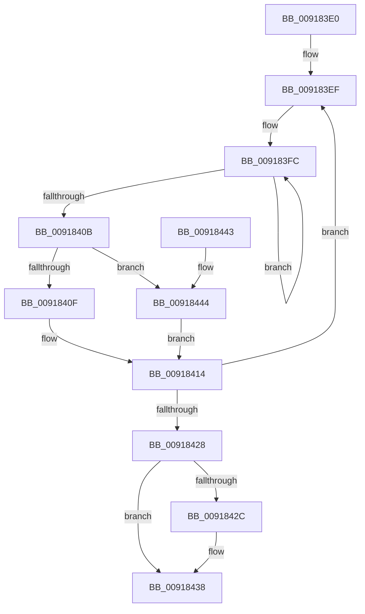

# PspJobTimeLimitsWork

- RVA: `0x009183E0`–`0x0091844A` (길이 `106` bytes)
- VA: `0x00000001409183E0`
- 실행 섹션: `PAGE`
- PDB 이름 있음: `예`; PDB Function 태그: `아니요`
- unwind 정보 RVA: `0x0008AB4C`
- 디코드: `30`개 명령, `106/106` bytes 표시
- 미해석 바이트: `0` (있으면 어셈블리에 `.byte`로 보존)

> 이 문서는 커널 이미지의 기계어와 PDB 기호를 분석해 생성했습니다. 4번과 5번은 함수 원형과 자료형을 바이너리 사용 방식에서 추정한 C 해석이며 원본 소스 복구 결과는 아닙니다.

## 1. Dependencies

- 직접 호출 지점: **1**; 고유 호출 대상: **1**
- 직접 호출자로 확인된 함수: **0**
- RIP 상대 이미지 참조: **3**

### Outgoing calls
- `0x00918414` → [PspEnforceLimits](PspEnforceLimits_function_00919FC0.md) (function, `0x00919FC0`)

### Direct callers
- 이 함수 시작 RVA로 연결되는 직접 call은 확인되지 않았습니다. 간접 호출은 완전히 역산할 수 없습니다.

### Static image references
- `0x009183EF` → RVA `0x00F065E8` (`.data`; read)
- `0x0091842C` → RVA `0x00E0C598` (`.data`; read)
- `0x00918432` → RVA `0x00E0C59C` (`.data`; write)

## 2. Other-region calls and transfers

- 다른 실행 섹션으로 향하는 call: **0**
- 별도 외부 분기/꼬리 이동을 확인하지 못했습니다.

## 3. Assembly (complete function range)

```asm
009183E0  48 89 5C 24 08                  mov qword ptr [rsp + 8], rbx
009183E5  57                              push rdi
009183E6  48 83 EC 20                     sub rsp, 0x20
009183EA  33 FF                           xor edi, edi
009183EC  40 8A DF                        mov bl, dil
009183EF  0F 0D 0D F2 E1 5E 00            prefetchw byte ptr [rip + 0x5ee1f2]
009183F6  8B 05 EC E1 5E 00               mov eax, dword ptr [rip + 0x5ee1ec]
009183FC  8B C8                           mov ecx, eax
009183FE  83 E1 FC                        and ecx, 0xfffffffc
00918401  F0 0F B1 0D DF E1 5E 00         lock cmpxchg dword ptr [rip + 0x5ee1df], ecx
00918409  75 F1                           jne 0x1409183fc
0091840B  A8 01                           test al, 1
0091840D  75 35                           jne 0x140918444
0091840F  B9 01 00 00 00                  mov ecx, 1
00918414  E8 A7 1B 00 00                  call 0x140919fc0
00918419  B8 04 00 00 00                  mov eax, 4
0091841E  F0 0F B1 3D C2 E1 5E 00         lock cmpxchg dword ptr [rip + 0x5ee1c2], edi
00918426  75 C7                           jne 0x1409183ef
00918428  84 DB                           test bl, bl
0091842A  74 0C                           je 0x140918438
0091842C  8B 05 66 41 4F 00               mov eax, dword ptr [rip + 0x4f4166]
00918432  89 05 64 41 4F 00               mov dword ptr [rip + 0x4f4164], eax
00918438  48 8B 5C 24 30                  mov rbx, qword ptr [rsp + 0x30]
0091843D  48 83 C4 20                     add rsp, 0x20
00918441  5F                              pop rdi
00918442  C3                              ret
00918443  CC                              int3
00918444  8B CF                           mov ecx, edi
00918446  B3 01                           mov bl, 1
00918448  EB CA                           jmp 0x140918414
```

## 4. C-style interpretation (structured pseudocode)

```c
__int64 __fastcall PspJobTimeLimitsWork(void)
{
    __int64 result;
    __int64 v_rdi;
    __int64 v_rsp;
    unsigned __int64 v_stack_p8;

    v_stack_p8 = v_rbx;
    v_rsp = (v_rsp) - (32);
    v_rdi = 0;
loc_009183EF:
loc_009183FC:
    a1 = (unsigned int)(((unsigned int)((unsigned int)((unsigned int)(*(unsigned int *)(v_rip + 6218220))))) & (0xFFFFFFFCULL));
    if (condition_is_not_equal) goto loc_009183FC;
    if ((((unsigned __int8)((unsigned int)(*(unsigned int *)(v_rip + 6218220)))) & (1)) != 0) goto loc_00918444;
loc_00918414:
    result = PspEnforceLimits(1, a2, a3, a4);
    if ((((unsigned __int8)((unsigned int)(*(unsigned int *)(v_rip + 6218220)))) & (1)) != 0) goto loc_009183EF;
    result = 4;
    if (0 != 0) {
        result = *(unsigned int *)(v_rip + 5194086);
        *(unsigned int *)(v_rip + 5194084) = (unsigned int)(result);
    }
    v_rsp = (v_rsp) + (32);
    return result;
loc_00918444:
    goto loc_00918414;
}
```

## 5. (Beta) C Style

```c
void PspJobTimeLimitsWork(void)
{
    int64_t result;
    int64_t local_rdi;
    int64_t local_rsp;
    uint64_t v_stack_p8;

    v_stack_p8 = local_rbx;
    local_rsp = (local_rsp) - (32);
    local_rdi = 0;
loc_009183EF:
loc_009183FC:
    a1 = (uint32_t)(((uint32_t)((uint32_t)((uint32_t)(*(uint32_t *)(v_rip + 0x5EE1EC))))) & (0xFFFFFFFCULL));
    if (condition_is_not_equal) goto loc_009183FC;
    if ((((uint8_t)((uint32_t)(*(uint32_t *)(v_rip + 0x5EE1EC)))) & (1)) != 0) goto loc_00918444;
loc_00918414:
    result = PspEnforceLimits(1, a2, a3, a4);
    if ((((uint8_t)((uint32_t)(*(uint32_t *)(v_rip + 0x5EE1EC)))) & (1)) != 0) goto loc_009183EF;
    result = 4;
    if (0 != 0) {
        result = *(uint32_t *)(v_rip + 0x4F4166);
        *(uint32_t *)(v_rip + 0x4F4164) = (uint32_t)(result);
    }
    local_rsp = (local_rsp) + (32);
    return result;
loc_00918444:
    goto loc_00918414;
}
```

## 6. Execution-region graph

[열기: 2D/3D 그래프와 함수 탐색 컨트롤 패널](../../../control-panel.html?section=page&rva=0x009183E0&view=graph)

- 2D 그래프는 위에서 아래로 흐르고, 3D 그래프는 빈 공간을 드래그해 회전합니다. Shift+드래그는 이동, 휠은 확대·축소, 함수 노드 선택은 대상 보고서 이동입니다.

### Static fallback


