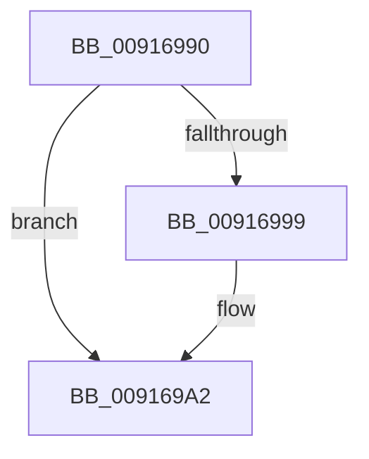

# PspLockJobMemoryLimitsExclusive

- RVA: `0x00916990`–`0x009169A7` (길이 `23` bytes)
- VA: `0x0000000140916990`
- 실행 섹션: `PAGE`
- PDB 이름 있음: `예`; PDB Function 태그: `아니요`
- unwind 정보 RVA: `0x0008A880`
- 디코드: `7`개 명령, `23/23` bytes 표시
- 미해석 바이트: `0` (있으면 어셈블리에 `.byte`로 보존)

> 이 문서는 커널 이미지의 기계어와 PDB 기호를 분석해 생성했습니다. 4번과 5번은 함수 원형과 자료형을 바이너리 사용 방식에서 추정한 C 해석이며 원본 소스 복구 결과는 아닙니다.

## 1. Dependencies

- 직접 호출 지점: **0**; 고유 호출 대상: **0**
- 직접 호출자로 확인된 함수: **3**
- RIP 상대 이미지 참조: **0**

### Outgoing calls
- 직접 디코드된 call 명령이 없습니다.

### Direct callers
- [sub_0087F483](../87/Unknown_function_0087F483.md) at `0x0087F534`
- [PspJobClose](PspJobClose_function_00916FE0.md) at `0x0091707A`
- [NtSetInformationJobObject](../9F/NtSetInformationJobObject_function_009F84C0.md) at `0x009F88A2`
- [NtSetInformationJobObject](../9F/NtSetInformationJobObject_function_009F84C0.md) at `0x009F89AB`
- [NtSetInformationJobObject](../9F/NtSetInformationJobObject_function_009F84C0.md) at `0x009F9355`
- [NtSetInformationJobObject](../9F/NtSetInformationJobObject_function_009F84C0.md) at `0x009F9D82`
- [NtSetInformationJobObject](../9F/NtSetInformationJobObject_function_009F84C0.md) at `0x009FA6EB`
- [NtSetInformationJobObject](../9F/NtSetInformationJobObject_function_009F84C0.md) at `0x009FAA5A`

### Static image references
- 디코드된 RIP-relative 메모리 참조가 없습니다.

## 2. Other-region calls and transfers

- 다른 실행 섹션으로 향하는 call: **0**
- call이 아닌 외부 분기/꼬리 이동: **1**
  - `0x009169A5` → [sub_009169F1](Unknown_function_009169F1.md) (`tail-transfer`)

## 3. Assembly (complete function range)

```asm
00916990  48 83 EC 28                     sub rsp, 0x28
00916994  4D 85 C0                        test r8, r8
00916997  74 09                           je 0x1409169a2
00916999  66 41 FF 88 E6 01 00 00         dec word ptr [r8 + 0x1e6]
009169A1  90                              nop
009169A2  48 3B CA                        cmp rcx, rdx
009169A5  74 4A                           je 0x1409169f1
```

## 4. C-style interpretation (structured pseudocode)

```c
void __fastcall PspLockJobMemoryLimitsExclusive(__int64 a1, __int64 a2, __int64 a3)
{
    __int64 v_rsp;

    v_rsp = (v_rsp) - (40);
    if (a3 != 0) {
    }
}
```

## 5. (Beta) C Style

```c
void PspLockJobMemoryLimitsExclusive(int64_t Arg1, int64_t Arg2, int64_t Arg3)
{
    int64_t local_rsp;

    local_rsp = (local_rsp) - (40);
    if (Arg3 != 0) {
    }
}
```

## 6. Execution-region graph

[열기: 2D/3D 그래프와 함수 탐색 컨트롤 패널](../../../control-panel.html?section=page&rva=0x00916990&view=graph)

- 2D 그래프는 위에서 아래로 흐르고, 3D 그래프는 빈 공간을 드래그해 회전합니다. Shift+드래그는 이동, 휠은 확대·축소, 함수 노드 선택은 대상 보고서 이동입니다.

### Static fallback


