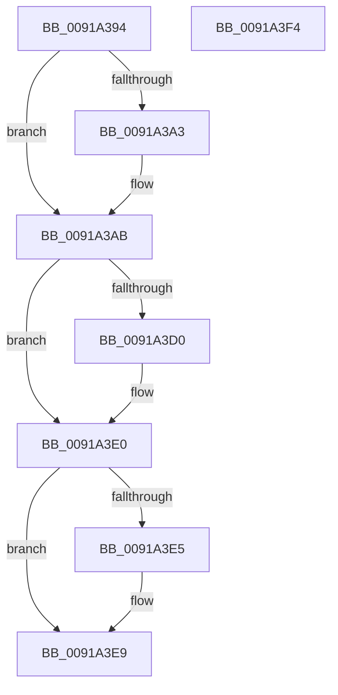

# PspLockJobMemoryLimitsShared

- RVA: `0x0091A394`–`0x0091A3F5` (길이 `97` bytes)
- VA: `0x000000014091A394`
- 실행 섹션: `PAGE`
- PDB 이름 있음: `예`; PDB Function 태그: `아니요`
- unwind 정보 RVA: `0x00068D5C`
- 디코드: `30`개 명령, `97/97` bytes 표시
- 미해석 바이트: `0` (있으면 어셈블리에 `.byte`로 보존)

> 이 문서는 커널 이미지의 기계어와 PDB 기호를 분석해 생성했습니다. 4번과 5번은 함수 원형과 자료형을 바이너리 사용 방식에서 추정한 C 해석이며 원본 소스 복구 결과는 아닙니다.

## 1. Dependencies

- 직접 호출 지점: **2**; 고유 호출 대상: **2**
- 직접 호출자로 확인된 함수: **6**
- RIP 상대 이미지 참조: **0**

### Outgoing calls
- `0x0091A3BA` → [KeAbPreAcquire](../../text/21/KeAbPreAcquire_function_00210230.md) (function, `0x00210230`)
- `0x0091A3DB` → [ExfAcquirePushLockSharedEx](../../text/21/ExfAcquirePushLockSharedEx_function_0021044C.md) (function, `0x0021044C`)

### Direct callers
- [PsReportProcessMemoryLimitViolation](../78/PsReportProcessMemoryLimitViolation_function_00784A5C.md) at `0x00784AA0`
- [PspEnforceLimitsJobPostCallback](PspEnforceLimitsJobPostCallback_function_00919720.md) at `0x00919ABA`
- [NtSetInformationJobObject](../9F/NtSetInformationJobObject_function_009F84C0.md) at `0x009FA7EF`
- [NtQueryInformationJobObject](../9F/NtQueryInformationJobObject_function_009FB860.md) at `0x009FBD26`
- [NtQueryInformationJobObject](../9F/NtQueryInformationJobObject_function_009FB860.md) at `0x009FC027`
- [PspApplyJobLimitsToProcess](../A5/PspApplyJobLimitsToProcess_function_00A57274.md) at `0x00A572D4`
- [sub_00B316B4](../B3/Unknown_function_00B316B4.md) at `0x00B31922`

### Static image references
- 디코드된 RIP-relative 메모리 참조가 없습니다.

## 2. Other-region calls and transfers

- 다른 실행 섹션으로 향하는 call: **2**
  - `0x0091A3BA` → [KeAbPreAcquire](../../text/21/KeAbPreAcquire_function_00210230.md) (`PAGE` → `.text`)
  - `0x0091A3DB` → [ExfAcquirePushLockSharedEx](../../text/21/ExfAcquirePushLockSharedEx_function_0021044C.md) (`PAGE` → `.text`)
- 별도 외부 분기/꼬리 이동을 확인하지 못했습니다.

## 3. Assembly (complete function range)

```asm
0091A394  48 89 5C 24 10                  mov qword ptr [rsp + 0x10], rbx
0091A399  57                              push rdi
0091A39A  48 83 EC 20                     sub rsp, 0x20
0091A39E  48 85 D2                        test rdx, rdx
0091A3A1  74 08                           je 0x14091a3ab
0091A3A3  66 FF 8A E6 01 00 00            dec word ptr [rdx + 0x1e6]
0091A3AA  90                              nop
0091A3AB  48 8D B9 F0 04 00 00            lea rdi, [rcx + 0x4f0]
0091A3B2  45 33 C0                        xor r8d, r8d
0091A3B5  48 8B CF                        mov rcx, rdi
0091A3B8  33 D2                           xor edx, edx
0091A3BA  E8 71 5E 8F FF                  call 0x140210230
0091A3BF  48 8B D8                        mov rbx, rax
0091A3C2  B9 11 00 00 00                  mov ecx, 0x11
0091A3C7  33 C0                           xor eax, eax
0091A3C9  F0 48 0F B1 0F                  lock cmpxchg qword ptr [rdi], rcx
0091A3CE  74 10                           je 0x14091a3e0
0091A3D0  4C 8B CF                        mov r9, rdi
0091A3D3  4C 8B C3                        mov r8, rbx
0091A3D6  33 D2                           xor edx, edx
0091A3D8  48 8B CF                        mov rcx, rdi
0091A3DB  E8 6C 60 8F FF                  call 0x14021044c
0091A3E0  48 85 DB                        test rbx, rbx
0091A3E3  74 04                           je 0x14091a3e9
0091A3E5  C6 43 0A 01                     mov byte ptr [rbx + 0xa], 1
0091A3E9  48 8B 5C 24 38                  mov rbx, qword ptr [rsp + 0x38]
0091A3EE  48 83 C4 20                     add rsp, 0x20
0091A3F2  5F                              pop rdi
0091A3F3  C3                              ret
0091A3F4  CC                              int3
```

## 4. C-style interpretation (structured pseudocode)

```c
__int64 __fastcall PspLockJobMemoryLimitsShared(__int64 a1, __int64 a2, int a3)
{
    __int64 result;
    __int64 v_rsp;
    unsigned __int64 v_stack_p10;

    v_stack_p10 = v_rbx;
    v_rsp = (v_rsp) - (32);
    if (a2 != 0) {
    }
    a3 = 0;
    a2 = 0;
    result = KeAbPreAcquire(a1 + 1264, a2, a3, a4);
    result = 0;
    if (!(condition_is_equal)) {
        a4 = a1 + 1264;
        a3 = 0;
        a2 = 0;
        a1 = a1 + 1264;
        result = ExfAcquirePushLockSharedEx(a1, a2, a3, a4);
    }
    if (result != 0) {
        *(unsigned __int8 *)(result + 10) = 1;
    }
    v_rsp = (v_rsp) + (32);
    return result;
}
```

## 5. (Beta) C Style

```c
int64_t PspLockJobMemoryLimitsShared(void *Arg1, int64_t Arg2, int32_t Arg3)
{
    uint8_t *arg1 = (uint8_t *)Arg1;

    int64_t result;
    int64_t local_rsp;
    uint64_t v_stack_p10;

    v_stack_p10 = local_rbx;
    local_rsp = (local_rsp) - (32);
    if (Arg2 != 0) {
    }
    Arg3 = 0;
    Arg2 = 0;
    result = KeAbPreAcquire(Arg1 + 1264, Arg2, Arg3, a4);
    result = 0;
    if (!(condition_is_equal)) {
        a4 = Arg1 + 1264;
        Arg3 = 0;
        Arg2 = 0;
        Arg1 = Arg1 + 1264;
        result = ExfAcquirePushLockSharedEx(Arg1, Arg2, Arg3, a4);
    }
    if (result != 0) {
        *(uint8_t *)(result + 0xA) = 1;
    }
    local_rsp = (local_rsp) + (32);
    return result;
}
```

### 관측된 메모리 오프셋

구조체 형식이 확인되지 않은 접근은 인자 기준의 오프셋으로만 기록했습니다.

| 기준 인자 | 오프셋 표현 | 폭 (bit) | 접근 |
|---|---:|---:|---|
| `Arg1` | `+ 0x0` | `64` | `R` |
| `Arg1` | `+ 0x4F0` | `64` | `R` |

## 6. Execution-region graph

[열기: 2D/3D 그래프와 함수 탐색 컨트롤 패널](../../../control-panel.html?section=page&rva=0x0091A394&view=graph)

- 2D 그래프는 위에서 아래로 흐르고, 3D 그래프는 빈 공간을 드래그해 회전합니다. Shift+드래그는 이동, 휠은 확대·축소, 함수 노드 선택은 대상 보고서 이동입니다.

### Static fallback


