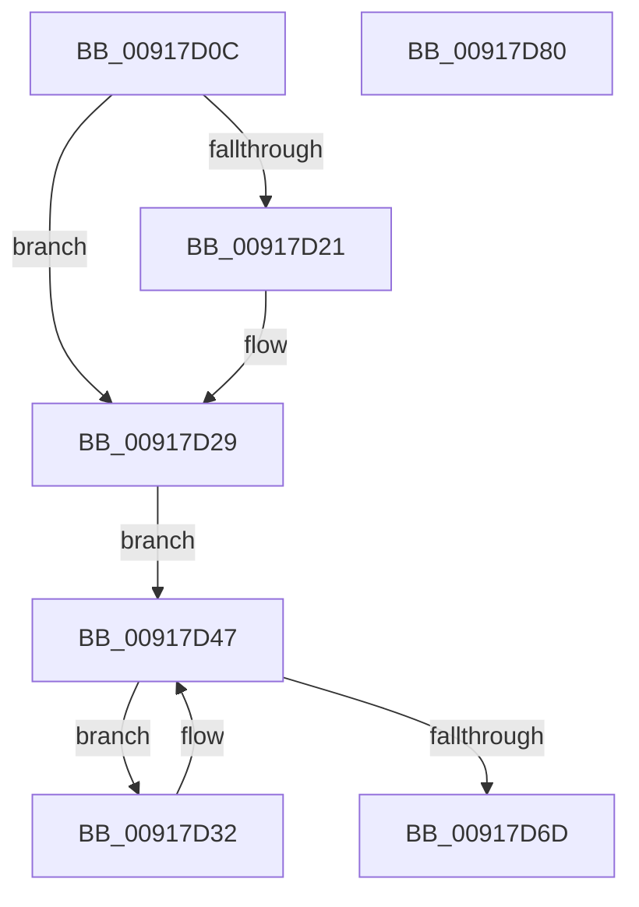

# PspLockRootJobExclusive

- RVA: `0x00917D0C`–`0x00917D81` (길이 `117` bytes)
- VA: `0x0000000140917D0C`
- 실행 섹션: `PAGE`
- PDB 이름 있음: `예`; PDB Function 태그: `아니요`
- unwind 정보 RVA: `0x00068D5C`
- 디코드: `31`개 명령, `117/117` bytes 표시
- 미해석 바이트: `0` (있으면 어셈블리에 `.byte`로 보존)

> 이 문서는 커널 이미지의 기계어와 PDB 기호를 분석해 생성했습니다. 4번과 5번은 함수 원형과 자료형을 바이너리 사용 방식에서 추정한 C 해석이며 원본 소스 복구 결과는 아닙니다.

## 1. Dependencies

- 직접 호출 지점: **2**; 고유 호출 대상: **2**
- 직접 호출자로 확인된 함수: **5**
- RIP 상대 이미지 참조: **0**

### Outgoing calls
- `0x00917D3B` → [ExReleaseResourceLite](../../text/25/ExReleaseResourceLite_function_0025FA10.md) (function, `0x0025FA10`)
- `0x00917D57` → [ExAcquireResourceExclusiveLite](../../text/21/ExAcquireResourceExclusiveLite_function_00214E20.md) (function, `0x00214E20`)

### Direct callers
- [PspJobDelete](../../text/4B/PspJobDelete_function_004BF8F0.md) at `0x004BF97D`
- [PspJobDelete](../../text/4B/PspJobDelete_function_004BF8F0.md) at `0x004BFA07`
- [PspSetNetRateControl](../78/PspSetNetRateControl_function_00785944.md) at `0x00785A2F`
- [PspAllocateAndQueryNotificationChannel](PspAllocateAndQueryNotificationChannel_function_00917EE4.md) at `0x00917F6E`
- [PspAllocateAndQueryNotificationChannel](PspAllocateAndQueryNotificationChannel_function_00917EE4.md) at `0x00918221`
- [PspSetJobIoRateControl](../9F/PspSetJobIoRateControl_function_009F78EC.md) at `0x009F798C`
- [PspSetJobIoRateControl](../9F/PspSetJobIoRateControl_function_009F78EC.md) at `0x009F7B0F`
- [NtSetInformationJobObject](../9F/NtSetInformationJobObject_function_009F84C0.md) at `0x009FAB19`

### Static image references
- 디코드된 RIP-relative 메모리 참조가 없습니다.

## 2. Other-region calls and transfers

- 다른 실행 섹션으로 향하는 call: **2**
  - `0x00917D3B` → [ExReleaseResourceLite](../../text/25/ExReleaseResourceLite_function_0025FA10.md) (`PAGE` → `.text`)
  - `0x00917D57` → [ExAcquireResourceExclusiveLite](../../text/21/ExAcquireResourceExclusiveLite_function_00214E20.md) (`PAGE` → `.text`)
- 별도 외부 분기/꼬리 이동을 확인하지 못했습니다.

## 3. Assembly (complete function range)

```asm
00917D0C  48 89 5C 24 10                  mov qword ptr [rsp + 0x10], rbx
00917D11  57                              push rdi
00917D12  48 83 EC 20                     sub rsp, 0x20
00917D16  49 8B F8                        mov rdi, r8
00917D19  48 8B D9                        mov rbx, rcx
00917D1C  48 85 D2                        test rdx, rdx
00917D1F  74 08                           je 0x140917d29
00917D21  66 FF 8A E6 01 00 00            dec word ptr [rdx + 0x1e6]
00917D28  90                              nop
00917D29  48 8B 81 20 05 00 00            mov rax, qword ptr [rcx + 0x520]
00917D30  EB 15                           jmp 0x140917d47
00917D32  48 8B 4C 24 30                  mov rcx, qword ptr [rsp + 0x30]
00917D37  48 83 C1 38                     add rcx, 0x38
00917D3B  E8 D0 7C 94 FF                  call 0x14025fa10
00917D40  48 8B 83 20 05 00 00            mov rax, qword ptr [rbx + 0x520]
00917D47  48 89 44 24 30                  mov qword ptr [rsp + 0x30], rax
00917D4C  B2 01                           mov dl, 1
00917D4E  48 8B 4C 24 30                  mov rcx, qword ptr [rsp + 0x30]
00917D53  48 83 C1 38                     add rcx, 0x38
00917D57  E8 C4 D0 8F FF                  call 0x140214e20
00917D5C  48 8B 8B 20 05 00 00            mov rcx, qword ptr [rbx + 0x520]
00917D63  48 8B 44 24 30                  mov rax, qword ptr [rsp + 0x30]
00917D68  48 3B C1                        cmp rax, rcx
00917D6B  75 C5                           jne 0x140917d32
00917D6D  48 8B 44 24 30                  mov rax, qword ptr [rsp + 0x30]
00917D72  48 8B 5C 24 38                  mov rbx, qword ptr [rsp + 0x38]
00917D77  48 89 07                        mov qword ptr [rdi], rax
00917D7A  48 83 C4 20                     add rsp, 0x20
00917D7E  5F                              pop rdi
00917D7F  C3                              ret
00917D80  CC                              int3
```

## 4. C-style interpretation (structured pseudocode)

```c
__int64 __fastcall PspLockRootJobExclusive(__int64 a1, __int64 a2, __int64 a3)
{
    __int64 result;
    __int64 v_rsp;
    unsigned __int64 v_stack_p10;
    unsigned __int64 v_stack_p8;

    v_stack_p10 = v_rbx;
    v_rsp = (v_rsp) - (32);
    if (a2 != 0) {
    }
    goto loc_00917D47;
loc_00917D32:
    a1 = (v_stack_p8) + (56);
    result = ExReleaseResourceLite(a1, a2, a3, a4);
loc_00917D47:
    v_stack_p8 = *(unsigned __int64 *)(a1 + 1312);
    a1 = (v_stack_p8) + (56);
    result = ExAcquireResourceExclusiveLite(a1, 1, a3, a4);
    if (v_stack_p8 != (*(unsigned __int64 *)(a1 + 1312))) goto loc_00917D32;
    *(unsigned __int64 *)(a3) = v_stack_p8;
    v_rsp = (v_rsp) + (32);
    return v_stack_p8;
}
```

## 5. (Beta) C Style

```c
int64_t PspLockRootJobExclusive(void *Arg1, int64_t Arg2, void *Arg3)
{
    uint8_t *arg1 = (uint8_t *)Arg1;
    uint8_t *arg3 = (uint8_t *)Arg3;

    int64_t result;
    int64_t local_rsp;
    uint64_t v_stack_p10;
    uint64_t v_stack_p8;

    v_stack_p10 = local_rbx;
    local_rsp = (local_rsp) - (32);
    if (Arg2 != 0) {
    }
    goto loc_00917D47;
loc_00917D32:
    Arg1 = (v_stack_p8) + (56);
    result = ExReleaseResourceLite(Arg1, Arg2, Arg3, a4);
loc_00917D47:
    v_stack_p8 = *(uint64_t *)(arg1 + 0x520);
    Arg1 = (v_stack_p8) + (56);
    result = ExAcquireResourceExclusiveLite(Arg1, 1, Arg3, a4);
    if (v_stack_p8 != (*(uint64_t *)(arg1 + 0x520))) goto loc_00917D32;
    *(uint64_t *)(arg3) = v_stack_p8;
    local_rsp = (local_rsp) + (32);
    return v_stack_p8;
}
```

### 관측된 메모리 오프셋

구조체 형식이 확인되지 않은 접근은 인자 기준의 오프셋으로만 기록했습니다.

| 기준 인자 | 오프셋 표현 | 폭 (bit) | 접근 |
|---|---:|---:|---|
| `Arg1` | `+ 0x520` | `64` | `R` |
| `Arg3` | `+ 0x0` | `64` | `W` |

## 6. Execution-region graph

[열기: 2D/3D 그래프와 함수 탐색 컨트롤 패널](../../../control-panel.html?section=page&rva=0x00917D0C&view=graph)

- 2D 그래프는 위에서 아래로 흐르고, 3D 그래프는 빈 공간을 드래그해 회전합니다. Shift+드래그는 이동, 휠은 확대·축소, 함수 노드 선택은 대상 보고서 이동입니다.

### Static fallback


