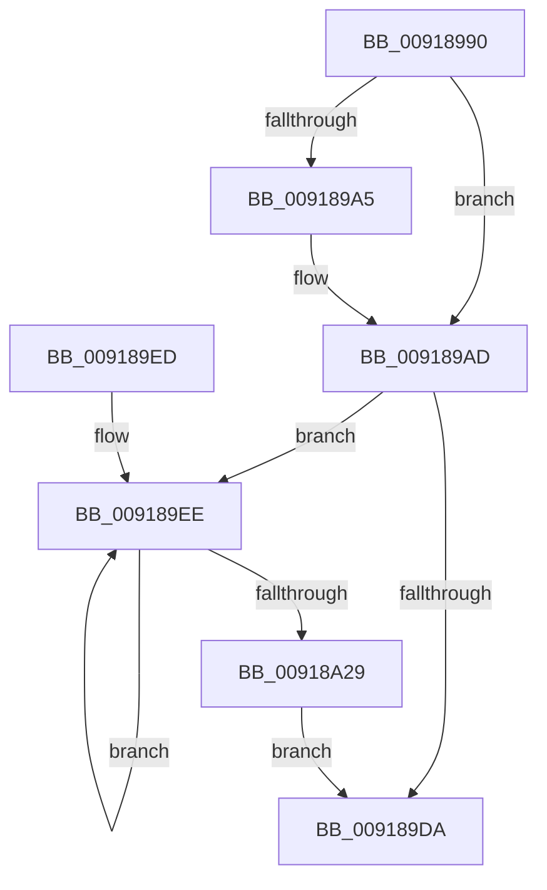

# PspLockRootJobShared

- RVA: `0x00918990`–`0x00918A2B` (길이 `155` bytes)
- VA: `0x0000000140918990`
- 실행 섹션: `PAGE`
- PDB 이름 있음: `예`; PDB Function 태그: `아니요`
- unwind 정보 RVA: `0x0008ABDC`
- 디코드: `40`개 명령, `155/155` bytes 표시
- 미해석 바이트: `0` (있으면 어셈블리에 `.byte`로 보존)

> 이 문서는 커널 이미지의 기계어와 PDB 기호를 분석해 생성했습니다. 4번과 5번은 함수 원형과 자료형을 바이너리 사용 방식에서 추정한 C 해석이며 원본 소스 복구 결과는 아닙니다.

## 1. Dependencies

- 직접 호출 지점: **3**; 고유 호출 대상: **2**
- 직접 호출자로 확인된 함수: **1**
- RIP 상대 이미지 참조: **0**

### Outgoing calls
- `0x009189C4` → [ExAcquireResourceSharedLite](../../text/21/ExAcquireResourceSharedLite_function_00211BC0.md) (function, `0x00211BC0`)
- `0x009189F7` → [ExReleaseResourceLite](../../text/25/ExReleaseResourceLite_function_0025FA10.md) (function, `0x0025FA10`)
- `0x00918A13` → [ExAcquireResourceSharedLite](../../text/21/ExAcquireResourceSharedLite_function_00211BC0.md) (function, `0x00211BC0`)

### Direct callers
- [PspQueryJobHierarchyAccountingInformation](PspQueryJobHierarchyAccountingInformation_function_0091864C.md) at `0x009186AD`

### Static image references
- 디코드된 RIP-relative 메모리 참조가 없습니다.

## 2. Other-region calls and transfers

- 다른 실행 섹션으로 향하는 call: **3**
  - `0x009189C4` → [ExAcquireResourceSharedLite](../../text/21/ExAcquireResourceSharedLite_function_00211BC0.md) (`PAGE` → `.text`)
  - `0x009189F7` → [ExReleaseResourceLite](../../text/25/ExReleaseResourceLite_function_0025FA10.md) (`PAGE` → `.text`)
  - `0x00918A13` → [ExAcquireResourceSharedLite](../../text/21/ExAcquireResourceSharedLite_function_00211BC0.md) (`PAGE` → `.text`)
- 별도 외부 분기/꼬리 이동을 확인하지 못했습니다.

## 3. Assembly (complete function range)

```asm
00918990  48 89 5C 24 10                  mov qword ptr [rsp + 0x10], rbx
00918995  57                              push rdi
00918996  48 83 EC 20                     sub rsp, 0x20
0091899A  49 8B F8                        mov rdi, r8
0091899D  48 8B D9                        mov rbx, rcx
009189A0  48 85 D2                        test rdx, rdx
009189A3  74 08                           je 0x1409189ad
009189A5  66 FF 8A E6 01 00 00            dec word ptr [rdx + 0x1e6]
009189AC  90                              nop
009189AD  48 8B 81 20 05 00 00            mov rax, qword ptr [rcx + 0x520]
009189B4  B2 01                           mov dl, 1
009189B6  48 89 44 24 30                  mov qword ptr [rsp + 0x30], rax
009189BB  48 8B 4C 24 30                  mov rcx, qword ptr [rsp + 0x30]
009189C0  48 83 C1 38                     add rcx, 0x38
009189C4  E8 F7 91 8F FF                  call 0x140211bc0
009189C9  48 8B 8B 20 05 00 00            mov rcx, qword ptr [rbx + 0x520]
009189D0  48 8B 44 24 30                  mov rax, qword ptr [rsp + 0x30]
009189D5  48 3B C1                        cmp rax, rcx
009189D8  75 14                           jne 0x1409189ee
009189DA  48 8B 44 24 30                  mov rax, qword ptr [rsp + 0x30]
009189DF  48 8B 5C 24 38                  mov rbx, qword ptr [rsp + 0x38]
009189E4  48 89 07                        mov qword ptr [rdi], rax
009189E7  48 83 C4 20                     add rsp, 0x20
009189EB  5F                              pop rdi
009189EC  C3                              ret
009189ED  CC                              int3
009189EE  48 8B 4C 24 30                  mov rcx, qword ptr [rsp + 0x30]
009189F3  48 83 C1 38                     add rcx, 0x38
009189F7  E8 14 70 94 FF                  call 0x14025fa10
009189FC  48 8B 83 20 05 00 00            mov rax, qword ptr [rbx + 0x520]
00918A03  B2 01                           mov dl, 1
00918A05  48 89 44 24 30                  mov qword ptr [rsp + 0x30], rax
00918A0A  48 8B 4C 24 30                  mov rcx, qword ptr [rsp + 0x30]
00918A0F  48 83 C1 38                     add rcx, 0x38
00918A13  E8 A8 91 8F FF                  call 0x140211bc0
00918A18  48 8B 8B 20 05 00 00            mov rcx, qword ptr [rbx + 0x520]
00918A1F  48 8B 44 24 30                  mov rax, qword ptr [rsp + 0x30]
00918A24  48 3B C1                        cmp rax, rcx
00918A27  75 C5                           jne 0x1409189ee
00918A29  EB AF                           jmp 0x1409189da
```

## 4. C-style interpretation (structured pseudocode)

```c
__int64 __fastcall PspLockRootJobShared(__int64 a1, __int64 a2, __int64 a3)
{
    __int64 result;
    __int64 v_rsp;
    unsigned __int64 v_stack_p10;
    unsigned __int64 v_stack_p30;
    unsigned __int64 v_stack_p8;

    v_stack_p10 = v_rbx;
    v_rsp = (v_rsp) - (32);
    if (a2 != 0) {
    }
    v_stack_p8 = *(unsigned __int64 *)(a1 + 1312);
    a1 = (v_stack_p8) + (56);
    result = ExAcquireResourceSharedLite(a1, 1, a3, a4);
    if (v_stack_p8 != (*(unsigned __int64 *)(a1 + 1312))) goto loc_009189EE;
loc_009189DA:
    *(unsigned __int64 *)(a3) = v_stack_p8;
    v_rsp = (v_rsp) + (32);
    return v_stack_p8;
loc_009189EE:
    a1 = (v_stack_p30) + (56);
    result = ExReleaseResourceLite(a1, 1, a3, a4);
    v_stack_p30 = *(unsigned __int64 *)(v_stack_p10 + 1312);
    a1 = (v_stack_p30) + (56);
    result = ExAcquireResourceSharedLite(a1, 1, a3, a4);
    if (v_stack_p30 != (*(unsigned __int64 *)(v_stack_p10 + 1312))) goto loc_009189EE;
    goto loc_009189DA;
}
```

## 5. (Beta) C Style

```c
int64_t PspLockRootJobShared(void *Arg1, int64_t Arg2, void *Arg3)
{
    uint8_t *arg1 = (uint8_t *)Arg1;
    uint8_t *arg3 = (uint8_t *)Arg3;

    int64_t result;
    int64_t local_rsp;
    uint64_t v_stack_p10;
    uint64_t v_stack_p30;
    uint64_t v_stack_p8;

    v_stack_p10 = local_rbx;
    local_rsp = (local_rsp) - (32);
    if (Arg2 != 0) {
    }
    v_stack_p8 = *(uint64_t *)(arg1 + 0x520);
    Arg1 = (v_stack_p8) + (56);
    result = ExAcquireResourceSharedLite(Arg1, 1, Arg3, a4);
    if (v_stack_p8 != (*(uint64_t *)(arg1 + 0x520))) goto loc_009189EE;
loc_009189DA:
    *(uint64_t *)(arg3) = v_stack_p8;
    local_rsp = (local_rsp) + (32);
    return v_stack_p8;
loc_009189EE:
    Arg1 = (v_stack_p30) + (56);
    result = ExReleaseResourceLite(Arg1, 1, Arg3, a4);
    v_stack_p30 = *(uint64_t *)(v_stack_p10 + 0x520);
    Arg1 = (v_stack_p30) + (56);
    result = ExAcquireResourceSharedLite(Arg1, 1, Arg3, a4);
    if (v_stack_p30 != (*(uint64_t *)(v_stack_p10 + 0x520))) goto loc_009189EE;
    goto loc_009189DA;
}
```

### 관측된 메모리 오프셋

구조체 형식이 확인되지 않은 접근은 인자 기준의 오프셋으로만 기록했습니다.

| 기준 인자 | 오프셋 표현 | 폭 (bit) | 접근 |
|---|---:|---:|---|
| `Arg1` | `+ 0x520` | `64` | `R` |
| `Arg3` | `+ 0x0` | `64` | `W` |

## 6. Execution-region graph

[열기: 2D/3D 그래프와 함수 탐색 컨트롤 패널](../../../control-panel.html?section=page&rva=0x00918990&view=graph)

- 2D 그래프는 위에서 아래로 흐르고, 3D 그래프는 빈 공간을 드래그해 회전합니다. Shift+드래그는 이동, 휠은 확대·축소, 함수 노드 선택은 대상 보고서 이동입니다.

### Static fallback


