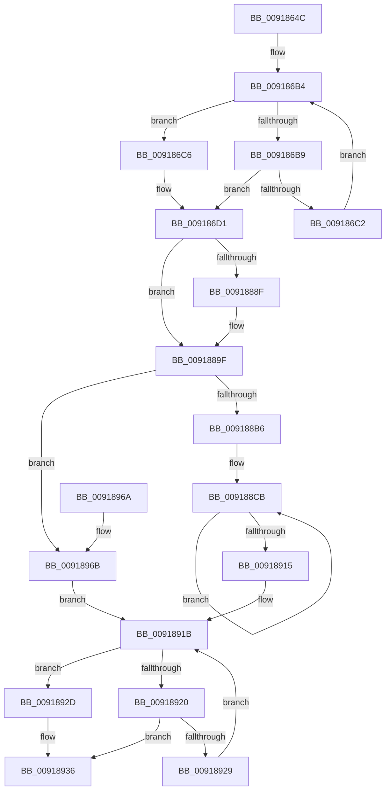

# PspQueryJobHierarchyAccountingInformation

- RVA: `0x0091864C`–`0x0091897B` (길이 `815` bytes)
- VA: `0x000000014091864C`
- 실행 섹션: `PAGE`
- PDB 이름 있음: `예`; PDB Function 태그: `아니요`
- unwind 정보 RVA: `0x0008ABB8`
- 디코드: `182`개 명령, `815/815` bytes 표시
- 미해석 바이트: `0` (있으면 어셈블리에 `.byte`로 보존)

> 이 문서는 커널 이미지의 기계어와 PDB 기호를 분석해 생성했습니다. 4번과 5번은 함수 원형과 자료형을 바이너리 사용 방식에서 추정한 C 해석이며 원본 소스 복구 결과는 아닙니다.

## 1. Dependencies

- 직접 호출 지점: **10**; 고유 호출 대상: **9**
- 직접 호출자로 확인된 함수: **2**
- RIP 상대 이미지 참조: **2**

### Outgoing calls
- `0x0091869D` → [memset](../../text/6C/memset_function_006C6C40.md) (function, `0x006C6C40`)
- `0x009186AD` → [PspLockRootJobShared](PspLockRootJobShared_function_00918990.md) (function, `0x00918990`)
- `0x009186CC` → [ExAcquireResourceSharedLite](../../text/21/ExAcquireResourceSharedLite_function_00211BC0.md) (function, `0x00211BC0`)
- `0x009186F2` → [PspEnumJobsAndProcessesInJobHierarchy](PspEnumJobsAndProcessesInJobHierarchy_function_0091A1EC.md) (function, `0x0091A1EC`)
- `0x00918893` → [KeQuerySchedulingGroupReadyTime](../../text/47/KeQuerySchedulingGroupReadyTime_function_0047A9E4.md) (function, `0x0047A9E4`)
- `0x009188BA` → [PsAddProcessEnergyValues](../../text/41/PsAddProcessEnergyValues_function_00416F58.md) (function, `0x00416F58`)
- `0x00918931` → [ExReleaseResourceLite](../../text/25/ExReleaseResourceLite_function_0025FA10.md) (function, `0x0025FA10`)
- `0x0091893E` → [PspUnlockJob](PspUnlockJob_function_00919E00.md) (function, `0x00919E00`)
- `0x0091894D` → [_security_check_cookie](../../text/6A/_security_check_cookie_function_006AC640.md) (function, `0x006AC640`)
- `0x00918974` → [memset](../../text/6C/memset_function_006C6C40.md) (function, `0x006C6C40`)

### Direct callers
- [NtQueryInformationJobObject](../9F/NtQueryInformationJobObject_function_009FB860.md) at `0x009FBCC1`
- [NtQueryInformationJobObject](../9F/NtQueryInformationJobObject_function_009FB860.md) at `0x009FC55B`
- [sub_00B316B4](../B3/Unknown_function_00B316B4.md) at `0x00B3239E`

### Static image references
- `0x00918669` → RVA `0x00E0A740` (`.data`; read)
- `0x009186DE` → RVA `0x00919E50` (`PspQueryProcessAccountingInformationCallback`; read)

## 2. Other-region calls and transfers

- 다른 실행 섹션으로 향하는 call: **7**
  - `0x0091869D` → [memset](../../text/6C/memset_function_006C6C40.md) (`PAGE` → `.text`)
  - `0x009186CC` → [ExAcquireResourceSharedLite](../../text/21/ExAcquireResourceSharedLite_function_00211BC0.md) (`PAGE` → `.text`)
  - `0x00918893` → [KeQuerySchedulingGroupReadyTime](../../text/47/KeQuerySchedulingGroupReadyTime_function_0047A9E4.md) (`PAGE` → `.text`)
  - `0x009188BA` → [PsAddProcessEnergyValues](../../text/41/PsAddProcessEnergyValues_function_00416F58.md) (`PAGE` → `.text`)
  - `0x00918931` → [ExReleaseResourceLite](../../text/25/ExReleaseResourceLite_function_0025FA10.md) (`PAGE` → `.text`)
  - `0x0091894D` → [_security_check_cookie](../../text/6A/_security_check_cookie_function_006AC640.md) (`PAGE` → `.text`)
  - `0x00918974` → [memset](../../text/6C/memset_function_006C6C40.md) (`PAGE` → `.text`)
- 별도 외부 분기/꼬리 이동을 확인하지 못했습니다.

## 3. Assembly (complete function range)

```asm
0091864C  48 89 5C 24 18                  mov qword ptr [rsp + 0x18], rbx
00918651  48 89 74 24 20                  mov qword ptr [rsp + 0x20], rsi
00918656  55                              push rbp
00918657  57                              push rdi
00918658  41 56                           push r14
0091865A  48 8D AC 24 E0 FD FF FF         lea rbp, [rsp - 0x220]
00918662  48 81 EC 20 03 00 00            sub rsp, 0x320
00918669  48 8B 05 D0 20 4F 00            mov rax, qword ptr [rip + 0x4f20d0]
00918670  48 33 C4                        xor rax, rsp
00918673  48 89 85 10 02 00 00            mov qword ptr [rbp + 0x210], rax
0091867A  65 4C 8B 34 25 88 01 00 00      mov r14, qword ptr gs:[0x188]
00918683  48 8B DA                        mov rbx, rdx
00918686  48 8B F9                        mov rdi, rcx
00918689  33 F6                           xor esi, esi
0091868B  33 D2                           xor edx, edx
0091868D  48 89 74 24 30                  mov qword ptr [rsp + 0x30], rsi
00918692  48 8D 4C 24 40                  lea rcx, [rsp + 0x40]
00918697  41 B8 C8 02 00 00               mov r8d, 0x2c8
0091869D  E8 9E E5 DA FF                  call 0x1406c6c40
009186A2  4C 8D 44 24 30                  lea r8, [rsp + 0x30]
009186A7  49 8B D6                        mov rdx, r14
009186AA  48 8B CF                        mov rcx, rdi
009186AD  E8 DE 02 00 00                  call 0x140918990
009186B2  8B CE                           mov ecx, esi
009186B4  83 F9 01                        cmp ecx, 1
009186B7  73 0D                           jae 0x1409186c6
009186B9  8B C1                           mov eax, ecx
009186BB  48 3B 7C C4 30                  cmp rdi, qword ptr [rsp + rax*8 + 0x30]
009186C0  74 0F                           je 0x1409186d1
009186C2  FF C1                           inc ecx
009186C4  EB EE                           jmp 0x1409186b4
009186C6  48 8D 4F 38                     lea rcx, [rdi + 0x38]
009186CA  B2 01                           mov dl, 1
009186CC  E8 EF 94 8F FF                  call 0x140211bc0
009186D1  48 8D 44 24 40                  lea rax, [rsp + 0x40]
009186D6  C7 44 24 28 01 00 00 00         mov dword ptr [rsp + 0x28], 1
009186DE  4C 8D 0D 6B 17 00 00            lea r9, [rip + 0x176b]
009186E5  48 89 44 24 20                  mov qword ptr [rsp + 0x20], rax
009186EA  45 33 C0                        xor r8d, r8d
009186ED  33 D2                           xor edx, edx
009186EF  48 8B CF                        mov rcx, rdi
009186F2  E8 F5 1A 00 00                  call 0x14091a1ec
009186F7  48 8B 87 A0 00 00 00            mov rax, qword ptr [rdi + 0xa0]
009186FE  48 8B 4D B0                     mov rcx, qword ptr [rbp - 0x50]
00918702  48 03 C1                        add rax, rcx
00918705  48 89 03                        mov qword ptr [rbx], rax
00918708  48 03 8F B8 00 00 00            add rcx, qword ptr [rdi + 0xb8]
0091870F  48 89 4B 10                     mov qword ptr [rbx + 0x10], rcx
00918713  48 8B 87 A8 00 00 00            mov rax, qword ptr [rdi + 0xa8]
0091871A  48 8B 4D A8                     mov rcx, qword ptr [rbp - 0x58]
0091871E  48 03 C1                        add rax, rcx
00918721  48 89 43 08                     mov qword ptr [rbx + 8], rax
00918725  48 03 8F C0 00 00 00            add rcx, qword ptr [rdi + 0xc0]
0091872C  48 89 4B 18                     mov qword ptr [rbx + 0x18], rcx
00918730  8B 8F D0 00 00 00               mov ecx, dword ptr [rdi + 0xd0]
00918736  03 4D 38                        add ecx, dword ptr [rbp + 0x38]
00918739  89 4B 20                        mov dword ptr [rbx + 0x20], ecx
0091873C  8B 87 D4 00 00 00               mov eax, dword ptr [rdi + 0xd4]
00918742  89 43 24                        mov dword ptr [rbx + 0x24], eax
00918745  8B 87 D8 00 00 00               mov eax, dword ptr [rdi + 0xd8]
0091874B  89 43 28                        mov dword ptr [rbx + 0x28], eax
0091874E  8B 87 DC 00 00 00               mov eax, dword ptr [rdi + 0xdc]
00918754  89 43 2C                        mov dword ptr [rbx + 0x2c], eax
00918757  48 8B 8F 48 02 00 00            mov rcx, qword ptr [rdi + 0x248]
0091875E  48 03 4D D0                     add rcx, qword ptr [rbp - 0x30]
00918762  48 89 4B 30                     mov qword ptr [rbx + 0x30], rcx
00918766  48 8B 8F 50 02 00 00            mov rcx, qword ptr [rdi + 0x250]
0091876D  48 03 4D D8                     add rcx, qword ptr [rbp - 0x28]
00918771  48 89 4B 38                     mov qword ptr [rbx + 0x38], rcx
00918775  48 8B 8F 58 02 00 00            mov rcx, qword ptr [rdi + 0x258]
0091877C  48 03 4D E0                     add rcx, qword ptr [rbp - 0x20]
00918780  48 89 4B 40                     mov qword ptr [rbx + 0x40], rcx
00918784  48 8B 8F 60 02 00 00            mov rcx, qword ptr [rdi + 0x260]
0091878B  48 03 4D E8                     add rcx, qword ptr [rbp - 0x18]
0091878F  48 89 4B 48                     mov qword ptr [rbx + 0x48], rcx
00918793  48 8B 8F 68 02 00 00            mov rcx, qword ptr [rdi + 0x268]
0091879A  48 03 4D F0                     add rcx, qword ptr [rbp - 0x10]
0091879E  48 89 4B 50                     mov qword ptr [rbx + 0x50], rcx
009187A2  48 8B 8F 70 02 00 00            mov rcx, qword ptr [rdi + 0x270]
009187A9  48 03 4D F8                     add rcx, qword ptr [rbp - 8]
009187AD  48 89 4B 58                     mov qword ptr [rbx + 0x58], rcx
009187B1  48 8B 8F 78 02 00 00            mov rcx, qword ptr [rdi + 0x278]
009187B8  48 03 4D 10                     add rcx, qword ptr [rbp + 0x10]
009187BC  48 89 4B 60                     mov qword ptr [rbx + 0x60], rcx
009187C0  48 8B 8F 80 02 00 00            mov rcx, qword ptr [rdi + 0x280]
009187C7  48 03 4D 18                     add rcx, qword ptr [rbp + 0x18]
009187CB  48 89 4B 68                     mov qword ptr [rbx + 0x68], rcx
009187CF  48 8B 8F 88 02 00 00            mov rcx, qword ptr [rdi + 0x288]
009187D6  48 03 4D 20                     add rcx, qword ptr [rbp + 0x20]
009187DA  48 89 4B 70                     mov qword ptr [rbx + 0x70], rcx
009187DE  48 8B 8F 90 02 00 00            mov rcx, qword ptr [rdi + 0x290]
009187E5  48 03 4D 28                     add rcx, qword ptr [rbp + 0x28]
009187E9  48 89 4B 78                     mov qword ptr [rbx + 0x78], rcx
009187ED  48 8B 8F 98 02 00 00            mov rcx, qword ptr [rdi + 0x298]
009187F4  48 03 4D 30                     add rcx, qword ptr [rbp + 0x30]
009187F8  48 89 8B 80 00 00 00            mov qword ptr [rbx + 0x80], rcx
009187FF  48 8B 8F C8 00 00 00            mov rcx, qword ptr [rdi + 0xc8]
00918806  48 03 4D C8                     add rcx, qword ptr [rbp - 0x38]
0091880A  48 89 8B 88 00 00 00            mov qword ptr [rbx + 0x88], rcx
00918811  48 8B 8F B0 00 00 00            mov rcx, qword ptr [rdi + 0xb0]
00918818  48 03 4D C0                     add rcx, qword ptr [rbp - 0x40]
0091881C  48 89 8B 90 00 00 00            mov qword ptr [rbx + 0x90], rcx
00918823  48 8B 8F E8 04 00 00            mov rcx, qword ptr [rdi + 0x4e8]
0091882A  48 03 4D B8                     add rcx, qword ptr [rbp - 0x48]
0091882E  48 89 8B 98 00 00 00            mov qword ptr [rbx + 0x98], rcx
00918835  48 8B 8F 18 07 00 00            mov rcx, qword ptr [rdi + 0x718]
0091883C  48 03 4D 00                     add rcx, qword ptr [rbp]
00918840  48 89 8B B0 01 00 00            mov qword ptr [rbx + 0x1b0], rcx
00918847  48 8B 8F 20 07 00 00            mov rcx, qword ptr [rdi + 0x720]
0091884E  48 03 4D 08                     add rcx, qword ptr [rbp + 8]
00918852  48 89 8B B8 01 00 00            mov qword ptr [rbx + 0x1b8], rcx
00918859  48 8B 8F A0 02 00 00            mov rcx, qword ptr [rdi + 0x2a0]
00918860  48 03 8D F8 01 00 00            add rcx, qword ptr [rbp + 0x1f8]
00918867  48 89 8B C0 01 00 00            mov qword ptr [rbx + 0x1c0], rcx
0091886E  48 8B 8F A8 02 00 00            mov rcx, qword ptr [rdi + 0x2a8]
00918875  48 03 8D 00 02 00 00            add rcx, qword ptr [rbp + 0x200]
0091887C  48 89 8B C8 01 00 00            mov qword ptr [rbx + 0x1c8], rcx
00918883  48 8B 8F D8 04 00 00            mov rcx, qword ptr [rdi + 0x4d8]
0091888A  48 85 C9                        test rcx, rcx
0091888D  74 10                           je 0x14091889f
0091888F  48 83 E9 80                     sub rcx, -0x80
00918893  E8 4C 21 B6 FF                  call 0x14047a9e4
00918898  48 01 83 98 00 00 00            add qword ptr [rbx + 0x98], rax
0091889F  48 8B 97 18 06 00 00            mov rdx, qword ptr [rdi + 0x618]
009188A6  48 81 C3 A0 00 00 00            add rbx, 0xa0
009188AD  48 85 D2                        test rdx, rdx
009188B0  0F 84 B5 00 00 00               je 0x14091896b
009188B6  48 8D 4D 40                     lea rcx, [rbp + 0x40]
009188BA  E8 99 E6 AF FF                  call 0x140416f58
009188BF  B9 02 00 00 00                  mov ecx, 2
009188C4  48 8D 45 40                     lea rax, [rbp + 0x40]
009188C8  8D 51 7E                        lea edx, [rcx + 0x7e]
009188CB  0F 10 00                        movups xmm0, xmmword ptr [rax]
009188CE  0F 10 48 10                     movups xmm1, xmmword ptr [rax + 0x10]
009188D2  0F 11 03                        movups xmmword ptr [rbx], xmm0
009188D5  0F 10 40 20                     movups xmm0, xmmword ptr [rax + 0x20]
009188D9  0F 11 4B 10                     movups xmmword ptr [rbx + 0x10], xmm1
009188DD  0F 10 48 30                     movups xmm1, xmmword ptr [rax + 0x30]
009188E1  0F 11 43 20                     movups xmmword ptr [rbx + 0x20], xmm0
009188E5  0F 10 40 40                     movups xmm0, xmmword ptr [rax + 0x40]
009188E9  0F 11 4B 30                     movups xmmword ptr [rbx + 0x30], xmm1
009188ED  0F 10 48 50                     movups xmm1, xmmword ptr [rax + 0x50]
009188F1  0F 11 43 40                     movups xmmword ptr [rbx + 0x40], xmm0
009188F5  0F 10 40 60                     movups xmm0, xmmword ptr [rax + 0x60]
009188F9  0F 11 4B 50                     movups xmmword ptr [rbx + 0x50], xmm1
009188FD  0F 10 48 70                     movups xmm1, xmmword ptr [rax + 0x70]
00918901  48 03 C2                        add rax, rdx
00918904  0F 11 43 60                     movups xmmword ptr [rbx + 0x60], xmm0
00918908  48 03 DA                        add rbx, rdx
0091890B  0F 11 4B F0                     movups xmmword ptr [rbx - 0x10], xmm1
0091890F  48 83 E9 01                     sub rcx, 1
00918913  75 B6                           jne 0x1409188cb
00918915  0F 10 00                        movups xmm0, xmmword ptr [rax]
00918918  0F 11 03                        movups xmmword ptr [rbx], xmm0
0091891B  83 FE 01                        cmp esi, 1
0091891E  73 0D                           jae 0x14091892d
00918920  8B C6                           mov eax, esi
00918922  48 3B 7C C4 30                  cmp rdi, qword ptr [rsp + rax*8 + 0x30]
00918927  74 0D                           je 0x140918936
00918929  FF C6                           inc esi
0091892B  EB EE                           jmp 0x14091891b
0091892D  48 8D 4F 38                     lea rcx, [rdi + 0x38]
00918931  E8 DA 70 94 FF                  call 0x14025fa10
00918936  48 8B 4C 24 30                  mov rcx, qword ptr [rsp + 0x30]
0091893B  49 8B D6                        mov rdx, r14
0091893E  E8 BD 14 00 00                  call 0x140919e00
00918943  48 8B 8D 10 02 00 00            mov rcx, qword ptr [rbp + 0x210]
0091894A  48 33 CC                        xor rcx, rsp
0091894D  E8 EE 3C D9 FF                  call 0x1406ac640
00918952  4C 8D 9C 24 20 03 00 00         lea r11, [rsp + 0x320]
0091895A  49 8B 5B 30                     mov rbx, qword ptr [r11 + 0x30]
0091895E  49 8B 73 38                     mov rsi, qword ptr [r11 + 0x38]
00918962  49 8B E3                        mov rsp, r11
00918965  41 5E                           pop r14
00918967  5F                              pop rdi
00918968  5D                              pop rbp
00918969  C3                              ret
0091896A  CC                              int3
0091896B  41 B8 10 01 00 00               mov r8d, 0x110
00918971  48 8B CB                        mov rcx, rbx
00918974  E8 C7 E2 DA FF                  call 0x1406c6c40
00918979  EB A0                           jmp 0x14091891b
```

## 4. C-style interpretation (structured pseudocode)

```c
__int64 __fastcall PspQueryJobHierarchyAccountingInformation(__int64 a1, __int64 a2)
{
    __int64 result;
    __int64 v_rbx;
    __int64 v_rsi;
    __int64 v_rsp;
    unsigned __int64 v_stack_m18;
    unsigned __int64 v_stack_m1F8;
    unsigned int v_stack_m200;
    unsigned __int64 v_stack_m208;
    unsigned __int64 v_stack_m210;
    unsigned __int64 v_stack_m218;
    unsigned __int64 v_stack_m220;
    unsigned __int64 v_stack_m228;
    unsigned __int64 v_stack_m230;
    unsigned __int64 v_stack_m238;
    unsigned __int64 v_stack_m240;
    unsigned __int64 v_stack_m248;
    unsigned __int64 v_stack_m250;
    unsigned __int64 v_stack_m258;
    unsigned __int64 v_stack_m260;
    unsigned __int64 v_stack_m268;
    unsigned __int64 v_stack_m270;
    unsigned __int64 v_stack_m278;
    unsigned __int64 v_stack_m28;
    unsigned __int64 v_stack_m280;
    unsigned __int64 v_stack_m288;
    unsigned __int64 v_stack_m290;
    unsigned __int64 v_stack_m2F8;
    unsigned __int64 v_stack_m308;
    unsigned int v_stack_m310;
    unsigned __int64 v_stack_m318;
    unsigned __int64 v_stack_m38;
    unsigned __int64 v_stack_m40;
    unsigned __int64 v_stack_p18;
    unsigned __int64 v_stack_p20;

    v_stack_p18 = v_rbx;
    v_stack_p20 = v_rsi;
    v_rsp = (v_rsp) - (800);
    result = (*(unsigned __int64 *)(v_rip + 5185744)) ^ (v_rsp);
    v_stack_m28 = result;
    v_rsi = 0;
    a2 = 0;
    v_stack_m308 = 0;
    result = memset(v_stack_m2F8, a2, 712, a4);
    result = PspLockRootJobShared(a1, *(unsigned __int64 *)(gs_base + (0 + 392)), v_stack_m308, a4);
loc_009186B4:
    if (0 >= 1) goto loc_009186C6;
    if (a1 == (*(unsigned __int64 *)(v_rsp + 0 * 8 + 48))) goto loc_009186D1;
    a1 = (unsigned int)((0) + 1);
    goto loc_009186B4;
loc_009186C6:
    result = ExAcquireResourceSharedLite(a1 + 56, 1, v_stack_m308, a4);
loc_009186D1:
    v_stack_m310 = 1;
    v_stack_m318 = v_stack_m2F8;
    a3 = 0;
    a2 = 0;
    result = PspEnumJobsAndProcessesInJobHierarchy(a1, a2, a3, v_rip + 5995);
    result = (*(unsigned __int64 *)(a1 + 160)) + (v_stack_m288);
    *(unsigned __int64 *)(a2) = result;
    a1 = (v_stack_m288) + (*(unsigned __int64 *)(a1 + 184));
    *(unsigned __int64 *)(a2 + 16) = a1;
    result = (*(unsigned __int64 *)(a1 + 168)) + (v_stack_m290);
    *(unsigned __int64 *)(a2 + 8) = result;
    a1 = (v_stack_m290) + (*(unsigned __int64 *)(a1 + 192));
    *(unsigned __int64 *)(a2 + 24) = a1;
    a1 = (unsigned int)(((unsigned int)(*(unsigned int *)(a1 + 208))) + (v_stack_m200));
    *(unsigned int *)(a2 + 32) = (unsigned int)(a1);
    *(unsigned int *)(a2 + 36) = (unsigned int)((unsigned int)(*(unsigned int *)(a1 + 212)));
    *(unsigned int *)(a2 + 40) = (unsigned int)((unsigned int)(*(unsigned int *)(a1 + 216)));
    *(unsigned int *)(a2 + 44) = (unsigned int)((unsigned int)(*(unsigned int *)(a1 + 220)));
    a1 = (*(unsigned __int64 *)(a1 + 584)) + (v_stack_m268);
    *(unsigned __int64 *)(a2 + 48) = a1;
    a1 = (*(unsigned __int64 *)(a1 + 592)) + (v_stack_m260);
    *(unsigned __int64 *)(a2 + 56) = a1;
    a1 = (*(unsigned __int64 *)(a1 + 600)) + (v_stack_m258);
    *(unsigned __int64 *)(a2 + 64) = a1;
    a1 = (*(unsigned __int64 *)(a1 + 608)) + (v_stack_m250);
    *(unsigned __int64 *)(a2 + 72) = a1;
    a1 = (*(unsigned __int64 *)(a1 + 616)) + (v_stack_m248);
    *(unsigned __int64 *)(a2 + 80) = a1;
    a1 = (*(unsigned __int64 *)(a1 + 624)) + (v_stack_m240);
    *(unsigned __int64 *)(a2 + 88) = a1;
    a1 = (*(unsigned __int64 *)(a1 + 632)) + (v_stack_m228);
    *(unsigned __int64 *)(a2 + 96) = a1;
    a1 = (*(unsigned __int64 *)(a1 + 640)) + (v_stack_m220);
    *(unsigned __int64 *)(a2 + 104) = a1;
    a1 = (*(unsigned __int64 *)(a1 + 648)) + (v_stack_m218);
    *(unsigned __int64 *)(a2 + 112) = a1;
    a1 = (*(unsigned __int64 *)(a1 + 656)) + (v_stack_m210);
    *(unsigned __int64 *)(a2 + 120) = a1;
    a1 = (*(unsigned __int64 *)(a1 + 664)) + (v_stack_m208);
    *(unsigned __int64 *)(a2 + 128) = a1;
    a1 = (*(unsigned __int64 *)(a1 + 200)) + (v_stack_m270);
    *(unsigned __int64 *)(a2 + 136) = a1;
    a1 = (*(unsigned __int64 *)(a1 + 176)) + (v_stack_m278);
    *(unsigned __int64 *)(a2 + 144) = a1;
    a1 = (*(unsigned __int64 *)(a1 + 1256)) + (v_stack_m280);
    *(unsigned __int64 *)(a2 + 152) = a1;
    a1 = (*(unsigned __int64 *)(a1 + 1816)) + (v_stack_m238);
    *(unsigned __int64 *)(a2 + 432) = a1;
    a1 = (*(unsigned __int64 *)(a1 + 1824)) + (v_stack_m230);
    *(unsigned __int64 *)(a2 + 440) = a1;
    a1 = (*(unsigned __int64 *)(a1 + 672)) + (v_stack_m40);
    *(unsigned __int64 *)(a2 + 448) = a1;
    a1 = (*(unsigned __int64 *)(a1 + 680)) + (v_stack_m38);
    *(unsigned __int64 *)(a2 + 456) = a1;
    result = (unsigned int)(*(unsigned int *)(a1 + 220));
    if (*(unsigned __int64 *)(a1 + 1240) != 0) {
        a1 = (*(unsigned __int64 *)(a1 + 1240)) - (-128);
        result = KeQuerySchedulingGroupReadyTime(a1, a2, a3, v_rip + 5995);
    }
    v_rbx = (a2) + (160);
    if (*(unsigned __int64 *)(a1 + 1560) == 0) goto loc_0091896B;
    result = PsAddProcessEnergyValues(v_stack_m1F8, *(unsigned __int64 *)(a1 + 1560), a3, v_rip + 5995);
loc_009188CB:
    *(unsigned __int64 *)(v_rbx) = v_xmm0;
    *(unsigned __int64 *)(v_rbx + 16) = v_xmm1;
    *(unsigned __int64 *)(v_rbx + 32) = v_xmm0;
    *(unsigned __int64 *)(v_rbx + 48) = v_xmm1;
    *(unsigned __int64 *)(v_rbx + 64) = v_xmm0;
    *(unsigned __int64 *)(v_rbx + 80) = v_xmm1;
    result = (v_stack_m1F8) + (2 + 126);
    *(unsigned __int64 *)(v_rbx + 96) = v_xmm0;
    v_rbx = (v_rbx) + (2 + 126);
    *(unsigned __int64 *)(v_rbx - 16) = v_xmm1;
    a1 = (2) - (1);
    if (condition_is_not_equal) goto loc_009188CB;
    *(unsigned __int64 *)(v_rbx) = v_xmm0;
loc_0091891B:
    if (0 >= 1) goto loc_0091892D;
    if (a1 == (*(unsigned __int64 *)(v_rsp + 0 * 8 + 48))) goto loc_00918936;
    v_rsi = (unsigned int)((v_rsi) + 1);
    goto loc_0091891B;
loc_0091892D:
    result = ExReleaseResourceLite(a1 + 56, 2 + 126, a3, v_rip + 5995);
loc_00918936:
    result = PspUnlockJob(v_stack_m308, *(unsigned __int64 *)(gs_base + (0 + 392)), a3, v_rip + 5995);
    a1 = (v_stack_m28) ^ (v_rsp);
    result = _security_check_cookie(a1, *(unsigned __int64 *)(gs_base + (0 + 392)), a3, v_rip + 5995);
    return result;
loc_0091896B:
    result = memset(*(unsigned __int64 *)(v_stack_m18 + 48), *(unsigned __int64 *)(gs_base + (0 + 392)), 272, v_rip + 5995);
    goto loc_0091891B;
}
```

## 5. (Beta) C Style

```c
int64_t PspQueryJobHierarchyAccountingInformation(int64_t Arg1, void *Arg2)
{
    uint8_t *arg2 = (uint8_t *)Arg2;

    int64_t result;
    int64_t local_rbx;
    int64_t local_rsi;
    int64_t local_rsp;
    uint64_t v_stack_m18;
    uint64_t v_stack_m1F8;
    uint32_t v_stack_m200;
    uint64_t v_stack_m208;
    uint64_t v_stack_m210;
    uint64_t v_stack_m218;
    uint64_t v_stack_m220;
    uint64_t v_stack_m228;
    uint64_t v_stack_m230;
    uint64_t v_stack_m238;
    uint64_t v_stack_m240;
    uint64_t v_stack_m248;
    uint64_t v_stack_m250;
    uint64_t v_stack_m258;
    uint64_t v_stack_m260;
    uint64_t v_stack_m268;
    uint64_t v_stack_m270;
    uint64_t v_stack_m278;
    uint64_t v_stack_m28;
    uint64_t v_stack_m280;
    uint64_t v_stack_m288;
    uint64_t v_stack_m290;
    uint64_t v_stack_m2F8;
    uint64_t v_stack_m308;
    uint32_t v_stack_m310;
    uint64_t v_stack_m318;
    uint64_t v_stack_m38;
    uint64_t v_stack_m40;
    uint64_t v_stack_p18;
    uint64_t v_stack_p20;

    v_stack_p18 = local_rbx;
    v_stack_p20 = local_rsi;
    local_rsp = (local_rsp) - (800);
    result = (*(uint64_t *)(v_rip + 0x4F20D0)) ^ (local_rsp);
    v_stack_m28 = result;
    local_rsi = 0;
    Arg2 = 0;
    v_stack_m308 = 0;
    result = memset(v_stack_m2F8, Arg2, 712, a4);
    result = PspLockRootJobShared(Arg1, *(uint64_t *)(gs_base + (0 + 0x188)), v_stack_m308, a4);
loc_009186B4:
    if (0 >= 1) goto loc_009186C6;
    if (Arg1 == (*(uint64_t *)(local_rsp + 0x0 * 8 + 0x30))) goto loc_009186D1;
    Arg1 = (uint32_t)((0) + 1);
    goto loc_009186B4;
loc_009186C6:
    result = ExAcquireResourceSharedLite(Arg1 + 56, 1, v_stack_m308, a4);
loc_009186D1:
    v_stack_m310 = 1;
    v_stack_m318 = v_stack_m2F8;
    a3 = 0;
    Arg2 = 0;
    result = PspEnumJobsAndProcessesInJobHierarchy(Arg1, Arg2, a3, v_rip + 5995);
    result = (*(uint64_t *)(Arg1 + 0xA0)) + (v_stack_m288);
    *(uint64_t *)(arg2) = result;
    Arg1 = (v_stack_m288) + (*(uint64_t *)(Arg1 + 0xB8));
    *(uint64_t *)(arg2 + 0x10) = Arg1;
    result = (*(uint64_t *)(Arg1 + 0xA8)) + (v_stack_m290);
    *(uint64_t *)(arg2 + 0x8) = result;
    Arg1 = (v_stack_m290) + (*(uint64_t *)(Arg1 + 0xC0));
    *(uint64_t *)(arg2 + 0x18) = Arg1;
    Arg1 = (uint32_t)(((uint32_t)(*(uint32_t *)(Arg1 + 0xD0))) + (v_stack_m200));
    *(uint32_t *)(arg2 + 0x20) = (uint32_t)(Arg1);
    *(uint32_t *)(arg2 + 0x24) = (uint32_t)((uint32_t)(*(uint32_t *)(Arg1 + 0xD4)));
    *(uint32_t *)(arg2 + 0x28) = (uint32_t)((uint32_t)(*(uint32_t *)(Arg1 + 0xD8)));
    *(uint32_t *)(arg2 + 0x2C) = (uint32_t)((uint32_t)(*(uint32_t *)(Arg1 + 0xDC)));
    Arg1 = (*(uint64_t *)(Arg1 + 0x248)) + (v_stack_m268);
    *(uint64_t *)(arg2 + 0x30) = Arg1;
    Arg1 = (*(uint64_t *)(Arg1 + 0x250)) + (v_stack_m260);
    *(uint64_t *)(arg2 + 0x38) = Arg1;
    Arg1 = (*(uint64_t *)(Arg1 + 0x258)) + (v_stack_m258);
    *(uint64_t *)(arg2 + 0x40) = Arg1;
    Arg1 = (*(uint64_t *)(Arg1 + 0x260)) + (v_stack_m250);
    *(uint64_t *)(arg2 + 0x48) = Arg1;
    Arg1 = (*(uint64_t *)(Arg1 + 0x268)) + (v_stack_m248);
    *(uint64_t *)(arg2 + 0x50) = Arg1;
    Arg1 = (*(uint64_t *)(Arg1 + 0x270)) + (v_stack_m240);
    *(uint64_t *)(arg2 + 0x58) = Arg1;
    Arg1 = (*(uint64_t *)(Arg1 + 0x278)) + (v_stack_m228);
    *(uint64_t *)(arg2 + 0x60) = Arg1;
    Arg1 = (*(uint64_t *)(Arg1 + 0x280)) + (v_stack_m220);
    *(uint64_t *)(arg2 + 0x68) = Arg1;
    Arg1 = (*(uint64_t *)(Arg1 + 0x288)) + (v_stack_m218);
    *(uint64_t *)(arg2 + 0x70) = Arg1;
    Arg1 = (*(uint64_t *)(Arg1 + 0x290)) + (v_stack_m210);
    *(uint64_t *)(arg2 + 0x78) = Arg1;
    Arg1 = (*(uint64_t *)(Arg1 + 0x298)) + (v_stack_m208);
    *(uint64_t *)(arg2 + 0x80) = Arg1;
    Arg1 = (*(uint64_t *)(Arg1 + 0xC8)) + (v_stack_m270);
    *(uint64_t *)(arg2 + 0x88) = Arg1;
    Arg1 = (*(uint64_t *)(Arg1 + 0xB0)) + (v_stack_m278);
    *(uint64_t *)(arg2 + 0x90) = Arg1;
    Arg1 = (*(uint64_t *)(Arg1 + 0x4E8)) + (v_stack_m280);
    *(uint64_t *)(arg2 + 0x98) = Arg1;
    Arg1 = (*(uint64_t *)(Arg1 + 0x718)) + (v_stack_m238);
    *(uint64_t *)(arg2 + 0x1B0) = Arg1;
    Arg1 = (*(uint64_t *)(Arg1 + 0x720)) + (v_stack_m230);
    *(uint64_t *)(arg2 + 0x1B8) = Arg1;
    Arg1 = (*(uint64_t *)(Arg1 + 0x2A0)) + (v_stack_m40);
    *(uint64_t *)(arg2 + 0x1C0) = Arg1;
    Arg1 = (*(uint64_t *)(Arg1 + 0x2A8)) + (v_stack_m38);
    *(uint64_t *)(arg2 + 0x1C8) = Arg1;
    result = (uint32_t)(*(uint32_t *)(Arg1 + 0xDC));
    if (*(uint64_t *)(Arg1 + 0x4D8) != 0) {
        Arg1 = (*(uint64_t *)(Arg1 + 0x4D8)) - (-128);
        result = KeQuerySchedulingGroupReadyTime(Arg1, Arg2, a3, v_rip + 5995);
    }
    local_rbx = (Arg2) + (160);
    if (*(uint64_t *)(Arg1 + 0x618) == 0) goto loc_0091896B;
    result = PsAddProcessEnergyValues(v_stack_m1F8, *(uint64_t *)(Arg1 + 0x618), a3, v_rip + 5995);
loc_009188CB:
    *(uint64_t *)(local_rbx) = v_xmm0;
    *(uint64_t *)(local_rbx + 0x10) = v_xmm1;
    *(uint64_t *)(local_rbx + 0x20) = v_xmm0;
    *(uint64_t *)(local_rbx + 0x30) = v_xmm1;
    *(uint64_t *)(local_rbx + 0x40) = v_xmm0;
    *(uint64_t *)(local_rbx + 0x50) = v_xmm1;
    result = (v_stack_m1F8) + (2 + 126);
    *(uint64_t *)(local_rbx + 0x60) = v_xmm0;
    local_rbx = (local_rbx) + (2 + 126);
    *(uint64_t *)(local_rbx - 0x10) = v_xmm1;
    Arg1 = (2) - (1);
    if (condition_is_not_equal) goto loc_009188CB;
    *(uint64_t *)(local_rbx) = v_xmm0;
loc_0091891B:
    if (0 >= 1) goto loc_0091892D;
    if (Arg1 == (*(uint64_t *)(local_rsp + 0x0 * 8 + 0x30))) goto loc_00918936;
    local_rsi = (uint32_t)((local_rsi) + 1);
    goto loc_0091891B;
loc_0091892D:
    result = ExReleaseResourceLite(Arg1 + 56, 2 + 126, a3, v_rip + 5995);
loc_00918936:
    result = PspUnlockJob(v_stack_m308, *(uint64_t *)(gs_base + (0 + 0x188)), a3, v_rip + 5995);
    Arg1 = (v_stack_m28) ^ (local_rsp);
    result = _security_check_cookie(Arg1, *(uint64_t *)(gs_base + (0 + 0x188)), a3, v_rip + 5995);
    return result;
loc_0091896B:
    result = memset(*(uint64_t *)(v_stack_m18 + 0x30), *(uint64_t *)(gs_base + (0 + 0x188)), 272, v_rip + 5995);
    goto loc_0091891B;
}
```

### 관측된 메모리 오프셋

구조체 형식이 확인되지 않은 접근은 인자 기준의 오프셋으로만 기록했습니다.

| 기준 인자 | 오프셋 표현 | 폭 (bit) | 접근 |
|---|---:|---:|---|
| `Arg2` | `- 0x10` | `128` | `R` |
| `Arg2` | `+ 0x0` | `64` | `W` |
| `Arg2` | `+ 0x0` | `128` | `R` |
| `Arg2` | `+ 0x8` | `64` | `W` |
| `Arg2` | `+ 0x10` | `64` | `W` |
| `Arg2` | `+ 0x10` | `128` | `R` |
| `Arg2` | `+ 0x18` | `64` | `W` |
| `Arg2` | `+ 0x20` | `32` | `W` |
| `Arg2` | `+ 0x20` | `128` | `R` |
| `Arg2` | `+ 0x24` | `32` | `W` |
| `Arg2` | `+ 0x28` | `32` | `W` |
| `Arg2` | `+ 0x2C` | `32` | `W` |
| `Arg2` | `+ 0x30` | `64` | `W` |
| `Arg2` | `+ 0x30` | `128` | `R` |
| `Arg2` | `+ 0x38` | `64` | `W` |
| `Arg2` | `+ 0x40` | `64` | `W` |
| `Arg2` | `+ 0x40` | `128` | `R` |
| `Arg2` | `+ 0x48` | `64` | `W` |
| `Arg2` | `+ 0x50` | `64` | `W` |
| `Arg2` | `+ 0x50` | `128` | `R` |
| `Arg2` | `+ 0x58` | `64` | `W` |
| `Arg2` | `+ 0x60` | `64` | `W` |
| `Arg2` | `+ 0x60` | `128` | `R` |
| `Arg2` | `+ 0x68` | `64` | `W` |
| `Arg2` | `+ 0x70` | `64` | `W` |
| `Arg2` | `+ 0x78` | `64` | `W` |
| `Arg2` | `+ 0x80` | `64` | `W` |
| `Arg2` | `+ 0x88` | `64` | `W` |
| `Arg2` | `+ 0x90` | `64` | `W` |
| `Arg2` | `+ 0x98` | `64` | `R/W` |
| `Arg2` | `+ 0x98` | `64` | `W` |
| `Arg2` | `+ 0x1B0` | `64` | `W` |

추가 오프셋 3개는 표에서 생략했습니다.

## 6. Execution-region graph

[열기: 2D/3D 그래프와 함수 탐색 컨트롤 패널](../../../control-panel.html?section=page&rva=0x0091864C&view=graph)

- 2D 그래프는 위에서 아래로 흐르고, 3D 그래프는 빈 공간을 드래그해 회전합니다. Shift+드래그는 이동, 휠은 확대·축소, 함수 노드 선택은 대상 보고서 이동입니다.

### Static fallback


