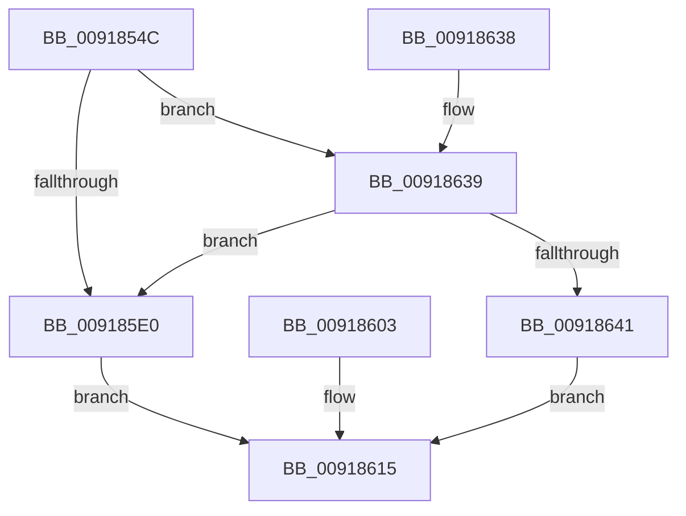

# PspQueryJobHierarchyProcessIdList

- RVA: `0x0091854C`–`0x00918643` (길이 `247` bytes)
- VA: `0x000000014091854C`
- 실행 섹션: `PAGE`
- PDB 이름 있음: `예`; PDB Function 태그: `아니요`
- unwind 정보 RVA: `0x0008AB7C`
- 디코드: `64`개 명령, `247/247` bytes 표시
- 미해석 바이트: `0` (있으면 어셈블리에 `.byte`로 보존)

> 이 문서는 커널 이미지의 기계어와 PDB 기호를 분석해 생성했습니다. 4번과 5번은 함수 원형과 자료형을 바이너리 사용 방식에서 추정한 C 해석이며 원본 소스 복구 결과는 아닙니다.

## 1. Dependencies

- 직접 호출 지점: **3**; 고유 호출 대상: **3**
- 직접 호출자로 확인된 함수: **1**
- RIP 상대 이미지 참조: **1**

### Outgoing calls
- `0x00918588` → [PspLockJobShared](PspLockJobShared_function_0091A490.md) (function, `0x0091A490`)
- `0x009185CD` → [PspEnumJobsAndProcessesInJobHierarchy](PspEnumJobsAndProcessesInJobHierarchy_function_0091A1EC.md) (function, `0x0091A1EC`)
- `0x0091861B` → [PspUnlockJob](PspUnlockJob_function_00919E00.md) (function, `0x00919E00`)

### Direct callers
- [sub_00B316B4](../B3/Unknown_function_00B316B4.md) at `0x00B317CA`

### Static image references
- `0x009185BE` → RVA `0x00918FE0` (`PspQueryProcessIdListCallback`; read)

## 2. Other-region calls and transfers

- 다른 실행 섹션으로 향하는 call: **0**
- 별도 외부 분기/꼬리 이동을 확인하지 못했습니다.

## 3. Assembly (complete function range)

```asm
0091854C  48 8B C4                        mov rax, rsp
0091854F  48 89 58 18                     mov qword ptr [rax + 0x18], rbx
00918553  48 89 70 20                     mov qword ptr [rax + 0x20], rsi
00918557  48 89 48 08                     mov qword ptr [rax + 8], rcx
0091855B  57                              push rdi
0091855C  41 56                           push r14
0091855E  41 57                           push r15
00918560  48 83 EC 60                     sub rsp, 0x60
00918564  4D 8B F9                        mov r15, r9
00918567  41 8B D8                        mov ebx, r8d
0091856A  4C 8B F2                        mov r14, rdx
0091856D  48 8B F9                        mov rdi, rcx
00918570  83 60 DC 00                     and dword ptr [rax - 0x24], 0
00918574  65 48 8B 34 25 88 01 00 00      mov rsi, qword ptr gs:[0x188]
0091857D  48 89 B4 24 88 00 00 00         mov qword ptr [rsp + 0x88], rsi
00918585  48 8B D6                        mov rdx, rsi
00918588  E8 03 1F 00 00                  call 0x14091a490
0091858D  49 8D 46 08                     lea rax, [r14 + 8]
00918591  48 89 44 24 40                  mov qword ptr [rsp + 0x40], rax
00918596  8D 43 F8                        lea eax, [rbx - 8]
00918599  89 44 24 48                     mov dword ptr [rsp + 0x48], eax
0091859D  83 64 24 4C 00                  and dword ptr [rsp + 0x4c], 0
009185A2  8B 87 D8 00 00 00               mov eax, dword ptr [rdi + 0xd8]
009185A8  89 44 24 50                     mov dword ptr [rsp + 0x50], eax
009185AC  C7 44 24 28 01 00 00 00         mov dword ptr [rsp + 0x28], 1
009185B4  48 8D 44 24 40                  lea rax, [rsp + 0x40]
009185B9  48 89 44 24 20                  mov qword ptr [rsp + 0x20], rax
009185BE  4C 8D 0D 1B 0A 00 00            lea r9, [rip + 0xa1b]
009185C5  45 33 C0                        xor r8d, r8d
009185C8  33 D2                           xor edx, edx
009185CA  48 8B CF                        mov rcx, rdi
009185CD  E8 1A 1C 00 00                  call 0x14091a1ec
009185D2  8B D8                           mov ebx, eax
009185D4  B8 00 00 00 80                  mov eax, 0x80000000
009185D9  8D 0C 03                        lea ecx, [rbx + rax]
009185DC  85 C8                           test eax, ecx
009185DE  74 59                           je 0x140918639
009185E0  8B 8F D8 00 00 00               mov ecx, dword ptr [rdi + 0xd8]
009185E6  8D 0C CD 08 00 00 00            lea ecx, [rcx*8 + 8]
009185ED  41 89 0F                        mov dword ptr [r15], ecx
009185F0  8B 87 D8 00 00 00               mov eax, dword ptr [rdi + 0xd8]
009185F6  41 89 06                        mov dword ptr [r14], eax
009185F9  8B 44 24 4C                     mov eax, dword ptr [rsp + 0x4c]
009185FD  41 89 46 04                     mov dword ptr [r14 + 4], eax
00918601  EB 12                           jmp 0x140918615
00918603  8B D8                           mov ebx, eax
00918605  48 8B BC 24 80 00 00 00         mov rdi, qword ptr [rsp + 0x80]
0091860D  48 8B B4 24 88 00 00 00         mov rsi, qword ptr [rsp + 0x88]
00918615  48 8B D6                        mov rdx, rsi
00918618  48 8B CF                        mov rcx, rdi
0091861B  E8 E0 17 00 00                  call 0x140919e00
00918620  8B C3                           mov eax, ebx
00918622  4C 8D 5C 24 60                  lea r11, [rsp + 0x60]
00918627  49 8B 5B 30                     mov rbx, qword ptr [r11 + 0x30]
0091862B  49 8B 73 38                     mov rsi, qword ptr [r11 + 0x38]
0091862F  49 8B E3                        mov rsp, r11
00918632  41 5F                           pop r15
00918634  41 5E                           pop r14
00918636  5F                              pop rdi
00918637  C3                              ret
00918638  CC                              int3
00918639  81 FB 05 00 00 80               cmp ebx, 0x80000005
0091863F  74 9F                           je 0x1409185e0
00918641  EB D2                           jmp 0x140918615
```

## 4. C-style interpretation (structured pseudocode)

```c
__int64 __fastcall PspQueryJobHierarchyProcessIdList(__int64 a1, __int64 a2, int a3, __int64 a4)
{
    __int64 result;
    __int64 v_rsp;
    unsigned __int64 v_stack_m18;
    unsigned int v_stack_m28;
    unsigned int v_stack_m2C;
    unsigned int v_stack_m30;
    unsigned __int64 v_stack_m38;
    unsigned int v_stack_m50;
    unsigned __int64 v_stack_m58;
    unsigned __int64 v_stack_p10;
    unsigned __int64 v_stack_p8;

    *(unsigned __int64 *)(v_rsp + 24) = v_rbx;
    *(unsigned __int64 *)(v_rsp + 32) = v_rsi;
    *(unsigned __int64 *)(v_rsp + 8) = a1;
    v_rsp = (v_rsp) - (96);
    v_stack_p10 = *(unsigned __int64 *)(gs_base + (0 + 392));
    result = PspLockJobShared(a1, *(unsigned __int64 *)(gs_base + (0 + 392)), a3, a4);
    v_stack_m38 = a2 + 8;
    v_stack_m30 = (unsigned int)((unsigned int)(a3) - 8);
    v_stack_m28 = (unsigned int)((unsigned int)(*(unsigned int *)(a1 + 216)));
    v_stack_m50 = 1;
    v_stack_m58 = v_stack_m38;
    a3 = 0;
    a2 = 0;
    result = PspEnumJobsAndProcessesInJobHierarchy(a1, a2, a3, v_rip + 2587);
    if ((((unsigned int)((unsigned int)(0x80000000ULL))) & ((unsigned int)((unsigned int)((unsigned int)(result)) + (unsigned int)(0x80000000ULL) * 1))) == 0) goto loc_00918639;
loc_009185E0:
    *(unsigned int *)(a4) = (unsigned int)((unsigned int)(*(unsigned int *)(a1 + 216)) * 8 + 8);
    *(unsigned int *)(a2) = (unsigned int)((unsigned int)(*(unsigned int *)(a1 + 216)));
    *(unsigned int *)(a2 + 4) = (unsigned int)((unsigned int)(v_stack_m2C));
    goto loc_00918615;
loc_00918615:
    result = PspUnlockJob(a1, *(unsigned __int64 *)(gs_base + (0 + 392)), a3, v_rip + 2587);
    return (unsigned int)((unsigned int)((unsigned int)((unsigned int)(result))));
loc_00918639:
    if (((unsigned int)(*(unsigned __int64 *)(v_stack_m18 + 48))) == 0x80000005ULL) goto loc_009185E0;
    goto loc_00918615;
}
```

## 5. (Beta) C Style

```c
int64_t PspQueryJobHierarchyProcessIdList(void *Arg1, void *Arg2, void *Arg3, void *Arg4)
{
    uint8_t *arg1 = (uint8_t *)Arg1;
    uint8_t *arg2 = (uint8_t *)Arg2;
    uint8_t *arg3 = (uint8_t *)Arg3;
    uint8_t *arg4 = (uint8_t *)Arg4;

    int64_t result;
    int64_t local_rsp;
    uint64_t v_stack_m18;
    uint32_t v_stack_m28;
    uint32_t v_stack_m2C;
    uint32_t v_stack_m30;
    uint64_t v_stack_m38;
    uint32_t v_stack_m50;
    uint64_t v_stack_m58;
    uint64_t v_stack_p10;
    uint64_t v_stack_p8;

    *(uint64_t *)(local_rsp + 0x18) = local_rbx;
    *(uint64_t *)(local_rsp + 0x20) = local_rsi;
    *(void **)(local_rsp + 0x8) = Arg1;
    local_rsp = (local_rsp) - (96);
    v_stack_p10 = *(uint64_t *)(gs_base + (0 + 0x188));
    result = PspLockJobShared(Arg1, *(uint64_t *)(gs_base + (0 + 0x188)), Arg3, Arg4);
    v_stack_m38 = Arg2 + 8;
    v_stack_m30 = (uint32_t)((uint32_t)(Arg3) - 8);
    v_stack_m28 = (uint32_t)((uint32_t)(*(uint32_t *)(arg1 + 0xD8)));
    v_stack_m50 = 1;
    v_stack_m58 = v_stack_m38;
    Arg3 = 0;
    Arg2 = 0;
    result = PspEnumJobsAndProcessesInJobHierarchy(Arg1, Arg2, Arg3, v_rip + 2587);
    if ((((uint32_t)((uint32_t)(0x80000000ULL))) & ((uint32_t)((uint32_t)((uint32_t)(result)) + (uint32_t)(0x80000000ULL) * 1))) == 0) goto loc_00918639;
loc_009185E0:
    *(uint32_t *)(arg4) = (uint32_t)((uint32_t)(*(uint32_t *)(arg1 + 0xD8)) * 8 + 8);
    *(uint32_t *)(arg2) = (uint32_t)((uint32_t)(*(uint32_t *)(arg1 + 0xD8)));
    *(uint32_t *)(arg2 + 0x4) = (uint32_t)((uint32_t)(v_stack_m2C));
    goto loc_00918615;
loc_00918615:
    result = PspUnlockJob(Arg1, *(uint64_t *)(gs_base + (0 + 0x188)), Arg3, v_rip + 2587);
    return (uint32_t)((uint32_t)((uint32_t)((uint32_t)(result))));
loc_00918639:
    if (((uint32_t)(*(uint64_t *)(v_stack_m18 + 0x30))) == 0x80000005ULL) goto loc_009185E0;
    goto loc_00918615;
}
```

### 관측된 메모리 오프셋

구조체 형식이 확인되지 않은 접근은 인자 기준의 오프셋으로만 기록했습니다.

| 기준 인자 | 오프셋 표현 | 폭 (bit) | 접근 |
|---|---:|---:|---|
| `Arg1` | `+ 0xD8` | `32` | `R` |
| `Arg2` | `+ 0x0` | `32` | `W` |
| `Arg2` | `+ 0x4` | `32` | `W` |
| `Arg2` | `+ 0x8` | `64` | `R` |
| `Arg3` | `- 0x8` | `32` | `R` |
| `Arg4` | `+ 0x0` | `32` | `W` |

## 6. Execution-region graph

[열기: 2D/3D 그래프와 함수 탐색 컨트롤 패널](../../../control-panel.html?section=page&rva=0x0091854C&view=graph)

- 2D 그래프는 위에서 아래로 흐르고, 3D 그래프는 빈 공간을 드래그해 회전합니다. Shift+드래그는 이동, 휠은 확대·축소, 함수 노드 선택은 대상 보고서 이동입니다.

### Static fallback


