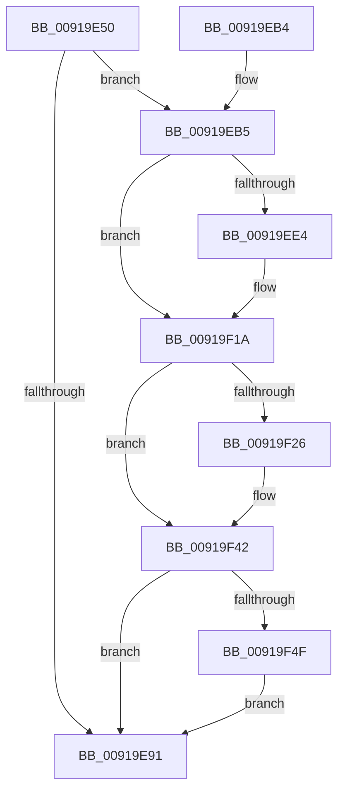

# PspQueryProcessAccountingInformationCallback

- RVA: `0x00919E50`–`0x00919F72` (길이 `290` bytes)
- VA: `0x0000000140919E50`
- 실행 섹션: `PAGE`
- PDB 이름 있음: `예`; PDB Function 태그: `아니요`
- unwind 정보 RVA: `0x0008AD40`
- 디코드: `63`개 명령, `290/290` bytes 표시
- 미해석 바이트: `0` (있으면 어셈블리에 `.byte`로 보존)

> 이 문서는 커널 이미지의 기계어와 PDB 기호를 분석해 생성했습니다. 4번과 5번은 함수 원형과 자료형을 바이너리 사용 방식에서 추정한 C 해석이며 원본 소스 복구 결과는 아닙니다.

## 1. Dependencies

- 직접 호출 지점: **7**; 고유 호출 대상: **7**
- 직접 호출자로 확인된 함수: **1**
- RIP 상대 이미지 참조: **1**

### Outgoing calls
- `0x00919E82` → [memset](../../text/6C/memset_function_006C6C40.md) (function, `0x006C6C40`)
- `0x00919E9E` → [_security_check_cookie](../../text/6A/_security_check_cookie_function_006AC640.md) (function, `0x006AC640`)
- `0x00919EBB` → [PsQueryStatisticsProcess](PsQueryStatisticsProcess_function_00919350.md) (function, `0x00919350`)
- `0x00919EC7` → [PspAddAccountingValues](PspAddAccountingValues_function_00919D9C.md) (function, `0x00919D9C`)
- `0x00919F42` → [PoEnergyEstimationEnabled](../../text/45/PoEnergyEstimationEnabled_function_00450000.md) (function, `0x00450000`)
- `0x00919F57` → [PsQueryProcessEnergyValues](PsQueryProcessEnergyValues_function_0091A4E0.md) (function, `0x0091A4E0`)
- `0x00919F68` → [PsAddProcessEnergyValues](../../text/41/PsAddProcessEnergyValues_function_00416F58.md) (function, `0x00416F58`)

### Direct callers
- [PspCallJobHierarchyCallbacks](PspCallJobHierarchyCallbacks_function_00918A34.md) at `0x00918BB8`

### Static image references
- `0x00919E5D` → RVA `0x00E0A740` (`.data`; read)

## 2. Other-region calls and transfers

- 다른 실행 섹션으로 향하는 call: **4**
  - `0x00919E82` → [memset](../../text/6C/memset_function_006C6C40.md) (`PAGE` → `.text`)
  - `0x00919E9E` → [_security_check_cookie](../../text/6A/_security_check_cookie_function_006AC640.md) (`PAGE` → `.text`)
  - `0x00919F42` → [PoEnergyEstimationEnabled](../../text/45/PoEnergyEstimationEnabled_function_00450000.md) (`PAGE` → `.text`)
  - `0x00919F68` → [PsAddProcessEnergyValues](../../text/41/PsAddProcessEnergyValues_function_00416F58.md) (`PAGE` → `.text`)
- 별도 외부 분기/꼬리 이동을 확인하지 못했습니다.

## 3. Assembly (complete function range)

```asm
00919E50  48 89 5C 24 18                  mov qword ptr [rsp + 0x18], rbx
00919E55  57                              push rdi
00919E56  48 81 EC F0 01 00 00            sub rsp, 0x1f0
00919E5D  48 8B 05 DC 08 4F 00            mov rax, qword ptr [rip + 0x4f08dc]
00919E64  48 33 C4                        xor rax, rsp
00919E67  48 89 84 24 E0 01 00 00         mov qword ptr [rsp + 0x1e0], rax
00919E6F  48 8B DA                        mov rbx, rdx
00919E72  48 8B F9                        mov rdi, rcx
00919E75  33 D2                           xor edx, edx
00919E77  48 8D 4C 24 20                  lea rcx, [rsp + 0x20]
00919E7C  41 B8 B8 01 00 00               mov r8d, 0x1b8
00919E82  E8 B9 CD DA FF                  call 0x1406c6c40
00919E87  8B 87 F0 01 00 00               mov eax, dword ptr [rdi + 0x1f0]
00919E8D  A8 02                           test al, 2
00919E8F  74 24                           je 0x140919eb5
00919E91  33 C0                           xor eax, eax
00919E93  48 8B 8C 24 E0 01 00 00         mov rcx, qword ptr [rsp + 0x1e0]
00919E9B  48 33 CC                        xor rcx, rsp
00919E9E  E8 9D 27 D9 FF                  call 0x1406ac640
00919EA3  48 8B 9C 24 10 02 00 00         mov rbx, qword ptr [rsp + 0x210]
00919EAB  48 81 C4 F0 01 00 00            add rsp, 0x1f0
00919EB2  5F                              pop rdi
00919EB3  C3                              ret
00919EB4  CC                              int3
00919EB5  48 8B D3                        mov rdx, rbx
00919EB8  48 8B CF                        mov rcx, rdi
00919EBB  E8 90 F4 FF FF                  call 0x140919350
00919EC0  48 8D 4B 68                     lea rcx, [rbx + 0x68]
00919EC4  48 8B D3                        mov rdx, rbx
00919EC7  E8 D0 FE FF FF                  call 0x140919d9c
00919ECC  8B 87 04 04 00 00               mov eax, dword ptr [rdi + 0x404]
00919ED2  01 83 F8 00 00 00               add dword ptr [rbx + 0xf8], eax
00919ED8  48 8B 8F 38 06 00 00            mov rcx, qword ptr [rdi + 0x638]
00919EDF  48 85 C9                        test rcx, rcx
00919EE2  74 36                           je 0x140919f1a
00919EE4  48 8B 01                        mov rax, qword ptr [rcx]
00919EE7  48 01 83 D0 00 00 00            add qword ptr [rbx + 0xd0], rax
00919EEE  48 8B 41 08                     mov rax, qword ptr [rcx + 8]
00919EF2  48 01 83 D8 00 00 00            add qword ptr [rbx + 0xd8], rax
00919EF9  48 8B 41 10                     mov rax, qword ptr [rcx + 0x10]
00919EFD  48 01 83 E0 00 00 00            add qword ptr [rbx + 0xe0], rax
00919F04  48 8B 41 18                     mov rax, qword ptr [rcx + 0x18]
00919F08  48 01 83 E8 00 00 00            add qword ptr [rbx + 0xe8], rax
00919F0F  48 8B 41 20                     mov rax, qword ptr [rcx + 0x20]
00919F13  48 01 83 F0 00 00 00            add qword ptr [rbx + 0xf0], rax
00919F1A  48 8B 87 F0 07 00 00            mov rax, qword ptr [rdi + 0x7f0]
00919F21  48 85 C0                        test rax, rax
00919F24  74 1C                           je 0x140919f42
00919F26  48 8B 00                        mov rax, qword ptr [rax]
00919F29  48 89 83 B8 02 00 00            mov qword ptr [rbx + 0x2b8], rax
00919F30  48 8B 87 F0 07 00 00            mov rax, qword ptr [rdi + 0x7f0]
00919F37  48 8B 50 08                     mov rdx, qword ptr [rax + 8]
00919F3B  48 89 93 C0 02 00 00            mov qword ptr [rbx + 0x2c0], rdx
00919F42  E8 B9 60 B3 FF                  call 0x140450000
00919F47  84 C0                           test al, al
00919F49  0F 84 42 FF FF FF               je 0x140919e91
00919F4F  48 8D 54 24 20                  lea rdx, [rsp + 0x20]
00919F54  48 8B CF                        mov rcx, rdi
00919F57  E8 84 05 00 00                  call 0x14091a4e0
00919F5C  48 8D 8B 00 01 00 00            lea rcx, [rbx + 0x100]
00919F63  48 8D 54 24 20                  lea rdx, [rsp + 0x20]
00919F68  E8 EB CF AF FF                  call 0x140416f58
00919F6D  E9 1F FF FF FF                  jmp 0x140919e91
```

## 4. C-style interpretation (structured pseudocode)

```c
__int64 __fastcall PspQueryProcessAccountingInformationCallback(__int64 a1, __int64 a2)
{
    __int64 result;
    __int64 v_rsp;
    unsigned __int64 v_stack_m18;
    unsigned __int64 v_stack_m1D8;
    unsigned __int64 v_stack_p18;
    unsigned __int64 v_stack_p20;

    v_stack_p18 = v_rbx;
    v_rsp = (v_rsp) - (496);
    result = (*(unsigned __int64 *)(v_rip + 5179612)) ^ (v_rsp);
    v_stack_m18 = result;
    a2 = 0;
    result = memset(v_stack_m1D8, a2, 440, a4);
    if ((((unsigned __int8)((unsigned int)(*(unsigned int *)(a1 + 496)))) & (2)) == 0) goto loc_00919EB5;
loc_00919E91:
    result = 0;
    a1 = (v_stack_m18) ^ (v_rsp);
    result = _security_check_cookie(a1, a2, 440, a4);
    v_rsp = (v_rsp) + (496);
    return result;
loc_00919EB5:
    result = PsQueryStatisticsProcess(a1, v_stack_p18, 440, a4);
    result = PspAddAccountingValues(v_stack_p18 + 104, v_stack_p18, 440, a4);
    result = (unsigned int)(*(unsigned int *)(a1 + 1028));
    if (*(unsigned __int64 *)(a1 + 1592) != 0) {
        result = *(unsigned __int64 *)(*(unsigned __int64 *)(a1 + 1592));
        result = *(unsigned __int64 *)(*(unsigned __int64 *)(a1 + 1592) + 8);
        result = *(unsigned __int64 *)(*(unsigned __int64 *)(a1 + 1592) + 16);
        result = *(unsigned __int64 *)(*(unsigned __int64 *)(a1 + 1592) + 24);
        result = *(unsigned __int64 *)(*(unsigned __int64 *)(a1 + 1592) + 32);
    }
    result = *(unsigned __int64 *)(a1 + 2032);
    if (*(unsigned __int64 *)(a1 + 2032) != 0) {
        result = *(unsigned __int64 *)(*(unsigned __int64 *)(a1 + 2032));
        *(unsigned __int64 *)(v_stack_p18 + 696) = result;
        result = *(unsigned __int64 *)(a1 + 2032);
        a2 = *(unsigned __int64 *)(result + 8);
        *(unsigned __int64 *)(v_stack_p18 + 704) = a2;
    }
    result = PoEnergyEstimationEnabled(*(unsigned __int64 *)(a1 + 1592), a2, 440, a4);
    if ((unsigned __int8)(result) == 0) goto loc_00919E91;
    result = PsQueryProcessEnergyValues(a1, v_stack_p20, 440, a4);
    result = PsAddProcessEnergyValues(v_stack_p18 + 256, v_stack_p20, 440, a4);
    goto loc_00919E91;
}
```

## 5. (Beta) C Style

```c
int64_t PspQueryProcessAccountingInformationCallback(void *Arg1, void *Arg2)
{
    uint8_t *arg1 = (uint8_t *)Arg1;
    uint8_t *arg2 = (uint8_t *)Arg2;

    int64_t result;
    int64_t local_rsp;
    uint64_t v_stack_m18;
    uint64_t v_stack_m1D8;
    uint64_t v_stack_p18;
    uint64_t v_stack_p20;

    v_stack_p18 = local_rbx;
    local_rsp = (local_rsp) - (496);
    result = (*(uint64_t *)(v_rip + 0x4F08DC)) ^ (local_rsp);
    v_stack_m18 = result;
    Arg2 = 0;
    result = memset(v_stack_m1D8, Arg2, 440, a4);
    if ((((uint8_t)((uint32_t)(*(uint32_t *)(arg1 + 0x1F0)))) & (2)) == 0) goto loc_00919EB5;
loc_00919E91:
    result = 0;
    Arg1 = (v_stack_m18) ^ (local_rsp);
    result = _security_check_cookie(Arg1, Arg2, 440, a4);
    local_rsp = (local_rsp) + (496);
    return result;
loc_00919EB5:
    result = PsQueryStatisticsProcess(Arg1, v_stack_p18, 440, a4);
    result = PspAddAccountingValues(v_stack_p18 + 104, v_stack_p18, 440, a4);
    result = (uint32_t)(*(uint32_t *)(arg1 + 0x404));
    if (*(uint64_t *)(arg1 + 0x638) != 0) {
        result = *(uint64_t *)(*(uint64_t *)(arg1 + 0x638));
        result = *(uint64_t *)(*(uint64_t *)(arg1 + 0x638) + 0x8);
        result = *(uint64_t *)(*(uint64_t *)(arg1 + 0x638) + 0x10);
        result = *(uint64_t *)(*(uint64_t *)(arg1 + 0x638) + 0x18);
        result = *(uint64_t *)(*(uint64_t *)(arg1 + 0x638) + 0x20);
    }
    result = *(uint64_t *)(arg1 + 0x7F0);
    if (*(uint64_t *)(arg1 + 0x7F0) != 0) {
        result = *(uint64_t *)(*(uint64_t *)(arg1 + 0x7F0));
        *(uint64_t *)(v_stack_p18 + 0x2B8) = result;
        result = *(uint64_t *)(arg1 + 0x7F0);
        Arg2 = *(uint64_t *)(result + 0x8);
        *(void **)(v_stack_p18 + 0x2C0) = Arg2;
    }
    result = PoEnergyEstimationEnabled(*(uint64_t *)(arg1 + 0x638), Arg2, 440, a4);
    if ((uint8_t)(result) == 0) goto loc_00919E91;
    result = PsQueryProcessEnergyValues(Arg1, v_stack_p20, 440, a4);
    result = PsAddProcessEnergyValues(v_stack_p18 + 256, v_stack_p20, 440, a4);
    goto loc_00919E91;
}
```

### 관측된 메모리 오프셋

구조체 형식이 확인되지 않은 접근은 인자 기준의 오프셋으로만 기록했습니다.

| 기준 인자 | 오프셋 표현 | 폭 (bit) | 접근 |
|---|---:|---:|---|
| `Arg1` | `+ 0x1F0` | `32` | `R` |
| `Arg1` | `+ 0x404` | `32` | `R` |
| `Arg1` | `+ 0x638` | `64` | `R` |
| `Arg1` | `+ 0x7F0` | `64` | `R` |
| `Arg2` | `+ 0x68` | `64` | `R` |
| `Arg2` | `+ 0xD0` | `64` | `R/W` |
| `Arg2` | `+ 0xD8` | `64` | `R/W` |
| `Arg2` | `+ 0xE0` | `64` | `R/W` |
| `Arg2` | `+ 0xE8` | `64` | `R/W` |
| `Arg2` | `+ 0xF0` | `64` | `R/W` |
| `Arg2` | `+ 0xF8` | `32` | `R/W` |
| `Arg2` | `+ 0x100` | `64` | `R` |
| `Arg2` | `+ 0x2B8` | `64` | `W` |
| `Arg2` | `+ 0x2C0` | `64` | `W` |

## 6. Execution-region graph

[열기: 2D/3D 그래프와 함수 탐색 컨트롤 패널](../../../control-panel.html?section=page&rva=0x00919E50&view=graph)

- 2D 그래프는 위에서 아래로 흐르고, 3D 그래프는 빈 공간을 드래그해 회전합니다. Shift+드래그는 이동, 휠은 확대·축소, 함수 노드 선택은 대상 보고서 이동입니다.

### Static fallback


