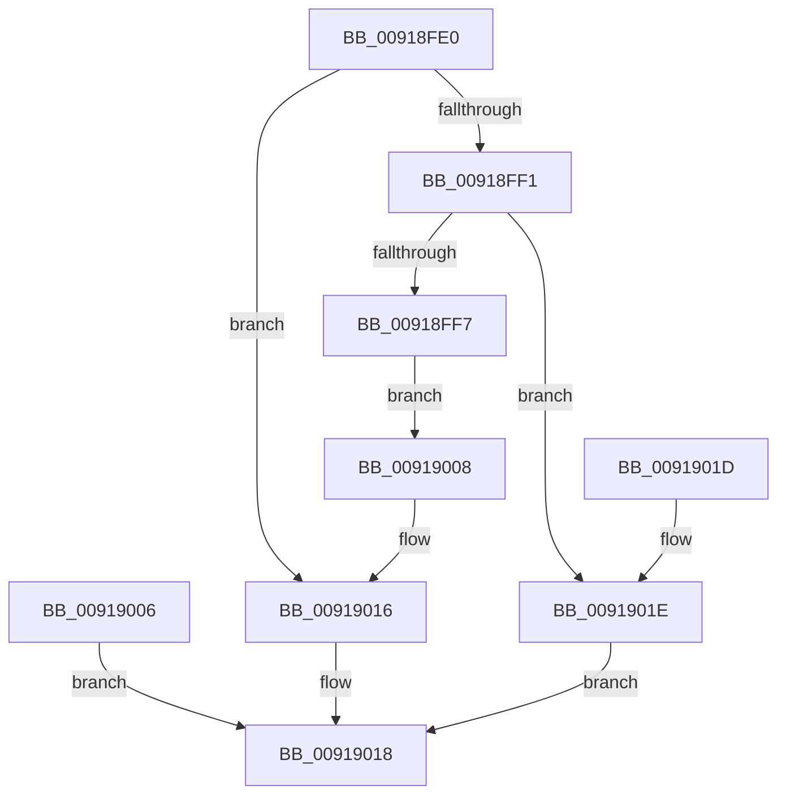

# PspQueryProcessIdListCallback

- RVA: `0x00918FE0`–`0x00919025` (길이 `69` bytes)
- VA: `0x0000000140918FE0`
- 실행 섹션: `PAGE`
- PDB 이름 있음: `예`; PDB Function 태그: `아니요`
- unwind 정보 RVA: `0x0008AC4C`
- 디코드: `22`개 명령, `69/69` bytes 표시
- 미해석 바이트: `0` (있으면 어셈블리에 `.byte`로 보존)

> 이 문서는 커널 이미지의 기계어와 PDB 기호를 분석해 생성했습니다. 4번과 5번은 함수 원형과 자료형을 바이너리 사용 방식에서 추정한 C 해석이며 원본 소스 복구 결과는 아닙니다.

## 1. Dependencies

- 직접 호출 지점: **0**; 고유 호출 대상: **0**
- 직접 호출자로 확인된 함수: **1**
- RIP 상대 이미지 참조: **0**

### Outgoing calls
- 직접 디코드된 call 명령이 없습니다.

### Direct callers
- [PspCallJobHierarchyCallbacks](PspCallJobHierarchyCallbacks_function_00918A34.md) at `0x00918B88`

### Static image references
- 디코드된 RIP-relative 메모리 참조가 없습니다.

## 2. Other-region calls and transfers

- 다른 실행 섹션으로 향하는 call: **0**
- 별도 외부 분기/꼬리 이동을 확인하지 못했습니다.

## 3. Assembly (complete function range)

```asm
00918FE0  48 83 EC 18                     sub rsp, 0x18
00918FE4  4C 8B C1                        mov r8, rcx
00918FE7  8B 81 F0 01 00 00               mov eax, dword ptr [rcx + 0x1f0]
00918FED  A8 01                           test al, 1
00918FEF  75 25                           jne 0x140919016
00918FF1  83 7A 08 08                     cmp dword ptr [rdx + 8], 8
00918FF5  72 27                           jb 0x14091901e
00918FF7  48 8B 0A                        mov rcx, qword ptr [rdx]
00918FFA  49 8B 80 D0 01 00 00            mov rax, qword ptr [r8 + 0x1d0]
00919001  48 89 01                        mov qword ptr [rcx], rax
00919004  EB 02                           jmp 0x140919008
00919006  EB 10                           jmp 0x140919018
00919008  FF 42 0C                        inc dword ptr [rdx + 0xc]
0091900B  48 83 02 08                     add qword ptr [rdx], 8
0091900F  83 42 08 F8                     add dword ptr [rdx + 8], -8
00919013  FF 4A 10                        dec dword ptr [rdx + 0x10]
00919016  33 C0                           xor eax, eax
00919018  48 83 C4 18                     add rsp, 0x18
0091901C  C3                              ret
0091901D  CC                              int3
0091901E  B8 05 00 00 80                  mov eax, 0x80000005
00919023  EB F3                           jmp 0x140919018
```

## 4. C-style interpretation (structured pseudocode)

```c
__int64 __fastcall PspQueryProcessIdListCallback(__int64 a1, __int64 a2)
{
    __int64 result;
    __int64 v_rsp;

    v_rsp = (v_rsp) - (24);
    if ((((unsigned __int8)((unsigned int)(*(unsigned int *)(a1 + 496)))) & (1)) != 0) goto loc_00919016;
    if ((*(unsigned int *)(a2 + 8)) < 8) goto loc_0091901E;
    *(unsigned __int64 *)(*(unsigned __int64 *)(a2)) = *(unsigned __int64 *)(a1 + 464);
    goto loc_00919008;
loc_00919008:
loc_00919016:
    result = 0;
loc_00919018:
    v_rsp = (v_rsp) + (24);
    return result;
loc_0091901E:
    goto loc_00919018;
}
```

## 5. (Beta) C Style

```c
int64_t PspQueryProcessIdListCallback(void *Arg1, void *Arg2)
{
    uint8_t *arg1 = (uint8_t *)Arg1;
    uint8_t *arg2 = (uint8_t *)Arg2;

    int64_t result;
    int64_t local_rsp;

    local_rsp = (local_rsp) - (24);
    if ((((uint8_t)((uint32_t)(*(uint32_t *)(arg1 + 0x1F0)))) & (1)) != 0) goto loc_00919016;
    if ((*(uint32_t *)(arg2 + 0x8)) < 8) goto loc_0091901E;
    *(uint64_t *)(*(uint64_t *)(arg2)) = *(uint64_t *)(arg1 + 0x1D0);
    goto loc_00919008;
loc_00919008:
loc_00919016:
    result = 0;
loc_00919018:
    local_rsp = (local_rsp) + (24);
    return result;
loc_0091901E:
    goto loc_00919018;
}
```

### 관측된 메모리 오프셋

구조체 형식이 확인되지 않은 접근은 인자 기준의 오프셋으로만 기록했습니다.

| 기준 인자 | 오프셋 표현 | 폭 (bit) | 접근 |
|---|---:|---:|---|
| `Arg1` | `+ 0x1D0` | `64` | `R` |
| `Arg1` | `+ 0x1F0` | `32` | `R` |
| `Arg2` | `+ 0x0` | `64` | `R` |
| `Arg2` | `+ 0x0` | `64` | `R/W` |
| `Arg2` | `+ 0x8` | `32` | `R` |
| `Arg2` | `+ 0x8` | `32` | `R/W` |
| `Arg2` | `+ 0xC` | `32` | `R/W` |
| `Arg2` | `+ 0x10` | `32` | `R/W` |

## 6. Execution-region graph

[열기: 2D/3D 그래프와 함수 탐색 컨트롤 패널](../../../control-panel.html?section=page&rva=0x00918FE0&view=graph)

- 2D 그래프는 위에서 아래로 흐르고, 3D 그래프는 빈 공간을 드래그해 회전합니다. Shift+드래그는 이동, 휠은 확대·축소, 함수 노드 선택은 대상 보고서 이동입니다.

### Static fallback


