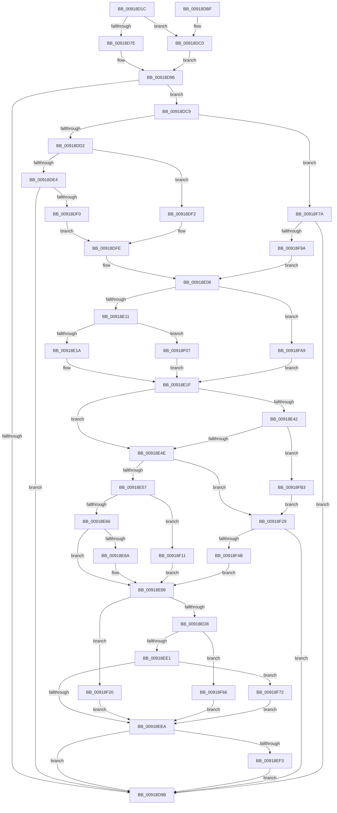

# PspQueryRateControlHistory

- RVA: `0x00918D1C`–`0x00918FCC` (길이 `688` bytes)
- VA: `0x0000000140918D1C`
- 실행 섹션: `PAGE`
- PDB 이름 있음: `예`; PDB Function 태그: `아니요`
- unwind 정보 RVA: `0x0008AC28`
- 디코드: `189`개 명령, `688/688` bytes 표시
- 미해석 바이트: `0` (있으면 어셈블리에 `.byte`로 보존)

> 이 문서는 커널 이미지의 기계어와 PDB 기호를 분석해 생성했습니다. 4번과 5번은 함수 원형과 자료형을 바이너리 사용 방식에서 추정한 C 해석이며 원본 소스 복구 결과는 아닙니다.

## 1. Dependencies

- 직접 호출 지점: **11**; 고유 호출 대상: **10**
- 직접 호출자로 확인된 함수: **2**
- RIP 상대 이미지 참조: **1**

### Outgoing calls
- `0x00918DA2` → [_security_check_cookie](../../text/6A/_security_check_cookie_function_006AC640.md) (function, `0x006AC640`)
- `0x00918DE7` → [PspJobIoRateQueryHistory](../../text/46/PspJobIoRateQueryHistory_function_0046640C.md) (function, `0x0046640C`)
- `0x00918DF9` → [KeQuerySchedulingGroupHistory](../../text/48/KeQuerySchedulingGroupHistory_function_0048B8B4.md) (function, `0x0048B8B4`)
- `0x00918E77` → [RtlCopyBitMap](../../text/3E/RtlCopyBitMap_function_003E2210.md) (function, `0x003E2210`)
- `0x00918E84` → [RtlClearBits](../../text/3E/RtlClearBits_function_003E1A90.md) (function, `0x003E1A90`)
- `0x00918EC6` → [RtlNumberOfSetBits](../../text/43/RtlNumberOfSetBits_function_00433F70.md) (function, `0x00433F70`)
- `0x00918EFD` → [memset](../../text/6C/memset_function_006C6C40.md) (function, `0x006C6C40`)
- `0x00918F16` → [memset](../../text/6C/memset_function_006C6C40.md) (function, `0x006C6C40`)
- `0x00918F39` → [ExAllocatePool2](../../poolcode/B8/ExAllocatePool2_function_00B820F0.md) (function, `0x00B820F0`)
- `0x00918F8D` → [PspNetRateControlDispatch](../78/PspNetRateControlDispatch_function_007850C4.md) (function, `0x007850C4`)
- `0x00918FB8` → [ExFreePoolWithTag](../../poolcode/B8/ExFreePoolWithTag_function_00B82870.md) (function, `0x00B82870`)

### Direct callers
- [PspEnforceLimitsJobPreCallback](PspEnforceLimitsJobPreCallback_function_00918C10.md) at `0x00918CEA`
- [NtQueryInformationJobObject](../9F/NtQueryInformationJobObject_function_009FB860.md) at `0x009FBE13`

### Static image references
- `0x00918D33` → RVA `0x00E0A740` (`.data`; read)

## 2. Other-region calls and transfers

- 다른 실행 섹션으로 향하는 call: **10**
  - `0x00918DA2` → [_security_check_cookie](../../text/6A/_security_check_cookie_function_006AC640.md) (`PAGE` → `.text`)
  - `0x00918DE7` → [PspJobIoRateQueryHistory](../../text/46/PspJobIoRateQueryHistory_function_0046640C.md) (`PAGE` → `.text`)
  - `0x00918DF9` → [KeQuerySchedulingGroupHistory](../../text/48/KeQuerySchedulingGroupHistory_function_0048B8B4.md) (`PAGE` → `.text`)
  - `0x00918E77` → [RtlCopyBitMap](../../text/3E/RtlCopyBitMap_function_003E2210.md) (`PAGE` → `.text`)
  - `0x00918E84` → [RtlClearBits](../../text/3E/RtlClearBits_function_003E1A90.md) (`PAGE` → `.text`)
  - `0x00918EC6` → [RtlNumberOfSetBits](../../text/43/RtlNumberOfSetBits_function_00433F70.md) (`PAGE` → `.text`)
  - `0x00918EFD` → [memset](../../text/6C/memset_function_006C6C40.md) (`PAGE` → `.text`)
  - `0x00918F16` → [memset](../../text/6C/memset_function_006C6C40.md) (`PAGE` → `.text`)
  - `0x00918F39` → [ExAllocatePool2](../../poolcode/B8/ExAllocatePool2_function_00B820F0.md) (`PAGE` → `POOLCODE`)
  - `0x00918FB8` → [ExFreePoolWithTag](../../poolcode/B8/ExFreePoolWithTag_function_00B82870.md) (`PAGE` → `POOLCODE`)
- 별도 외부 분기/꼬리 이동을 확인하지 못했습니다.

## 3. Assembly (complete function range)

```asm
00918D1C  48 89 5C 24 10                  mov qword ptr [rsp + 0x10], rbx
00918D21  55                              push rbp
00918D22  56                              push rsi
00918D23  57                              push rdi
00918D24  41 54                           push r12
00918D26  41 55                           push r13
00918D28  41 56                           push r14
00918D2A  41 57                           push r15
00918D2C  48 8B EC                        mov rbp, rsp
00918D2F  48 83 EC 70                     sub rsp, 0x70
00918D33  48 8B 05 06 1A 4F 00            mov rax, qword ptr [rip + 0x4f1a06]
00918D3A  48 33 C4                        xor rax, rsp
00918D3D  48 89 45 F8                     mov qword ptr [rbp - 8], rax
00918D41  44 8B 55 60                     mov r10d, dword ptr [rbp + 0x60]
00918D45  33 F6                           xor esi, esi
00918D47  33 C0                           xor eax, eax
00918D49  44 88 45 B0                     mov byte ptr [rbp - 0x50], r8b
00918D4D  48 89 45 CC                     mov qword ptr [rbp - 0x34], rax
00918D51  0F 57 C0                        xorps xmm0, xmm0
00918D54  48 89 45 C8                     mov qword ptr [rbp - 0x38], rax
00918D58  4D 8B F1                        mov r14, r9
00918D5B  89 75 B4                        mov dword ptr [rbp - 0x4c], esi
00918D5E  45 8A E0                        mov r12b, r8b
00918D61  89 75 B8                        mov dword ptr [rbp - 0x48], esi
00918D64  8B DA                           mov ebx, edx
00918D66  48 89 75 C0                     mov qword ptr [rbp - 0x40], rsi
00918D6A  4C 8B D9                        mov r11, rcx
00918D6D  41 89 31                        mov dword ptr [r9], esi
00918D70  0F 11 45 D8                     movups xmmword ptr [rbp - 0x28], xmm0
00918D74  0F 11 45 E8                     movups xmmword ptr [rbp - 0x18], xmm0
00918D78  41 83 FA 01                     cmp r10d, 1
00918D7C  74 42                           je 0x140918dc0
00918D7E  48 8D 81 08 06 00 00            lea rax, [rcx + 0x608]
00918D85  48 81 C1 D8 04 00 00            add rcx, 0x4d8
00918D8C  45 85 D2                        test r10d, r10d
00918D8F  48 0F 44 C8                     cmove rcx, rax
00918D93  48 8B 39                        mov rdi, qword ptr [rcx]
00918D96  48 85 FF                        test rdi, rdi
00918D99  75 2E                           jne 0x140918dc9
00918D9B  48 8B 4D F8                     mov rcx, qword ptr [rbp - 8]
00918D9F  48 33 CC                        xor rcx, rsp
00918DA2  E8 99 38 D9 FF                  call 0x1406ac640
00918DA7  48 8B 9C 24 B8 00 00 00         mov rbx, qword ptr [rsp + 0xb8]
00918DAF  48 83 C4 70                     add rsp, 0x70
00918DB3  41 5F                           pop r15
00918DB5  41 5E                           pop r14
00918DB7  41 5D                           pop r13
00918DB9  41 5C                           pop r12
00918DBB  5F                              pop rdi
00918DBC  5E                              pop rsi
00918DBD  5D                              pop rbp
00918DBE  C3                              ret
00918DBF  CC                              int3
00918DC0  48 8D B9 38 06 00 00            lea rdi, [rcx + 0x638]
00918DC7  EB CD                           jmp 0x140918d96
00918DC9  45 85 D2                        test r10d, r10d
00918DCC  0F 84 A8 01 00 00               je 0x140918f7a
00918DD2  4C 8D 4D B8                     lea r9, [rbp - 0x48]
00918DD6  4C 8D 45 B4                     lea r8, [rbp - 0x4c]
00918DDA  48 8D 55 C0                     lea rdx, [rbp - 0x40]
00918DDE  41 83 FA 01                     cmp r10d, 1
00918DE2  75 0E                           jne 0x140918df2
00918DE4  49 8B CB                        mov rcx, r11
00918DE7  E8 20 D6 B4 FF                  call 0x14046640c
00918DEC  85 C0                           test eax, eax
00918DEE  78 AB                           js 0x140918d9b
00918DF0  EB 0C                           jmp 0x140918dfe
00918DF2  48 8D 8F 80 00 00 00            lea rcx, [rdi + 0x80]
00918DF9  E8 B6 2A B7 FF                  call 0x14048b8b4
00918DFE  8B 4D B4                        mov ecx, dword ptr [rbp - 0x4c]
00918E01  8B 75 B8                        mov esi, dword ptr [rbp - 0x48]
00918E04  4C 8B 7D C0                     mov r15, qword ptr [rbp - 0x40]
00918E08  83 EB 02                        sub ebx, 2
00918E0B  0F 84 98 01 00 00               je 0x140918fa9
00918E11  83 FB 01                        cmp ebx, 1
00918E14  0F 84 ED 00 00 00               je 0x140918f07
00918E1A  B8 10 27 00 00                  mov eax, 0x2710
00918E1F  4C 8B 47 18                     mov r8, qword ptr [rdi + 0x18]
00918E23  FF C8                           dec eax
00918E25  03 C1                           add eax, ecx
00918E27  33 D2                           xor edx, edx
00918E29  F7 F1                           div ecx
00918E2B  49 8B C8                        mov rcx, r8
00918E2E  44 8B E8                        mov r13d, eax
00918E31  8D 58 07                        lea ebx, [rax + 7]
00918E34  C1 EB 03                        shr ebx, 3
00918E37  83 C3 07                        add ebx, 7
00918E3A  83 E3 F8                        and ebx, 0xfffffff8
00918E3D  4D 85 C0                        test r8, r8
00918E40  74 0C                           je 0x140918e4e
00918E42  8B C3                           mov eax, ebx
00918E44  48 39 47 20                     cmp qword ptr [rdi + 0x20], rax
00918E48  0F 82 65 01 00 00               jb 0x140918fb3
00918E4E  48 85 C9                        test rcx, rcx
00918E51  0F 84 D2 00 00 00               je 0x140918f29
00918E57  8D 04 DD 00 00 00 00            lea eax, [rbx*8]
00918E5E  3B F0                           cmp esi, eax
00918E60  0F 83 AB 00 00 00               jae 0x140918f11
00918E66  85 F6                           test esi, esi
00918E68  74 1F                           je 0x140918e89
00918E6A  48 8D 5F 08                     lea rbx, [rdi + 8]
00918E6E  44 8B C6                        mov r8d, esi
00918E71  48 8B D3                        mov rdx, rbx
00918E74  48 8B CB                        mov rcx, rbx
00918E77  E8 94 93 AC FF                  call 0x1403e2210
00918E7C  44 8B C6                        mov r8d, esi
00918E7F  33 D2                           xor edx, edx
00918E81  48 8B CB                        mov rcx, rbx
00918E84  E8 07 8C AC FF                  call 0x1403e1a90
00918E89  48 8B 57 18                     mov rdx, qword ptr [rdi + 0x18]
00918E8D  B8 40 00 00 00                  mov eax, 0x40
00918E92  3B F0                           cmp esi, eax
00918E94  44 89 6D C8                     mov dword ptr [rbp - 0x38], r13d
00918E98  0F 47 F0                        cmova esi, eax
00918E9B  8D 58 C1                        lea ebx, [rax - 0x3f]
00918E9E  8B CE                           mov ecx, esi
00918EA0  8B C3                           mov eax, ebx
00918EA2  48 D3 E0                        shl rax, cl
00918EA5  48 FF C8                        dec rax
00918EA8  48 8B C8                        mov rcx, rax
00918EAB  49 23 C7                        and rax, r15
00918EAE  48 F7 D1                        not rcx
00918EB1  48 23 0A                        and rcx, qword ptr [rdx]
00918EB4  48 0B C8                        or rcx, rax
00918EB7  48 89 0A                        mov qword ptr [rdx], rcx
00918EBA  48 8D 4D C8                     lea rcx, [rbp - 0x38]
00918EBE  48 8B 47 18                     mov rax, qword ptr [rdi + 0x18]
00918EC2  48 89 45 D0                     mov qword ptr [rbp - 0x30], rax
00918EC6  E8 A5 B0 B1 FF                  call 0x140433f70
00918ECB  6B C0 64                        imul eax, eax, 0x64
00918ECE  33 D2                           xor edx, edx
00918ED0  41 F7 F5                        div r13d
00918ED3  83 F8 3C                        cmp eax, 0x3c
00918ED6  73 48                           jae 0x140918f20
00918ED8  83 F8 28                        cmp eax, 0x28
00918EDB  0F 83 85 00 00 00               jae 0x140918f66
00918EE1  83 F8 14                        cmp eax, 0x14
00918EE4  0F 83 88 00 00 00               jae 0x140918f72
00918EEA  45 84 E4                        test r12b, r12b
00918EED  0F 84 A8 FE FF FF               je 0x140918d9b
00918EF3  4C 8B 47 20                     mov r8, qword ptr [rdi + 0x20]
00918EF7  33 D2                           xor edx, edx
00918EF9  48 8B 4F 18                     mov rcx, qword ptr [rdi + 0x18]
00918EFD  E8 3E DD DA FF                  call 0x1406c6c40
00918F02  E9 94 FE FF FF                  jmp 0x140918d9b
00918F07  B8 C0 27 09 00                  mov eax, 0x927c0
00918F0C  E9 0E FF FF FF                  jmp 0x140918e1f
00918F11  44 8B C3                        mov r8d, ebx
00918F14  33 D2                           xor edx, edx
00918F16  E8 25 DD DA FF                  call 0x1406c6c40
00918F1B  E9 69 FF FF FF                  jmp 0x140918e89
00918F20  41 C7 06 03 00 00 00            mov dword ptr [r14], 3
00918F27  EB C1                           jmp 0x140918eea
00918F29  41 B8 50 73 4A 62               mov r8d, 0x624a7350
00918F2F  8B D3                           mov edx, ebx
00918F31  B9 00 01 00 00                  mov ecx, 0x100
00918F36  44 8B E3                        mov r12d, ebx
00918F39  E8 B2 91 26 00                  call 0x140b820f0
00918F3E  48 89 47 18                     mov qword ptr [rdi + 0x18], rax
00918F42  48 85 C0                        test rax, rax
00918F45  0F 84 50 FE FF FF               je 0x140918d9b
00918F4B  8D 0C DD 00 00 00 00            lea ecx, [rbx*8]
00918F52  48 89 47 10                     mov qword ptr [rdi + 0x10], rax
00918F56  89 4F 08                        mov dword ptr [rdi + 8], ecx
00918F59  4C 89 67 20                     mov qword ptr [rdi + 0x20], r12
00918F5D  44 8A 65 B0                     mov r12b, byte ptr [rbp - 0x50]
00918F61  E9 23 FF FF FF                  jmp 0x140918e89
00918F66  41 C7 06 02 00 00 00            mov dword ptr [r14], 2
00918F6D  E9 78 FF FF FF                  jmp 0x140918eea
00918F72  41 89 1E                        mov dword ptr [r14], ebx
00918F75  E9 70 FF FF FF                  jmp 0x140918eea
00918F7A  C7 45 E0 01 00 00 00            mov dword ptr [rbp - 0x20], 1
00918F81  48 8D 4D D8                     lea rcx, [rbp - 0x28]
00918F85  48 8B 47 38                     mov rax, qword ptr [rdi + 0x38]
00918F89  48 89 45 D8                     mov qword ptr [rbp - 0x28], rax
00918F8D  E8 32 C1 E6 FF                  call 0x1407850c4
00918F92  85 C0                           test eax, eax
00918F94  0F 88 01 FE FF FF               js 0x140918d9b
00918F9A  4C 8B 7D E8                     mov r15, qword ptr [rbp - 0x18]
00918F9E  8B 4D F0                        mov ecx, dword ptr [rbp - 0x10]
00918FA1  8B 75 F4                        mov esi, dword ptr [rbp - 0xc]
00918FA4  E9 5F FE FF FF                  jmp 0x140918e08
00918FA9  B8 60 EA 00 00                  mov eax, 0xea60
00918FAE  E9 6C FE FF FF                  jmp 0x140918e1f
00918FB3  BA 50 73 4A 62                  mov edx, 0x624a7350
00918FB8  E8 B3 98 26 00                  call 0x140b82870
00918FBD  48 83 67 18 00                  and qword ptr [rdi + 0x18], 0
00918FC2  48 83 67 20 00                  and qword ptr [rdi + 0x20], 0
00918FC7  E9 5D FF FF FF                  jmp 0x140918f29
```

## 4. C-style interpretation (structured pseudocode)

```c
__int64 __fastcall PspQueryRateControlHistory(__int64 a1, int a2, unsigned __int8 a3, __int64 a4, unsigned int a5)
{
    __int64 result;
    __int64 v_rbx;
    __int64 v_rsi;
    __int64 v_rsp;
    unsigned __int64 v_stack_m40;
    unsigned int v_stack_m44;
    unsigned int v_stack_m48;
    unsigned __int64 v_stack_m50;
    unsigned int v_stack_m58;
    unsigned __int64 v_stack_m60;
    unsigned __int64 v_stack_m68;
    unsigned __int64 v_stack_m6C;
    unsigned __int64 v_stack_m70;
    unsigned __int64 v_stack_m78;
    unsigned int v_stack_m80;
    unsigned int v_stack_m84;
    unsigned __int8 v_stack_m88;
    unsigned __int64 v_stack_p10;

    v_stack_p10 = v_rbx;
    v_rsp = (v_rsp) - (112);
    result = (*(unsigned __int64 *)(v_rip + 5184006)) ^ (v_rsp);
    v_stack_m40 = result;
    v_rsi = 0;
    result = 0;
    v_stack_m88 = a3;
    v_stack_m6C = 0;
    v_stack_m70 = 0;
    v_stack_m84 = 0;
    v_stack_m80 = 0;
    v_stack_m78 = 0;
    *(unsigned int *)(a4) = 0;
    v_stack_m60 = v_xmm0;
    v_stack_m50 = v_xmm0;
    if (((unsigned int)((unsigned int)(a5))) == 1) goto loc_00918DC0;
    a1 = (a1) + (0x4D8ULL);
    if ((unsigned int)((unsigned int)(a5)) == 0) { a1 = a1 + 1544; }
loc_00918D96:
    if (*(unsigned __int64 *)(a1) != 0) goto loc_00918DC9;
loc_00918D9B:
    a1 = (v_stack_m40) ^ (v_rsp);
    result = _security_check_cookie(a1, a2, a3, a4);
    v_rsp = (v_rsp) + (112);
    return result;
loc_00918DC0:
    goto loc_00918D96;
loc_00918DC9:
    if ((unsigned int)((unsigned int)(a5)) == 0) goto loc_00918F7A;
    if (((unsigned int)((unsigned int)(a5))) != 1) goto loc_00918DF2;
    result = PspJobIoRateQueryHistory(a1, v_stack_m78, v_stack_m84, v_stack_m80);
    if (sign_flag) goto loc_00918D9B;
    goto loc_00918DFE;
loc_00918DF2:
    result = KeQuerySchedulingGroupHistory(a1 + 1592 + 128, v_stack_m78, v_stack_m84, v_stack_m80);
loc_00918DFE:
loc_00918E08:
    v_rbx = (unsigned int)((v_stack_p10) - (2));
    if (condition_is_equal) goto loc_00918FA9;
    if (((unsigned int)(v_rbx)) == 1) goto loc_00918F07;
loc_00918E1F:
    result = (unsigned int)(((unsigned int)(0x2710ULL)) - 1);
    result = (unsigned int)((result) + ((unsigned int)((unsigned int)(v_stack_m84))));
    a2 = 0;
    v_rbx = (unsigned int)((result + 7) >> (3));
    v_rbx = (unsigned int)((v_rbx) + (7));
    v_rbx = (unsigned int)((v_rbx) & (0xFFFFFFF8ULL));
    if (*(unsigned __int64 *)(a1 + 1592 + 24) == 0) goto loc_00918E4E;
    if ((*(unsigned __int64 *)(a1 + 1592 + 32)) < ((unsigned int)((unsigned int)(v_rbx)))) goto loc_00918FB3;
loc_00918E4E:
    if (*(unsigned __int64 *)(a1 + 1592 + 24) == 0) goto loc_00918F29;
    if (((unsigned int)((unsigned int)(v_stack_m80))) >= ((unsigned int)(v_rbx * 8))) goto loc_00918F11;
    result = v_rbx * 8;
    if ((unsigned int)((unsigned int)(v_stack_m80)) != 0) {
        v_rbx = a1 + 1592 + 8;
        a3 = (unsigned int)((unsigned int)(v_stack_m80));
        a2 = v_rbx;
        a1 = v_rbx;
        result = RtlCopyBitMap(a1, a2, a3, v_stack_m80);
        a3 = (unsigned int)((unsigned int)(v_stack_m80));
        a2 = 0;
        a1 = v_rbx;
        result = RtlClearBits(a1, a2, a3, v_stack_m80);
    }
    v_stack_m70 = (unsigned int)((unsigned int)((unsigned int)(result)));
    v_rsi = (unsigned int)(v_stack_m80);
    if (((unsigned int)((unsigned int)(v_stack_m80))) > 64) { v_rsi = 64; }
    result = ((unsigned int)((unsigned int)(64 - 63))) << ((unsigned __int8)((unsigned int)((unsigned int)(v_rsi))));
    result = (result) - 1;
    result = (result) & (v_stack_m78);
    a1 = ~(result);
    a1 = (a1) & (*(unsigned __int64 *)(*(unsigned __int64 *)(a1 + 1592 + 24)));
    a1 = (a1) | (result);
    *(unsigned __int64 *)(*(unsigned __int64 *)(a1 + 1592 + 24)) = a1;
    v_stack_m68 = *(unsigned __int64 *)(a1 + 1592 + 24);
    result = RtlNumberOfSetBits(v_stack_m70, *(unsigned __int64 *)(a1 + 1592 + 24), a3, v_stack_m80);
    result = (unsigned int)((result) * ((unsigned int)(result)));
    a2 = 0;
    if (((unsigned int)(result)) >= 60) goto loc_00918F20;
    if (((unsigned int)(result)) >= 40) goto loc_00918F66;
    if (((unsigned int)(result)) >= 20) goto loc_00918F72;
loc_00918EEA:
    if (a3 == 0) goto loc_00918D9B;
    a2 = 0;
    result = memset(*(unsigned __int64 *)(a1 + 1592 + 24), a2, *(unsigned __int64 *)(a1 + 1592 + 32), v_stack_m80);
    goto loc_00918D9B;
loc_00918F07:
    goto loc_00918E1F;
loc_00918F11:
    a2 = 0;
    result = memset(*(unsigned __int64 *)(a1 + 1592 + 24), a2, (unsigned int)((unsigned int)(64 - 63)), v_stack_m80);
    goto loc_00918E89;
loc_00918F20:
    *(unsigned int *)(a4) = 3;
    goto loc_00918EEA;
loc_00918F29:
    result = ExAllocatePool2(256, (unsigned int)((unsigned int)(64 - 63)), (unsigned int)(0x624A7350ULL), v_stack_m80);
    *(unsigned __int64 *)(a1 + 1592 + 24) = result;
    if (result == 0) goto loc_00918D9B;
    *(unsigned __int64 *)(a1 + 1592 + 16) = result;
    *(unsigned int *)(a1 + 1592 + 8) = (unsigned int)(64 - 63 * 8);
    *(unsigned __int64 *)(a1 + 1592 + 32) = (unsigned int)((unsigned int)(64 - 63));
    goto loc_00918E89;
loc_00918F66:
    *(unsigned int *)(a4) = 2;
    goto loc_00918EEA;
loc_00918F72:
    *(unsigned int *)(a4) = (unsigned int)(64 - 63);
    goto loc_00918EEA;
loc_00918F7A:
    v_stack_m58 = 1;
    v_stack_m60 = *(unsigned __int64 *)(a1 + 1592 + 56);
    result = PspNetRateControlDispatch(v_stack_m60, (unsigned int)((unsigned int)(64 - 63)), (unsigned int)(0x624A7350ULL), v_stack_m80);
    if (sign_flag) goto loc_00918D9B;
    goto loc_00918E08;
loc_00918FA9:
    goto loc_00918E1F;
loc_00918FB3:
    result = ExFreePoolWithTag((unsigned int)(v_stack_m48), (unsigned int)(0x624A7350ULL), (unsigned int)(0x624A7350ULL), v_stack_m80);
    goto loc_00918F29;
}
```

## 5. (Beta) C Style

```c
int64_t PspQueryRateControlHistory(void *Arg1, int32_t Arg2, uint8_t Arg3, void *Arg4, uint32_t Arg5)
{
    uint8_t *arg1 = (uint8_t *)Arg1;
    uint8_t *arg4 = (uint8_t *)Arg4;

    int64_t result;
    int64_t local_rbx;
    int64_t local_rsi;
    int64_t local_rsp;
    uint64_t v_stack_m40;
    uint32_t v_stack_m44;
    uint32_t v_stack_m48;
    uint64_t v_stack_m50;
    uint32_t v_stack_m58;
    uint64_t v_stack_m60;
    uint64_t v_stack_m68;
    uint64_t v_stack_m6C;
    uint64_t v_stack_m70;
    uint64_t v_stack_m78;
    uint32_t v_stack_m80;
    uint32_t v_stack_m84;
    uint8_t v_stack_m88;
    uint64_t v_stack_p10;

    v_stack_p10 = local_rbx;
    local_rsp = (local_rsp) - (112);
    result = (*(uint64_t *)(v_rip + 0x4F1A06)) ^ (local_rsp);
    v_stack_m40 = result;
    local_rsi = 0;
    result = 0;
    v_stack_m88 = Arg3;
    v_stack_m6C = 0;
    v_stack_m70 = 0;
    v_stack_m84 = 0;
    v_stack_m80 = 0;
    v_stack_m78 = 0;
    *(uint32_t *)(arg4) = 0;
    v_stack_m60 = v_xmm0;
    v_stack_m50 = v_xmm0;
    if (((uint32_t)((uint32_t)(Arg5))) == 1) goto loc_00918DC0;
    Arg1 = (Arg1) + (0x4D8ULL);
    if ((uint32_t)((uint32_t)(Arg5)) == 0) { Arg1 = Arg1 + 1544; }
loc_00918D96:
    if (*(uint64_t *)(arg1) != 0) goto loc_00918DC9;
loc_00918D9B:
    Arg1 = (v_stack_m40) ^ (local_rsp);
    result = _security_check_cookie(Arg1, Arg2, Arg3, Arg4);
    local_rsp = (local_rsp) + (112);
    return result;
loc_00918DC0:
    goto loc_00918D96;
loc_00918DC9:
    if ((uint32_t)((uint32_t)(Arg5)) == 0) goto loc_00918F7A;
    if (((uint32_t)((uint32_t)(Arg5))) != 1) goto loc_00918DF2;
    result = PspJobIoRateQueryHistory(Arg1, v_stack_m78, v_stack_m84, v_stack_m80);
    if (sign_flag) goto loc_00918D9B;
    goto loc_00918DFE;
loc_00918DF2:
    result = KeQuerySchedulingGroupHistory(Arg1 + 1592 + 128, v_stack_m78, v_stack_m84, v_stack_m80);
loc_00918DFE:
loc_00918E08:
    local_rbx = (uint32_t)((v_stack_p10) - (2));
    if (condition_is_equal) goto loc_00918FA9;
    if (((uint32_t)(local_rbx)) == 1) goto loc_00918F07;
loc_00918E1F:
    result = (uint32_t)(((uint32_t)(0x2710ULL)) - 1);
    result = (uint32_t)((result) + ((uint32_t)((uint32_t)(v_stack_m84))));
    Arg2 = 0;
    local_rbx = (uint32_t)((result + 7) >> (3));
    local_rbx = (uint32_t)((local_rbx) + (7));
    local_rbx = (uint32_t)((local_rbx) & (0xFFFFFFF8ULL));
    if (*(uint64_t *)(arg1 + 0x638 + 0x18) == 0) goto loc_00918E4E;
    if ((*(uint64_t *)(arg1 + 0x638 + 0x20)) < ((uint32_t)((uint32_t)(local_rbx)))) goto loc_00918FB3;
loc_00918E4E:
    if (*(uint64_t *)(arg1 + 0x638 + 0x18) == 0) goto loc_00918F29;
    if (((uint32_t)((uint32_t)(v_stack_m80))) >= ((uint32_t)(local_rbx * 8))) goto loc_00918F11;
    result = local_rbx * 8;
    if ((uint32_t)((uint32_t)(v_stack_m80)) != 0) {
        local_rbx = Arg1 + 1592 + 8;
        Arg3 = (uint32_t)((uint32_t)(v_stack_m80));
        Arg2 = local_rbx;
        Arg1 = local_rbx;
        result = RtlCopyBitMap(Arg1, Arg2, Arg3, v_stack_m80);
        Arg3 = (uint32_t)((uint32_t)(v_stack_m80));
        Arg2 = 0;
        Arg1 = local_rbx;
        result = RtlClearBits(Arg1, Arg2, Arg3, v_stack_m80);
    }
    v_stack_m70 = (uint32_t)((uint32_t)((uint32_t)(result)));
    local_rsi = (uint32_t)(v_stack_m80);
    if (((uint32_t)((uint32_t)(v_stack_m80))) > 64) { local_rsi = 64; }
    result = ((uint32_t)((uint32_t)(64 - 63))) << ((uint8_t)((uint32_t)((uint32_t)(local_rsi))));
    result = (result) - 1;
    result = (result) & (v_stack_m78);
    Arg1 = ~(result);
    Arg1 = (Arg1) & (*(uint64_t *)(*(uint64_t *)(arg1 + 0x638 + 0x18)));
    Arg1 = (Arg1) | (result);
    *(void **)(*(uint64_t *)(arg1 + 0x638 + 0x18)) = Arg1;
    v_stack_m68 = *(uint64_t *)(arg1 + 0x638 + 0x18);
    result = RtlNumberOfSetBits(v_stack_m70, *(uint64_t *)(arg1 + 0x638 + 0x18), Arg3, v_stack_m80);
    result = (uint32_t)((result) * ((uint32_t)(result)));
    Arg2 = 0;
    if (((uint32_t)(result)) >= 60) goto loc_00918F20;
    if (((uint32_t)(result)) >= 40) goto loc_00918F66;
    if (((uint32_t)(result)) >= 20) goto loc_00918F72;
loc_00918EEA:
    if (Arg3 == 0) goto loc_00918D9B;
    Arg2 = 0;
    result = memset(*(uint64_t *)(arg1 + 0x638 + 0x18), Arg2, *(uint64_t *)(arg1 + 0x638 + 0x20), v_stack_m80);
    goto loc_00918D9B;
loc_00918F07:
    goto loc_00918E1F;
loc_00918F11:
    Arg2 = 0;
    result = memset(*(uint64_t *)(arg1 + 0x638 + 0x18), Arg2, (uint32_t)((uint32_t)(64 - 63)), v_stack_m80);
    goto loc_00918E89;
loc_00918F20:
    *(uint32_t *)(arg4) = 3;
    goto loc_00918EEA;
loc_00918F29:
    result = ExAllocatePool2(256, (uint32_t)((uint32_t)(64 - 63)), (uint32_t)(0x624A7350ULL), v_stack_m80);
    *(uint64_t *)(arg1 + 0x638 + 0x18) = result;
    if (result == 0) goto loc_00918D9B;
    *(uint64_t *)(arg1 + 0x638 + 0x10) = result;
    *(uint32_t *)(arg1 + 0x638 + 0x8) = (uint32_t)(64 - 63 * 8);
    *(uint64_t *)(arg1 + 0x638 + 0x20) = (uint32_t)((uint32_t)(64 - 63));
    goto loc_00918E89;
loc_00918F66:
    *(uint32_t *)(arg4) = 2;
    goto loc_00918EEA;
loc_00918F72:
    *(uint32_t *)(arg4) = (uint32_t)(64 - 63);
    goto loc_00918EEA;
loc_00918F7A:
    v_stack_m58 = 1;
    v_stack_m60 = *(uint64_t *)(arg1 + 0x638 + 0x38);
    result = PspNetRateControlDispatch(v_stack_m60, (uint32_t)((uint32_t)(64 - 63)), (uint32_t)(0x624A7350ULL), v_stack_m80);
    if (sign_flag) goto loc_00918D9B;
    goto loc_00918E08;
loc_00918FA9:
    goto loc_00918E1F;
loc_00918FB3:
    result = ExFreePoolWithTag((uint32_t)(v_stack_m48), (uint32_t)(0x624A7350ULL), (uint32_t)(0x624A7350ULL), v_stack_m80);
    goto loc_00918F29;
}
```

### 관측된 메모리 오프셋

구조체 형식이 확인되지 않은 접근은 인자 기준의 오프셋으로만 기록했습니다.

| 기준 인자 | 오프셋 표현 | 폭 (bit) | 접근 |
|---|---:|---:|---|
| `Arg1` | `+ 0x608` | `64` | `R` |
| `Arg1` | `+ 0x638` | `64` | `R` |
| `Arg4` | `+ 0x0` | `32` | `W` |

## 6. Execution-region graph

[열기: 2D/3D 그래프와 함수 탐색 컨트롤 패널](../../../control-panel.html?section=page&rva=0x00918D1C&view=graph)

- 2D 그래프는 위에서 아래로 흐르고, 3D 그래프는 빈 공간을 드래그해 회전합니다. Shift+드래그는 이동, 휠은 확대·축소, 함수 노드 선택은 대상 보고서 이동입니다.

### Static fallback


