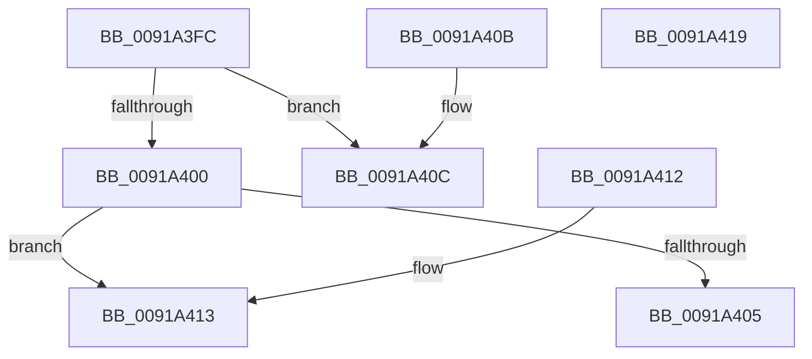

# PspRateControlLimitFlag

- RVA: `0x0091A3FC`–`0x0091A41A` (길이 `30` bytes)
- VA: `0x000000014091A3FC`
- 실행 섹션: `PAGE`
- PDB 이름 있음: `예`; PDB Function 태그: `아니요`
- unwind 정보 RVA: `0x000DB714`
- 디코드: `13`개 명령, `30/30` bytes 표시
- 미해석 바이트: `0` (있으면 어셈블리에 `.byte`로 보존)

> 이 문서는 커널 이미지의 기계어와 PDB 기호를 분석해 생성했습니다. 4번과 5번은 함수 원형과 자료형을 바이너리 사용 방식에서 추정한 C 해석이며 원본 소스 복구 결과는 아닙니다.

## 1. Dependencies

- 직접 호출 지점: **0**; 고유 호출 대상: **0**
- 직접 호출자로 확인된 함수: **3**
- RIP 상대 이미지 참조: **0**

### Outgoing calls
- 직접 디코드된 call 명령이 없습니다.

### Direct callers
- [PspEnforceLimitsJobPostCallback](PspEnforceLimitsJobPostCallback_function_00919720.md) at `0x00919C10`
- [PspEnforceLimitsJobPostCallback](PspEnforceLimitsJobPostCallback_function_00919720.md) at `0x00919C87`
- [NtSetInformationJobObject](../9F/NtSetInformationJobObject_function_009F84C0.md) at `0x009FA534`
- [NtQueryInformationJobObject](../9F/NtQueryInformationJobObject_function_009FB860.md) at `0x009FC5DD`

### Static image references
- 디코드된 RIP-relative 메모리 참조가 없습니다.

## 2. Other-region calls and transfers

- 다른 실행 섹션으로 향하는 call: **0**
- 별도 외부 분기/꼬리 이동을 확인하지 못했습니다.

## 3. Assembly (complete function range)

```asm
0091A3FC  85 C9                           test ecx, ecx
0091A3FE  74 0C                           je 0x14091a40c
0091A400  83 F9 01                        cmp ecx, 1
0091A403  75 0E                           jne 0x14091a413
0091A405  B8 00 00 08 00                  mov eax, 0x80000
0091A40A  C3                              ret
0091A40B  CC                              int3
0091A40C  B8 00 00 10 00                  mov eax, 0x100000
0091A411  C3                              ret
0091A412  CC                              int3
0091A413  B8 00 00 04 00                  mov eax, 0x40000
0091A418  C3                              ret
0091A419  CC                              int3
```

## 4. C-style interpretation (structured pseudocode)

```c
__int64 __fastcall PspRateControlLimitFlag(int a1)
{
    if (a1 == 0) goto loc_0091A40C;
    if (a1 != 1) goto loc_0091A413;
    return (unsigned int)(0x80000ULL);
loc_0091A40C:
    return (unsigned int)(0x100000ULL);
loc_0091A413:
    return (unsigned int)(0x40000ULL);
}
```

## 5. (Beta) C Style

```c
int64_t PspRateControlLimitFlag(int32_t Arg1)
{
    if (Arg1 == 0) goto loc_0091A40C;
    if (Arg1 != 1) goto loc_0091A413;
    return (uint32_t)(0x80000ULL);
loc_0091A40C:
    return (uint32_t)(0x100000ULL);
loc_0091A413:
    return (uint32_t)(0x40000ULL);
}
```

## 6. Execution-region graph

[열기: 2D/3D 그래프와 함수 탐색 컨트롤 패널](../../../control-panel.html?section=page&rva=0x0091A3FC&view=graph)

- 2D 그래프는 위에서 아래로 흐르고, 3D 그래프는 빈 공간을 드래그해 회전합니다. Shift+드래그는 이동, 휠은 확대·축소, 함수 노드 선택은 대상 보고서 이동입니다.

### Static fallback


