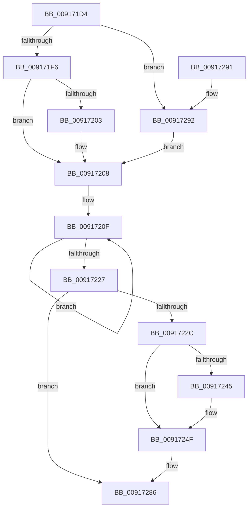

# PspSendReliableJobNotification

- RVA: `0x009171D4`–`0x0091729C` (길이 `200` bytes)
- VA: `0x00000001409171D4`
- 실행 섹션: `PAGE`
- PDB 이름 있음: `예`; PDB Function 태그: `아니요`
- unwind 정보 RVA: `0x0008A9AC`
- 디코드: `50`개 명령, `200/200` bytes 표시
- 미해석 바이트: `0` (있으면 어셈블리에 `.byte`로 보존)

> 이 문서는 커널 이미지의 기계어와 PDB 기호를 분석해 생성했습니다. 4번과 5번은 함수 원형과 자료형을 바이너리 사용 방식에서 추정한 C 해석이며 원본 소스 복구 결과는 아닙니다.

## 1. Dependencies

- 직접 호출 지점: **3**; 고유 호출 대상: **3**
- 직접 호출자로 확인된 함수: **3**
- RIP 상대 이미지 참조: **1**

### Outgoing calls
- `0x00917234` → [ObfReferenceObjectWithTag](../../text/21/ObfReferenceObjectWithTag_function_00210710.md) (function, `0x00210710`)
- `0x0091724A` → [EtwTraceJobSendNotification](EtwTraceJobSendNotification_function_0091713C.md) (function, `0x0091713C`)
- `0x00917279` → [IoSetIoCompletionEx](../../text/24/IoSetIoCompletionEx_function_0024FA80.md) (function, `0x0024FA80`)

### Direct callers
- [PspEvaluateAndNotifyEmptyJob](PspEvaluateAndNotifyEmptyJob_function_00917D88.md) at `0x00917E2C`
- [PspEnforceLimitsJobPostCallback](PspEnforceLimitsJobPostCallback_function_00919720.md) at `0x00919C9B`
- [PspJobNotificationWorker](../A5/PspJobNotificationWorker_function_00A55CB0.md) at `0x00A55DA9`

### Static image references
- `0x00917239` → RVA `0x00FC6B00` (`ALMOSTRO`; read)

## 2. Other-region calls and transfers

- 다른 실행 섹션으로 향하는 call: **2**
  - `0x00917234` → [ObfReferenceObjectWithTag](../../text/21/ObfReferenceObjectWithTag_function_00210710.md) (`PAGE` → `.text`)
  - `0x00917279` → [IoSetIoCompletionEx](../../text/24/IoSetIoCompletionEx_function_0024FA80.md) (`PAGE` → `.text`)
- 별도 외부 분기/꼬리 이동을 확인하지 못했습니다.

## 3. Assembly (complete function range)

```asm
009171D4  48 89 5C 24 08                  mov qword ptr [rsp + 8], rbx
009171D9  57                              push rdi
009171DA  48 83 EC 40                     sub rsp, 0x40
009171DE  8B FA                           mov edi, edx
009171E0  41 BA 08 00 00 00               mov r10d, 8
009171E6  48 8B D9                        mov rbx, rcx
009171E9  45 8D 42 04                     lea r8d, [r10 + 4]
009171ED  83 FA 0B                        cmp edx, 0xb
009171F0  0F 84 9C 00 00 00               je 0x140917292
009171F6  41 3B F8                        cmp edi, r8d
009171F9  BA 08 00 01 00                  mov edx, 0x10008
009171FE  45 8B C2                        mov r8d, r10d
00917201  74 05                           je 0x140917208
00917203  BA 08 80 00 00                  mov edx, 0x8008
00917208  8B 81 10 06 00 00               mov eax, dword ptr [rcx + 0x610]
0091720E  90                              nop
0091720F  44 8B C8                        mov r9d, eax
00917212  8B CA                           mov ecx, edx
00917214  45 23 CA                        and r9d, r10d
00917217  41 0F 44 C8                     cmove ecx, r8d
0091721B  0B C8                           or ecx, eax
0091721D  F0 0F B1 8B 10 06 00 00         lock cmpxchg dword ptr [rbx + 0x610], ecx
00917225  75 E8                           jne 0x14091720f
00917227  45 85 C9                        test r9d, r9d
0091722A  75 5A                           jne 0x140917286
0091722C  BA 50 73 4A 62                  mov edx, 0x624a7350
00917231  48 8B CB                        mov rcx, rbx
00917234  E8 D7 94 8F FF                  call 0x140210710
00917239  F7 05 BD F8 6A 00 00 00 08 00   test dword ptr [rip + 0x6af8bd], 0x80000
00917243  74 0A                           je 0x14091724f
00917245  8B D7                           mov edx, edi
00917247  48 8B CB                        mov rcx, rbx
0091724A  E8 ED FE FF FF                  call 0x14091713c
0091724F  48 8B 83 D0 04 00 00            mov rax, qword ptr [rbx + 0x4d0]
00917256  45 33 C9                        xor r9d, r9d
00917259  48 8B 93 30 02 00 00            mov rdx, qword ptr [rbx + 0x230]
00917260  45 33 C0                        xor r8d, r8d
00917263  48 8B 8B 28 02 00 00            mov rcx, qword ptr [rbx + 0x228]
0091726A  48 89 44 24 30                  mov qword ptr [rsp + 0x30], rax
0091726F  C6 44 24 28 00                  mov byte ptr [rsp + 0x28], 0
00917274  48 89 7C 24 20                  mov qword ptr [rsp + 0x20], rdi
00917279  E8 02 88 93 FF                  call 0x14024fa80
0091727E  F0 48 FF 83 38 02 00 00         lock inc qword ptr [rbx + 0x238]
00917286  48 8B 5C 24 50                  mov rbx, qword ptr [rsp + 0x50]
0091728B  48 83 C4 40                     add rsp, 0x40
0091728F  5F                              pop rdi
00917290  C3                              ret
00917291  CC                              int3
00917292  BA 0C 40 00 00                  mov edx, 0x400c
00917297  E9 6C FF FF FF                  jmp 0x140917208
```

## 4. C-style interpretation (structured pseudocode)

```c
__int64 __fastcall PspSendReliableJobNotification(__int64 a1, int a2)
{
    __int64 result;
    __int64 v_rsp;
    unsigned __int64 v_stack_m18;
    unsigned __int8 v_stack_m20;
    unsigned __int64 v_stack_m28;
    unsigned __int64 v_stack_p8;

    v_stack_p8 = v_rbx;
    v_rsp = (v_rsp) - (64);
    if (a2 == 11) goto loc_00917292;
    if (((unsigned int)((unsigned int)(a2))) != ((unsigned int)(8 + 4))) {
        a2 = 0x8008ULL;
    }
loc_0091720F:
    a4 = (unsigned int)(((unsigned int)((unsigned int)((unsigned int)(*(unsigned int *)(a1 + 1552))))) & (8));
    a1 = (unsigned int)(a2);
    if (condition_is_equal) { a1 = 8; }
    a1 = (unsigned int)((a1) | ((unsigned int)((unsigned int)(*(unsigned int *)(a1 + 1552)))));
    if (condition_is_not_equal) goto loc_0091720F;
    if ((unsigned int)(a4) != 0) goto loc_00917286;
    result = ObfReferenceObjectWithTag(a1, (unsigned int)(0x624A7350ULL), 8, a4);
    if (((*(unsigned int *)(v_rip + 7010493)) & (0x80000ULL)) != 0) {
        a2 = (unsigned int)((unsigned int)(a2));
        a1 = a1;
        result = EtwTraceJobSendNotification(a1, a2, 8, a4);
    }
    a4 = 0;
    a3 = 0;
    v_stack_m18 = *(unsigned __int64 *)(a1 + 1232);
    v_stack_m20 = 0;
    v_stack_m28 = (unsigned int)(a2);
    result = IoSetIoCompletionEx(*(unsigned __int64 *)(a1 + 552), *(unsigned __int64 *)(a1 + 560), a3, a4);
loc_00917286:
    v_rsp = (v_rsp) + (64);
    return result;
loc_00917292:
    goto loc_00917208;
}
```

## 5. (Beta) C Style

```c
int64_t PspSendReliableJobNotification(void *Arg1, int32_t Arg2)
{
    uint8_t *arg1 = (uint8_t *)Arg1;

    int64_t result;
    int64_t local_rsp;
    uint64_t v_stack_m18;
    uint8_t v_stack_m20;
    uint64_t v_stack_m28;
    uint64_t v_stack_p8;

    v_stack_p8 = local_rbx;
    local_rsp = (local_rsp) - (64);
    if (Arg2 == 11) goto loc_00917292;
    if (((uint32_t)((uint32_t)(Arg2))) != ((uint32_t)(8 + 4))) {
        Arg2 = 0x8008ULL;
    }
loc_0091720F:
    a4 = (uint32_t)(((uint32_t)((uint32_t)((uint32_t)(*(uint32_t *)(arg1 + 0x610))))) & (8));
    Arg1 = (uint32_t)(Arg2);
    if (condition_is_equal) { Arg1 = 8; }
    Arg1 = (uint32_t)((Arg1) | ((uint32_t)((uint32_t)(*(uint32_t *)(arg1 + 0x610)))));
    if (condition_is_not_equal) goto loc_0091720F;
    if ((uint32_t)(a4) != 0) goto loc_00917286;
    result = ObfReferenceObjectWithTag(Arg1, (uint32_t)(0x624A7350ULL), 8, a4);
    if (((*(uint32_t *)(v_rip + 0x6AF8BD)) & (0x80000ULL)) != 0) {
        Arg2 = (uint32_t)((uint32_t)(Arg2));
        Arg1 = Arg1;
        result = EtwTraceJobSendNotification(Arg1, Arg2, 8, a4);
    }
    a4 = 0;
    a3 = 0;
    v_stack_m18 = *(uint64_t *)(arg1 + 0x4D0);
    v_stack_m20 = 0;
    v_stack_m28 = (uint32_t)(Arg2);
    result = IoSetIoCompletionEx(*(uint64_t *)(arg1 + 0x228), *(uint64_t *)(arg1 + 0x230), a3, a4);
loc_00917286:
    local_rsp = (local_rsp) + (64);
    return result;
loc_00917292:
    goto loc_00917208;
}
```

### 관측된 메모리 오프셋

구조체 형식이 확인되지 않은 접근은 인자 기준의 오프셋으로만 기록했습니다.

| 기준 인자 | 오프셋 표현 | 폭 (bit) | 접근 |
|---|---:|---:|---|
| `Arg1` | `+ 0x228` | `64` | `R` |
| `Arg1` | `+ 0x230` | `64` | `R` |
| `Arg1` | `+ 0x238` | `64` | `R/W` |
| `Arg1` | `+ 0x4D0` | `64` | `R` |
| `Arg1` | `+ 0x610` | `32` | `R` |

## 6. Execution-region graph

[열기: 2D/3D 그래프와 함수 탐색 컨트롤 패널](../../../control-panel.html?section=page&rva=0x009171D4&view=graph)

- 2D 그래프는 위에서 아래로 흐르고, 3D 그래프는 빈 공간을 드래그해 회전합니다. Shift+드래그는 이동, 휠은 확대·축소, 함수 노드 선택은 대상 보고서 이동입니다.

### Static fallback


