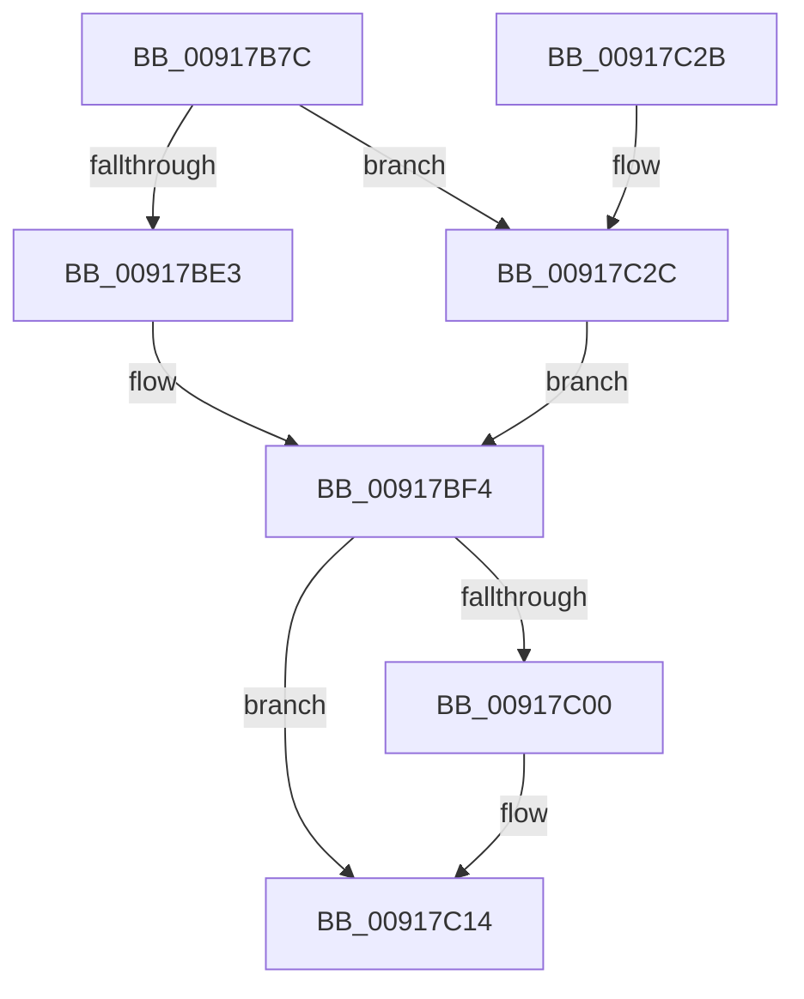

# PspTerminateAllProcessesInJobHierarchy

- RVA: `0x00917B7C`–`0x00917C31` (길이 `181` bytes)
- VA: `0x0000000140917B7C`
- 실행 섹션: `PAGE`
- PDB 이름 있음: `예`; PDB Function 태그: `아니요`
- unwind 정보 RVA: `0x0008AAB8`
- 디코드: `49`개 명령, `181/181` bytes 표시
- 미해석 바이트: `0` (있으면 어셈블리에 `.byte`로 보존)

> 이 문서는 커널 이미지의 기계어와 PDB 기호를 분석해 생성했습니다. 4번과 5번은 함수 원형과 자료형을 바이너리 사용 방식에서 추정한 C 해석이며 원본 소스 복구 결과는 아닙니다.

## 1. Dependencies

- 직접 호출 지점: **3**; 고유 호출 대상: **3**
- 직접 호출자로 확인된 함수: **4**
- RIP 상대 이미지 참조: **2**

### Outgoing calls
- `0x00917BD6` → [PspEnumJobsAndProcessesInJobHierarchy](PspEnumJobsAndProcessesInJobHierarchy_function_0091A1EC.md) (function, `0x0091A1EC`)
- `0x00917BEB` → [PspEvaluateAndNotifyEmptyJob](PspEvaluateAndNotifyEmptyJob_function_00917D88.md) (function, `0x00917D88`)
- `0x00917C0F` → [EtwTraceJob](EtwTraceJob_function_00917C38.md) (function, `0x00917C38`)

### Direct callers
- [PsTerminateServerSilo](../77/PsTerminateServerSilo_function_0077F620.md) at `0x0077F635`
- [PspJobClose](PspJobClose_function_00916FE0.md) at `0x00917059`
- [NtTerminateJobObject](NtTerminateJobObject_function_009172B0.md) at `0x00917301`
- [sub_00B21AB8](../B2/Unknown_function_00B21AB8.md) at `0x00B21B44`
- [sub_00B21AB8](../B2/Unknown_function_00B21AB8.md) at `0x00B21B58`

### Static image references
- `0x00917BC2` → RVA `0x00917430` (`PspTerminateProcessesJobCallback`; read)
- `0x00917BF4` → RVA `0x00FC6B00` (`ALMOSTRO`; read)

## 2. Other-region calls and transfers

- 다른 실행 섹션으로 향하는 call: **0**
- 별도 외부 분기/꼬리 이동을 확인하지 못했습니다.

## 3. Assembly (complete function range)

```asm
00917B7C  4C 8B DC                        mov r11, rsp
00917B7F  49 89 5B 10                     mov qword ptr [r11 + 0x10], rbx
00917B83  49 89 6B 18                     mov qword ptr [r11 + 0x18], rbp
00917B87  49 89 73 20                     mov qword ptr [r11 + 0x20], rsi
00917B8B  57                              push rdi
00917B8C  48 83 EC 30                     sub rsp, 0x30
00917B90  33 DB                           xor ebx, ebx
00917B92  8B F2                           mov esi, edx
00917B94  49 89 5B 08                     mov qword ptr [r11 + 8], rbx
00917B98  48 8B F9                        mov rdi, rcx
00917B9B  F0 81 89 10 06 00 00 80 00 00 00  lock or dword ptr [rcx + 0x610], 0x80
00917BA6  45 84 C0                        test r8b, r8b
00917BA9  0F B6 C3                        movzx eax, bl
00917BAC  89 54 24 40                     mov dword ptr [rsp + 0x40], edx
00917BB0  8D 6B 01                        lea ebp, [rbx + 1]
00917BB3  0F 45 C5                        cmovne eax, ebp
00917BB6  C7 44 24 28 02 00 00 00         mov dword ptr [rsp + 0x28], 2
00917BBE  88 44 24 44                     mov byte ptr [rsp + 0x44], al
00917BC2  4C 8D 05 67 F8 FF FF            lea r8, [rip - 0x799]
00917BC9  49 8D 43 08                     lea rax, [r11 + 8]
00917BCD  45 33 C9                        xor r9d, r9d
00917BD0  33 D2                           xor edx, edx
00917BD2  49 89 43 E8                     mov qword ptr [r11 - 0x18], rax
00917BD6  E8 11 26 00 00                  call 0x14091a1ec
00917BDB  8A 44 24 44                     mov al, byte ptr [rsp + 0x44]
00917BDF  A8 02                           test al, 2
00917BE1  75 49                           jne 0x140917c2c
00917BE3  45 33 C0                        xor r8d, r8d
00917BE6  33 D2                           xor edx, edx
00917BE8  48 8B CF                        mov rcx, rdi
00917BEB  E8 98 01 00 00                  call 0x140917d88
00917BF0  8A 44 24 44                     mov al, byte ptr [rsp + 0x44]
00917BF4  F7 05 02 EF 6A 00 00 00 08 00   test dword ptr [rip + 0x6aef02], 0x80000
00917BFE  74 14                           je 0x140917c14
00917C00  41 B9 21 07 00 00               mov r9d, 0x721
00917C06  0F B6 D0                        movzx edx, al
00917C09  44 8B C6                        mov r8d, esi
00917C0C  48 8B CF                        mov rcx, rdi
00917C0F  E8 24 00 00 00                  call 0x140917c38
00917C14  48 8B 6C 24 50                  mov rbp, qword ptr [rsp + 0x50]
00917C19  8A C3                           mov al, bl
00917C1B  48 8B 5C 24 48                  mov rbx, qword ptr [rsp + 0x48]
00917C20  48 8B 74 24 58                  mov rsi, qword ptr [rsp + 0x58]
00917C25  48 83 C4 30                     add rsp, 0x30
00917C29  5F                              pop rdi
00917C2A  C3                              ret
00917C2B  CC                              int3
00917C2C  40 8A DD                        mov bl, bpl
00917C2F  EB C3                           jmp 0x140917bf4
```

## 4. C-style interpretation (structured pseudocode)

```c
__int64 __fastcall PspTerminateAllProcessesInJobHierarchy(__int64 a1, int a2, unsigned __int8 a3, int a4)
{
    __int64 result;
    __int64 v_rbx;
    __int64 v_rsp;
    unsigned int v_stack_m10;
    unsigned __int64 v_stack_p10;
    unsigned __int64 v_stack_p18;
    unsigned __int64 v_stack_p20;
    unsigned int v_stack_p8;
    unsigned __int8 v_stack_pC;

    *(unsigned __int64 *)(v_rsp + 16) = v_rbx;
    *(unsigned __int64 *)(v_rsp + 24) = v_rbp;
    *(unsigned __int64 *)(v_rsp + 32) = v_rsi;
    v_rsp = (v_rsp) - (48);
    v_rbx = 0;
    *(unsigned __int64 *)(v_rsp + 8) = 0;
    v_stack_p8 = a2;
    result = 0;
    if (a3 != 0) { result = (unsigned int)(v_rbx + 1); }
    v_stack_m10 = 2;
    v_stack_pC = (unsigned __int8)(result);
    a4 = 0;
    a2 = 0;
    *(unsigned __int64 *)(v_rsp - 24) = v_rsp + 8;
    result = PspEnumJobsAndProcessesInJobHierarchy(a1, a2, v_rip - 1945, a4);
    if ((((unsigned __int8)(v_stack_pC)) & (2)) != 0) goto loc_00917C2C;
    a3 = 0;
    a2 = 0;
    result = PspEvaluateAndNotifyEmptyJob(a1, a2, a3, a4);
loc_00917BF4:
    result = v_stack_pC;
    if (((*(unsigned int *)(v_rip + 7008002)) & (0x80000ULL)) != 0) {
        a4 = 0x721ULL;
        a2 = (unsigned __int8)(v_stack_pC);
        a3 = (unsigned int)((unsigned int)(a2));
        a1 = a1;
        result = EtwTraceJob(a1, a2, a3, a4);
    }
    v_rsp = (v_rsp) + (48);
    return 0;
loc_00917C2C:
    goto loc_00917BF4;
}
```

## 5. (Beta) C Style

```c
int64_t PspTerminateAllProcessesInJobHierarchy(void *Arg1, int32_t Arg2, uint8_t Arg3, int32_t Arg4)
{
    uint8_t *arg1 = (uint8_t *)Arg1;

    int64_t result;
    int64_t local_rbx;
    int64_t local_rsp;
    uint32_t v_stack_m10;
    uint64_t v_stack_p10;
    uint64_t v_stack_p18;
    uint64_t v_stack_p20;
    uint32_t v_stack_p8;
    uint8_t v_stack_pC;

    *(uint64_t *)(local_rsp + 0x10) = local_rbx;
    *(uint64_t *)(local_rsp + 0x18) = local_rbp;
    *(uint64_t *)(local_rsp + 0x20) = local_rsi;
    local_rsp = (local_rsp) - (48);
    local_rbx = 0;
    *(uint64_t *)(local_rsp + 0x8) = 0;
    v_stack_p8 = Arg2;
    result = 0;
    if (Arg3 != 0) { result = (uint32_t)(local_rbx + 1); }
    v_stack_m10 = 2;
    v_stack_pC = (uint8_t)(result);
    Arg4 = 0;
    Arg2 = 0;
    *(uint64_t *)(local_rsp - 0x18) = local_rsp + 8;
    result = PspEnumJobsAndProcessesInJobHierarchy(Arg1, Arg2, v_rip - 1945, Arg4);
    if ((((uint8_t)(v_stack_pC)) & (2)) != 0) goto loc_00917C2C;
    Arg3 = 0;
    Arg2 = 0;
    result = PspEvaluateAndNotifyEmptyJob(Arg1, Arg2, Arg3, Arg4);
loc_00917BF4:
    result = v_stack_pC;
    if (((*(uint32_t *)(v_rip + 0x6AEF02)) & (0x80000ULL)) != 0) {
        Arg4 = 0x721ULL;
        Arg2 = (uint8_t)(v_stack_pC);
        Arg3 = (uint32_t)((uint32_t)(Arg2));
        Arg1 = Arg1;
        result = EtwTraceJob(Arg1, Arg2, Arg3, Arg4);
    }
    local_rsp = (local_rsp) + (48);
    return 0;
loc_00917C2C:
    goto loc_00917BF4;
}
```

### 관측된 메모리 오프셋

구조체 형식이 확인되지 않은 접근은 인자 기준의 오프셋으로만 기록했습니다.

| 기준 인자 | 오프셋 표현 | 폭 (bit) | 접근 |
|---|---:|---:|---|
| `Arg1` | `+ 0x610` | `32` | `R/W` |

## 6. Execution-region graph

[열기: 2D/3D 그래프와 함수 탐색 컨트롤 패널](../../../control-panel.html?section=page&rva=0x00917B7C&view=graph)

- 2D 그래프는 위에서 아래로 흐르고, 3D 그래프는 빈 공간을 드래그해 회전합니다. Shift+드래그는 이동, 휠은 확대·축소, 함수 노드 선택은 대상 보고서 이동입니다.

### Static fallback


