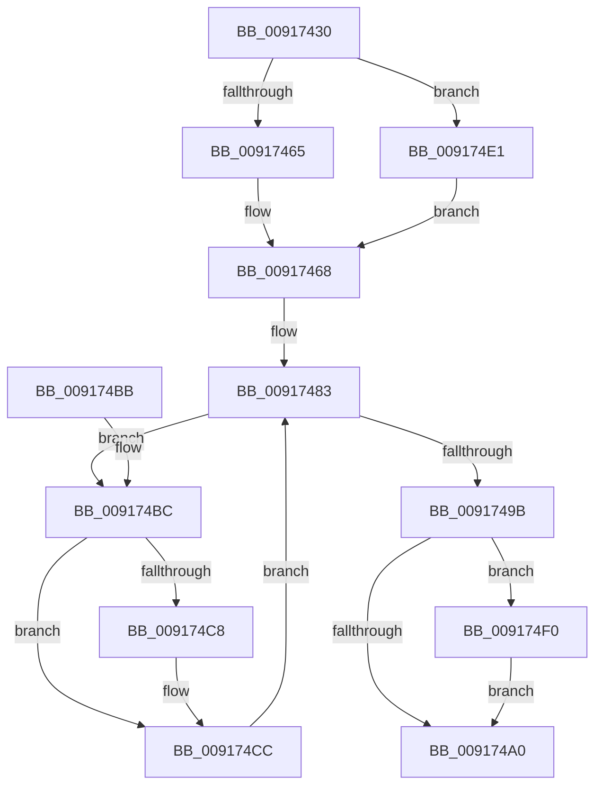

# PspTerminateProcessesJobCallback

- RVA: `0x00917430`–`0x009174FA` (길이 `202` bytes)
- VA: `0x0000000140917430`
- 실행 섹션: `PAGE`
- PDB 이름 있음: `예`; PDB Function 태그: `아니요`
- unwind 정보 RVA: `0x0008AA18`
- 디코드: `59`개 명령, `202/202` bytes 표시
- 미해석 바이트: `0` (있으면 어셈블리에 `.byte`로 보존)

> 이 문서는 커널 이미지의 기계어와 PDB 기호를 분석해 생성했습니다. 4번과 5번은 함수 원형과 자료형을 바이너리 사용 방식에서 추정한 C 해석이며 원본 소스 복구 결과는 아닙니다.

## 1. Dependencies

- 직접 호출 지점: **5**; 고유 호출 대상: **5**
- 직접 호출자로 확인된 함수: **0**
- RIP 상대 이미지 참조: **0**

### Outgoing calls
- `0x0091745C` → [PsIsServerSilo](../../text/22/PsIsServerSilo_function_00225828.md) (function, `0x00225828`)
- `0x0091748E` → [PspGetNextJobProcess](PspGetNextJobProcess_function_00918450.md) (function, `0x00918450`)
- `0x009174D7` → [PspRemoveProcessFromJobChain](../90/PspRemoveProcessFromJobChain_function_00907288.md) (function, `0x00907288`)
- `0x009174E3` → [PspBeginServerSiloShutdown](../AD/PspBeginServerSiloShutdown_function_00AD2B7C.md) (function, `0x00AD2B7C`)
- `0x009174F3` → [PspCompleteServerSiloShutdown](../77/PspCompleteServerSiloShutdown_function_0077F808.md) (function, `0x0077F808`)

### Direct callers
- 이 함수 시작 RVA로 연결되는 직접 call은 확인되지 않았습니다. 간접 호출은 완전히 역산할 수 없습니다.

### Static image references
- 디코드된 RIP-relative 메모리 참조가 없습니다.

## 2. Other-region calls and transfers

- 다른 실행 섹션으로 향하는 call: **1**
  - `0x0091745C` → [PsIsServerSilo](../../text/22/PsIsServerSilo_function_00225828.md) (`PAGE` → `.text`)
- 별도 외부 분기/꼬리 이동을 확인하지 못했습니다.

## 3. Assembly (complete function range)

```asm
00917430  4C 8B DC                        mov r11, rsp
00917433  49 89 5B 08                     mov qword ptr [r11 + 8], rbx
00917437  49 89 6B 10                     mov qword ptr [r11 + 0x10], rbp
0091743B  49 89 73 18                     mov qword ptr [r11 + 0x18], rsi
0091743F  57                              push rdi
00917440  41 56                           push r14
00917442  41 57                           push r15
00917444  48 83 EC 40                     sub rsp, 0x40
00917448  33 C0                           xor eax, eax
0091744A  0F 57 C0                        xorps xmm0, xmm0
0091744D  0F 11 44 24 20                  movups xmmword ptr [rsp + 0x20], xmm0
00917452  49 89 43 D8                     mov qword ptr [r11 - 0x28], rax
00917456  48 8B FA                        mov rdi, rdx
00917459  48 8B D9                        mov rbx, rcx
0091745C  E8 C7 E3 90 FF                  call 0x140225828
00917461  84 C0                           test al, al
00917463  75 7C                           jne 0x1409174e1
00917465  40 32 F6                        xor sil, sil
00917468  0F B6 47 04                     movzx eax, byte ptr [rdi + 4]
0091746C  65 4C 8B 34 25 88 01 00 00      mov r14, qword ptr gs:[0x188]
00917475  83 E0 01                        and eax, 1
00917478  45 33 C9                        xor r9d, r9d
0091747B  44 8D 3C C5 06 00 00 00         lea r15d, [rax*8 + 6]
00917483  4C 8D 44 24 20                  lea r8, [rsp + 0x20]
00917488  49 8B D6                        mov rdx, r14
0091748B  48 8B CB                        mov rcx, rbx
0091748E  E8 BD 0F 00 00                  call 0x140918450
00917493  48 8B E8                        mov rbp, rax
00917496  48 85 C0                        test rax, rax
00917499  75 21                           jne 0x1409174bc
0091749B  40 84 F6                        test sil, sil
0091749E  75 50                           jne 0x1409174f0
009174A0  48 8B 5C 24 60                  mov rbx, qword ptr [rsp + 0x60]
009174A5  33 C0                           xor eax, eax
009174A7  48 8B 6C 24 68                  mov rbp, qword ptr [rsp + 0x68]
009174AC  48 8B 74 24 70                  mov rsi, qword ptr [rsp + 0x70]
009174B1  48 83 C4 40                     add rsp, 0x40
009174B5  41 5F                           pop r15
009174B7  41 5E                           pop r14
009174B9  5F                              pop rdi
009174BA  C3                              ret
009174BB  CC                              int3
009174BC  F7 85 F0 01 00 00 00 08 00 00   test dword ptr [rbp + 0x1f0], 0x800
009174C6  75 04                           jne 0x1409174cc
009174C8  80 4F 04 02                     or byte ptr [rdi + 4], 2
009174CC  44 8B 0F                        mov r9d, dword ptr [rdi]
009174CF  45 8B C7                        mov r8d, r15d
009174D2  33 D2                           xor edx, edx
009174D4  48 8B CD                        mov rcx, rbp
009174D7  E8 AC FD FE FF                  call 0x140907288
009174DC  4C 8B CD                        mov r9, rbp
009174DF  EB A2                           jmp 0x140917483
009174E1  8B 12                           mov edx, dword ptr [rdx]
009174E3  E8 94 B6 1B 00                  call 0x140ad2b7c
009174E8  40 8A F0                        mov sil, al
009174EB  E9 78 FF FF FF                  jmp 0x140917468
009174F0  48 8B CB                        mov rcx, rbx
009174F3  E8 10 83 E6 FF                  call 0x14077f808
009174F8  EB A6                           jmp 0x1409174a0
```

## 4. C-style interpretation (structured pseudocode)

```c
__int64 __fastcall PspTerminateProcessesJobCallback(__int64 a1, __int64 a2, __int64 a3, int a4)
{
    __int64 result;
    __int64 v_rsi;
    __int64 v_rsp;
    unsigned __int64 v_stack_m38;
    unsigned __int64 v_stack_p10;
    unsigned __int64 v_stack_p18;
    unsigned __int64 v_stack_p8;

    *(unsigned __int64 *)(v_rsp + 8) = v_rbx;
    *(unsigned __int64 *)(v_rsp + 16) = v_rbp;
    *(unsigned __int64 *)(v_rsp + 24) = v_rsi;
    v_rsp = (v_rsp) - (64);
    result = 0;
    v_stack_m38 = v_xmm0;
    *(unsigned __int64 *)(v_rsp - 40) = 0;
    result = PsIsServerSilo(a1, a2, a3, a4);
    if ((unsigned __int8)(result) != 0) goto loc_009174E1;
    v_rsi = 0;
loc_00917468:
    result = (unsigned int)((*(unsigned __int8 *)(a2 + 4)) & (1));
    a4 = 0;
loc_00917483:
    result = PspGetNextJobProcess(a1, *(unsigned __int64 *)(gs_base + (0 + 392)), v_stack_m38, a4);
    if (result != 0) goto loc_009174BC;
    if (0 != 0) goto loc_009174F0;
loc_009174A0:
    result = 0;
    v_rsp = (v_rsp) + (64);
    return result;
loc_009174BC:
    if (((*(unsigned int *)(v_stack_p10 + 496)) & (0x800ULL)) == 0) {
    }
    a2 = 0;
    result = PspRemoveProcessFromJobChain(v_stack_p10, a2, (unsigned int)((unsigned int)(result * 8 + 6)), (unsigned int)(*(unsigned int *)(a2)));
    goto loc_00917483;
loc_009174E1:
    result = PspBeginServerSiloShutdown(v_stack_p10, (unsigned int)(*(unsigned int *)(a2)), (unsigned int)((unsigned int)(result * 8 + 6)), v_stack_p10);
    goto loc_00917468;
loc_009174F0:
    result = PspCompleteServerSiloShutdown(v_stack_p8, (unsigned int)(*(unsigned int *)(a2)), (unsigned int)((unsigned int)(result * 8 + 6)), v_stack_p10);
    goto loc_009174A0;
}
```

## 5. (Beta) C Style

```c
int64_t PspTerminateProcessesJobCallback(int64_t Arg1, void *Arg2, int64_t Arg3, int32_t Arg4)
{
    uint8_t *arg2 = (uint8_t *)Arg2;

    int64_t result;
    int64_t local_rsi;
    int64_t local_rsp;
    uint64_t v_stack_m38;
    uint64_t v_stack_p10;
    uint64_t v_stack_p18;
    uint64_t v_stack_p8;

    *(uint64_t *)(local_rsp + 0x8) = local_rbx;
    *(uint64_t *)(local_rsp + 0x10) = local_rbp;
    *(uint64_t *)(local_rsp + 0x18) = local_rsi;
    local_rsp = (local_rsp) - (64);
    result = 0;
    v_stack_m38 = v_xmm0;
    *(uint64_t *)(local_rsp - 0x28) = 0;
    result = PsIsServerSilo(Arg1, Arg2, Arg3, Arg4);
    if ((uint8_t)(result) != 0) goto loc_009174E1;
    local_rsi = 0;
loc_00917468:
    result = (uint32_t)((*(uint8_t *)(arg2 + 0x4)) & (1));
    Arg4 = 0;
loc_00917483:
    result = PspGetNextJobProcess(Arg1, *(uint64_t *)(gs_base + (0 + 0x188)), v_stack_m38, Arg4);
    if (result != 0) goto loc_009174BC;
    if (0 != 0) goto loc_009174F0;
loc_009174A0:
    result = 0;
    local_rsp = (local_rsp) + (64);
    return result;
loc_009174BC:
    if (((*(uint32_t *)(v_stack_p10 + 0x1F0)) & (0x800ULL)) == 0) {
    }
    Arg2 = 0;
    result = PspRemoveProcessFromJobChain(v_stack_p10, Arg2, (uint32_t)((uint32_t)(result * 8 + 6)), (uint32_t)(*(uint32_t *)(arg2)));
    goto loc_00917483;
loc_009174E1:
    result = PspBeginServerSiloShutdown(v_stack_p10, (uint32_t)(*(uint32_t *)(arg2)), (uint32_t)((uint32_t)(result * 8 + 6)), v_stack_p10);
    goto loc_00917468;
loc_009174F0:
    result = PspCompleteServerSiloShutdown(v_stack_p8, (uint32_t)(*(uint32_t *)(arg2)), (uint32_t)((uint32_t)(result * 8 + 6)), v_stack_p10);
    goto loc_009174A0;
}
```

### 관측된 메모리 오프셋

구조체 형식이 확인되지 않은 접근은 인자 기준의 오프셋으로만 기록했습니다.

| 기준 인자 | 오프셋 표현 | 폭 (bit) | 접근 |
|---|---:|---:|---|
| `Arg2` | `+ 0x0` | `32` | `R` |
| `Arg2` | `+ 0x4` | `8` | `R` |
| `Arg2` | `+ 0x4` | `8` | `R/W` |

## 6. Execution-region graph

[열기: 2D/3D 그래프와 함수 탐색 컨트롤 패널](../../../control-panel.html?section=page&rva=0x00917430&view=graph)

- 2D 그래프는 위에서 아래로 흐르고, 3D 그래프는 빈 공간을 드래그해 회전합니다. Shift+드래그는 이동, 휠은 확대·축소, 함수 노드 선택은 대상 보고서 이동입니다.

### Static fallback


