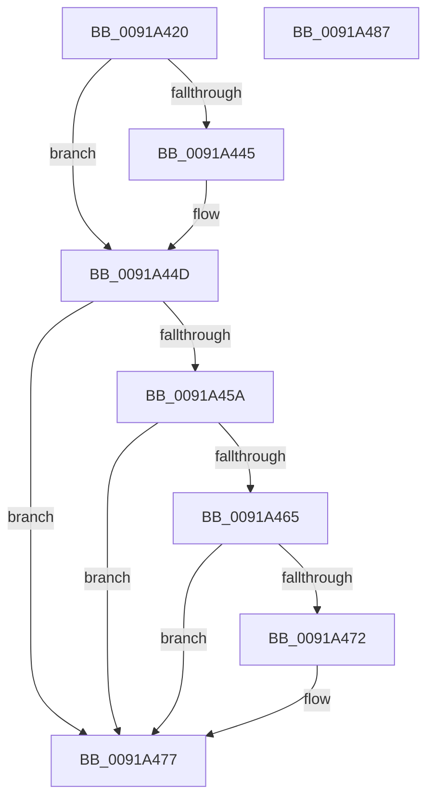

# PspUnlockJobMemoryLimitsShared

- RVA: `0x0091A420`–`0x0091A488` (길이 `104` bytes)
- VA: `0x000000014091A420`
- 실행 섹션: `PAGE`
- PDB 이름 있음: `예`; PDB Function 태그: `아니요`
- unwind 정보 RVA: `0x0005FD94`
- 디코드: `30`개 명령, `104/104` bytes 표시
- 미해석 바이트: `0` (있으면 어셈블리에 `.byte`로 보존)

> 이 문서는 커널 이미지의 기계어와 PDB 기호를 분석해 생성했습니다. 4번과 5번은 함수 원형과 자료형을 바이너리 사용 방식에서 추정한 C 해석이며 원본 소스 복구 결과는 아닙니다.

## 1. Dependencies

- 직접 호출 지점: **3**; 고유 호출 대상: **3**
- 직접 호출자로 확인된 함수: **4**
- RIP 상대 이미지 참조: **0**

### Outgoing calls
- `0x0091A448` → [ExfReleasePushLockShared](../../text/26/ExfReleasePushLockShared_function_00263440.md) (function, `0x00263440`)
- `0x0091A450` → [KeAbPostRelease](../../text/2E/KeAbPostRelease_function_002E1600.md) (function, `0x002E1600`)
- `0x0091A472` → [KiCheckForKernelApcDelivery](../../text/2E/KiCheckForKernelApcDelivery_function_002E2C80.md) (function, `0x002E2C80`)

### Direct callers
- [PsReportProcessMemoryLimitViolation](../78/PsReportProcessMemoryLimitViolation_function_00784A5C.md) at `0x00784AEC`
- [PspEnforceLimitsJobPostCallback](PspEnforceLimitsJobPostCallback_function_00919720.md) at `0x00919B0E`
- [NtQueryInformationJobObject](../9F/NtQueryInformationJobObject_function_009FB860.md) at `0x009FC072`
- [PspApplyJobLimitsToProcess](../A5/PspApplyJobLimitsToProcess_function_00A57274.md) at `0x00A572F4`

### Static image references
- 디코드된 RIP-relative 메모리 참조가 없습니다.

## 2. Other-region calls and transfers

- 다른 실행 섹션으로 향하는 call: **3**
  - `0x0091A448` → [ExfReleasePushLockShared](../../text/26/ExfReleasePushLockShared_function_00263440.md) (`PAGE` → `.text`)
  - `0x0091A450` → [KeAbPostRelease](../../text/2E/KeAbPostRelease_function_002E1600.md) (`PAGE` → `.text`)
  - `0x0091A472` → [KiCheckForKernelApcDelivery](../../text/2E/KiCheckForKernelApcDelivery_function_002E2C80.md) (`PAGE` → `.text`)
- 별도 외부 분기/꼬리 이동을 확인하지 못했습니다.

## 3. Assembly (complete function range)

```asm
0091A420  48 89 5C 24 10                  mov qword ptr [rsp + 0x10], rbx
0091A425  48 89 74 24 18                  mov qword ptr [rsp + 0x18], rsi
0091A42A  57                              push rdi
0091A42B  48 83 EC 20                     sub rsp, 0x20
0091A42F  33 F6                           xor esi, esi
0091A431  48 8D B9 F0 04 00 00            lea rdi, [rcx + 0x4f0]
0091A438  48 8B DA                        mov rbx, rdx
0091A43B  8D 46 11                        lea eax, [rsi + 0x11]
0091A43E  F0 48 0F B1 37                  lock cmpxchg qword ptr [rdi], rsi
0091A443  74 08                           je 0x14091a44d
0091A445  48 8B CF                        mov rcx, rdi
0091A448  E8 F3 8F 94 FF                  call 0x140263440
0091A44D  48 8B CF                        mov rcx, rdi
0091A450  E8 AB 71 9C FF                  call 0x1402e1600
0091A455  48 85 DB                        test rbx, rbx
0091A458  74 1D                           je 0x14091a477
0091A45A  90                              nop
0091A45B  66 83 83 E6 01 00 00 01         add word ptr [rbx + 0x1e6], 1
0091A463  75 12                           jne 0x14091a477
0091A465  48 8D 83 98 00 00 00            lea rax, [rbx + 0x98]
0091A46C  90                              nop
0091A46D  48 39 00                        cmp qword ptr [rax], rax
0091A470  74 05                           je 0x14091a477
0091A472  E8 09 88 9C FF                  call 0x1402e2c80
0091A477  48 8B 5C 24 38                  mov rbx, qword ptr [rsp + 0x38]
0091A47C  48 8B 74 24 40                  mov rsi, qword ptr [rsp + 0x40]
0091A481  48 83 C4 20                     add rsp, 0x20
0091A485  5F                              pop rdi
0091A486  C3                              ret
0091A487  CC                              int3
```

## 4. C-style interpretation (structured pseudocode)

```c
__int64 __fastcall PspUnlockJobMemoryLimitsShared(__int64 a1, __int64 a2)
{
    __int64 result;
    __int64 v_rsi;
    __int64 v_rsp;
    unsigned __int64 v_stack_p10;
    unsigned __int64 v_stack_p18;

    v_stack_p10 = v_rbx;
    v_stack_p18 = v_rsi;
    v_rsp = (v_rsp) - (32);
    v_rsi = 0;
    result = v_rsi + 17;
    if (!(condition_is_equal)) {
        a1 = a1 + 1264;
        result = ExfReleasePushLockShared(a1, a2, a3, a4);
    }
    result = KeAbPostRelease(a1 + 1264, a2, a3, a4);
    if (a2 == 0) goto loc_0091A477;
    if (a2 != 0) goto loc_0091A477;
    result = a2 + 152;
    if ((*(unsigned __int64 *)(a2 + 152)) != (a2 + 152)) {
        result = KiCheckForKernelApcDelivery(a1 + 1264, a2, a3, a4);
    }
    v_rsp = (v_rsp) + (32);
    return result;
}
```

## 5. (Beta) C Style

```c
int64_t PspUnlockJobMemoryLimitsShared(void *Arg1, int64_t Arg2)
{
    uint8_t *arg1 = (uint8_t *)Arg1;

    int64_t result;
    int64_t local_rsi;
    int64_t local_rsp;
    uint64_t v_stack_p10;
    uint64_t v_stack_p18;

    v_stack_p10 = local_rbx;
    v_stack_p18 = local_rsi;
    local_rsp = (local_rsp) - (32);
    local_rsi = 0;
    result = local_rsi + 17;
    if (!(condition_is_equal)) {
        Arg1 = Arg1 + 1264;
        result = ExfReleasePushLockShared(Arg1, Arg2, a3, a4);
    }
    result = KeAbPostRelease(Arg1 + 1264, Arg2, a3, a4);
    if (Arg2 == 0) goto loc_0091A477;
    if (Arg2 != 0) goto loc_0091A477;
    result = Arg2 + 152;
    if ((*(uint64_t *)(Arg2 + 0x98)) != (Arg2 + 152)) {
        result = KiCheckForKernelApcDelivery(Arg1 + 1264, Arg2, a3, a4);
    }
    local_rsp = (local_rsp) + (32);
    return result;
}
```

### 관측된 메모리 오프셋

구조체 형식이 확인되지 않은 접근은 인자 기준의 오프셋으로만 기록했습니다.

| 기준 인자 | 오프셋 표현 | 폭 (bit) | 접근 |
|---|---:|---:|---|
| `Arg1` | `+ 0x0` | `64` | `R` |
| `Arg1` | `+ 0x4F0` | `64` | `R` |

## 6. Execution-region graph

[열기: 2D/3D 그래프와 함수 탐색 컨트롤 패널](../../../control-panel.html?section=page&rva=0x0091A420&view=graph)

- 2D 그래프는 위에서 아래로 흐르고, 3D 그래프는 빈 공간을 드래그해 회전합니다. Shift+드래그는 이동, 휠은 확대·축소, 함수 노드 선택은 대상 보고서 이동입니다.

### Static fallback


