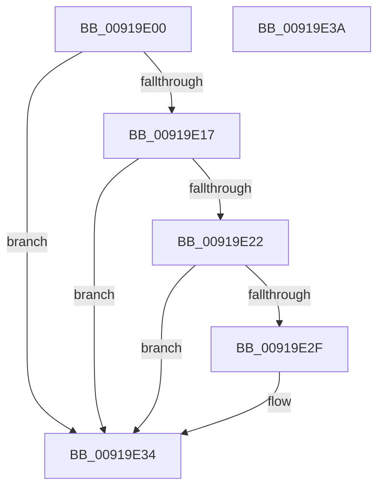

# PspUnlockJob

- RVA: `0x00919E00`–`0x00919E3B` (길이 `59` bytes)
- VA: `0x0000000140919E00`
- 실행 섹션: `PAGE`
- PDB 이름 있음: `예`; PDB Function 태그: `아니요`
- unwind 정보 RVA: `0x0005CF00`
- 디코드: `19`개 명령, `59/59` bytes 표시
- 미해석 바이트: `0` (있으면 어셈블리에 `.byte`로 보존)

> 이 문서는 커널 이미지의 기계어와 PDB 기호를 분석해 생성했습니다. 4번과 5번은 함수 원형과 자료형을 바이너리 사용 방식에서 추정한 C 해석이며 원본 소스 복구 결과는 아닙니다.

## 1. Dependencies

- 직접 호출 지점: **2**; 고유 호출 대상: **2**
- 직접 호출자로 확인된 함수: **25**
- RIP 상대 이미지 참조: **0**

### Outgoing calls
- `0x00919E0D` → [ExReleaseResourceLite](../../text/25/ExReleaseResourceLite_function_0025FA10.md) (function, `0x0025FA10`)
- `0x00919E2F` → [KiCheckForKernelApcDelivery](../../text/2E/KiCheckForKernelApcDelivery_function_002E2C80.md) (function, `0x002E2C80`)

### Direct callers
- [PspJobDelete](../../text/4B/PspJobDelete_function_004BF8F0.md) at `0x004BF9E7`
- [PspJobDelete](../../text/4B/PspJobDelete_function_004BF8F0.md) at `0x004BFA3C`
- [PspCompleteServerSiloShutdownDeferred](../77/PspCompleteServerSiloShutdownDeferred_function_0077F860.md) at `0x0077F987`
- [PspConvertSiloToServerSilo](../77/PspConvertSiloToServerSilo_function_0077F9B4.md) at `0x0077FAFB`
- [PspQueryJobHierarchyInterferenceCount](../78/PspQueryJobHierarchyInterferenceCount_function_00785110.md) at `0x0078517F`
- [PspQuitNextJobProcess](../78/PspQuitNextJobProcess_function_00785298.md) at `0x007852DC`
- [PspSetNetRateControl](../78/PspSetNetRateControl_function_00785944.md) at `0x00785BDA`
- [PspRemoveProcessFromJobChain](../90/PspRemoveProcessFromJobChain_function_00907288.md) at `0x009074F3`
- [PspRemoveProcessFromJobChain](../90/PspRemoveProcessFromJobChain_function_00907288.md) at `0x00907552`
- [PspJobClose](PspJobClose_function_00916FE0.md) at `0x0091704C`
- [PspJobClose](PspJobClose_function_00916FE0.md) at `0x009170B2`
- [PspEvaluateAndNotifyEmptyJob](PspEvaluateAndNotifyEmptyJob_function_00917D88.md) at `0x00917DCD`
- [PspAllocateAndQueryNotificationChannel](PspAllocateAndQueryNotificationChannel_function_00917EE4.md) at `0x00917FEB`
- [PspGetNextJobProcess](PspGetNextJobProcess_function_00918450.md) at `0x009184B7`
- [PspQueryJobHierarchyProcessIdList](PspQueryJobHierarchyProcessIdList_function_0091854C.md) at `0x0091861B`
- [PspQueryJobHierarchyAccountingInformation](PspQueryJobHierarchyAccountingInformation_function_0091864C.md) at `0x0091893E`
- [PspEnforceLimitsJobPostCallback](PspEnforceLimitsJobPostCallback_function_00919720.md) at `0x00919A88`
- [PspEnforceLimitsJobPostCallback](PspEnforceLimitsJobPostCallback_function_00919720.md) at `0x00919C53`
- [PsInsertPermanentSiloContextEx](../9E/PsInsertPermanentSiloContextEx_function_009E8224.md) at `0x009E82FA`
- [PspSetJobIoRateControl](../9F/PspSetJobIoRateControl_function_009F78EC.md) at `0x009F7A19`
- [PspSetJobIoRateControl](../9F/PspSetJobIoRateControl_function_009F78EC.md) at `0x009F7B4B`
- [NtSetInformationJobObject](../9F/NtSetInformationJobObject_function_009F84C0.md) at `0x009FAB8C`
- [NtSetInformationJobObject](../9F/NtSetInformationJobObject_function_009F84C0.md) at `0x009FABDD`
- [NtQueryInformationJobObject](../9F/NtQueryInformationJobObject_function_009FB860.md) at `0x009FBE6D`
- [NtQueryInformationJobObject](../9F/NtQueryInformationJobObject_function_009FB860.md) at `0x009FC1E2`
- [NtQueryInformationJobObject](../9F/NtQueryInformationJobObject_function_009FB860.md) at `0x009FC29F`
- [NtQueryInformationJobObject](../9F/NtQueryInformationJobObject_function_009FB860.md) at `0x009FC3A5`
- [PspSendProcessNotificationToJobChain](../A4/PspSendProcessNotificationToJobChain_function_00A45ADC.md) at `0x00A45B41`
- [PspLockRootJobFromProcess](../A4/PspLockRootJobFromProcess_function_00A45BD8.md) at `0x00A45C66`
- [PspNotificationPacketCallback](../A6/PspNotificationPacketCallback_function_00A67B30.md) at `0x00A67BB0`
- [PspCreateSilo](../A8/PspCreateSilo_function_00A89CFC.md) at `0x00A89D69`
- [sub_00B21AB8](../B2/Unknown_function_00B21AB8.md) at `0x00B21B36`
- [sub_00B21AB8](../B2/Unknown_function_00B21AB8.md) at `0x00B21BA4`
- [sub_00B316B4](../B3/Unknown_function_00B316B4.md) at `0x00B3179F`
- [sub_00B316B4](../B3/Unknown_function_00B316B4.md) at `0x00B3187E`
- [sub_00B316B4](../B3/Unknown_function_00B316B4.md) at `0x00B319A8`
- [sub_00B316B4](../B3/Unknown_function_00B316B4.md) at `0x00B31A2F`
- [sub_00B316B4](../B3/Unknown_function_00B316B4.md) at `0x00B31ABB`
- [sub_00B316B4](../B3/Unknown_function_00B316B4.md) at `0x00B31BCC`
- [sub_00B316B4](../B3/Unknown_function_00B316B4.md) at `0x00B31D28`
- [sub_00B316B4](../B3/Unknown_function_00B316B4.md) at `0x00B324A5`
- [sub_00B316B4](../B3/Unknown_function_00B316B4.md) at `0x00B324EC`
- [sub_00B316B4](../B3/Unknown_function_00B316B4.md) at `0x00B32539`
- [sub_00B3D6D2](../B3/Unknown_function_00B3D6D2.md) at `0x00B3D6D8`

### Static image references
- 디코드된 RIP-relative 메모리 참조가 없습니다.

## 2. Other-region calls and transfers

- 다른 실행 섹션으로 향하는 call: **2**
  - `0x00919E0D` → [ExReleaseResourceLite](../../text/25/ExReleaseResourceLite_function_0025FA10.md) (`PAGE` → `.text`)
  - `0x00919E2F` → [KiCheckForKernelApcDelivery](../../text/2E/KiCheckForKernelApcDelivery_function_002E2C80.md) (`PAGE` → `.text`)
- 별도 외부 분기/꼬리 이동을 확인하지 못했습니다.

## 3. Assembly (complete function range)

```asm
00919E00  40 53                           push rbx
00919E02  48 83 EC 20                     sub rsp, 0x20
00919E06  48 83 C1 38                     add rcx, 0x38
00919E0A  48 8B DA                        mov rbx, rdx
00919E0D  E8 FE 5B 94 FF                  call 0x14025fa10
00919E12  48 85 DB                        test rbx, rbx
00919E15  74 1D                           je 0x140919e34
00919E17  90                              nop
00919E18  66 83 83 E6 01 00 00 01         add word ptr [rbx + 0x1e6], 1
00919E20  75 12                           jne 0x140919e34
00919E22  48 81 C3 98 00 00 00            add rbx, 0x98
00919E29  90                              nop
00919E2A  48 39 1B                        cmp qword ptr [rbx], rbx
00919E2D  74 05                           je 0x140919e34
00919E2F  E8 4C 8E 9C FF                  call 0x1402e2c80
00919E34  48 83 C4 20                     add rsp, 0x20
00919E38  5B                              pop rbx
00919E39  C3                              ret
00919E3A  CC                              int3
```

## 4. C-style interpretation (structured pseudocode)

```c
__int64 __fastcall PspUnlockJob(__int64 a1, __int64 a2)
{
    __int64 result;
    __int64 v_rbx;
    __int64 v_rsp;

    v_rsp = (v_rsp) - (32);
    a1 = (a1) + (56);
    result = ExReleaseResourceLite(a1, a2, a3, a4);
    if (a2 == 0) goto loc_00919E34;
    if (a2 != 0) goto loc_00919E34;
    v_rbx = (a2) + (152);
    if ((*(unsigned __int64 *)(v_rbx)) != v_rbx) {
        result = KiCheckForKernelApcDelivery(a1, a2, a3, a4);
    }
    v_rsp = (v_rsp) + (32);
    return result;
}
```

## 5. (Beta) C Style

```c
int64_t PspUnlockJob(int64_t Arg1, int64_t Arg2)
{
    int64_t result;
    int64_t local_rbx;
    int64_t local_rsp;

    local_rsp = (local_rsp) - (32);
    Arg1 = (Arg1) + (56);
    result = ExReleaseResourceLite(Arg1, Arg2, a3, a4);
    if (Arg2 == 0) goto loc_00919E34;
    if (Arg2 != 0) goto loc_00919E34;
    local_rbx = (Arg2) + (152);
    if ((*(uint64_t *)(local_rbx)) != local_rbx) {
        result = KiCheckForKernelApcDelivery(Arg1, Arg2, a3, a4);
    }
    local_rsp = (local_rsp) + (32);
    return result;
}
```

## 6. Execution-region graph

[열기: 2D/3D 그래프와 함수 탐색 컨트롤 패널](../../../control-panel.html?section=page&rva=0x00919E00&view=graph)

- 2D 그래프는 위에서 아래로 흐르고, 3D 그래프는 빈 공간을 드래그해 회전합니다. Shift+드래그는 이동, 휠은 확대·축소, 함수 노드 선택은 대상 보고서 이동입니다.

### Static fallback


