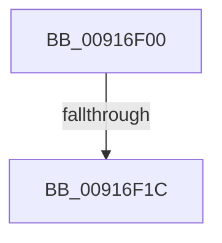

# RtlCreateAcl

- RVA: `0x00916F00`–`0x00916F20` (길이 `32` bytes)
- VA: `0x0000000140916F00`
- 실행 섹션: `PAGE`
- PDB 이름 있음: `예`; PDB Function 태그: `아니요`
- unwind 정보 RVA: `0x0008A920`
- 디코드: `10`개 명령, `32/32` bytes 표시
- 미해석 바이트: `0` (있으면 어셈블리에 `.byte`로 보존)

> 이 문서는 커널 이미지의 기계어와 PDB 기호를 분석해 생성했습니다. 4번과 5번은 함수 원형과 자료형을 바이너리 사용 방식에서 추정한 C 해석이며 원본 소스 복구 결과는 아닙니다.

## 1. Dependencies

- 직접 호출 지점: **0**; 고유 호출 대상: **0**
- 직접 호출자로 확인된 함수: **63**
- RIP 상대 이미지 참조: **0**

### Outgoing calls
- 직접 디코드된 call 명령이 없습니다.

### Direct callers
- [RtlCheckTokenCapability](../../text/3A/RtlCheckTokenCapability_function_003A5520.md) at `0x003A56BD`
- [RtlCheckTokenMembershipEx](../../text/3A/RtlCheckTokenMembershipEx_function_003A5A30.md) at `0x003A5B2D`
- [SepAppendAceToTokenDefaultDacl](../../text/40/SepAppendAceToTokenDefaultDacl_function_004002F8.md) at `0x004003DA`
- [sub_00400840](../../text/40/Unknown_function_00400840.md) at `0x00400890`
- [AdtpBuildAccessReasonAuditStringInternal](../../text/40/AdtpBuildAccessReasonAuditStringInternal_function_0040F344.md) at `0x0040F6BE`
- [SepInitProcessAuditSd](../../text/60/SepInitProcessAuditSd_function_00606230.md) at `0x006062FF`
- [SepInitProcessAuditSd](../../text/60/SepInitProcessAuditSd_function_00606230.md) at `0x006063BC`
- [WdipAccessCheck](../../text/64/WdipAccessCheck_function_0064E084.md) at `0x0064E1D5`
- [ExpPlRunOnceInit](../../text/65/ExpPlRunOnceInit_function_006571E0.md) at `0x006571F6`
- [DbgkpCreateNotificationEvent](../71/DbgkpCreateNotificationEvent_function_00710480.md) at `0x00710591`
- [PiAuCheckTokenMembership](../73/PiAuCheckTokenMembership_function_00731348.md) at `0x0073140B`
- [PiAuGetServiceStateSecurityObject](../73/PiAuGetServiceStateSecurityObject_function_007314F0.md) at `0x00731588`
- [PiAuGetStateDirectorySecurityObject](../73/PiAuGetStateDirectorySecurityObject_function_00731738.md) at `0x007317D4`
- [ObCreateKernelObjectsSD](../74/ObCreateKernelObjectsSD_function_0074D7A8.md) at `0x0074D82A`
- [ObpGetDosDevicesProtection](../74/ObpGetDosDevicesProtection_function_0074E2BC.md) at `0x0074E357`
- [ObpGetDosDevicesProtection](../74/ObpGetDosDevicesProtection_function_0074E2BC.md) at `0x0074E4D0`
- [ObpCreateDefaultObjectTypeSD](../74/ObpCreateDefaultObjectTypeSD_function_0074F04C.md) at `0x0074F0E7`
- [PfpCreateEventInternal](../75/PfpCreateEventInternal_function_00753480.md) at `0x0075353A`
- [PopCreateHiberFileSecurityDescriptor](../75/PopCreateHiberFileSecurityDescriptor_function_0075D3DC.md) at `0x0075D486`
- [PspSessionObjectCreate](../78/PspSessionObjectCreate_function_007892A8.md) at `0x00789368`
- [RtlpComputeMergedAcl2](../78/RtlpComputeMergedAcl2_function_0078EA34.md) at `0x0078EA88`
- [RtlpSysVolCreateSecurityDescriptor](../79/RtlpSysVolCreateSecurityDescriptor_function_00791654.md) at `0x00791718`
- [SepInitializationPhase1](../79/SepInitializationPhase1_function_0079C580.md) at `0x0079C685`
- [SepConstructMandatoryAccessControlList](../79/SepConstructMandatoryAccessControlList_function_0079D3AC.md) at `0x0079D4B4`
- [SmKmStoreFileMakeSecurityDescriptor](../7A/SmKmStoreFileMakeSecurityDescriptor_function_007A9988.md) at `0x007A9B0F`
- [NtSetUuidSeed](../7D/NtSetUuidSeed_function_007D0DD0.md) at `0x007D0F47`
- [CMFCreateSecurityDescriptor](../7D/CMFCreateSecurityDescriptor_function_007D2B10.md) at `0x007D2E39`
- [CmpAdminSystemSecurityDescriptor](../7E/CmpAdminSystemSecurityDescriptor_function_007EBED8.md) at `0x007EBFFC`
- [CmpGenerateAppHiveSecurityDescriptor](../7E/CmpGenerateAppHiveSecurityDescriptor_function_007ECEAC.md) at `0x007ECFA5`
- [CmpGenerateAppHiveSecurityDescriptor](../7E/CmpGenerateAppHiveSecurityDescriptor_function_007ECEAC.md) at `0x007ED033`
- [CmpHiveRootSecurityDescriptor](../7E/CmpHiveRootSecurityDescriptor_function_007ED104.md) at `0x007ED382`
- [MiCreatePagingFile](../7F/MiCreatePagingFile_function_007FEFF4.md) at `0x007FF37D`
- [MiCreateMemoryEventSD](../81/MiCreateMemoryEventSD_function_00810F40.md) at `0x00810FE5`
- [PnpGetEnumSecurityDescriptor](../83/PnpGetEnumSecurityDescriptor_function_00831FCC.md) at `0x0083216B`
- [DrvDbGetRegistrarSecurityDescriptor](../83/DrvDbGetRegistrarSecurityDescriptor_function_00835728.md) at `0x00835770`
- [DrvDbGetSecurityDescriptor](../83/DrvDbGetSecurityDescriptor_function_0083580C.md) at `0x00835A09`
- [ObpGetSilosRootDirectory](../83/ObpGetSilosRootDirectory_function_0083CF00.md) at `0x0083CFA7`
- [RtlpCreateServerAcl](../8B/RtlpCreateServerAcl_function_008BCF58.md) at `0x008BD0A8`
- [PopCreateNotificationName](PopCreateNotificationName_function_009121E8.md) at `0x00912240`
- [PiUEventInitClientRegistrationContext](PiUEventInitClientRegistrationContext_function_00916A54.md) at `0x00916BE1`
- [BiCreateKeySecurityDescriptor](BiCreateKeySecurityDescriptor_function_00916D6C.md) at `0x00916DF1`
- [PspAllocateAndQueryNotificationChannel](PspAllocateAndQueryNotificationChannel_function_00917EE4.md) at `0x0091817D`
- [RtlpNewSecurityObject](../92/RtlpNewSecurityObject_function_0092AB50.md) at `0x0092C8A3`
- [sub_00968AF6](../96/Unknown_function_00968AF6.md) at `0x0096998F`
- [sub_00968AF6](../96/Unknown_function_00968AF6.md) at `0x00969EFF`
- [PiDevCfgGetKeySecurityDescriptor](../99/PiDevCfgGetKeySecurityDescriptor_function_00996240.md) at `0x0099646D`
- [_CmGetRegKeySecurityDescriptor](../A8/_CmGetRegKeySecurityDescriptor_function_00A83F34.md) at `0x00A840B3`
- [_PnpGetPropertiesSecurityDescriptor](../A9/_PnpGetPropertiesSecurityDescriptor_function_00A91B8C.md) at `0x00A91C19`
- [IopCreateSecurityDescriptorPerType](../AD/IopCreateSecurityDescriptorPerType_function_00ADCC6C.md) at `0x00ADCD53`
- [sub_00B3E006](../B3/Unknown_function_00B3E006.md) at `0x00B3E02E`
- [ViInitializeLocalSystemDescriptor](../../pagevrfy/B9/ViInitializeLocalSystemDescriptor_function_00B936F8.md) at `0x00B9378C`
- [IopCreateUmdfDirectory](../../init/C2/IopCreateUmdfDirectory_function_00C2C818.md) at `0x00C2C91D`
- [IopApplySystemPartitionProt](../../init/C2/IopApplySystemPartitionProt_function_00C2E398.md) at `0x00C2E451`
- [PiAuCreateLocalSystemSecurityObject](../../init/C3/PiAuCreateLocalSystemSecurityObject_function_00C34570.md) at `0x00C345D8`
- [PiAuCreateStandardSecurityObject](../../init/C3/PiAuCreateStandardSecurityObject_function_00C34710.md) at `0x00C349E8`
- [PiAuGetDriverDataDirectorySecurityObject](../../init/C3/PiAuGetDriverDataDirectorySecurityObject_function_00C34EEC.md) at `0x00C34F86`
- [PopUmpoInitializeChannel](../../init/C4/PopUmpoInitializeChannel_function_00C428F0.md) at `0x00C429D1`
- [SshpAlpcInitialize](../../init/C4/SshpAlpcInitialize_function_00C448B4.md) at `0x00C449F7`
- [PspInitializeCpuPartitionsDefaultSd](../../init/C4/PspInitializeCpuPartitionsDefaultSd_function_00C457D4.md) at `0x00C458D7`
- [PspInitializeSystemPartitionPhase0](../../init/C4/PspInitializeSystemPartitionPhase0_function_00C46898.md) at `0x00C46935`
- [SepInitSystemDacls](../../init/C4/SepInitSystemDacls_function_00C478DC.md) at `0x00C47B50`
- [SepInitSystemDacls](../../init/C4/SepInitSystemDacls_function_00C478DC.md) at `0x00C47B64`
- [SepInitSystemDacls](../../init/C4/SepInitSystemDacls_function_00C478DC.md) at `0x00C47B81`
- [SepInitSystemDacls](../../init/C4/SepInitSystemDacls_function_00C478DC.md) at `0x00C47B97`
- [SepInitSystemDacls](../../init/C4/SepInitSystemDacls_function_00C478DC.md) at `0x00C47BA8`
- [SepInitSystemDacls](../../init/C4/SepInitSystemDacls_function_00C478DC.md) at `0x00C47BB9`
- [SepInitSystemDacls](../../init/C4/SepInitSystemDacls_function_00C478DC.md) at `0x00C47BCB`
- [SepInitSystemDacls](../../init/C4/SepInitSystemDacls_function_00C478DC.md) at `0x00C47BDC`
- [SepInitSystemDacls](../../init/C4/SepInitSystemDacls_function_00C478DC.md) at `0x00C47BEE`
- [SepInitSystemDacls](../../init/C4/SepInitSystemDacls_function_00C478DC.md) at `0x00C47C00`
- [SepInitSystemDacls](../../init/C4/SepInitSystemDacls_function_00C478DC.md) at `0x00C47C12`
- [SeMakeAnonymousLogonToken](../../init/C4/SeMakeAnonymousLogonToken_function_00C4A8D8.md) at `0x00C4A9E7`
- [SeMakeAnonymousLogonTokenNoEveryone](../../init/C4/SeMakeAnonymousLogonTokenNoEveryone_function_00C4AB5C.md) at `0x00C4AC48`
- [SeMakeSystemToken](../../init/C4/SeMakeSystemToken_function_00C4ADBC.md) at `0x00C4B154`
- [SeMakeSystemToken](../../init/C4/SeMakeSystemToken_function_00C4ADBC.md) at `0x00C4B19D`
- [WmipInitializeSecurity](../../init/C4/WmipInitializeSecurity_function_00C4D840.md) at `0x00C4D8F2`
- [ExpKeyedEventInitialization](../../init/C5/ExpKeyedEventInitialization_function_00C5460C.md) at `0x00C54757`
- [ExpKeyedEventInitialization](../../init/C5/ExpKeyedEventInitialization_function_00C5460C.md) at `0x00C5481B`
- [ObInitSystem](../../init/C7/ObInitSystem_function_00C71C7C.md) at `0x00C720EB`

### Static image references
- 디코드된 RIP-relative 메모리 참조가 없습니다.

## 2. Other-region calls and transfers

- 다른 실행 섹션으로 향하는 call: **0**
- call이 아닌 외부 분기/꼬리 이동: **1**
  - `0x00916F1A` → [sub_00916F6D](Unknown_function_00916F6D.md) (`tail-transfer`)

## 3. Assembly (complete function range)

```asm
00916F00  48 89 5C 24 10                  mov qword ptr [rsp + 0x10], rbx
00916F05  48 89 74 24 18                  mov qword ptr [rsp + 0x18], rsi
00916F0A  57                              push rdi
00916F0B  48 83 EC 20                     sub rsp, 0x20
00916F0F  8B DA                           mov ebx, edx
00916F11  41 8B F0                        mov esi, r8d
00916F14  48 8B F9                        mov rdi, rcx
00916F17  83 FA 08                        cmp edx, 8
00916F1A  72 51                           jb 0x140916f6d
00916F1C  41 8D 40 FE                     lea eax, [r8 - 2]
```

## 4. C-style interpretation (structured pseudocode)

```c
__int64 __fastcall RtlCreateAcl(__int64 a1, int a2, __int64 a3)
{
    __int64 v_rsp;
    unsigned __int64 v_stack_p10;
    unsigned __int64 v_stack_p18;

    v_stack_p10 = v_rbx;
    v_stack_p18 = v_rsi;
    v_rsp = (v_rsp) - (32);
    return a3 - 2;
}
```

## 5. (Beta) C Style

```c
void *RtlCreateAcl(int64_t Arg1, int32_t Arg2, void *Arg3)
{
    uint8_t *arg3 = (uint8_t *)Arg3;

    int64_t local_rsp;
    uint64_t v_stack_p10;
    uint64_t v_stack_p18;

    v_stack_p10 = local_rbx;
    v_stack_p18 = local_rsi;
    local_rsp = (local_rsp) - (32);
    return Arg3 - 2;
}
```

### 관측된 메모리 오프셋

구조체 형식이 확인되지 않은 접근은 인자 기준의 오프셋으로만 기록했습니다.

| 기준 인자 | 오프셋 표현 | 폭 (bit) | 접근 |
|---|---:|---:|---|
| `Arg3` | `- 0x2` | `32` | `R` |

## 6. Execution-region graph

[열기: 2D/3D 그래프와 함수 탐색 컨트롤 패널](../../../control-panel.html?section=page&rva=0x00916F00&view=graph)

- 2D 그래프는 위에서 아래로 흐르고, 3D 그래프는 빈 공간을 드래그해 회전합니다. Shift+드래그는 이동, 휠은 확대·축소, 함수 노드 선택은 대상 보고서 이동입니다.

### Static fallback


