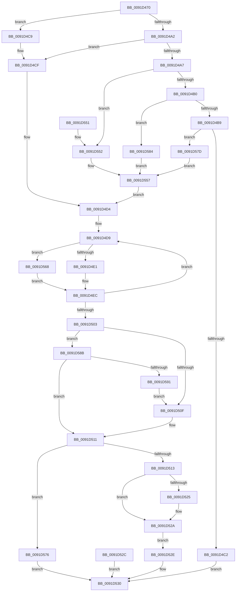

# RtlIntegerToChar

- RVA: `0x0091D470`–`0x0091D5AC` (길이 `316` bytes)
- VA: `0x000000014091D470`
- 실행 섹션: `PAGE`
- PDB 이름 있음: `예`; PDB Function 태그: `아니요`
- unwind 정보 RVA: `0x0008B20C`
- 디코드: `96`개 명령, `316/316` bytes 표시
- 미해석 바이트: `0` (있으면 어셈블리에 `.byte`로 보존)

> 이 문서는 커널 이미지의 기계어와 PDB 기호를 분석해 생성했습니다. 4번과 5번은 함수 원형과 자료형을 바이너리 사용 방식에서 추정한 C 해석이며 원본 소스 복구 결과는 아닙니다.

## 1. Dependencies

- 직접 호출 지점: **3**; 고유 호출 대상: **3**
- 직접 호출자로 확인된 함수: **2**
- RIP 상대 이미지 참조: **2**

### Outgoing calls
- `0x0091D51C` → [memcpy](../../text/6C/memcpy_function_006C6840.md) (function, `0x006C6840`)
- `0x0091D538` → [_security_check_cookie](../../text/6A/_security_check_cookie_function_006AC640.md) (function, `0x006AC640`)
- `0x0091D59D` → [memset](../../text/6C/memset_function_006C6C40.md) (function, `0x006C6C40`)

### Direct callers
- [CmpInitializeRegistryNode](../7E/CmpInitializeRegistryNode_function_007EE81C.md) at `0x007EE92C`
- [RtlIntegerToUnicodeString](RtlIntegerToUnicodeString_function_0091D3E0.md) at `0x0091D40E`

### Static image references
- `0x0091D483` → RVA `0x00E0A740` (`.data`; read)
- `0x0091D4F1` → RVA `0x00B4B0D0` (`RtlpIntegerChars`; read)

## 2. Other-region calls and transfers

- 다른 실행 섹션으로 향하는 call: **3**
  - `0x0091D51C` → [memcpy](../../text/6C/memcpy_function_006C6840.md) (`PAGE` → `.text`)
  - `0x0091D538` → [_security_check_cookie](../../text/6A/_security_check_cookie_function_006AC640.md) (`PAGE` → `.text`)
  - `0x0091D59D` → [memset](../../text/6C/memset_function_006C6C40.md) (`PAGE` → `.text`)
- 별도 외부 분기/꼬리 이동을 확인하지 못했습니다.

## 3. Assembly (complete function range)

```asm
0091D470  48 89 5C 24 08                  mov qword ptr [rsp + 8], rbx
0091D475  48 89 74 24 10                  mov qword ptr [rsp + 0x10], rsi
0091D47A  57                              push rdi
0091D47B  41 56                           push r14
0091D47D  41 57                           push r15
0091D47F  48 83 EC 50                     sub rsp, 0x50
0091D483  48 8B 05 B6 D2 4E 00            mov rax, qword ptr [rip + 0x4ed2b6]
0091D48A  48 33 C4                        xor rax, rsp
0091D48D  48 89 44 24 48                  mov qword ptr [rsp + 0x48], rax
0091D492  4D 8B F9                        mov r15, r9
0091D495  41 8B F8                        mov edi, r8d
0091D498  44 8B C2                        mov r8d, edx
0091D49B  44 8B D1                        mov r10d, ecx
0091D49E  85 D2                           test edx, edx
0091D4A0  74 27                           je 0x14091d4c9
0091D4A2  83 FA 0A                        cmp edx, 0xa
0091D4A5  74 28                           je 0x14091d4cf
0091D4A7  83 FA 10                        cmp edx, 0x10
0091D4AA  0F 84 A2 00 00 00               je 0x14091d552
0091D4B0  83 FA 02                        cmp edx, 2
0091D4B3  0F 84 CB 00 00 00               je 0x14091d584
0091D4B9  83 FA 08                        cmp edx, 8
0091D4BC  0F 84 BB 00 00 00               je 0x14091d57d
0091D4C2  B8 0D 00 00 C0                  mov eax, 0xc000000d
0091D4C7  EB 67                           jmp 0x14091d530
0091D4C9  41 B8 0A 00 00 00               mov r8d, 0xa
0091D4CF  33 C9                           xor ecx, ecx
0091D4D1  45 33 C9                        xor r9d, r9d
0091D4D4  4C 8D 74 24 41                  lea r14, [rsp + 0x41]
0091D4D9  85 C9                           test ecx, ecx
0091D4DB  0F 85 87 00 00 00               jne 0x14091d568
0091D4E1  33 D2                           xor edx, edx
0091D4E3  41 8B C2                        mov eax, r10d
0091D4E6  41 F7 F0                        div r8d
0091D4E9  44 8B D0                        mov r10d, eax
0091D4EC  49 FF CE                        dec r14
0091D4EF  8B C2                           mov eax, edx
0091D4F1  48 8D 15 D8 DB 22 00            lea rdx, [rip + 0x22dbd8]
0091D4F8  8A 04 10                        mov al, byte ptr [rax + rdx]
0091D4FB  41 88 06                        mov byte ptr [r14], al
0091D4FE  45 85 D2                        test r10d, r10d
0091D501  75 D6                           jne 0x14091d4d9
0091D503  48 8D 74 24 41                  lea rsi, [rsp + 0x41]
0091D508  41 2B F6                        sub esi, r14d
0091D50B  85 FF                           test edi, edi
0091D50D  78 7C                           js 0x14091d58b
0091D50F  3B F7                           cmp esi, edi
0091D511  7F 63                           jg 0x14091d576
0091D513  44 8B C6                        mov r8d, esi
0091D516  49 8B D6                        mov rdx, r14
0091D519  49 8B CF                        mov rcx, r15
0091D51C  E8 1F 93 DA FF                  call 0x1406c6840
0091D521  3B F7                           cmp esi, edi
0091D523  7D 05                           jge 0x14091d52a
0091D525  42 C6 04 3E 00                  mov byte ptr [rsi + r15], 0
0091D52A  EB 02                           jmp 0x14091d52e
0091D52C  EB 02                           jmp 0x14091d530
0091D52E  33 C0                           xor eax, eax
0091D530  48 8B 4C 24 48                  mov rcx, qword ptr [rsp + 0x48]
0091D535  48 33 CC                        xor rcx, rsp
0091D538  E8 03 F1 D8 FF                  call 0x1406ac640
0091D53D  48 8B 5C 24 70                  mov rbx, qword ptr [rsp + 0x70]
0091D542  48 8B 74 24 78                  mov rsi, qword ptr [rsp + 0x78]
0091D547  48 83 C4 50                     add rsp, 0x50
0091D54B  41 5F                           pop r15
0091D54D  41 5E                           pop r14
0091D54F  5F                              pop rdi
0091D550  C3                              ret
0091D551  CC                              int3
0091D552  B9 04 00 00 00                  mov ecx, 4
0091D557  41 B9 01 00 00 00               mov r9d, 1
0091D55D  41 D3 E1                        shl r9d, cl
0091D560  41 FF C9                        dec r9d
0091D563  E9 6C FF FF FF                  jmp 0x14091d4d4
0091D568  41 8B D1                        mov edx, r9d
0091D56B  41 23 D2                        and edx, r10d
0091D56E  41 D3 EA                        shr r10d, cl
0091D571  E9 76 FF FF FF                  jmp 0x14091d4ec
0091D576  B8 05 00 00 80                  mov eax, 0x80000005
0091D57B  EB B3                           jmp 0x14091d530
0091D57D  B9 03 00 00 00                  mov ecx, 3
0091D582  EB D3                           jmp 0x14091d557
0091D584  B9 01 00 00 00                  mov ecx, 1
0091D589  EB CC                           jmp 0x14091d557
0091D58B  F7 DF                           neg edi
0091D58D  3B F7                           cmp esi, edi
0091D58F  7D 80                           jge 0x14091d511
0091D591  2B FE                           sub edi, esi
0091D593  8B DF                           mov ebx, edi
0091D595  44 8B C7                        mov r8d, edi
0091D598  B2 30                           mov dl, 0x30
0091D59A  49 8B CF                        mov rcx, r15
0091D59D  E8 9E 96 DA FF                  call 0x1406c6c40
0091D5A2  8B FE                           mov edi, esi
0091D5A4  4C 03 FB                        add r15, rbx
0091D5A7  E9 63 FF FF FF                  jmp 0x14091d50f
```

## 4. C-style interpretation (structured pseudocode)

```c
__int64 __fastcall RtlIntegerToChar(int a1, int a2, int a3, __int64 a4)
{
    __int64 result;
    __int64 v_r10;
    __int64 v_r14;
    __int64 v_r15;
    __int64 v_rdi;
    __int64 v_rsi;
    __int64 v_rsp;
    unsigned __int64 v_stack_m20;
    unsigned __int64 v_stack_m27;
    unsigned __int64 v_stack_p10;
    unsigned __int64 v_stack_p8;

    v_stack_p8 = v_rbx;
    v_stack_p10 = v_rsi;
    v_rsp = (v_rsp) - (80);
    result = (*(unsigned __int64 *)(v_rip + 5165750)) ^ (v_rsp);
    v_stack_m20 = result;
    if (a2 == 0) goto loc_0091D4C9;
    if (a2 == 10) goto loc_0091D4CF;
    if (a2 == 16) goto loc_0091D552;
    if (a2 == 2) goto loc_0091D584;
    if (a2 == 8) goto loc_0091D57D;
    goto loc_0091D530;
loc_0091D4C9:
loc_0091D4CF:
    a1 = 0;
    a4 = 0;
loc_0091D4D4:
loc_0091D4D9:
    if (0 != 0) goto loc_0091D568;
    a2 = 0;
loc_0091D4EC:
    v_r14 = (v_stack_m27) - 1;
    *(unsigned __int8 *)(v_r14) = (unsigned __int8)(*(unsigned __int8 *)(0 + v_rip + 2284504 * 1));
    if ((unsigned int)((unsigned int)((unsigned int)((unsigned int)((unsigned int)((unsigned int)(a1)))))) != 0) goto loc_0091D4D9;
    v_rsi = (unsigned int)((v_stack_m27) - ((unsigned int)(v_r14)));
    if (sign_flag) goto loc_0091D58B;
loc_0091D50F:
loc_0091D511:
    if (((unsigned int)(v_rsi)) > ((unsigned int)((unsigned int)(a3)))) goto loc_0091D576;
    result = memcpy(0, v_r14, (unsigned int)((unsigned int)(v_rsi)), a4);
    if (((unsigned int)(v_rsi)) < ((unsigned int)((unsigned int)(a3)))) {
        *(unsigned __int8 *)(v_rsi + a4 * 1) = 0;
    }
    goto loc_0091D52E;
loc_0091D52E:
    result = 0;
loc_0091D530:
    a1 = (v_stack_m20) ^ (v_rsp);
    result = _security_check_cookie(a1, v_r14, (unsigned int)((unsigned int)(v_rsi)), a4);
    v_rsp = (v_rsp) + (80);
    return result;
loc_0091D552:
loc_0091D557:
    a4 = (unsigned int)((1) << (4));
    a4 = (unsigned int)((a4) - 1);
    goto loc_0091D4D4;
loc_0091D568:
    a2 = (unsigned int)(((unsigned int)((unsigned int)(a4))) & ((unsigned int)((unsigned int)((unsigned int)((unsigned int)((unsigned int)((unsigned int)(a1))))))));
    v_r10 = (unsigned int)(((unsigned int)((unsigned int)((unsigned int)((unsigned int)((unsigned int)(a1)))))) >> (4));
    goto loc_0091D4EC;
loc_0091D576:
    goto loc_0091D530;
loc_0091D57D:
    goto loc_0091D557;
loc_0091D584:
    goto loc_0091D557;
loc_0091D58B:
    v_rdi = (unsigned int)(-((unsigned int)(a3)));
    if (((unsigned int)(v_stack_p10)) >= ((unsigned int)(v_rdi))) goto loc_0091D511;
    v_rdi = (unsigned int)((v_rdi) - ((unsigned int)(v_stack_p10)));
    result = memset(a4, 48, (unsigned int)((unsigned int)(v_rdi)), a4);
    v_r15 = (a4) + ((unsigned int)((unsigned int)(v_rdi)));
    goto loc_0091D50F;
}
```

## 5. (Beta) C Style

```c
int64_t RtlIntegerToChar(int32_t Arg1, int32_t Arg2, int32_t Arg3, int64_t Arg4)
{
    int64_t result;
    int64_t local_r10;
    int64_t local_r14;
    int64_t local_r15;
    int64_t local_rdi;
    int64_t local_rsi;
    int64_t local_rsp;
    uint64_t v_stack_m20;
    uint64_t v_stack_m27;
    uint64_t v_stack_p10;
    uint64_t v_stack_p8;

    v_stack_p8 = local_rbx;
    v_stack_p10 = local_rsi;
    local_rsp = (local_rsp) - (80);
    result = (*(uint64_t *)(v_rip + 0x4ED2B6)) ^ (local_rsp);
    v_stack_m20 = result;
    if (Arg2 == 0) goto loc_0091D4C9;
    if (Arg2 == 10) goto loc_0091D4CF;
    if (Arg2 == 16) goto loc_0091D552;
    if (Arg2 == 2) goto loc_0091D584;
    if (Arg2 == 8) goto loc_0091D57D;
    goto loc_0091D530;
loc_0091D4C9:
loc_0091D4CF:
    Arg1 = 0;
    Arg4 = 0;
loc_0091D4D4:
loc_0091D4D9:
    if (0 != 0) goto loc_0091D568;
    Arg2 = 0;
loc_0091D4EC:
    local_r14 = (v_stack_m27) - 1;
    *(uint8_t *)(local_r14) = (uint8_t)(*(uint8_t *)(0 + v_rip + 0x22DBD8 * 1));
    if ((uint32_t)((uint32_t)((uint32_t)((uint32_t)((uint32_t)((uint32_t)(Arg1)))))) != 0) goto loc_0091D4D9;
    local_rsi = (uint32_t)((v_stack_m27) - ((uint32_t)(local_r14)));
    if (sign_flag) goto loc_0091D58B;
loc_0091D50F:
loc_0091D511:
    if (((uint32_t)(local_rsi)) > ((uint32_t)((uint32_t)(Arg3)))) goto loc_0091D576;
    result = memcpy(0, local_r14, (uint32_t)((uint32_t)(local_rsi)), Arg4);
    if (((uint32_t)(local_rsi)) < ((uint32_t)((uint32_t)(Arg3)))) {
        *(uint8_t *)(local_rsi + Arg4 * 1) = 0;
    }
    goto loc_0091D52E;
loc_0091D52E:
    result = 0;
loc_0091D530:
    Arg1 = (v_stack_m20) ^ (local_rsp);
    result = _security_check_cookie(Arg1, local_r14, (uint32_t)((uint32_t)(local_rsi)), Arg4);
    local_rsp = (local_rsp) + (80);
    return result;
loc_0091D552:
loc_0091D557:
    Arg4 = (uint32_t)((1) << (4));
    Arg4 = (uint32_t)((Arg4) - 1);
    goto loc_0091D4D4;
loc_0091D568:
    Arg2 = (uint32_t)(((uint32_t)((uint32_t)(Arg4))) & ((uint32_t)((uint32_t)((uint32_t)((uint32_t)((uint32_t)((uint32_t)(Arg1))))))));
    local_r10 = (uint32_t)(((uint32_t)((uint32_t)((uint32_t)((uint32_t)((uint32_t)(Arg1)))))) >> (4));
    goto loc_0091D4EC;
loc_0091D576:
    goto loc_0091D530;
loc_0091D57D:
    goto loc_0091D557;
loc_0091D584:
    goto loc_0091D557;
loc_0091D58B:
    local_rdi = (uint32_t)(-((uint32_t)(Arg3)));
    if (((uint32_t)(v_stack_p10)) >= ((uint32_t)(local_rdi))) goto loc_0091D511;
    local_rdi = (uint32_t)((local_rdi) - ((uint32_t)(v_stack_p10)));
    result = memset(Arg4, 48, (uint32_t)((uint32_t)(local_rdi)), Arg4);
    local_r15 = (Arg4) + ((uint32_t)((uint32_t)(local_rdi)));
    goto loc_0091D50F;
}
```

## 6. Execution-region graph

[열기: 2D/3D 그래프와 함수 탐색 컨트롤 패널](../../../control-panel.html?section=page&rva=0x0091D470&view=graph)

- 2D 그래프는 위에서 아래로 흐르고, 3D 그래프는 빈 공간을 드래그해 회전합니다. Shift+드래그는 이동, 휠은 확대·축소, 함수 노드 선택은 대상 보고서 이동입니다.

### Static fallback


