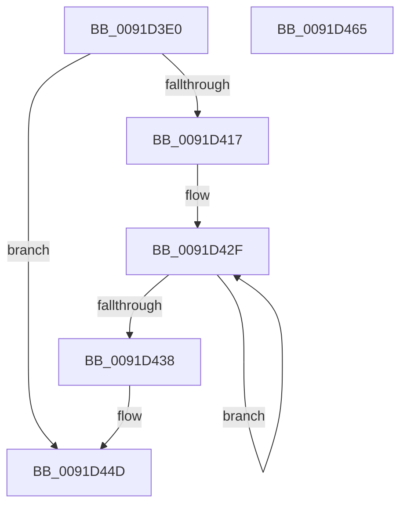

# RtlIntegerToUnicodeString

- RVA: `0x0091D3E0`–`0x0091D466` (길이 `134` bytes)
- VA: `0x000000014091D3E0`
- 실행 섹션: `PAGE`
- PDB 이름 있음: `예`; PDB Function 태그: `아니요`
- unwind 정보 RVA: `0x0008B1F4`
- 디코드: `35`개 명령, `134/134` bytes 표시
- 미해석 바이트: `0` (있으면 어셈블리에 `.byte`로 보존)

> 이 문서는 커널 이미지의 기계어와 PDB 기호를 분석해 생성했습니다. 4번과 5번은 함수 원형과 자료형을 바이너리 사용 방식에서 추정한 C 해석이며 원본 소스 복구 결과는 아닙니다.

## 1. Dependencies

- 직접 호출 지점: **3**; 고유 호출 대상: **3**
- 직접 호출자로 확인된 함수: **13**
- RIP 상대 이미지 참조: **1**

### Outgoing calls
- `0x0091D40E` → [RtlIntegerToChar](RtlIntegerToChar_function_0091D470.md) (function, `0x0091D470`)
- `0x0091D448` → [RtlAnsiStringToUnicodeString](../90/RtlAnsiStringToUnicodeString_function_0090BEA0.md) (function, `0x0090BEA0`)
- `0x0091D455` → [_security_check_cookie](../../text/6A/_security_check_cookie_function_006AC640.md) (function, `0x006AC640`)

### Direct callers
- [AdtpFormatPrefix](../../text/40/AdtpFormatPrefix_function_0040F8E0.md) at `0x0040F933`
- [BapdpMarshallBootDataToRegistry](../../text/65/BapdpMarshallBootDataToRegistry_function_006548A8.md) at `0x00654BAC`
- [sub_006ECA3A](../../text/6E/Unknown_function_006ECA3A.md) at `0x006ECE28`
- [pIoQueryDeviceDescription](../71/pIoQueryDeviceDescription_function_0071F10C.md) at `0x0071F273`
- [pIoQueryDeviceDescription](../71/pIoQueryDeviceDescription_function_0071F10C.md) at `0x0071F429`
- [AdtpBuildReplacementString](../82/AdtpBuildReplacementString_function_00822884.md) at `0x008228BF`
- [AdtpBuildUserAccountControlString](../82/AdtpBuildUserAccountControlString_function_00822920.md) at `0x00822A01`
- [AdtpBuildUserAccountControlString](../82/AdtpBuildUserAccountControlString_function_00822920.md) at `0x00822A2F`
- [AdtpBuildUserAccountControlString](../82/AdtpBuildUserAccountControlString_function_00822920.md) at `0x00822AD4`
- [AdtpObjsInitialize](../82/AdtpObjsInitialize_function_00822B30.md) at `0x00822BE6`
- [AdtpObjsInitialize](../82/AdtpObjsInitialize_function_00822B30.md) at `0x00822C3C`
- [ObCreateSiloRootDirectory](../83/ObCreateSiloRootDirectory_function_0083CA34.md) at `0x0083CB12`
- [ObGetSiloRootDirectoryPath](../83/ObGetSiloRootDirectoryPath_function_0083CD74.md) at `0x0083CE18`
- [ExProcessCounterSetCallback](ExProcessCounterSetCallback_function_0091CDF0.md) at `0x0091D13E`
- [RtlpInitNlsFileName](../A1/RtlpInitNlsFileName_function_00A19B9C.md) at `0x00A19C97`
- [AdtpBuildAccessesString](../A8/AdtpBuildAccessesString_function_00A8898C.md) at `0x00A88C83`
- [PopReadSimulatedHGSClasses](../../init/C4/PopReadSimulatedHGSClasses_function_00C41470.md) at `0x00C4175F`

### Static image references
- `0x0091D3EA` → RVA `0x00E0A740` (`.data`; read)

## 2. Other-region calls and transfers

- 다른 실행 섹션으로 향하는 call: **1**
  - `0x0091D455` → [_security_check_cookie](../../text/6A/_security_check_cookie_function_006AC640.md) (`PAGE` → `.text`)
- 별도 외부 분기/꼬리 이동을 확인하지 못했습니다.

## 3. Assembly (complete function range)

```asm
0091D3E0  48 89 5C 24 08                  mov qword ptr [rsp + 8], rbx
0091D3E5  57                              push rdi
0091D3E6  48 83 EC 60                     sub rsp, 0x60
0091D3EA  48 8B 05 4F D3 4E 00            mov rax, qword ptr [rip + 0x4ed34f]
0091D3F1  48 33 C4                        xor rax, rsp
0091D3F4  48 89 44 24 58                  mov qword ptr [rsp + 0x58], rax
0091D3F9  83 64 24 24 00                  and dword ptr [rsp + 0x24], 0
0091D3FE  4C 8D 4C 24 30                  lea r9, [rsp + 0x30]
0091D403  49 8B D8                        mov rbx, r8
0091D406  BF 21 00 00 00                  mov edi, 0x21
0091D40B  44 8B C7                        mov r8d, edi
0091D40E  E8 5D 00 00 00                  call 0x14091d470
0091D413  85 C0                           test eax, eax
0091D415  78 36                           js 0x14091d44d
0091D417  48 8D 44 24 30                  lea rax, [rsp + 0x30]
0091D41C  66 89 7C 24 22                  mov word ptr [rsp + 0x22], di
0091D421  48 89 44 24 28                  mov qword ptr [rsp + 0x28], rax
0091D426  48 8D 4C 24 30                  lea rcx, [rsp + 0x30]
0091D42B  48 83 C8 FF                     or rax, 0xffffffffffffffff
0091D42F  48 FF C0                        inc rax
0091D432  80 3C 01 00                     cmp byte ptr [rcx + rax], 0
0091D436  75 F7                           jne 0x14091d42f
0091D438  45 33 C0                        xor r8d, r8d
0091D43B  66 89 44 24 20                  mov word ptr [rsp + 0x20], ax
0091D440  48 8D 54 24 20                  lea rdx, [rsp + 0x20]
0091D445  48 8B CB                        mov rcx, rbx
0091D448  E8 53 EA FE FF                  call 0x14090bea0
0091D44D  48 8B 4C 24 58                  mov rcx, qword ptr [rsp + 0x58]
0091D452  48 33 CC                        xor rcx, rsp
0091D455  E8 E6 F1 D8 FF                  call 0x1406ac640
0091D45A  48 8B 5C 24 70                  mov rbx, qword ptr [rsp + 0x70]
0091D45F  48 83 C4 60                     add rsp, 0x60
0091D463  5F                              pop rdi
0091D464  C3                              ret
0091D465  CC                              int3
```

## 4. C-style interpretation (structured pseudocode)

```c
__int64 __fastcall RtlIntegerToUnicodeString(__int64 a1, __int64 a2, __int64 a3)
{
    __int64 result;
    __int64 v_rsp;
    unsigned __int64 v_stack_m10;
    unsigned __int64 v_stack_m38;
    unsigned __int64 v_stack_m40;
    unsigned int v_stack_m44;
    unsigned __int16 v_stack_m46;
    unsigned __int16 v_stack_m48;
    unsigned __int64 v_stack_p8;

    v_stack_p8 = v_rbx;
    v_rsp = (v_rsp) - (96);
    result = (*(unsigned __int64 *)(v_rip + 5165903)) ^ (v_rsp);
    v_stack_m10 = result;
    result = RtlIntegerToChar(a1, a2, 33, v_stack_m38);
    if (sign_flag) goto loc_0091D44D;
    v_stack_m46 = 33;
    v_stack_m40 = v_stack_m38;
    result = (v_stack_m38) | (-1);
loc_0091D42F:
    result = (result) + 1;
    if ((*(unsigned __int8 *)(v_stack_m38 + result * 1)) != 0) goto loc_0091D42F;
    a3 = 0;
    v_stack_m48 = (unsigned __int16)(result);
    result = RtlAnsiStringToUnicodeString(0, v_stack_m48, a3, v_stack_m38);
loc_0091D44D:
    a1 = (v_stack_m10) ^ (v_rsp);
    result = _security_check_cookie(a1, v_stack_m48, a3, v_stack_m38);
    v_rsp = (v_rsp) + (96);
    return result;
}
```

## 5. (Beta) C Style

```c
int64_t RtlIntegerToUnicodeString(int64_t Arg1, int64_t Arg2, int64_t Arg3)
{
    int64_t result;
    int64_t local_rsp;
    uint64_t v_stack_m10;
    uint64_t v_stack_m38;
    uint64_t v_stack_m40;
    uint32_t v_stack_m44;
    uint16_t v_stack_m46;
    uint16_t v_stack_m48;
    uint64_t v_stack_p8;

    v_stack_p8 = local_rbx;
    local_rsp = (local_rsp) - (96);
    result = (*(uint64_t *)(v_rip + 0x4ED34F)) ^ (local_rsp);
    v_stack_m10 = result;
    result = RtlIntegerToChar(Arg1, Arg2, 33, v_stack_m38);
    if (sign_flag) goto loc_0091D44D;
    v_stack_m46 = 33;
    v_stack_m40 = v_stack_m38;
    result = (v_stack_m38) | (-1);
loc_0091D42F:
    result = (result) + 1;
    if ((*(uint8_t *)(v_stack_m38 + result * 1)) != 0) goto loc_0091D42F;
    Arg3 = 0;
    v_stack_m48 = (uint16_t)(result);
    result = RtlAnsiStringToUnicodeString(0, v_stack_m48, Arg3, v_stack_m38);
loc_0091D44D:
    Arg1 = (v_stack_m10) ^ (local_rsp);
    result = _security_check_cookie(Arg1, v_stack_m48, Arg3, v_stack_m38);
    local_rsp = (local_rsp) + (96);
    return result;
}
```

## 6. Execution-region graph

[열기: 2D/3D 그래프와 함수 탐색 컨트롤 패널](../../../control-panel.html?section=page&rva=0x0091D3E0&view=graph)

- 2D 그래프는 위에서 아래로 흐르고, 3D 그래프는 빈 공간을 드래그해 회전합니다. Shift+드래그는 이동, 휠은 확대·축소, 함수 노드 선택은 대상 보고서 이동입니다.

### Static fallback


