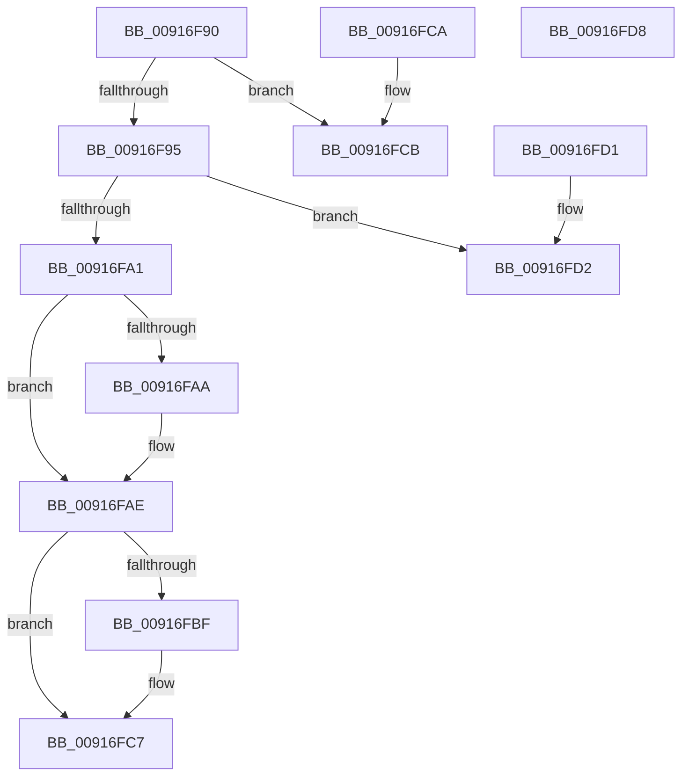

# RtlSetOwnerSecurityDescriptor

- RVA: `0x00916F90`–`0x00916FD9` (길이 `73` bytes)
- VA: `0x0000000140916F90`
- 실행 섹션: `PAGE`
- PDB 이름 있음: `예`; PDB Function 태그: `아니요`
- unwind 정보 RVA: `0x000DB714`
- 디코드: `26`개 명령, `73/73` bytes 표시
- 미해석 바이트: `0` (있으면 어셈블리에 `.byte`로 보존)

> 이 문서는 커널 이미지의 기계어와 PDB 기호를 분석해 생성했습니다. 4번과 5번은 함수 원형과 자료형을 바이너리 사용 방식에서 추정한 C 해석이며 원본 소스 복구 결과는 아닙니다.

## 1. Dependencies

- 직접 호출 지점: **0**; 고유 호출 대상: **0**
- 직접 호출자로 확인된 함수: **23**
- RIP 상대 이미지 참조: **0**

### Outgoing calls
- 직접 디코드된 call 명령이 없습니다.

### Direct callers
- [RtlCheckTokenCapability](../../text/3A/RtlCheckTokenCapability_function_003A5520.md) at `0x003A5699`
- [RtlCheckTokenMembershipEx](../../text/3A/RtlCheckTokenMembershipEx_function_003A5A30.md) at `0x003A5B0A`
- [PiAuCheckTokenMembership](../73/PiAuCheckTokenMembership_function_00731348.md) at `0x007313EC`
- [PiAuGetServiceStateSecurityObject](../73/PiAuGetServiceStateSecurityObject_function_007314F0.md) at `0x0073167B`
- [PiAuGetStateDirectorySecurityObject](../73/PiAuGetStateDirectorySecurityObject_function_00731738.md) at `0x0073195B`
- [RtlpSysVolCheckOwnerAndSecurity](../79/RtlpSysVolCheckOwnerAndSecurity_function_00791324.md) at `0x0079157E`
- [RtlpSysVolTakeOwnership](../79/RtlpSysVolTakeOwnership_function_007917C8.md) at `0x0079192F`
- [CMFCreateSecurityDescriptor](../7D/CMFCreateSecurityDescriptor_function_007D2B10.md) at `0x007D3038`
- [CmpCopySaclToVirtualKey](../7E/CmpCopySaclToVirtualKey_function_007ECA6C.md) at `0x007ECBC6`
- [CmpGenerateAppHiveSecurityDescriptor](../7E/CmpGenerateAppHiveSecurityDescriptor_function_007ECEAC.md) at `0x007ECF7F`
- [PnpGetEnumSecurityDescriptor](../83/PnpGetEnumSecurityDescriptor_function_00831FCC.md) at `0x0083222E`
- [DrvDbGetSecurityDescriptor](../83/DrvDbGetSecurityDescriptor_function_0083580C.md) at `0x00835ABF`
- [BiCreateKeySecurityDescriptor](BiCreateKeySecurityDescriptor_function_00916D6C.md) at `0x00916EE4`
- [sub_00B4403A](../B4/Unknown_function_00B4403A.md) at `0x00B44078`
- [PiAuCreateLocalSystemSecurityObject](../../init/C3/PiAuCreateLocalSystemSecurityObject_function_00C34570.md) at `0x00C3464B`
- [PiAuCreateStandardSecurityObject](../../init/C3/PiAuCreateStandardSecurityObject_function_00C34710.md) at `0x00C34B89`
- [PiAuGetDriverDataDirectorySecurityObject](../../init/C3/PiAuGetDriverDataDirectorySecurityObject_function_00C34EEC.md) at `0x00C35060`
- [PspInitializeCpuPartitionsDefaultSd](../../init/C4/PspInitializeCpuPartitionsDefaultSd_function_00C457D4.md) at `0x00C45994`
- [SepInitSystemDacls](../../init/C4/SepInitSystemDacls_function_00C478DC.md) at `0x00C48210`
- [SepInitSystemDacls](../../init/C4/SepInitSystemDacls_function_00C478DC.md) at `0x00C48259`
- [SepInitSystemDacls](../../init/C4/SepInitSystemDacls_function_00C478DC.md) at `0x00C482B7`
- [SeMakeAnonymousLogonToken](../../init/C4/SeMakeAnonymousLogonToken_function_00C4A8D8.md) at `0x00C4AA70`
- [SeMakeAnonymousLogonTokenNoEveryone](../../init/C4/SeMakeAnonymousLogonTokenNoEveryone_function_00C4AB5C.md) at `0x00C4ACCE`
- [SeMakeSystemToken](../../init/C4/SeMakeSystemToken_function_00C4ADBC.md) at `0x00C4B244`
- [WmipInitializeSecurity](../../init/C4/WmipInitializeSecurity_function_00C4D840.md) at `0x00C4D9F4`

### Static image references
- 디코드된 RIP-relative 메모리 참조가 없습니다.

## 2. Other-region calls and transfers

- 다른 실행 섹션으로 향하는 call: **0**
- 별도 외부 분기/꼬리 이동을 확인하지 못했습니다.

## 3. Assembly (complete function range)

```asm
00916F90  80 39 01                        cmp byte ptr [rcx], 1
00916F93  75 36                           jne 0x140916fcb
00916F95  0F B7 41 02                     movzx eax, word ptr [rcx + 2]
00916F99  45 33 C9                        xor r9d, r9d
00916F9C  66 85 C0                        test ax, ax
00916F9F  78 31                           js 0x140916fd2
00916FA1  4C 89 49 08                     mov qword ptr [rcx + 8], r9
00916FA5  48 85 D2                        test rdx, rdx
00916FA8  74 04                           je 0x140916fae
00916FAA  48 89 51 08                     mov qword ptr [rcx + 8], rdx
00916FAE  BA FE FF 00 00                  mov edx, 0xfffe
00916FB3  66 23 C2                        and ax, dx
00916FB6  66 89 41 02                     mov word ptr [rcx + 2], ax
00916FBA  45 84 C0                        test r8b, r8b
00916FBD  74 08                           je 0x140916fc7
00916FBF  66 83 C8 01                     or ax, 1
00916FC3  66 89 41 02                     mov word ptr [rcx + 2], ax
00916FC7  33 C0                           xor eax, eax
00916FC9  C3                              ret
00916FCA  CC                              int3
00916FCB  B8 58 00 00 C0                  mov eax, 0xc0000058
00916FD0  C3                              ret
00916FD1  CC                              int3
00916FD2  B8 79 00 00 C0                  mov eax, 0xc0000079
00916FD7  C3                              ret
00916FD8  CC                              int3
```

## 4. C-style interpretation (structured pseudocode)

```c
__int64 __fastcall RtlSetOwnerSecurityDescriptor(__int64 a1, __int64 a2, unsigned __int8 a3, int a4)
{
    __int64 result;

    if ((*(unsigned __int8 *)(a1)) != 1) goto loc_00916FCB;
    a4 = 0;
    if (sign_flag) goto loc_00916FD2;
    *(unsigned __int64 *)(a1 + 8) = 0;
    if (a2 != 0) {
        *(unsigned __int64 *)(a1 + 8) = a2;
    }
    result = (unsigned __int16)((*(unsigned __int16 *)(a1 + 2)) & ((unsigned __int16)((unsigned int)(0xFFFEULL))));
    *(unsigned __int16 *)(a1 + 2) = (unsigned __int16)(result);
    if (a3 != 0) {
        result = (unsigned __int16)((result) | (1));
        *(unsigned __int16 *)(a1 + 2) = (unsigned __int16)(result);
    }
    result = 0;
    return result;
loc_00916FCB:
    return (unsigned int)(0xC0000058ULL);
loc_00916FD2:
    return (unsigned int)(0xC0000079ULL);
}
```

## 5. (Beta) C Style

```c
int64_t RtlSetOwnerSecurityDescriptor(void *Arg1, int64_t Arg2, uint8_t Arg3, int32_t Arg4)
{
    uint8_t *arg1 = (uint8_t *)Arg1;

    int64_t result;

    if ((*(uint8_t *)(arg1)) != 1) goto loc_00916FCB;
    Arg4 = 0;
    if (sign_flag) goto loc_00916FD2;
    *(uint64_t *)(arg1 + 0x8) = 0;
    if (Arg2 != 0) {
        *(uint64_t *)(arg1 + 0x8) = Arg2;
    }
    result = (uint16_t)((*(uint16_t *)(arg1 + 0x2)) & ((uint16_t)((uint32_t)(0xFFFEULL))));
    *(uint16_t *)(arg1 + 0x2) = (uint16_t)(result);
    if (Arg3 != 0) {
        result = (uint16_t)((result) | (1));
        *(uint16_t *)(arg1 + 0x2) = (uint16_t)(result);
    }
    result = 0;
    return result;
loc_00916FCB:
    return (uint32_t)(0xC0000058ULL);
loc_00916FD2:
    return (uint32_t)(0xC0000079ULL);
}
```

### 관측된 메모리 오프셋

구조체 형식이 확인되지 않은 접근은 인자 기준의 오프셋으로만 기록했습니다.

| 기준 인자 | 오프셋 표현 | 폭 (bit) | 접근 |
|---|---:|---:|---|
| `Arg1` | `+ 0x0` | `8` | `R` |
| `Arg1` | `+ 0x2` | `16` | `R` |
| `Arg1` | `+ 0x2` | `16` | `W` |
| `Arg1` | `+ 0x8` | `64` | `W` |

## 6. Execution-region graph

[열기: 2D/3D 그래프와 함수 탐색 컨트롤 패널](../../../control-panel.html?section=page&rva=0x00916F90&view=graph)

- 2D 그래프는 위에서 아래로 흐르고, 3D 그래프는 빈 공간을 드래그해 회전합니다. Shift+드래그는 이동, 휠은 확대·축소, 함수 노드 선택은 대상 보고서 이동입니다.

### Static fallback


