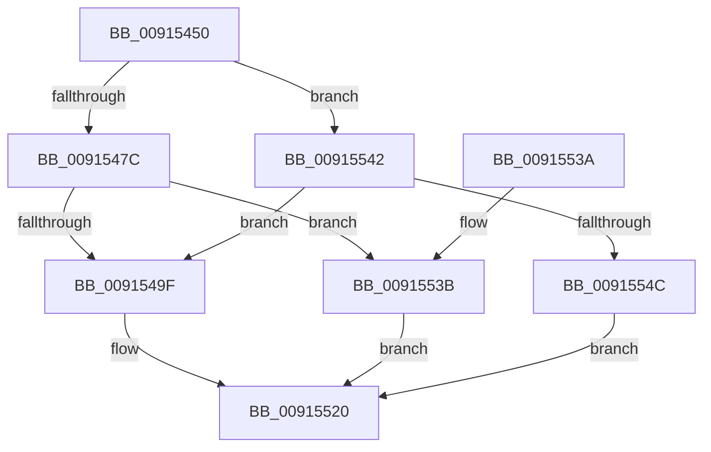

# RtlStringFromGUIDEx

- RVA: `0x00915450`–`0x00915553` (길이 `259` bytes)
- VA: `0x0000000140915450`
- 실행 섹션: `PAGE`
- PDB 이름 있음: `예`; PDB Function 태그: `아니요`
- unwind 정보 RVA: `0x0008A6BC`
- 디코드: `64`개 명령, `259/259` bytes 표시
- 미해석 바이트: `0` (있으면 어셈블리에 `.byte`로 보존)

> 이 문서는 커널 이미지의 기계어와 PDB 기호를 분석해 생성했습니다. 4번과 5번은 함수 원형과 자료형을 바이너리 사용 방식에서 추정한 C 해석이며 원본 소스 복구 결과는 아닙니다.

## 1. Dependencies

- 직접 호출 지점: **2**; 고유 호출 대상: **2**
- 직접 호출자로 확인된 함수: **32**
- RIP 상대 이미지 참조: **1**

### Outgoing calls
- `0x0091548D` → [ExAllocatePool2](../../poolcode/B8/ExAllocatePool2_function_00B820F0.md) (function, `0x00B820F0`)
- `0x00915519` → [swprintf_s](../../text/50/swprintf_s_function_00504B20.md) (function, `0x00504B20`)

### Direct callers
- [KsepEvntLogShimsApplied](../../text/5C/KsepEvntLogShimsApplied_function_005CBBE4.md) at `0x005CBCCD`
- [BapdpMarshallBootDataToRegistry](../../text/65/BapdpMarshallBootDataToRegistry_function_006548A8.md) at `0x00654AF8`
- [IoGetDeviceDirectory](../72/IoGetDeviceDirectory_function_00728370.md) at `0x00728611`
- [PiDevCfgResolveVariableGenerateGuid](../73/PiDevCfgResolveVariableGenerateGuid_function_00735FD0.md) at `0x00736026`
- [PpDevCfgProcessDeviceClass](../73/PpDevCfgProcessDeviceClass_function_00736824.md) at `0x0073695B`
- [RtlpConstructCrossVmObjectPath](../79/RtlpConstructCrossVmObjectPath_function_00790958.md) at `0x00790A17`
- [RtlpConstructCrossVmObjectPath](../79/RtlpConstructCrossVmObjectPath_function_00790958.md) at `0x00790A55`
- [ExpCreateOutputSIGNATURE](../7C/ExpCreateOutputSIGNATURE_function_007CB404.md) at `0x007CB4C7`
- [CmpCloneHwProfile](../7E/CmpCloneHwProfile_function_007E303C.md) at `0x007E35ED`
- [CmpRecoverEnlistment](../7F/CmpRecoverEnlistment_function_007F0014.md) at `0x007F005F`
- [CmpAddRemoveRMLogContainer](../7F/CmpAddRemoveRMLogContainer_function_007F01A0.md) at `0x007F0231`
- [CmpStartRMLog](../7F/CmpStartRMLog_function_007F0AFC.md) at `0x007F0BFA`
- [CmpStartRMLog](../7F/CmpStartRMLog_function_007F0AFC.md) at `0x007F0C87`
- [BiUpdateObjectReferenceInEfiEntry](../82/BiUpdateObjectReferenceInEfiEntry_function_0082745C.md) at `0x00827558`
- [CmpInitCmRM](../87/CmpInitCmRM_function_0087C700.md) at `0x0087C9FF`
- [RtlStringFromGUID](RtlStringFromGUID_function_00914BA0.md) at `0x00914BA7`
- [PopSetNewPolicyValue](PopSetNewPolicyValue_function_00914C6C.md) at `0x00914CA3`
- [BcdOpenObject](BcdOpenObject_function_00916704.md) at `0x00916769`
- [PpDevCfgProcessDeviceReset](../96/PpDevCfgProcessDeviceReset_function_00965498.md) at `0x009655AC`
- [PiDevCfgResetDeviceDriverSettings](../96/PiDevCfgResetDeviceDriverSettings_function_00966168.md) at `0x00966417`
- [PiDevCfgQueryDriverConfiguration](../97/PiDevCfgQueryDriverConfiguration_function_0097584C.md) at `0x00975D5B`
- [IopUpdateSecureDeviceClassState](../9A/IopUpdateSecureDeviceClassState_function_009A2CE8.md) at `0x009A2E18`
- [IopCreateSecureDeviceClassSettings](../9A/IopCreateSecureDeviceClassSettings_function_009A30D8.md) at `0x009A3151`
- [BiCreateObject](../A3/BiCreateObject_function_00A3D92C.md) at `0x00A3D9CF`
- [BcdGetElementDataWithFlags](../A3/BcdGetElementDataWithFlags_function_00A3EBE4.md) at `0x00A3ECA2`
- [BiConvertElementToRegistryData](../A4/BiConvertElementToRegistryData_function_00A400A8.md) at `0x00A4023F`
- [BiConvertElementToRegistryData](../A4/BiConvertElementToRegistryData_function_00A400A8.md) at `0x00A402B7`
- [BiConvertElementToRegistryData](../A4/BiConvertElementToRegistryData_function_00A400A8.md) at `0x00A40498`
- [ExpTranslateEfiPath](../A7/ExpTranslateEfiPath_function_00A7AF84.md) at `0x00A7B043`
- [PipGenerateContainerID](../A8/PipGenerateContainerID_function_00A87694.md) at `0x00A876FC`
- [PiDevCfgResolveVariableDeviceProperty](../AA/PiDevCfgResolveVariableDeviceProperty_function_00AA63A0.md) at `0x00AA6637`
- [PiDevCfgLogDeviceConfigured](../AD/PiDevCfgLogDeviceConfigured_function_00ADCDD4.md) at `0x00ADDA88`
- [ConvertDevpropcompkeyToString](../AF/ConvertDevpropcompkeyToString_function_00AFA604.md) at `0x00AFA660`
- [sub_00B21A3E](../B2/Unknown_function_00B21A3E.md) at `0x00B21A57`
- [sub_00B4588A](../B4/Unknown_function_00B4588A.md) at `0x00B45A48`
- [PipInitComputerIds](../../init/C7/PipInitComputerIds_function_00C74734.md) at `0x00C7565F`
- [PipInitComputerIds](../../init/C7/PipInitComputerIds_function_00C74734.md) at `0x00C757BE`

### Static image references
- `0x009154ED` → RVA `0x00B4D0B0` (`GuidFormat`; read)

## 2. Other-region calls and transfers

- 다른 실행 섹션으로 향하는 call: **2**
  - `0x0091548D` → [ExAllocatePool2](../../poolcode/B8/ExAllocatePool2_function_00B820F0.md) (`PAGE` → `POOLCODE`)
  - `0x00915519` → [swprintf_s](../../text/50/swprintf_s_function_00504B20.md) (`PAGE` → `.text`)
- 별도 외부 분기/꼬리 이동을 확인하지 못했습니다.

## 3. Assembly (complete function range)

```asm
00915450  48 89 5C 24 08                  mov qword ptr [rsp + 8], rbx
00915455  48 89 6C 24 10                  mov qword ptr [rsp + 0x10], rbp
0091545A  48 89 74 24 18                  mov qword ptr [rsp + 0x18], rsi
0091545F  57                              push rdi
00915460  41 56                           push r14
00915462  41 57                           push r15
00915464  48 83 EC 70                     sub rsp, 0x70
00915468  4C 8B F2                        mov r14, rdx
0091546B  4C 8B F9                        mov r15, rcx
0091546E  B8 4E 00 00 00                  mov eax, 0x4e
00915473  45 84 C0                        test r8b, r8b
00915476  0F 84 C6 00 00 00               je 0x140915542
0091547C  66 89 42 02                     mov word ptr [rdx + 2], ax
00915480  41 B8 53 74 72 67               mov r8d, 0x67727453
00915486  8B D0                           mov edx, eax
00915488  B9 00 01 00 00                  mov ecx, 0x100
0091548D  E8 5E CC 26 00                  call 0x140b820f0
00915492  49 89 46 08                     mov qword ptr [r14 + 8], rax
00915496  48 85 C0                        test rax, rax
00915499  0F 84 9C 00 00 00               je 0x14091553b
0091549F  41 0F B7 56 02                  movzx edx, word ptr [r14 + 2]
009154A4  66 41 C7 06 4C 00               mov word ptr [r14], 0x4c
009154AA  41 0F B6 4F 0E                  movzx ecx, byte ptr [r15 + 0xe]
009154AF  45 0F B6 47 0D                  movzx r8d, byte ptr [r15 + 0xd]
009154B4  45 0F B6 4F 0C                  movzx r9d, byte ptr [r15 + 0xc]
009154B9  41 0F B6 47 0F                  movzx eax, byte ptr [r15 + 0xf]
009154BE  45 0F B6 57 0B                  movzx r10d, byte ptr [r15 + 0xb]
009154C3  45 0F B6 5F 0A                  movzx r11d, byte ptr [r15 + 0xa]
009154C8  41 0F B6 5F 09                  movzx ebx, byte ptr [r15 + 9]
009154CD  41 0F B6 7F 08                  movzx edi, byte ptr [r15 + 8]
009154D2  41 0F B7 77 06                  movzx esi, word ptr [r15 + 6]
009154D7  41 0F B7 6F 04                  movzx ebp, word ptr [r15 + 4]
009154DC  89 44 24 68                     mov dword ptr [rsp + 0x68], eax
009154E0  89 4C 24 60                     mov dword ptr [rsp + 0x60], ecx
009154E4  49 8B 4E 08                     mov rcx, qword ptr [r14 + 8]
009154E8  44 89 44 24 58                  mov dword ptr [rsp + 0x58], r8d
009154ED  4C 8D 05 BC 7B 23 00            lea r8, [rip + 0x237bbc]
009154F4  44 89 4C 24 50                  mov dword ptr [rsp + 0x50], r9d
009154F9  45 8B 0F                        mov r9d, dword ptr [r15]
009154FC  44 89 54 24 48                  mov dword ptr [rsp + 0x48], r10d
00915501  44 89 5C 24 40                  mov dword ptr [rsp + 0x40], r11d
00915506  89 5C 24 38                     mov dword ptr [rsp + 0x38], ebx
0091550A  89 7C 24 30                     mov dword ptr [rsp + 0x30], edi
0091550E  89 74 24 28                     mov dword ptr [rsp + 0x28], esi
00915512  48 D1 EA                        shr rdx, 1
00915515  89 6C 24 20                     mov dword ptr [rsp + 0x20], ebp
00915519  E8 02 F6 BE FF                  call 0x140504b20
0091551E  33 C0                           xor eax, eax
00915520  4C 8D 5C 24 70                  lea r11, [rsp + 0x70]
00915525  49 8B 5B 20                     mov rbx, qword ptr [r11 + 0x20]
00915529  49 8B 6B 28                     mov rbp, qword ptr [r11 + 0x28]
0091552D  49 8B 73 30                     mov rsi, qword ptr [r11 + 0x30]
00915531  49 8B E3                        mov rsp, r11
00915534  41 5F                           pop r15
00915536  41 5E                           pop r14
00915538  5F                              pop rdi
00915539  C3                              ret
0091553A  CC                              int3
0091553B  B8 17 00 00 C0                  mov eax, 0xc0000017
00915540  EB DE                           jmp 0x140915520
00915542  66 39 42 02                     cmp word ptr [rdx + 2], ax
00915546  0F 83 53 FF FF FF               jae 0x14091549f
0091554C  B8 23 00 00 C0                  mov eax, 0xc0000023
00915551  EB CD                           jmp 0x140915520
```

## 4. C-style interpretation (structured pseudocode)

```c
__int64 __fastcall RtlStringFromGUIDEx(__int64 a1, __int64 a2, unsigned __int8 a3)
{
    __int64 result;
    __int64 v_rsp;
    unsigned __int64 v_stack_m18;
    unsigned int v_stack_m20;
    unsigned int v_stack_m28;
    unsigned int v_stack_m30;
    unsigned int v_stack_m38;
    unsigned int v_stack_m40;
    unsigned int v_stack_m48;
    unsigned int v_stack_m50;
    unsigned int v_stack_m58;
    unsigned int v_stack_m60;
    unsigned int v_stack_m68;
    unsigned __int64 v_stack_p10;
    unsigned __int64 v_stack_p18;
    unsigned __int64 v_stack_p8;

    v_stack_p8 = v_rbx;
    v_stack_p10 = v_rbp;
    v_stack_p18 = v_rsi;
    v_rsp = (v_rsp) - (112);
    if (a3 == 0) goto loc_00915542;
    *(unsigned __int16 *)(a2 + 2) = 78;
    result = ExAllocatePool2(256, 78, (unsigned int)(0x67727453ULL), a4);
    *(unsigned __int64 *)(a2 + 8) = result;
    if (result == 0) goto loc_0091553B;
loc_0091549F:
    *(unsigned __int16 *)(a2) = 76;
    v_stack_m20 = (unsigned int)(*(unsigned __int8 *)(a1 + 15));
    v_stack_m28 = (unsigned int)(*(unsigned __int8 *)(a1 + 14));
    v_stack_m30 = (unsigned int)(*(unsigned __int8 *)(a1 + 13));
    v_stack_m38 = (unsigned int)(*(unsigned __int8 *)(a1 + 12));
    v_stack_m40 = (unsigned int)(*(unsigned __int8 *)(a1 + 11));
    v_stack_m48 = (unsigned int)(*(unsigned __int8 *)(a1 + 10));
    v_stack_m50 = (unsigned int)(*(unsigned __int8 *)(a1 + 9));
    v_stack_m58 = (unsigned int)(*(unsigned __int8 *)(a1 + 8));
    v_stack_m60 = (unsigned int)(*(unsigned __int16 *)(a1 + 6));
    a2 = (*(unsigned __int16 *)(a2 + 2)) >> (1);
    v_stack_m68 = (unsigned int)(*(unsigned __int16 *)(a1 + 4));
    result = swprintf_s(*(unsigned __int64 *)(a2 + 8), a2, v_rip + 2325436, (unsigned int)(*(unsigned int *)(a1)));
    result = 0;
loc_00915520:
    return result;
loc_0091553B:
    goto loc_00915520;
loc_00915542:
    if ((*(unsigned __int16 *)(a2 + 2)) >= ((unsigned __int16)((unsigned int)(0xC0000017ULL)))) goto loc_0091549F;
    goto loc_00915520;
}
```

## 5. (Beta) C Style

```c
int64_t RtlStringFromGUIDEx(void *Arg1, void *Arg2, uint8_t Arg3)
{
    uint8_t *arg1 = (uint8_t *)Arg1;
    uint8_t *arg2 = (uint8_t *)Arg2;

    int64_t result;
    int64_t local_rsp;
    uint64_t v_stack_m18;
    uint32_t v_stack_m20;
    uint32_t v_stack_m28;
    uint32_t v_stack_m30;
    uint32_t v_stack_m38;
    uint32_t v_stack_m40;
    uint32_t v_stack_m48;
    uint32_t v_stack_m50;
    uint32_t v_stack_m58;
    uint32_t v_stack_m60;
    uint32_t v_stack_m68;
    uint64_t v_stack_p10;
    uint64_t v_stack_p18;
    uint64_t v_stack_p8;

    v_stack_p8 = local_rbx;
    v_stack_p10 = local_rbp;
    v_stack_p18 = local_rsi;
    local_rsp = (local_rsp) - (112);
    if (Arg3 == 0) goto loc_00915542;
    *(uint16_t *)(arg2 + 0x2) = 78;
    result = ExAllocatePool2(256, 78, (uint32_t)(0x67727453ULL), a4);
    *(uint64_t *)(arg2 + 0x8) = result;
    if (result == 0) goto loc_0091553B;
loc_0091549F:
    *(uint16_t *)(arg2) = 76;
    v_stack_m20 = (uint32_t)(*(uint8_t *)(arg1 + 0xF));
    v_stack_m28 = (uint32_t)(*(uint8_t *)(arg1 + 0xE));
    v_stack_m30 = (uint32_t)(*(uint8_t *)(arg1 + 0xD));
    v_stack_m38 = (uint32_t)(*(uint8_t *)(arg1 + 0xC));
    v_stack_m40 = (uint32_t)(*(uint8_t *)(arg1 + 0xB));
    v_stack_m48 = (uint32_t)(*(uint8_t *)(arg1 + 0xA));
    v_stack_m50 = (uint32_t)(*(uint8_t *)(arg1 + 0x9));
    v_stack_m58 = (uint32_t)(*(uint8_t *)(arg1 + 0x8));
    v_stack_m60 = (uint32_t)(*(uint16_t *)(arg1 + 0x6));
    Arg2 = (*(uint16_t *)(arg2 + 0x2)) >> (1);
    v_stack_m68 = (uint32_t)(*(uint16_t *)(arg1 + 0x4));
    result = swprintf_s(*(uint64_t *)(arg2 + 0x8), Arg2, v_rip + 2325436, (uint32_t)(*(uint32_t *)(arg1)));
    result = 0;
loc_00915520:
    return result;
loc_0091553B:
    goto loc_00915520;
loc_00915542:
    if ((*(uint16_t *)(arg2 + 0x2)) >= ((uint16_t)((uint32_t)(0xC0000017ULL)))) goto loc_0091549F;
    goto loc_00915520;
}
```

### 관측된 메모리 오프셋

구조체 형식이 확인되지 않은 접근은 인자 기준의 오프셋으로만 기록했습니다.

| 기준 인자 | 오프셋 표현 | 폭 (bit) | 접근 |
|---|---:|---:|---|
| `Arg1` | `+ 0x0` | `32` | `R` |
| `Arg1` | `+ 0x4` | `16` | `R` |
| `Arg1` | `+ 0x6` | `16` | `R` |
| `Arg1` | `+ 0x8` | `8` | `R` |
| `Arg1` | `+ 0x9` | `8` | `R` |
| `Arg1` | `+ 0xA` | `8` | `R` |
| `Arg1` | `+ 0xB` | `8` | `R` |
| `Arg1` | `+ 0xC` | `8` | `R` |
| `Arg1` | `+ 0xD` | `8` | `R` |
| `Arg1` | `+ 0xE` | `8` | `R` |
| `Arg1` | `+ 0xF` | `8` | `R` |
| `Arg2` | `+ 0x0` | `16` | `W` |
| `Arg2` | `+ 0x2` | `16` | `R` |
| `Arg2` | `+ 0x2` | `16` | `W` |
| `Arg2` | `+ 0x8` | `64` | `R` |
| `Arg2` | `+ 0x8` | `64` | `W` |

## 6. Execution-region graph

[열기: 2D/3D 그래프와 함수 탐색 컨트롤 패널](../../../control-panel.html?section=page&rva=0x00915450&view=graph)

- 2D 그래프는 위에서 아래로 흐르고, 3D 그래프는 빈 공간을 드래그해 회전합니다. Shift+드래그는 이동, 휠은 확대·축소, 함수 노드 선택은 대상 보고서 이동입니다.

### Static fallback


