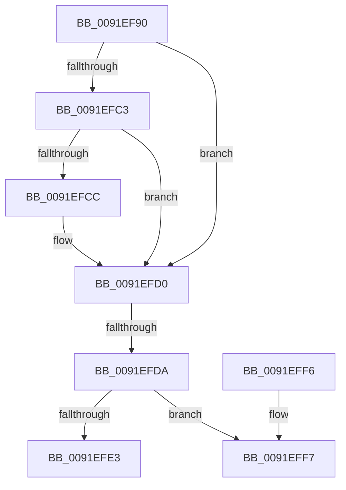

# SeAuditHandleCreation

- RVA: `0x0091EF90`–`0x0091EFFE` (길이 `110` bytes)
- VA: `0x000000014091EF90`
- 실행 섹션: `PAGE`
- PDB 이름 있음: `예`; PDB Function 태그: `아니요`
- unwind 정보 RVA: `0x0008B4D0`
- 디코드: `34`개 명령, `110/110` bytes 표시
- 미해석 바이트: `0` (있으면 어셈블리에 `.byte`로 보존)

> 이 문서는 커널 이미지의 기계어와 PDB 기호를 분석해 생성했습니다. 4번과 5번은 함수 원형과 자료형을 바이너리 사용 방식에서 추정한 C 해석이며 원본 소스 복구 결과는 아닙니다.

## 1. Dependencies

- 직접 호출 지점: **0**; 고유 호출 대상: **0**
- 직접 호출자로 확인된 함수: **1**
- RIP 상대 이미지 참조: **0**

### Outgoing calls
- 직접 디코드된 call 명령이 없습니다.

### Direct callers
- [ObDuplicateObject](../8C/ObDuplicateObject_function_008C4FA0.md) at `0x008C5CAA`

### Static image references
- 디코드된 RIP-relative 메모리 참조가 없습니다.

## 2. Other-region calls and transfers

- 다른 실행 섹션으로 향하는 call: **0**
- call이 아닌 외부 분기/꼬리 이동: **1**
  - `0x0091EFD4` → [sub_0091F1C8 + 0x1](Unknown_function_0091F1C8.md) (`tail-transfer`)

## 3. Assembly (complete function range)

```asm
0091EF90  48 89 54 24 10                  mov qword ptr [rsp + 0x10], rdx
0091EF95  53                              push rbx
0091EF96  56                              push rsi
0091EF97  57                              push rdi
0091EF98  41 55                           push r13
0091EF9A  41 56                           push r14
0091EF9C  48 81 EC B0 00 00 00            sub rsp, 0xb0
0091EFA3  4C 8B 71 48                     mov r14, qword ptr [rcx + 0x48]
0091EFA7  45 33 ED                        xor r13d, r13d
0091EFAA  4C 89 AC 24 E0 00 00 00         mov qword ptr [rsp + 0xe0], r13
0091EFB2  49 8B F8                        mov rdi, r8
0091EFB5  4C 8B D2                        mov r10, rdx
0091EFB8  48 8B D9                        mov rbx, rcx
0091EFBB  41 8B F5                        mov esi, r13d
0091EFBE  4D 85 C0                        test r8, r8
0091EFC1  75 0D                           jne 0x14091efd0
0091EFC3  49 8B 7E 38                     mov rdi, qword ptr [r14 + 0x38]
0091EFC7  48 85 FF                        test rdi, rdi
0091EFCA  75 04                           jne 0x14091efd0
0091EFCC  48 8B 79 40                     mov rdi, qword ptr [rcx + 0x40]
0091EFD0  40 38 71 09                     cmp byte ptr [rcx + 9], sil
0091EFD4  0F 85 EF 01 00 00               jne 0x14091f1c9
0091EFDA  41 38 B6 D8 00 00 00            cmp byte ptr [r14 + 0xd8], sil
0091EFE1  75 14                           jne 0x14091eff7
0091EFE3  40 88 71 0A                     mov byte ptr [rcx + 0xa], sil
0091EFE7  48 81 C4 B0 00 00 00            add rsp, 0xb0
0091EFEE  41 5E                           pop r14
0091EFF0  41 5D                           pop r13
0091EFF2  5F                              pop rdi
0091EFF3  5E                              pop rsi
0091EFF4  5B                              pop rbx
0091EFF5  C3                              ret
0091EFF6  CC                              int3
0091EFF7  48 C7 C1 FF FF FF FF            mov rcx, 0xffffffffffffffff
```

## 4. C-style interpretation (structured pseudocode)

```c
void __fastcall SeAuditHandleCreation(__int64 a1, __int64 a2, __int64 a3)
{
    __int64 v_r13;
    __int64 v_rdi;
    __int64 v_rsp;
    unsigned __int64 v_stack_p10;
    unsigned __int64 v_stack_p8;

    v_stack_p10 = a2;
    v_rsp = (v_rsp) - (176);
    v_r13 = 0;
    v_stack_p8 = 0;
    if (a3 != 0) goto loc_0091EFD0;
    v_rdi = *(unsigned __int64 *)(*(unsigned __int64 *)(a1 + 72) + 56);
    if (*(unsigned __int64 *)(*(unsigned __int64 *)(a1 + 72) + 56) == 0) {
        v_rdi = *(unsigned __int64 *)(a1 + 64);
    }
    if ((*(unsigned __int8 *)(*(unsigned __int64 *)(a1 + 72) + 216)) != 0) goto loc_0091EFF7;
    *(unsigned __int8 *)(a1 + 10) = 0;
    v_rsp = (v_rsp) + (176);
    return;
loc_0091EFF7:
    return;
}
```

## 5. (Beta) C Style

```c
void SeAuditHandleCreation(void *Arg1, int64_t Arg2, int64_t Arg3)
{
    uint8_t *arg1 = (uint8_t *)Arg1;

    int64_t local_r13;
    int64_t local_rdi;
    int64_t local_rsp;
    uint64_t v_stack_p10;
    uint64_t v_stack_p8;

    v_stack_p10 = Arg2;
    local_rsp = (local_rsp) - (176);
    local_r13 = 0;
    v_stack_p8 = 0;
    if (Arg3 != 0) goto loc_0091EFD0;
    local_rdi = *(uint64_t *)(*(uint64_t *)(arg1 + 0x48) + 0x38);
    if (*(uint64_t *)(*(uint64_t *)(arg1 + 0x48) + 0x38) == 0) {
        local_rdi = *(uint64_t *)(arg1 + 0x40);
    }
    if ((*(uint8_t *)(*(uint64_t *)(arg1 + 0x48) + 0xD8)) != 0) goto loc_0091EFF7;
    *(uint8_t *)(arg1 + 0xA) = 0;
    local_rsp = (local_rsp) + (176);
    return;
loc_0091EFF7:
    return;
}
```

### 관측된 메모리 오프셋

구조체 형식이 확인되지 않은 접근은 인자 기준의 오프셋으로만 기록했습니다.

| 기준 인자 | 오프셋 표현 | 폭 (bit) | 접근 |
|---|---:|---:|---|
| `Arg1` | `+ 0x9` | `8` | `R` |
| `Arg1` | `+ 0xA` | `8` | `W` |
| `Arg1` | `+ 0x40` | `64` | `R` |
| `Arg1` | `+ 0x48` | `64` | `R` |

## 6. Execution-region graph

[열기: 2D/3D 그래프와 함수 탐색 컨트롤 패널](../../../control-panel.html?section=page&rva=0x0091EF90&view=graph)

- 2D 그래프는 위에서 아래로 흐르고, 3D 그래프는 빈 공간을 드래그해 회전합니다. Shift+드래그는 이동, 휠은 확대·축소, 함수 노드 선택은 대상 보고서 이동입니다.

### Static fallback


