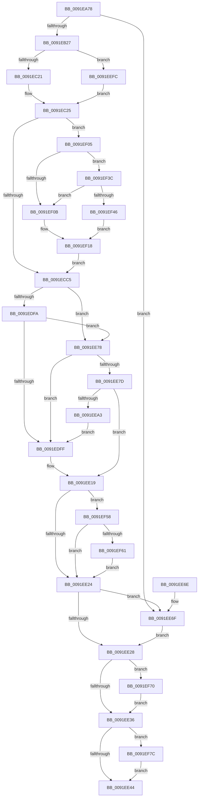

# SeOperationAuditAlarm

- RVA: `0x0091EA78`–`0x0091EF88` (길이 `1,296` bytes)
- VA: `0x000000014091EA78`
- 실행 섹션: `PAGE`
- PDB 이름 있음: `예`; PDB Function 태그: `아니요`
- unwind 정보 RVA: `0x0008B4A8`
- 디코드: `314`개 명령, `1,296/1,296` bytes 표시
- 미해석 바이트: `0` (있으면 어셈블리에 `.byte`로 보존)

> 이 문서는 커널 이미지의 기계어와 PDB 기호를 분석해 생성했습니다. 4번과 5번은 함수 원형과 자료형을 바이너리 사용 방식에서 추정한 C 해석이며 원본 소스 복구 결과는 아닙니다.

## 1. Dependencies

- 직접 호출 지점: **16**; 고유 호출 대상: **14**
- 직접 호출자로 확인된 함수: **1**
- RIP 상대 이미지 참조: **2**

### Outgoing calls
- `0x0091EACA` → [memset](../../text/6C/memset_function_006C6C40.md) (function, `0x006C6C40`)
- `0x0091EAFC` → [SepAdtClassifyObjectIntoSubCategory](SepAdtClassifyObjectIntoSubCategory_function_0091FA60.md) (function, `0x0091FA60`)
- `0x0091EB04` → [PsGetCurrentThreadProcess](../../text/47/PsGetCurrentThreadProcess_function_0047C7E0.md) (function, `0x0047C7E0`)
- `0x0091EB18` → [PsGetAllocatedFullProcessImageNameEx](PsGetAllocatedFullProcessImageNameEx_function_0091D6F0.md) (function, `0x0091D6F0`)
- `0x0091EB50` → [SeCaptureSubjectContext](../86/SeCaptureSubjectContext_function_0086B820.md) (function, `0x0086B820`)
- `0x0091ECA8` → [SepQueryNameString](../8F/SepQueryNameString_function_008F5DE8.md) (function, `0x008F5DE8`)
- `0x0091ECF4` → [ObNormalizeHandleValue](ObNormalizeHandleValue_function_0091E6A8.md) (function, `0x0091E6A8`)
- `0x0091EE0A` → [SepAdtLogAuditRecord](../../text/22/SepAdtLogAuditRecord_function_00224B6C.md) (function, `0x00224B6C`)
- `0x0091EE14` → [SeReleaseSubjectContext](../86/SeReleaseSubjectContext_function_0086B710.md) (function, `0x0086B710`)
- `0x0091EE4E` → [_security_check_cookie](../../text/6A/_security_check_cookie_function_006AC640.md) (function, `0x006AC640`)
- `0x0091EE71` → [SepAuditFailed](../86/SepAuditFailed_function_0086EE20.md) (function, `0x0086EE20`)
- `0x0091EE8F` → [SepCheckAndCopySelfRelativeSD](../../text/4B/SepCheckAndCopySelfRelativeSD_function_004B596C.md) (function, `0x004B596C`)
- `0x0091EEB6` → [SepSecurityDescriptorStrictLength](SepSecurityDescriptorStrictLength_function_0091E6E0.md) (function, `0x0091E6E0`)
- `0x0091EF66` → [ExFreePoolWithTag](../../poolcode/B8/ExFreePoolWithTag_function_00B82870.md) (function, `0x00B82870`)
- `0x0091EF72` → [ExFreePoolWithTag](../../poolcode/B8/ExFreePoolWithTag_function_00B82870.md) (function, `0x00B82870`)
- `0x0091EF7E` → [ExFreePoolWithTag](../../poolcode/B8/ExFreePoolWithTag_function_00B82870.md) (function, `0x00B82870`)

### Direct callers
- [ObpAuditObjectAccess](../94/ObpAuditObjectAccess_function_0094C270.md) at `0x0094C381`

### Static image references
- `0x0091EA97` → RVA `0x00E0A740` (`.data`; read)
- `0x0091EBAD` → RVA `0x000013A8` (`.rdata`; read)

## 2. Other-region calls and transfers

- 다른 실행 섹션으로 향하는 call: **8**
  - `0x0091EACA` → [memset](../../text/6C/memset_function_006C6C40.md) (`PAGE` → `.text`)
  - `0x0091EB04` → [PsGetCurrentThreadProcess](../../text/47/PsGetCurrentThreadProcess_function_0047C7E0.md) (`PAGE` → `.text`)
  - `0x0091EE0A` → [SepAdtLogAuditRecord](../../text/22/SepAdtLogAuditRecord_function_00224B6C.md) (`PAGE` → `.text`)
  - `0x0091EE4E` → [_security_check_cookie](../../text/6A/_security_check_cookie_function_006AC640.md) (`PAGE` → `.text`)
  - `0x0091EE8F` → [SepCheckAndCopySelfRelativeSD](../../text/4B/SepCheckAndCopySelfRelativeSD_function_004B596C.md) (`PAGE` → `.text`)
  - `0x0091EF66` → [ExFreePoolWithTag](../../poolcode/B8/ExFreePoolWithTag_function_00B82870.md) (`PAGE` → `POOLCODE`)
  - `0x0091EF72` → [ExFreePoolWithTag](../../poolcode/B8/ExFreePoolWithTag_function_00B82870.md) (`PAGE` → `POOLCODE`)
  - `0x0091EF7E` → [ExFreePoolWithTag](../../poolcode/B8/ExFreePoolWithTag_function_00B82870.md) (`PAGE` → `POOLCODE`)
- 별도 외부 분기/꼬리 이동을 확인하지 못했습니다.

## 3. Assembly (complete function range)

```asm
0091EA78  48 89 5C 24 08                  mov qword ptr [rsp + 8], rbx
0091EA7D  55                              push rbp
0091EA7E  56                              push rsi
0091EA7F  57                              push rdi
0091EA80  41 54                           push r12
0091EA82  41 55                           push r13
0091EA84  41 56                           push r14
0091EA86  41 57                           push r15
0091EA88  48 8D AC 24 70 FC FF FF         lea rbp, [rsp - 0x390]
0091EA90  48 81 EC 90 04 00 00            sub rsp, 0x490
0091EA97  48 8B 05 A2 BC 4E 00            mov rax, qword ptr [rip + 0x4ebca2]
0091EA9E  48 33 C4                        xor rax, rsp
0091EAA1  48 89 85 80 03 00 00            mov qword ptr [rbp + 0x380], rax
0091EAA8  48 8B 9D 00 04 00 00            mov rbx, qword ptr [rbp + 0x400]
0091EAAF  48 8D 4C 24 60                  lea rcx, [rsp + 0x60]
0091EAB4  4D 8B E0                        mov r12, r8
0091EAB7  48 89 5C 24 28                  mov qword ptr [rsp + 0x28], rbx
0091EABC  4C 8B FA                        mov r15, rdx
0091EABF  41 B8 18 04 00 00               mov r8d, 0x418
0091EAC5  33 D2                           xor edx, edx
0091EAC7  4D 8B F1                        mov r14, r9
0091EACA  E8 71 81 DA FF                  call 0x1406c6c40
0091EACF  33 C0                           xor eax, eax
0091EAD1  0F 57 C0                        xorps xmm0, xmm0
0091EAD4  45 33 C9                        xor r9d, r9d
0091EAD7  48 89 44 24 30                  mov qword ptr [rsp + 0x30], rax
0091EADC  41 B0 01                        mov r8b, 1
0091EADF  48 89 44 24 38                  mov qword ptr [rsp + 0x38], rax
0091EAE4  49 8B D6                        mov rdx, r14
0091EAE7  89 44 24 24                     mov dword ptr [rsp + 0x24], eax
0091EAEB  49 8B CF                        mov rcx, r15
0091EAEE  88 44 24 20                     mov byte ptr [rsp + 0x20], al
0091EAF2  0F 11 44 24 40                  movups xmmword ptr [rsp + 0x40], xmm0
0091EAF7  0F 11 44 24 50                  movups xmmword ptr [rsp + 0x50], xmm0
0091EAFC  E8 5F 0F 00 00                  call 0x14091fa60
0091EB01  0F B7 F0                        movzx esi, ax
0091EB04  E8 D7 DC B5 FF                  call 0x14047c7e0
0091EB09  48 8D 54 24 30                  lea rdx, [rsp + 0x30]
0091EB0E  48 8B C8                        mov rcx, rax
0091EB11  4C 8B A8 D0 01 00 00            mov r13, qword ptr [rax + 0x1d0]
0091EB18  E8 D3 EB FF FF                  call 0x14091d6f0
0091EB1D  8B F8                           mov edi, eax
0091EB1F  85 C0                           test eax, eax
0091EB21  0F 88 48 03 00 00               js 0x14091ee6f
0091EB27  83 64 24 68 00                  and dword ptr [rsp + 0x68], 0
0091EB2C  48 8D 4C 24 40                  lea rcx, [rsp + 0x40]
0091EB31  B8 08 00 00 00                  mov eax, 8
0091EB36  C7 44 24 60 03 00 00 00         mov dword ptr [rsp + 0x60], 3
0091EB3E  66 89 44 24 72                  mov word ptr [rsp + 0x72], ax
0091EB43  66 89 74 24 70                  mov word ptr [rsp + 0x70], si
0091EB48  C7 44 24 64 37 12 00 00         mov dword ptr [rsp + 0x64], 0x1237
0091EB50  E8 CB CC F4 FF                  call 0x14086b820
0091EB55  4C 8B 44 24 40                  mov r8, qword ptr [rsp + 0x40]
0091EB5A  41 BA 01 00 00 00               mov r10d, 1
0091EB60  4C 8B 4C 24 50                  mov r9, qword ptr [rsp + 0x50]
0091EB65  4D 85 C0                        test r8, r8
0091EB68  49 8B C1                        mov rax, r9
0091EB6B  49 0F 45 C0                     cmovne rax, r8
0091EB6F  48 8B 80 98 00 00 00            mov rax, qword ptr [rax + 0x98]
0091EB76  48 8B 10                        mov rdx, qword ptr [rax]
0091EB79  8B 44 24 68                     mov eax, dword ptr [rsp + 0x68]
0091EB7D  48 C1 E0 05                     shl rax, 5
0091EB81  C7 44 04 78 04 00 00 00         mov dword ptr [rsp + rax + 0x78], 4
0091EB89  0F B6 42 01                     movzx eax, byte ptr [rdx + 1]
0091EB8D  8D 0C 85 08 00 00 00            lea ecx, [rax*4 + 8]
0091EB94  8B 44 24 68                     mov eax, dword ptr [rsp + 0x68]
0091EB98  48 C1 E0 05                     shl rax, 5
0091EB9C  89 4C 04 7C                     mov dword ptr [rsp + rax + 0x7c], ecx
0091EBA0  8B 44 24 68                     mov eax, dword ptr [rsp + 0x68]
0091EBA4  48 C1 E0 05                     shl rax, 5
0091EBA8  48 89 54 05 90                  mov qword ptr [rbp + rax - 0x70], rdx
0091EBAD  48 8D 15 F4 27 6E FF            lea rdx, [rip - 0x91d80c]
0091EBB4  8B 44 24 68                     mov eax, dword ptr [rsp + 0x68]
0091EBB8  41 03 C2                        add eax, r10d
0091EBBB  89 44 24 68                     mov dword ptr [rsp + 0x68], eax
0091EBBF  8B C8                           mov ecx, eax
0091EBC1  48 C1 E1 05                     shl rcx, 5
0091EBC5  44 89 54 0C 78                  mov dword ptr [rsp + rcx + 0x78], r10d
0091EBCA  8B 44 24 68                     mov eax, dword ptr [rsp + 0x68]
0091EBCE  48 C1 E0 05                     shl rax, 5
0091EBD2  C7 44 04 7C 20 00 00 00         mov dword ptr [rsp + rax + 0x7c], 0x20
0091EBDA  8B 44 24 68                     mov eax, dword ptr [rsp + 0x68]
0091EBDE  48 C1 E0 05                     shl rax, 5
0091EBE2  48 89 54 05 90                  mov qword ptr [rbp + rax - 0x70], rdx
0091EBE7  8B 44 24 68                     mov eax, dword ptr [rsp + 0x68]
0091EBEB  41 03 C2                        add eax, r10d
0091EBEE  89 44 24 68                     mov dword ptr [rsp + 0x68], eax
0091EBF2  8B C8                           mov ecx, eax
0091EBF4  48 C1 E1 05                     shl rcx, 5
0091EBF8  C7 44 0C 78 05 00 00 00         mov dword ptr [rsp + rcx + 0x78], 5
0091EC00  8B 44 24 68                     mov eax, dword ptr [rsp + 0x68]
0091EC04  48 C1 E0 05                     shl rax, 5
0091EC08  C7 44 04 7C 08 00 00 00         mov dword ptr [rsp + rax + 0x7c], 8
0091EC10  8B 4C 24 68                     mov ecx, dword ptr [rsp + 0x68]
0091EC14  48 C1 E1 05                     shl rcx, 5
0091EC18  4D 85 C0                        test r8, r8
0091EC1B  0F 85 DB 02 00 00               jne 0x14091eefc
0091EC21  49 8B 41 18                     mov rax, qword ptr [r9 + 0x18]
0091EC25  48 89 44 0D 80                  mov qword ptr [rbp + rcx - 0x80], rax
0091EC2A  8B 44 24 68                     mov eax, dword ptr [rsp + 0x68]
0091EC2E  41 03 C2                        add eax, r10d
0091EC31  89 44 24 68                     mov dword ptr [rsp + 0x68], eax
0091EC35  8B C8                           mov ecx, eax
0091EC37  48 C1 E1 05                     shl rcx, 5
0091EC3B  44 89 54 0C 78                  mov dword ptr [rsp + rcx + 0x78], r10d
0091EC40  49 8B CF                        mov rcx, r15
0091EC43  8B 44 24 68                     mov eax, dword ptr [rsp + 0x68]
0091EC47  48 C1 E0 05                     shl rax, 5
0091EC4B  C7 44 04 7C 20 00 00 00         mov dword ptr [rsp + rax + 0x7c], 0x20
0091EC53  8B 44 24 68                     mov eax, dword ptr [rsp + 0x68]
0091EC57  48 C1 E0 05                     shl rax, 5
0091EC5B  48 89 54 05 90                  mov qword ptr [rbp + rax - 0x70], rdx
0091EC60  8B 44 24 68                     mov eax, dword ptr [rsp + 0x68]
0091EC64  41 03 C2                        add eax, r10d
0091EC67  89 44 24 68                     mov dword ptr [rsp + 0x68], eax
0091EC6B  8B D0                           mov edx, eax
0091EC6D  48 C1 E2 05                     shl rdx, 5
0091EC71  44 89 54 14 78                  mov dword ptr [rsp + rdx + 0x78], r10d
0091EC76  8B 44 24 68                     mov eax, dword ptr [rsp + 0x68]
0091EC7A  41 0F B7 16                     movzx edx, word ptr [r14]
0091EC7E  48 C1 E0 05                     shl rax, 5
0091EC82  83 C2 10                        add edx, 0x10
0091EC85  89 54 04 7C                     mov dword ptr [rsp + rax + 0x7c], edx
0091EC89  48 8D 54 24 38                  lea rdx, [rsp + 0x38]
0091EC8E  8B 44 24 68                     mov eax, dword ptr [rsp + 0x68]
0091EC92  48 C1 E0 05                     shl rax, 5
0091EC96  4C 89 74 05 90                  mov qword ptr [rbp + rax - 0x70], r14
0091EC9B  44 8B 74 24 68                  mov r14d, dword ptr [rsp + 0x68]
0091ECA0  41 8D 46 01                     lea eax, [r14 + 1]
0091ECA4  89 44 24 68                     mov dword ptr [rsp + 0x68], eax
0091ECA8  E8 3B 71 FD FF                  call 0x1408f5de8
0091ECAD  48 8B 54 24 38                  mov rdx, qword ptr [rsp + 0x38]
0091ECB2  41 BB 75 00 00 00               mov r11d, 0x75
0091ECB8  45 8D 7B 8D                     lea r15d, [r11 - 0x73]
0091ECBC  48 85 D2                        test rdx, rdx
0091ECBF  0F 85 40 02 00 00               jne 0x14091ef05
0091ECC5  8B 44 24 68                     mov eax, dword ptr [rsp + 0x68]
0091ECC9  41 B9 0B 00 00 00               mov r9d, 0xb
0091ECCF  FF C0                           inc eax
0091ECD1  89 44 24 68                     mov dword ptr [rsp + 0x68], eax
0091ECD5  8B C8                           mov ecx, eax
0091ECD7  48 C1 E1 05                     shl rcx, 5
0091ECDB  45 8D 51 FD                     lea r10d, [r9 - 3]
0091ECDF  44 89 4C 0C 78                  mov dword ptr [rsp + rcx + 0x78], r9d
0091ECE4  49 8B CC                        mov rcx, r12
0091ECE7  8B 44 24 68                     mov eax, dword ptr [rsp + 0x68]
0091ECEB  48 C1 E0 05                     shl rax, 5
0091ECEF  44 89 54 04 7C                  mov dword ptr [rsp + rax + 0x7c], r10d
0091ECF4  E8 AF F9 FF FF                  call 0x14091e6a8
0091ECF9  8B 4C 24 68                     mov ecx, dword ptr [rsp + 0x68]
0091ECFD  45 8D 41 F9                     lea r8d, [r9 - 7]
0091ED01  8B 95 F0 03 00 00               mov edx, dword ptr [rbp + 0x3f0]
0091ED07  48 C1 E1 05                     shl rcx, 5
0091ED0B  48 89 44 0D 80                  mov qword ptr [rbp + rcx - 0x80], rax
0091ED10  8B 44 24 68                     mov eax, dword ptr [rsp + 0x68]
0091ED14  FF C0                           inc eax
0091ED16  89 44 24 68                     mov dword ptr [rsp + 0x68], eax
0091ED1A  8B C8                           mov ecx, eax
0091ED1C  48 C1 E1 05                     shl rcx, 5
0091ED20  C7 44 0C 78 07 00 00 00         mov dword ptr [rsp + rcx + 0x78], 7
0091ED28  8B 44 24 68                     mov eax, dword ptr [rsp + 0x68]
0091ED2C  48 C1 E0 05                     shl rax, 5
0091ED30  44 89 44 04 7C                  mov dword ptr [rsp + rax + 0x7c], r8d
0091ED35  8B 44 24 68                     mov eax, dword ptr [rsp + 0x68]
0091ED39  48 C1 E0 05                     shl rax, 5
0091ED3D  48 89 54 05 80                  mov qword ptr [rbp + rax - 0x80], rdx
0091ED42  8B 44 24 68                     mov eax, dword ptr [rsp + 0x68]
0091ED46  48 C1 E0 05                     shl rax, 5
0091ED4A  4C 89 74 05 88                  mov qword ptr [rbp + rax - 0x78], r14
0091ED4F  8B 44 24 68                     mov eax, dword ptr [rsp + 0x68]
0091ED53  FF C0                           inc eax
0091ED55  89 44 24 68                     mov dword ptr [rsp + 0x68], eax
0091ED59  8B C8                           mov ecx, eax
0091ED5B  48 C1 E1 05                     shl rcx, 5
0091ED5F  C7 44 0C 78 0A 00 00 00         mov dword ptr [rsp + rcx + 0x78], 0xa
0091ED67  8B 44 24 68                     mov eax, dword ptr [rsp + 0x68]
0091ED6B  48 C1 E0 05                     shl rax, 5
0091ED6F  44 89 44 04 7C                  mov dword ptr [rsp + rax + 0x7c], r8d
0091ED74  8B 44 24 68                     mov eax, dword ptr [rsp + 0x68]
0091ED78  48 C1 E0 05                     shl rax, 5
0091ED7C  48 89 54 05 80                  mov qword ptr [rbp + rax - 0x80], rdx
0091ED81  8B 44 24 68                     mov eax, dword ptr [rsp + 0x68]
0091ED85  48 8B 54 24 30                  mov rdx, qword ptr [rsp + 0x30]
0091ED8A  FF C0                           inc eax
0091ED8C  89 44 24 68                     mov dword ptr [rsp + 0x68], eax
0091ED90  8B C8                           mov ecx, eax
0091ED92  48 C1 E1 05                     shl rcx, 5
0091ED96  44 89 4C 0C 78                  mov dword ptr [rsp + rcx + 0x78], r9d
0091ED9B  8B 44 24 68                     mov eax, dword ptr [rsp + 0x68]
0091ED9F  48 C1 E0 05                     shl rax, 5
0091EDA3  44 89 54 04 7C                  mov dword ptr [rsp + rax + 0x7c], r10d
0091EDA8  8B 44 24 68                     mov eax, dword ptr [rsp + 0x68]
0091EDAC  48 C1 E0 05                     shl rax, 5
0091EDB0  4C 89 6C 05 80                  mov qword ptr [rbp + rax - 0x80], r13
0091EDB5  8B 44 24 68                     mov eax, dword ptr [rsp + 0x68]
0091EDB9  FF C0                           inc eax
0091EDBB  89 44 24 68                     mov dword ptr [rsp + 0x68], eax
0091EDBF  8B C8                           mov ecx, eax
0091EDC1  48 C1 E1 05                     shl rcx, 5
0091EDC5  44 89 7C 0C 78                  mov dword ptr [rsp + rcx + 0x78], r15d
0091EDCA  0F B7 0A                        movzx ecx, word ptr [rdx]
0091EDCD  8B 44 24 68                     mov eax, dword ptr [rsp + 0x68]
0091EDD1  83 C1 10                        add ecx, 0x10
0091EDD4  48 C1 E0 05                     shl rax, 5
0091EDD8  89 4C 04 7C                     mov dword ptr [rsp + rax + 0x7c], ecx
0091EDDC  8B 44 24 68                     mov eax, dword ptr [rsp + 0x68]
0091EDE0  48 C1 E0 05                     shl rax, 5
0091EDE4  48 89 54 05 90                  mov qword ptr [rbp + rax - 0x70], rdx
0091EDE9  8B D6                           mov edx, esi
0091EDEB  8B 4C 24 68                     mov ecx, dword ptr [rsp + 0x68]
0091EDEF  FF C1                           inc ecx
0091EDF1  89 4C 24 68                     mov dword ptr [rsp + 0x68], ecx
0091EDF5  41 2B D3                        sub edx, r11d
0091EDF8  74 7E                           je 0x14091ee78
0091EDFA  83 FA 0C                        cmp edx, 0xc
0091EDFD  74 79                           je 0x14091ee78
0091EDFF  FF C1                           inc ecx
0091EE01  89 4C 24 68                     mov dword ptr [rsp + 0x68], ecx
0091EE05  48 8D 4C 24 60                  lea rcx, [rsp + 0x60]
0091EE0A  E8 5D 5D 90 FF                  call 0x140224b6c
0091EE0F  48 8D 4C 24 40                  lea rcx, [rsp + 0x40]
0091EE14  E8 F7 C8 F4 FF                  call 0x14086b710
0091EE19  80 7C 24 20 00                  cmp byte ptr [rsp + 0x20], 0
0091EE1E  0F 85 34 01 00 00               jne 0x14091ef58
0091EE24  85 FF                           test edi, edi
0091EE26  78 47                           js 0x14091ee6f
0091EE28  48 8B 4C 24 30                  mov rcx, qword ptr [rsp + 0x30]
0091EE2D  48 85 C9                        test rcx, rcx
0091EE30  0F 85 3A 01 00 00               jne 0x14091ef70
0091EE36  48 8B 4C 24 38                  mov rcx, qword ptr [rsp + 0x38]
0091EE3B  48 85 C9                        test rcx, rcx
0091EE3E  0F 85 38 01 00 00               jne 0x14091ef7c
0091EE44  48 8B 8D 80 03 00 00            mov rcx, qword ptr [rbp + 0x380]
0091EE4B  48 33 CC                        xor rcx, rsp
0091EE4E  E8 ED D7 D8 FF                  call 0x1406ac640
0091EE53  48 8B 9C 24 D0 04 00 00         mov rbx, qword ptr [rsp + 0x4d0]
0091EE5B  48 81 C4 90 04 00 00            add rsp, 0x490
0091EE62  41 5F                           pop r15
0091EE64  41 5E                           pop r14
0091EE66  41 5D                           pop r13
0091EE68  41 5C                           pop r12
0091EE6A  5F                              pop rdi
0091EE6B  5E                              pop rsi
0091EE6C  5D                              pop rbp
0091EE6D  C3                              ret
0091EE6E  CC                              int3
0091EE6F  8B CF                           mov ecx, edi
0091EE71  E8 AA FF F4 FF                  call 0x14086ee20
0091EE76  EB B0                           jmp 0x14091ee28
0091EE78  48 85 DB                        test rbx, rbx
0091EE7B  74 82                           je 0x14091edff
0091EE7D  4C 8D 4C 24 20                  lea r9, [rsp + 0x20]
0091EE82  48 8B CB                        mov rcx, rbx
0091EE85  4C 8D 44 24 24                  lea r8, [rsp + 0x24]
0091EE8A  48 8D 54 24 28                  lea rdx, [rsp + 0x28]
0091EE8F  E8 D8 6A B9 FF                  call 0x1404b596c
0091EE94  48 8B 5C 24 28                  mov rbx, qword ptr [rsp + 0x28]
0091EE99  8B F8                           mov edi, eax
0091EE9B  85 C0                           test eax, eax
0091EE9D  0F 88 76 FF FF FF               js 0x14091ee19
0091EEA3  8B 44 24 68                     mov eax, dword ptr [rsp + 0x68]
0091EEA7  48 8B CB                        mov rcx, rbx
0091EEAA  48 C1 E0 05                     shl rax, 5
0091EEAE  C7 44 04 78 1F 00 00 00         mov dword ptr [rsp + rax + 0x78], 0x1f
0091EEB6  E8 25 F8 FF FF                  call 0x14091e6e0
0091EEBB  8B 4C 24 68                     mov ecx, dword ptr [rsp + 0x68]
0091EEBF  48 C1 E1 05                     shl rcx, 5
0091EEC3  89 44 0C 7C                     mov dword ptr [rsp + rcx + 0x7c], eax
0091EEC7  8B 44 24 68                     mov eax, dword ptr [rsp + 0x68]
0091EECB  48 C1 E0 05                     shl rax, 5
0091EECF  48 89 5C 05 90                  mov qword ptr [rbp + rax - 0x70], rbx
0091EED4  8B 44 24 68                     mov eax, dword ptr [rsp + 0x68]
0091EED8  48 C1 E0 05                     shl rax, 5
0091EEDC  48 C7 44 05 80 20 00 00 00      mov qword ptr [rbp + rax - 0x80], 0x20
0091EEE5  8B 44 24 68                     mov eax, dword ptr [rsp + 0x68]
0091EEE9  48 C1 E0 05                     shl rax, 5
0091EEED  48 83 64 05 88 00               and qword ptr [rbp + rax - 0x78], 0
0091EEF3  8B 4C 24 68                     mov ecx, dword ptr [rsp + 0x68]
0091EEF7  E9 03 FF FF FF                  jmp 0x14091edff
0091EEFC  49 8B 40 18                     mov rax, qword ptr [r8 + 0x18]
0091EF00  E9 20 FD FF FF                  jmp 0x14091ec25
0091EF05  66 41 3B F3                     cmp si, r11w
0091EF09  75 31                           jne 0x14091ef3c
0091EF0B  8B 44 24 68                     mov eax, dword ptr [rsp + 0x68]
0091EF0F  48 C1 E0 05                     shl rax, 5
0091EF13  44 89 7C 04 78                  mov dword ptr [rsp + rax + 0x78], r15d
0091EF18  8B 44 24 68                     mov eax, dword ptr [rsp + 0x68]
0091EF1C  0F B7 0A                        movzx ecx, word ptr [rdx]
0091EF1F  48 C1 E0 05                     shl rax, 5
0091EF23  83 C1 10                        add ecx, 0x10
0091EF26  89 4C 04 7C                     mov dword ptr [rsp + rax + 0x7c], ecx
0091EF2A  8B 44 24 68                     mov eax, dword ptr [rsp + 0x68]
0091EF2E  48 C1 E0 05                     shl rax, 5
0091EF32  48 89 54 05 90                  mov qword ptr [rbp + rax - 0x70], rdx
0091EF37  E9 89 FD FF FF                  jmp 0x14091ecc5
0091EF3C  B8 81 00 00 00                  mov eax, 0x81
0091EF41  66 3B F0                        cmp si, ax
0091EF44  74 C5                           je 0x14091ef0b
0091EF46  8B 44 24 68                     mov eax, dword ptr [rsp + 0x68]
0091EF4A  48 C1 E0 05                     shl rax, 5
0091EF4E  C7 44 04 78 01 00 00 00         mov dword ptr [rsp + rax + 0x78], 1
0091EF56  EB C0                           jmp 0x14091ef18
0091EF58  48 85 DB                        test rbx, rbx
0091EF5B  0F 84 C3 FE FF FF               je 0x14091ee24
0091EF61  33 D2                           xor edx, edx
0091EF63  48 8B CB                        mov rcx, rbx
0091EF66  E8 05 39 26 00                  call 0x140b82870
0091EF6B  E9 B4 FE FF FF                  jmp 0x14091ee24
0091EF70  33 D2                           xor edx, edx
0091EF72  E8 F9 38 26 00                  call 0x140b82870
0091EF77  E9 BA FE FF FF                  jmp 0x14091ee36
0091EF7C  33 D2                           xor edx, edx
0091EF7E  E8 ED 38 26 00                  call 0x140b82870
0091EF83  E9 BC FE FF FF                  jmp 0x14091ee44
```

## 4. C-style interpretation (structured pseudocode)

```c
__int64 __fastcall SeOperationAuditAlarm(__int64 a1, __int64 a2, __int64 a3, __int64 a4, unsigned int a5, __int64 a6, __int64 a7)
{
    __int64 result;
    __int64 v_rsp;
    unsigned __int64 v_stack_m3C8;
    unsigned __int16 v_stack_m456;
    unsigned __int16 v_stack_m458;
    unsigned int v_stack_m460;
    unsigned int v_stack_m464;
    unsigned __int64 v_stack_m468;
    unsigned __int64 v_stack_m478;
    unsigned __int64 v_stack_m48;
    unsigned __int64 v_stack_m488;
    unsigned __int64 v_stack_m490;
    unsigned __int64 v_stack_m498;
    unsigned __int64 v_stack_m4A0;
    unsigned int v_stack_m4A4;
    unsigned __int8 v_stack_m4A8;
    unsigned __int64 v_stack_p20;
    unsigned __int64 v_stack_p24;
    unsigned __int64 v_stack_p28;
    unsigned int v_stack_p68;
    unsigned __int64 v_stack_p8;

    v_stack_p8 = v_rbx;
    v_rsp = (v_rsp) - (0x490ULL);
    result = (*(unsigned __int64 *)(v_rip + 5160098)) ^ (v_rsp);
    v_stack_m48 = result;
    v_stack_m4A0 = a7;
    a2 = 0;
    result = memset(v_stack_m468, a2, (unsigned int)(0x418ULL), a4);
    result = 0;
    a4 = 0;
    v_stack_m498 = 0;
    v_stack_m490 = 0;
    v_stack_m4A4 = 0;
    v_stack_m4A8 = 0;
    v_stack_m488 = v_xmm0;
    v_stack_m478 = v_xmm0;
    result = SepAdtClassifyObjectIntoSubCategory(0, 0, 1, a4);
    result = PsGetCurrentThreadProcess(0, 0, 1, a4);
    result = PsGetAllocatedFullProcessImageNameEx(result, v_stack_m498, 1, a4);
    if (sign_flag) goto loc_0091EE6F;
    v_stack_m468 = 3;
    v_stack_m456 = 8;
    v_stack_m458 = (unsigned __int16)((unsigned __int16)(result));
    v_stack_m464 = 0x1237ULL;
    result = SeCaptureSubjectContext(v_stack_m488, v_stack_m498, 1, a4);
    result = v_stack_m478;
    if (v_stack_m488 != 0) { result = v_stack_m488; }
    result = ((unsigned int)(v_stack_m460)) << (5);
    *(unsigned int *)(v_rsp + result * 1 + 120) = 4;
    result = ((unsigned int)(v_stack_m460)) << (5);
    *(unsigned int *)(v_rsp + result * 1 + 124) = (unsigned int)(*(unsigned __int8 *)(*(unsigned __int64 *)(*(unsigned __int64 *)(result + 152)) + 1) * 4 + 8);
    result = ((unsigned int)(v_stack_m460)) << (5);
    *(unsigned __int64 *)(v_stack_m3C8 + result * 1 - 112) = *(unsigned __int64 *)(*(unsigned __int64 *)(result + 152));
    result = (unsigned int)(((unsigned int)(v_stack_m460)) + (1));
    v_stack_m460 = (unsigned int)(result);
    a1 = ((unsigned int)((unsigned int)(result))) << (5);
    *(unsigned int *)(v_rsp + a1 * 1 + 120) = 1;
    result = ((unsigned int)(v_stack_m460)) << (5);
    *(unsigned int *)(v_rsp + result * 1 + 124) = 32;
    result = ((unsigned int)(v_stack_m460)) << (5);
    *(unsigned __int64 *)(v_stack_m3C8 + result * 1 - 112) = v_rip - 9558028;
    result = (unsigned int)(((unsigned int)(v_stack_m460)) + (1));
    v_stack_m460 = (unsigned int)(result);
    a1 = ((unsigned int)((unsigned int)(result))) << (5);
    *(unsigned int *)(v_rsp + a1 * 1 + 120) = 5;
    result = ((unsigned int)(v_stack_m460)) << (5);
    *(unsigned int *)(v_rsp + result * 1 + 124) = 8;
    a1 = ((unsigned int)(v_stack_m460)) << (5);
    if (v_stack_m488 != 0) goto loc_0091EEFC;
loc_0091EC25:
    *(unsigned __int64 *)(v_stack_m3C8 + a1 * 1 - 128) = *(unsigned __int64 *)(v_stack_m478 + 24);
    result = (unsigned int)(((unsigned int)(v_stack_m460)) + (1));
    v_stack_m460 = (unsigned int)(result);
    a1 = ((unsigned int)((unsigned int)(result))) << (5);
    *(unsigned int *)(v_rsp + a1 * 1 + 120) = 1;
    result = ((unsigned int)(v_stack_m460)) << (5);
    *(unsigned int *)(v_rsp + result * 1 + 124) = 32;
    result = ((unsigned int)(v_stack_m460)) << (5);
    *(unsigned __int64 *)(v_stack_m3C8 + result * 1 - 112) = v_rip - 9558028;
    result = (unsigned int)(((unsigned int)(v_stack_m460)) + (1));
    v_stack_m460 = (unsigned int)(result);
    a2 = ((unsigned int)((unsigned int)(result))) << (5);
    *(unsigned int *)(v_rsp + a2 * 1 + 120) = 1;
    result = ((unsigned int)(v_stack_m460)) << (5);
    a2 = (unsigned int)((*(unsigned __int16 *)(a4)) + (16));
    *(unsigned int *)(v_rsp + result * 1 + 124) = (unsigned int)(a2);
    result = ((unsigned int)(v_stack_m460)) << (5);
    *(unsigned __int64 *)(v_stack_m3C8 + result * 1 - 112) = 0;
    v_stack_m460 = (unsigned int)((unsigned int)(v_stack_m460) + 1);
    result = SepQueryNameString(0, v_stack_m490, v_stack_m488, v_stack_m478);
    if (v_stack_m490 != 0) goto loc_0091EF05;
loc_0091ECC5:
    result = (unsigned int)(((unsigned int)(v_stack_m460)) + 1);
    v_stack_m460 = (unsigned int)(result);
    a1 = ((unsigned int)((unsigned int)(result))) << (5);
    *(unsigned int *)(v_rsp + a1 * 1 + 120) = 11;
    result = ((unsigned int)(v_stack_m460)) << (5);
    *(unsigned int *)(v_rsp + result * 1 + 124) = (unsigned int)(11 - 3);
    result = ObNormalizeHandleValue(a3, v_stack_m490, v_stack_m488, 11);
    a1 = ((unsigned int)(v_stack_m460)) << (5);
    *(unsigned __int64 *)(v_stack_m3C8 + a1 * 1 - 128) = result;
    result = (unsigned int)(((unsigned int)(v_stack_m460)) + 1);
    v_stack_m460 = (unsigned int)(result);
    a1 = ((unsigned int)((unsigned int)(result))) << (5);
    *(unsigned int *)(v_rsp + a1 * 1 + 120) = 7;
    result = ((unsigned int)(v_stack_m460)) << (5);
    *(unsigned int *)(v_rsp + result * 1 + 124) = (unsigned int)(11 - 7);
    result = ((unsigned int)(v_stack_m460)) << (5);
    *(unsigned __int64 *)(v_stack_m3C8 + result * 1 - 128) = (unsigned int)(a5);
    result = ((unsigned int)(v_stack_m460)) << (5);
    *(unsigned __int64 *)(v_stack_m3C8 + result * 1 - 120) = (unsigned int)(v_stack_m460);
    result = (unsigned int)(((unsigned int)(v_stack_m460)) + 1);
    v_stack_m460 = (unsigned int)(result);
    a1 = ((unsigned int)((unsigned int)(result))) << (5);
    *(unsigned int *)(v_rsp + a1 * 1 + 120) = 10;
    result = ((unsigned int)(v_stack_m460)) << (5);
    *(unsigned int *)(v_rsp + result * 1 + 124) = (unsigned int)(11 - 7);
    result = ((unsigned int)(v_stack_m460)) << (5);
    *(unsigned __int64 *)(v_stack_m3C8 + result * 1 - 128) = (unsigned int)(a5);
    result = (unsigned int)(((unsigned int)(v_stack_m460)) + 1);
    v_stack_m460 = (unsigned int)(result);
    a1 = ((unsigned int)((unsigned int)(result))) << (5);
    *(unsigned int *)(v_rsp + a1 * 1 + 120) = 11;
    result = ((unsigned int)(v_stack_m460)) << (5);
    *(unsigned int *)(v_rsp + result * 1 + 124) = (unsigned int)(11 - 3);
    result = ((unsigned int)(v_stack_m460)) << (5);
    *(unsigned __int64 *)(v_stack_m3C8 + result * 1 - 128) = *(unsigned __int64 *)(result + 464);
    result = (unsigned int)(((unsigned int)(v_stack_m460)) + 1);
    v_stack_m460 = (unsigned int)(result);
    a1 = ((unsigned int)((unsigned int)(result))) << (5);
    *(unsigned int *)(v_rsp + a1 * 1 + 120) = (unsigned int)(117 - 115);
    a1 = (unsigned int)((*(unsigned __int16 *)(v_stack_m498)) + (16));
    result = ((unsigned int)(v_stack_m460)) << (5);
    *(unsigned int *)(v_rsp + result * 1 + 124) = (unsigned int)(a1);
    result = ((unsigned int)(v_stack_m460)) << (5);
    *(unsigned __int64 *)(v_stack_m3C8 + result * 1 - 112) = v_stack_m498;
    a1 = (unsigned int)(((unsigned int)(v_stack_m460)) + 1);
    v_stack_m460 = (unsigned int)(a1);
    a2 = (unsigned int)(((unsigned int)((unsigned int)((unsigned __int16)(result)))) - (117));
    if (condition_is_equal) goto loc_0091EE78;
    if (((unsigned int)(a2)) == 12) goto loc_0091EE78;
loc_0091EDFF:
    a1 = (unsigned int)((a1) + 1);
    v_stack_m460 = (unsigned int)(a1);
    result = SepAdtLogAuditRecord(v_stack_m468, a2, 11 - 7, 11);
    result = SeReleaseSubjectContext(v_stack_m488, a2, 11 - 7, 11);
loc_0091EE19:
    if (v_stack_m4A8 != 0) goto loc_0091EF58;
loc_0091EE24:
    if (sign_flag) goto loc_0091EE6F;
loc_0091EE28:
    if (v_stack_m498 != 0) goto loc_0091EF70;
loc_0091EE36:
    if (v_stack_m490 != 0) goto loc_0091EF7C;
loc_0091EE44:
    a1 = (v_stack_m48) ^ (v_rsp);
    result = _security_check_cookie(a1, a2, 11 - 7, 11);
    v_rsp = (v_rsp) + (0x490ULL);
    return result;
loc_0091EE6F:
    result = SepAuditFailed((unsigned int)((unsigned int)((unsigned int)((unsigned int)(result)))), a2, 11 - 7, 11);
    goto loc_0091EE28;
loc_0091EE78:
    if (v_stack_p8 == 0) goto loc_0091EDFF;
    result = SepCheckAndCopySelfRelativeSD(v_stack_p8, v_stack_p28, v_stack_p24, v_stack_p20);
    if (sign_flag) goto loc_0091EE19;
    result = ((unsigned int)(v_stack_p68)) << (5);
    *(unsigned int *)(v_rsp + result * 1 + 120) = 31;
    result = SepSecurityDescriptorStrictLength(v_stack_p28, v_stack_p28, v_stack_p24, v_stack_p20);
    a1 = ((unsigned int)(v_stack_p68)) << (5);
    *(unsigned int *)(v_rsp + a1 * 1 + 124) = (unsigned int)(result);
    result = ((unsigned int)(v_stack_p68)) << (5);
    *(unsigned __int64 *)(v_stack_m3C8 + result * 1 - 112) = v_stack_p28;
    result = ((unsigned int)(v_stack_p68)) << (5);
    *(unsigned __int64 *)(v_stack_m3C8 + result * 1 - 128) = 32;
    result = ((unsigned int)(v_stack_p68)) << (5);
    goto loc_0091EDFF;
loc_0091EEFC:
    goto loc_0091EC25;
loc_0091EF05:
    if (((unsigned __int16)((unsigned __int16)(result))) != 117) goto loc_0091EF3C;
loc_0091EF0B:
    result = ((unsigned int)(v_stack_p68)) << (5);
    *(unsigned int *)(v_rsp + result * 1 + 120) = (unsigned int)(117 - 115);
loc_0091EF18:
    result = ((unsigned int)(v_stack_p68)) << (5);
    a1 = (unsigned int)((*(unsigned __int16 *)(v_stack_p28)) + (16));
    *(unsigned int *)(v_rsp + result * 1 + 124) = (unsigned int)(a1);
    result = ((unsigned int)(v_stack_p68)) << (5);
    *(unsigned __int64 *)(v_stack_m3C8 + result * 1 - 112) = v_stack_p28;
    goto loc_0091ECC5;
loc_0091EF3C:
    if (((unsigned __int16)((unsigned __int16)(result))) == 129) goto loc_0091EF0B;
    result = ((unsigned int)(v_stack_p68)) << (5);
    *(unsigned int *)(v_rsp + result * 1 + 120) = 1;
    goto loc_0091EF18;
loc_0091EF58:
    if (v_stack_p28 == 0) goto loc_0091EE24;
    a2 = 0;
    result = ExFreePoolWithTag(v_stack_p28, a2, v_stack_p24, v_stack_p20);
    goto loc_0091EE24;
loc_0091EF70:
    a2 = 0;
    result = ExFreePoolWithTag(v_stack_p28, a2, v_stack_p24, v_stack_p20);
    goto loc_0091EE36;
loc_0091EF7C:
    a2 = 0;
    result = ExFreePoolWithTag(v_stack_p28, a2, v_stack_p24, v_stack_p20);
    goto loc_0091EE44;
}
```

## 5. (Beta) C Style

```c
int64_t SeOperationAuditAlarm(int64_t Arg1, int64_t Arg2, int64_t Arg3, void *Arg4, uint32_t Arg5, uint64_t Arg6, int64_t Arg7)
{
    uint8_t *arg4 = (uint8_t *)Arg4;

    int64_t result;
    int64_t local_rsp;
    uint64_t v_stack_m3C8;
    uint16_t v_stack_m456;
    uint16_t v_stack_m458;
    uint32_t v_stack_m460;
    uint32_t v_stack_m464;
    uint64_t v_stack_m468;
    uint64_t v_stack_m478;
    uint64_t v_stack_m48;
    uint64_t v_stack_m488;
    uint64_t v_stack_m490;
    uint64_t v_stack_m498;
    uint64_t v_stack_m4A0;
    uint32_t v_stack_m4A4;
    uint8_t v_stack_m4A8;
    uint64_t v_stack_p20;
    uint64_t v_stack_p24;
    uint64_t v_stack_p28;
    uint32_t v_stack_p68;
    uint64_t v_stack_p8;

    v_stack_p8 = local_rbx;
    local_rsp = (local_rsp) - (0x490ULL);
    result = (*(uint64_t *)(v_rip + 0x4EBCA2)) ^ (local_rsp);
    v_stack_m48 = result;
    v_stack_m4A0 = Arg7;
    Arg2 = 0;
    result = memset(v_stack_m468, Arg2, (uint32_t)(0x418ULL), Arg4);
    result = 0;
    Arg4 = 0;
    v_stack_m498 = 0;
    v_stack_m490 = 0;
    v_stack_m4A4 = 0;
    v_stack_m4A8 = 0;
    v_stack_m488 = v_xmm0;
    v_stack_m478 = v_xmm0;
    result = SepAdtClassifyObjectIntoSubCategory(0, 0, 1, Arg4);
    result = PsGetCurrentThreadProcess(0, 0, 1, Arg4);
    result = PsGetAllocatedFullProcessImageNameEx(result, v_stack_m498, 1, Arg4);
    if (sign_flag) goto loc_0091EE6F;
    v_stack_m468 = 3;
    v_stack_m456 = 8;
    v_stack_m458 = (uint16_t)((uint16_t)(result));
    v_stack_m464 = 0x1237ULL;
    result = SeCaptureSubjectContext(v_stack_m488, v_stack_m498, 1, Arg4);
    result = v_stack_m478;
    if (v_stack_m488 != 0) { result = v_stack_m488; }
    result = ((uint32_t)(v_stack_m460)) << (5);
    *(uint32_t *)(local_rsp + result * 1 + 0x78) = 4;
    result = ((uint32_t)(v_stack_m460)) << (5);
    *(uint32_t *)(local_rsp + result * 1 + 0x7C) = (uint32_t)(*(uint8_t *)(*(uint64_t *)(*(uint64_t *)(result + 0x98)) + 0x1) * 4 + 8);
    result = ((uint32_t)(v_stack_m460)) << (5);
    *(uint64_t *)(v_stack_m3C8 + result * 1 - 0x70) = *(uint64_t *)(*(uint64_t *)(result + 0x98));
    result = (uint32_t)(((uint32_t)(v_stack_m460)) + (1));
    v_stack_m460 = (uint32_t)(result);
    Arg1 = ((uint32_t)((uint32_t)(result))) << (5);
    *(uint32_t *)(local_rsp + Arg1 * 1 + 0x78) = 1;
    result = ((uint32_t)(v_stack_m460)) << (5);
    *(uint32_t *)(local_rsp + result * 1 + 0x7C) = 32;
    result = ((uint32_t)(v_stack_m460)) << (5);
    *(uint64_t *)(v_stack_m3C8 + result * 1 - 0x70) = v_rip - 9558028;
    result = (uint32_t)(((uint32_t)(v_stack_m460)) + (1));
    v_stack_m460 = (uint32_t)(result);
    Arg1 = ((uint32_t)((uint32_t)(result))) << (5);
    *(uint32_t *)(local_rsp + Arg1 * 1 + 0x78) = 5;
    result = ((uint32_t)(v_stack_m460)) << (5);
    *(uint32_t *)(local_rsp + result * 1 + 0x7C) = 8;
    Arg1 = ((uint32_t)(v_stack_m460)) << (5);
    if (v_stack_m488 != 0) goto loc_0091EEFC;
loc_0091EC25:
    *(uint64_t *)(v_stack_m3C8 + Arg1 * 1 - 0x80) = *(uint64_t *)(v_stack_m478 + 0x18);
    result = (uint32_t)(((uint32_t)(v_stack_m460)) + (1));
    v_stack_m460 = (uint32_t)(result);
    Arg1 = ((uint32_t)((uint32_t)(result))) << (5);
    *(uint32_t *)(local_rsp + Arg1 * 1 + 0x78) = 1;
    result = ((uint32_t)(v_stack_m460)) << (5);
    *(uint32_t *)(local_rsp + result * 1 + 0x7C) = 32;
    result = ((uint32_t)(v_stack_m460)) << (5);
    *(uint64_t *)(v_stack_m3C8 + result * 1 - 0x70) = v_rip - 9558028;
    result = (uint32_t)(((uint32_t)(v_stack_m460)) + (1));
    v_stack_m460 = (uint32_t)(result);
    Arg2 = ((uint32_t)((uint32_t)(result))) << (5);
    *(uint32_t *)(local_rsp + Arg2 * 1 + 0x78) = 1;
    result = ((uint32_t)(v_stack_m460)) << (5);
    Arg2 = (uint32_t)((*(uint16_t *)(arg4)) + (16));
    *(uint32_t *)(local_rsp + result * 1 + 0x7C) = (uint32_t)(Arg2);
    result = ((uint32_t)(v_stack_m460)) << (5);
    *(uint64_t *)(v_stack_m3C8 + result * 1 - 0x70) = 0;
    v_stack_m460 = (uint32_t)((uint32_t)(v_stack_m460) + 1);
    result = SepQueryNameString(0, v_stack_m490, v_stack_m488, v_stack_m478);
    if (v_stack_m490 != 0) goto loc_0091EF05;
loc_0091ECC5:
    result = (uint32_t)(((uint32_t)(v_stack_m460)) + 1);
    v_stack_m460 = (uint32_t)(result);
    Arg1 = ((uint32_t)((uint32_t)(result))) << (5);
    *(uint32_t *)(local_rsp + Arg1 * 1 + 0x78) = 11;
    result = ((uint32_t)(v_stack_m460)) << (5);
    *(uint32_t *)(local_rsp + result * 1 + 0x7C) = (uint32_t)(11 - 3);
    result = ObNormalizeHandleValue(Arg3, v_stack_m490, v_stack_m488, 11);
    Arg1 = ((uint32_t)(v_stack_m460)) << (5);
    *(uint64_t *)(v_stack_m3C8 + Arg1 * 1 - 0x80) = result;
    result = (uint32_t)(((uint32_t)(v_stack_m460)) + 1);
    v_stack_m460 = (uint32_t)(result);
    Arg1 = ((uint32_t)((uint32_t)(result))) << (5);
    *(uint32_t *)(local_rsp + Arg1 * 1 + 0x78) = 7;
    result = ((uint32_t)(v_stack_m460)) << (5);
    *(uint32_t *)(local_rsp + result * 1 + 0x7C) = (uint32_t)(11 - 7);
    result = ((uint32_t)(v_stack_m460)) << (5);
    *(uint64_t *)(v_stack_m3C8 + result * 1 - 0x80) = (uint32_t)(Arg5);
    result = ((uint32_t)(v_stack_m460)) << (5);
    *(uint64_t *)(v_stack_m3C8 + result * 1 - 0x78) = (uint32_t)(v_stack_m460);
    result = (uint32_t)(((uint32_t)(v_stack_m460)) + 1);
    v_stack_m460 = (uint32_t)(result);
    Arg1 = ((uint32_t)((uint32_t)(result))) << (5);
    *(uint32_t *)(local_rsp + Arg1 * 1 + 0x78) = 10;
    result = ((uint32_t)(v_stack_m460)) << (5);
    *(uint32_t *)(local_rsp + result * 1 + 0x7C) = (uint32_t)(11 - 7);
    result = ((uint32_t)(v_stack_m460)) << (5);
    *(uint64_t *)(v_stack_m3C8 + result * 1 - 0x80) = (uint32_t)(Arg5);
    result = (uint32_t)(((uint32_t)(v_stack_m460)) + 1);
    v_stack_m460 = (uint32_t)(result);
    Arg1 = ((uint32_t)((uint32_t)(result))) << (5);
    *(uint32_t *)(local_rsp + Arg1 * 1 + 0x78) = 11;
    result = ((uint32_t)(v_stack_m460)) << (5);
    *(uint32_t *)(local_rsp + result * 1 + 0x7C) = (uint32_t)(11 - 3);
    result = ((uint32_t)(v_stack_m460)) << (5);
    *(uint64_t *)(v_stack_m3C8 + result * 1 - 0x80) = *(uint64_t *)(result + 0x1D0);
    result = (uint32_t)(((uint32_t)(v_stack_m460)) + 1);
    v_stack_m460 = (uint32_t)(result);
    Arg1 = ((uint32_t)((uint32_t)(result))) << (5);
    *(uint32_t *)(local_rsp + Arg1 * 1 + 0x78) = (uint32_t)(117 - 115);
    Arg1 = (uint32_t)((*(uint16_t *)(v_stack_m498)) + (16));
    result = ((uint32_t)(v_stack_m460)) << (5);
    *(uint32_t *)(local_rsp + result * 1 + 0x7C) = (uint32_t)(Arg1);
    result = ((uint32_t)(v_stack_m460)) << (5);
    *(uint64_t *)(v_stack_m3C8 + result * 1 - 0x70) = v_stack_m498;
    Arg1 = (uint32_t)(((uint32_t)(v_stack_m460)) + 1);
    v_stack_m460 = (uint32_t)(Arg1);
    Arg2 = (uint32_t)(((uint32_t)((uint32_t)((uint16_t)(result)))) - (117));
    if (condition_is_equal) goto loc_0091EE78;
    if (((uint32_t)(Arg2)) == 12) goto loc_0091EE78;
loc_0091EDFF:
    Arg1 = (uint32_t)((Arg1) + 1);
    v_stack_m460 = (uint32_t)(Arg1);
    result = SepAdtLogAuditRecord(v_stack_m468, Arg2, 11 - 7, 11);
    result = SeReleaseSubjectContext(v_stack_m488, Arg2, 11 - 7, 11);
loc_0091EE19:
    if (v_stack_m4A8 != 0) goto loc_0091EF58;
loc_0091EE24:
    if (sign_flag) goto loc_0091EE6F;
loc_0091EE28:
    if (v_stack_m498 != 0) goto loc_0091EF70;
loc_0091EE36:
    if (v_stack_m490 != 0) goto loc_0091EF7C;
loc_0091EE44:
    Arg1 = (v_stack_m48) ^ (local_rsp);
    result = _security_check_cookie(Arg1, Arg2, 11 - 7, 11);
    local_rsp = (local_rsp) + (0x490ULL);
    return result;
loc_0091EE6F:
    result = SepAuditFailed((uint32_t)((uint32_t)((uint32_t)((uint32_t)(result)))), Arg2, 11 - 7, 11);
    goto loc_0091EE28;
loc_0091EE78:
    if (v_stack_p8 == 0) goto loc_0091EDFF;
    result = SepCheckAndCopySelfRelativeSD(v_stack_p8, v_stack_p28, v_stack_p24, v_stack_p20);
    if (sign_flag) goto loc_0091EE19;
    result = ((uint32_t)(v_stack_p68)) << (5);
    *(uint32_t *)(local_rsp + result * 1 + 0x78) = 31;
    result = SepSecurityDescriptorStrictLength(v_stack_p28, v_stack_p28, v_stack_p24, v_stack_p20);
    Arg1 = ((uint32_t)(v_stack_p68)) << (5);
    *(uint32_t *)(local_rsp + Arg1 * 1 + 0x7C) = (uint32_t)(result);
    result = ((uint32_t)(v_stack_p68)) << (5);
    *(uint64_t *)(v_stack_m3C8 + result * 1 - 0x70) = v_stack_p28;
    result = ((uint32_t)(v_stack_p68)) << (5);
    *(uint64_t *)(v_stack_m3C8 + result * 1 - 0x80) = 32;
    result = ((uint32_t)(v_stack_p68)) << (5);
    goto loc_0091EDFF;
loc_0091EEFC:
    goto loc_0091EC25;
loc_0091EF05:
    if (((uint16_t)((uint16_t)(result))) != 117) goto loc_0091EF3C;
loc_0091EF0B:
    result = ((uint32_t)(v_stack_p68)) << (5);
    *(uint32_t *)(local_rsp + result * 1 + 0x78) = (uint32_t)(117 - 115);
loc_0091EF18:
    result = ((uint32_t)(v_stack_p68)) << (5);
    Arg1 = (uint32_t)((*(uint16_t *)(v_stack_p28)) + (16));
    *(uint32_t *)(local_rsp + result * 1 + 0x7C) = (uint32_t)(Arg1);
    result = ((uint32_t)(v_stack_p68)) << (5);
    *(uint64_t *)(v_stack_m3C8 + result * 1 - 0x70) = v_stack_p28;
    goto loc_0091ECC5;
loc_0091EF3C:
    if (((uint16_t)((uint16_t)(result))) == 129) goto loc_0091EF0B;
    result = ((uint32_t)(v_stack_p68)) << (5);
    *(uint32_t *)(local_rsp + result * 1 + 0x78) = 1;
    goto loc_0091EF18;
loc_0091EF58:
    if (v_stack_p28 == 0) goto loc_0091EE24;
    Arg2 = 0;
    result = ExFreePoolWithTag(v_stack_p28, Arg2, v_stack_p24, v_stack_p20);
    goto loc_0091EE24;
loc_0091EF70:
    Arg2 = 0;
    result = ExFreePoolWithTag(v_stack_p28, Arg2, v_stack_p24, v_stack_p20);
    goto loc_0091EE36;
loc_0091EF7C:
    Arg2 = 0;
    result = ExFreePoolWithTag(v_stack_p28, Arg2, v_stack_p24, v_stack_p20);
    goto loc_0091EE44;
}
```

### 관측된 메모리 오프셋

구조체 형식이 확인되지 않은 접근은 인자 기준의 오프셋으로만 기록했습니다.

| 기준 인자 | 오프셋 표현 | 폭 (bit) | 접근 |
|---|---:|---:|---|
| `Arg4` | `+ 0x0` | `16` | `R` |

## 6. Execution-region graph

[열기: 2D/3D 그래프와 함수 탐색 컨트롤 패널](../../../control-panel.html?section=page&rva=0x0091EA78&view=graph)

- 2D 그래프는 위에서 아래로 흐르고, 3D 그래프는 빈 공간을 드래그해 회전합니다. Shift+드래그는 이동, 휠은 확대·축소, 함수 노드 선택은 대상 보고서 이동입니다.

### Static fallback


