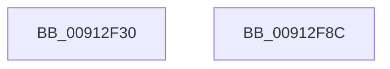

# SeQueryServerSiloToken

- RVA: `0x00912F30`–`0x00912F8D` (길이 `93` bytes)
- VA: `0x0000000140912F30`
- 실행 섹션: `PAGE`
- PDB 이름 있음: `예`; PDB Function 태그: `아니요`
- unwind 정보 RVA: `0x00060BC4`
- 디코드: `25`개 명령, `93/93` bytes 표시
- 미해석 바이트: `0` (있으면 어셈블리에 `.byte`로 보존)

> 이 문서는 커널 이미지의 기계어와 PDB 기호를 분석해 생성했습니다. 4번과 5번은 함수 원형과 자료형을 바이너리 사용 방식에서 추정한 C 해석이며 원본 소스 복구 결과는 아닙니다.

## 1. Dependencies

- 직접 호출 지점: **4**; 고유 호출 대상: **4**
- 직접 호출자로 확인된 함수: **3**
- RIP 상대 이미지 참조: **0**

### Outgoing calls
- `0x00912F5C` → [ExAcquireResourceSharedLite](../../text/21/ExAcquireResourceSharedLite_function_00211BC0.md) (function, `0x00211BC0`)
- `0x00912F68` → [ExReleaseResourceLite](../../text/25/ExReleaseResourceLite_function_0025FA10.md) (function, `0x0025FA10`)
- `0x00912F6D` → [KeLeaveCriticalRegion](../../text/25/KeLeaveCriticalRegion_function_0025D8B0.md) (function, `0x0025D8B0`)
- `0x00912F77` → [PsGetSiloBySessionId](PsGetSiloBySessionId_function_00912F94.md) (function, `0x00912F94`)

### Direct callers
- [SepUpdateSiloInClientSecurity](../AD/SepUpdateSiloInClientSecurity_function_00AD4E10.md) at `0x00AD4E42`
- [NtCreateUserProcess](../AE/NtCreateUserProcess_function_00AEA680.md) at `0x00AEAA7D`
- [sub_00B1943A](../B1/Unknown_function_00B1943A.md) at `0x00B19445`

### Static image references
- 디코드된 RIP-relative 메모리 참조가 없습니다.

## 2. Other-region calls and transfers

- 다른 실행 섹션으로 향하는 call: **3**
  - `0x00912F5C` → [ExAcquireResourceSharedLite](../../text/21/ExAcquireResourceSharedLite_function_00211BC0.md) (`PAGE` → `.text`)
  - `0x00912F68` → [ExReleaseResourceLite](../../text/25/ExReleaseResourceLite_function_0025FA10.md) (`PAGE` → `.text`)
  - `0x00912F6D` → [KeLeaveCriticalRegion](../../text/25/KeLeaveCriticalRegion_function_0025D8B0.md) (`PAGE` → `.text`)
- 별도 외부 분기/꼬리 이동을 확인하지 못했습니다.

## 3. Assembly (complete function range)

```asm
00912F30  48 89 5C 24 08                  mov qword ptr [rsp + 8], rbx
00912F35  48 89 74 24 10                  mov qword ptr [rsp + 0x10], rsi
00912F3A  57                              push rdi
00912F3B  48 83 EC 20                     sub rsp, 0x20
00912F3F  65 48 8B 04 25 88 01 00 00      mov rax, qword ptr gs:[0x188]
00912F48  48 8B F2                        mov rsi, rdx
00912F4B  48 8B F9                        mov rdi, rcx
00912F4E  B2 01                           mov dl, 1
00912F50  66 FF 88 E4 01 00 00            dec word ptr [rax + 0x1e4]
00912F57  90                              nop
00912F58  48 8B 49 30                     mov rcx, qword ptr [rcx + 0x30]
00912F5C  E8 5F EC 8F FF                  call 0x140211bc0
00912F61  48 8B 4F 30                     mov rcx, qword ptr [rdi + 0x30]
00912F65  8B 5F 78                        mov ebx, dword ptr [rdi + 0x78]
00912F68  E8 A3 CA 94 FF                  call 0x14025fa10
00912F6D  E8 3E A9 94 FF                  call 0x14025d8b0
00912F72  48 8B D6                        mov rdx, rsi
00912F75  8B CB                           mov ecx, ebx
00912F77  E8 18 00 00 00                  call 0x140912f94
00912F7C  48 8B 5C 24 30                  mov rbx, qword ptr [rsp + 0x30]
00912F81  48 8B 74 24 38                  mov rsi, qword ptr [rsp + 0x38]
00912F86  48 83 C4 20                     add rsp, 0x20
00912F8A  5F                              pop rdi
00912F8B  C3                              ret
00912F8C  CC                              int3
```

## 4. C-style interpretation (structured pseudocode)

```c
__int64 __fastcall SeQueryServerSiloToken(__int64 a1, __int64 a2)
{
    __int64 result;
    __int64 v_rsp;
    unsigned __int64 v_stack_p10;
    unsigned __int64 v_stack_p8;

    v_stack_p8 = v_rbx;
    v_stack_p10 = v_rsi;
    v_rsp = (v_rsp) - (32);
    result = ExAcquireResourceSharedLite(*(unsigned __int64 *)(a1 + 48), 1, a3, a4);
    result = ExReleaseResourceLite(*(unsigned __int64 *)(a1 + 48), 1, a3, a4);
    result = KeLeaveCriticalRegion(*(unsigned __int64 *)(a1 + 48), 1, a3, a4);
    result = PsGetSiloBySessionId((unsigned int)((unsigned int)((unsigned int)(*(unsigned int *)(a1 + 120)))), a2, a3, a4);
    v_rsp = (v_rsp) + (32);
    return result;
}
```

## 5. (Beta) C Style

```c
int64_t SeQueryServerSiloToken(void *Arg1, int64_t Arg2)
{
    uint8_t *arg1 = (uint8_t *)Arg1;

    int64_t result;
    int64_t local_rsp;
    uint64_t v_stack_p10;
    uint64_t v_stack_p8;

    v_stack_p8 = local_rbx;
    v_stack_p10 = local_rsi;
    local_rsp = (local_rsp) - (32);
    result = ExAcquireResourceSharedLite(*(uint64_t *)(arg1 + 0x30), 1, a3, a4);
    result = ExReleaseResourceLite(*(uint64_t *)(arg1 + 0x30), 1, a3, a4);
    result = KeLeaveCriticalRegion(*(uint64_t *)(arg1 + 0x30), 1, a3, a4);
    result = PsGetSiloBySessionId((uint32_t)((uint32_t)((uint32_t)(*(uint32_t *)(arg1 + 0x78)))), Arg2, a3, a4);
    local_rsp = (local_rsp) + (32);
    return result;
}
```

### 관측된 메모리 오프셋

구조체 형식이 확인되지 않은 접근은 인자 기준의 오프셋으로만 기록했습니다.

| 기준 인자 | 오프셋 표현 | 폭 (bit) | 접근 |
|---|---:|---:|---|
| `Arg1` | `+ 0x30` | `64` | `R` |
| `Arg1` | `+ 0x78` | `32` | `R` |

## 6. Execution-region graph

[열기: 2D/3D 그래프와 함수 탐색 컨트롤 패널](../../../control-panel.html?section=page&rva=0x00912F30&view=graph)

- 2D 그래프는 위에서 아래로 흐르고, 3D 그래프는 빈 공간을 드래그해 회전합니다. Shift+드래그는 이동, 휠은 확대·축소, 함수 노드 선택은 대상 보고서 이동입니다.

### Static fallback


