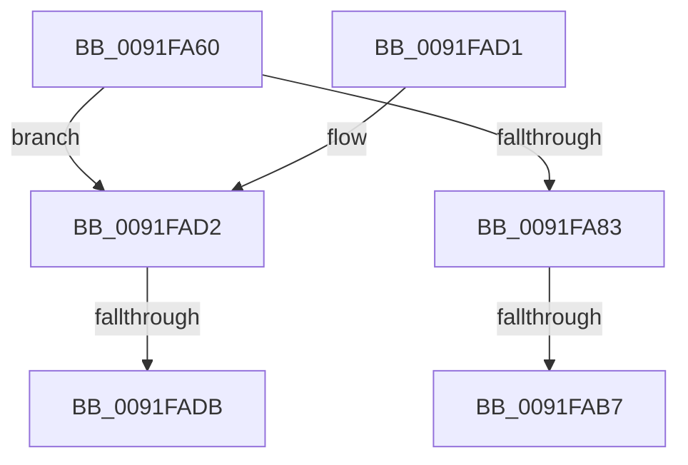

# SepAdtClassifyObjectIntoSubCategory

- RVA: `0x0091FA60`–`0x0091FAE5` (길이 `133` bytes)
- VA: `0x000000014091FA60`
- 실행 섹션: `PAGE`
- PDB 이름 있음: `예`; PDB Function 태그: `아니요`
- unwind 정보 RVA: `0x0008B594`
- 디코드: `33`개 명령, `133/133` bytes 표시
- 미해석 바이트: `0` (있으면 어셈블리에 `.byte`로 보존)

> 이 문서는 커널 이미지의 기계어와 PDB 기호를 분석해 생성했습니다. 4번과 5번은 함수 원형과 자료형을 바이너리 사용 방식에서 추정한 C 해석이며 원본 소스 복구 결과는 아닙니다.

## 1. Dependencies

- 직접 호출 지점: **0**; 고유 호출 대상: **0**
- 직접 호출자로 확인된 함수: **3**
- RIP 상대 이미지 참조: **4**

### Outgoing calls
- 직접 디코드된 call 명령이 없습니다.

### Direct callers
- [ObpCreateHandle](../86/ObpCreateHandle_function_0086B950.md) at `0x0086D2B2`
- [SeOperationAuditAlarm](SeOperationAuditAlarm_function_0091EA78.md) at `0x0091EAFC`
- [sub_0091EFFE](Unknown_function_0091EFFE.md) at `0x0091F086`

### Static image references
- `0x0091FA95` → RVA `0x00FC6E4C` (`ALMOSTRO`; read)
- `0x0091FA9F` → RVA `0x00FC7800` (`ALMOSTRO`; read)
- `0x0091FAAA` → RVA `0x00FC6AC0` (`ALMOSTRO`; read)
- `0x0091FADE` → RVA `0x00002030` (`.rdata`; read)

## 2. Other-region calls and transfers

- 다른 실행 섹션으로 향하는 call: **0**
- call이 아닌 외부 분기/꼬리 이동: **2**
  - `0x0091FAB1` → [sub_0091FB36 + 0x54](Unknown_function_0091FB36.md) (`tail-transfer`)
  - `0x0091FAD5` → [sub_0091FB36 + 0x66](Unknown_function_0091FB36.md) (`tail-transfer`)

## 3. Assembly (complete function range)

```asm
0091FA60  48 89 5C 24 10                  mov qword ptr [rsp + 0x10], rbx
0091FA65  48 89 6C 24 18                  mov qword ptr [rsp + 0x18], rbp
0091FA6A  48 89 74 24 20                  mov qword ptr [rsp + 0x20], rsi
0091FA6F  57                              push rdi
0091FA70  48 83 EC 20                     sub rsp, 0x20
0091FA74  45 0F B6 D8                     movzx r11d, r8b
0091FA78  48 8B FA                        mov rdi, rdx
0091FA7B  4C 8B D1                        mov r10, rcx
0091FA7E  48 85 C9                        test rcx, rcx
0091FA81  74 4F                           je 0x14091fad2
0091FA83  48 8D 41 D0                     lea rax, [rcx - 0x30]
0091FA87  48 C1 E8 08                     shr rax, 8
0091FA8B  0F B6 D0                        movzx edx, al
0091FA8E  0F B6 41 E8                     movzx eax, byte ptr [rcx - 0x18]
0091FA92  48 33 D0                        xor rdx, rax
0091FA95  0F B6 05 B0 73 6A 00            movzx eax, byte ptr [rip + 0x6a73b0]
0091FA9C  48 33 D0                        xor rdx, rax
0091FA9F  48 8D 05 5A 7D 6A 00            lea rax, [rip + 0x6a7d5a]
0091FAA6  48 8B 04 D0                     mov rax, qword ptr [rax + rdx*8]
0091FAAA  48 3B 05 0F 70 6A 00            cmp rax, qword ptr [rip + 0x6a700f]
0091FAB1  0F 85 D3 00 00 00               jne 0x14091fb8a
0091FAB7  B8 76 00 00 00                  mov eax, 0x76
0091FABC  48 8B 5C 24 38                  mov rbx, qword ptr [rsp + 0x38]
0091FAC1  48 8B 6C 24 40                  mov rbp, qword ptr [rsp + 0x40]
0091FAC6  48 8B 74 24 48                  mov rsi, qword ptr [rsp + 0x48]
0091FACB  48 83 C4 20                     add rsp, 0x20
0091FACF  5F                              pop rdi
0091FAD0  C3                              ret
0091FAD1  CC                              int3
0091FAD2  48 85 FF                        test rdi, rdi
0091FAD5  0F 84 C1 00 00 00               je 0x14091fb9c
0091FADB  0F B7 32                        movzx esi, word ptr [rdx]
0091FADE  48 8B 2D 4B 25 6E FF            mov rbp, qword ptr [rip - 0x91dab5]
```

## 4. C-style interpretation (structured pseudocode)

```c
__int64 __fastcall SepAdtClassifyObjectIntoSubCategory(__int64 a1, __int64 a2, unsigned __int8 a3)
{
    __int64 result;
    __int64 v_rsp;
    unsigned __int64 v_stack_p10;
    unsigned __int64 v_stack_p18;
    unsigned __int64 v_stack_p20;

    v_stack_p10 = v_rbx;
    v_stack_p18 = v_rbp;
    v_stack_p20 = v_rsi;
    v_rsp = (v_rsp) - (32);
    if (a1 == 0) goto loc_0091FAD2;
    result = (a1 - 48) >> (8);
    a2 = ((unsigned __int8)(result)) ^ (*(unsigned __int8 *)(a1 - 24));
    a2 = (a2) ^ (*(unsigned __int8 *)(v_rip + 6976432));
    v_rsp = (v_rsp) + (32);
    return 118;
loc_0091FAD2:
    return 118;
}
```

## 5. (Beta) C Style

```c
int64_t SepAdtClassifyObjectIntoSubCategory(int64_t Arg1, void *Arg2, uint8_t Arg3)
{
    uint8_t *arg2 = (uint8_t *)Arg2;

    int64_t result;
    int64_t local_rsp;
    uint64_t v_stack_p10;
    uint64_t v_stack_p18;
    uint64_t v_stack_p20;

    v_stack_p10 = local_rbx;
    v_stack_p18 = local_rbp;
    v_stack_p20 = local_rsi;
    local_rsp = (local_rsp) - (32);
    if (Arg1 == 0) goto loc_0091FAD2;
    result = (Arg1 - 48) >> (8);
    Arg2 = ((uint8_t)(result)) ^ (*(uint8_t *)(Arg1 - 0x18));
    Arg2 = (Arg2) ^ (*(uint8_t *)(v_rip + 0x6A73B0));
    local_rsp = (local_rsp) + (32);
    return 118;
loc_0091FAD2:
    return 118;
}
```

### 관측된 메모리 오프셋

구조체 형식이 확인되지 않은 접근은 인자 기준의 오프셋으로만 기록했습니다.

| 기준 인자 | 오프셋 표현 | 폭 (bit) | 접근 |
|---|---:|---:|---|
| `Arg2` | `+ 0x0` | `16` | `R` |

## 6. Execution-region graph

[열기: 2D/3D 그래프와 함수 탐색 컨트롤 패널](../../../control-panel.html?section=page&rva=0x0091FA60&view=graph)

- 2D 그래프는 위에서 아래로 흐르고, 3D 그래프는 빈 공간을 드래그해 회전합니다. Shift+드래그는 이동, 휠은 확대·축소, 함수 노드 선택은 대상 보고서 이동입니다.

### Static fallback


