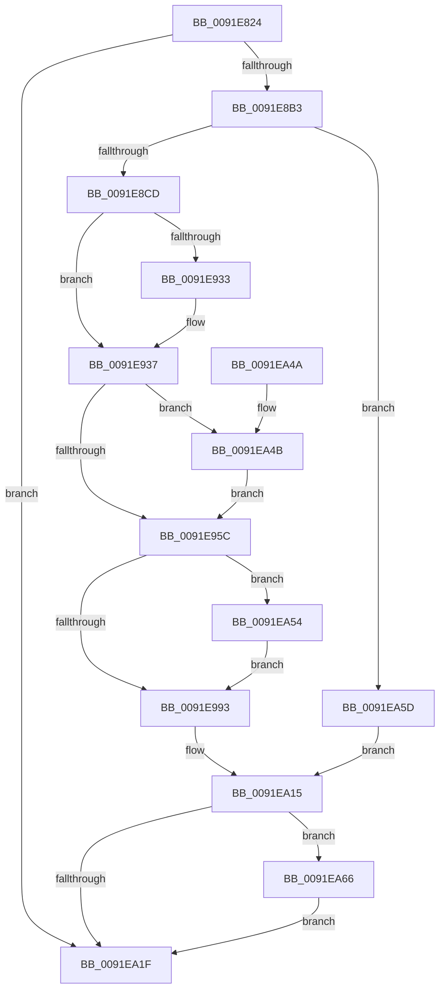

# SepAdtDeleteObjectAuditAlarm

- RVA: `0x0091E824`–`0x0091EA6F` (길이 `587` bytes)
- VA: `0x000000014091E824`
- 실행 섹션: `PAGE`
- PDB 이름 있음: `예`; PDB Function 태그: `아니요`
- unwind 정보 RVA: `0x0008B480`
- 디코드: `137`개 명령, `587/587` bytes 표시
- 미해석 바이트: `0` (있으면 어셈블리에 `.byte`로 보존)

> 이 문서는 커널 이미지의 기계어와 PDB 기호를 분석해 생성했습니다. 4번과 5번은 함수 원형과 자료형을 바이너리 사용 방식에서 추정한 C 해석이며 원본 소스 복구 결과는 아닙니다.

## 1. Dependencies

- 직접 호출 지점: **10**; 고유 호출 대상: **9**
- 직접 호출자로 확인된 함수: **2**
- RIP 상대 이미지 참조: **2**

### Outgoing calls
- `0x0091E8A6` → [SepAdtAuditObjectAccessWithContext](../86/SepAdtAuditObjectAccessWithContext_function_0086EEF0.md) (function, `0x0086EEF0`)
- `0x0091E8B3` → [PsGetCurrentThreadProcess](../../text/47/PsGetCurrentThreadProcess_function_0047C7E0.md) (function, `0x0047C7E0`)
- `0x0091E8C0` → [PsGetAllocatedFullProcessImageNameEx](PsGetAllocatedFullProcessImageNameEx_function_0091D6F0.md) (function, `0x0091D6F0`)
- `0x0091E8E8` → [memset](../../text/6C/memset_function_006C6C40.md) (function, `0x006C6C40`)
- `0x0091E9BA` → [ObNormalizeHandleValue](ObNormalizeHandleValue_function_0091E6A8.md) (function, `0x0091E6A8`)
- `0x0091E9CB` → [PsGetCurrentThreadProcess](../../text/47/PsGetCurrentThreadProcess_function_0047C7E0.md) (function, `0x0047C7E0`)
- `0x0091EA10` → [SepAdtLogAuditRecord](../../text/22/SepAdtLogAuditRecord_function_00224B6C.md) (function, `0x00224B6C`)
- `0x0091EA29` → [_security_check_cookie](../../text/6A/_security_check_cookie_function_006AC640.md) (function, `0x006AC640`)
- `0x0091EA5F` → [SepAuditFailed](../86/SepAuditFailed_function_0086EE20.md) (function, `0x0086EE20`)
- `0x0091EA68` → [ExFreePoolWithTag](../../poolcode/B8/ExFreePoolWithTag_function_00B82870.md) (function, `0x00B82870`)

### Direct callers
- [NtDeleteObjectAuditAlarm](../7A/NtDeleteObjectAuditAlarm_function_007A03C0.md) at `0x007A047F`
- [SeDeleteObjectAuditAlarmWithTransaction](../92/SeDeleteObjectAuditAlarmWithTransaction_function_00920830.md) at `0x00920879`

### Static image references
- `0x0091E845` → RVA `0x00E0A740` (`.data`; read)
- `0x0091E8F2` → RVA `0x000013A8` (`.rdata`; read)

## 2. Other-region calls and transfers

- 다른 실행 섹션으로 향하는 call: **6**
  - `0x0091E8B3` → [PsGetCurrentThreadProcess](../../text/47/PsGetCurrentThreadProcess_function_0047C7E0.md) (`PAGE` → `.text`)
  - `0x0091E8E8` → [memset](../../text/6C/memset_function_006C6C40.md) (`PAGE` → `.text`)
  - `0x0091E9CB` → [PsGetCurrentThreadProcess](../../text/47/PsGetCurrentThreadProcess_function_0047C7E0.md) (`PAGE` → `.text`)
  - `0x0091EA10` → [SepAdtLogAuditRecord](../../text/22/SepAdtLogAuditRecord_function_00224B6C.md) (`PAGE` → `.text`)
  - `0x0091EA29` → [_security_check_cookie](../../text/6A/_security_check_cookie_function_006AC640.md) (`PAGE` → `.text`)
  - `0x0091EA68` → [ExFreePoolWithTag](../../poolcode/B8/ExFreePoolWithTag_function_00B82870.md) (`PAGE` → `POOLCODE`)
- 별도 외부 분기/꼬리 이동을 확인하지 못했습니다.

## 3. Assembly (complete function range)

```asm
0091E824  48 89 5C 24 10                  mov qword ptr [rsp + 0x10], rbx
0091E829  48 89 74 24 18                  mov qword ptr [rsp + 0x18], rsi
0091E82E  55                              push rbp
0091E82F  57                              push rdi
0091E830  41 54                           push r12
0091E832  41 56                           push r14
0091E834  41 57                           push r15
0091E836  48 8D AC 24 70 FC FF FF         lea rbp, [rsp - 0x390]
0091E83E  48 81 EC 90 04 00 00            sub rsp, 0x490
0091E845  48 8B 05 F4 BE 4E 00            mov rax, qword ptr [rip + 0x4ebef4]
0091E84C  48 33 C4                        xor rax, rsp
0091E84F  48 89 85 80 03 00 00            mov qword ptr [rbp + 0x380], rax
0091E856  4C 8B B5 E0 03 00 00            mov r14, qword ptr [rbp + 0x3e0]
0091E85D  48 8D 44 24 40                  lea rax, [rsp + 0x40]
0091E862  48 89 44 24 30                  mov qword ptr [rsp + 0x30], rax
0091E867  4D 8B D1                        mov r10, r9
0091E86A  8A 85 E8 03 00 00               mov al, byte ptr [rbp + 0x3e8]
0091E870  45 33 E4                        xor r12d, r12d
0091E873  4C 8B FA                        mov r15, rdx
0091E876  88 44 24 28                     mov byte ptr [rsp + 0x28], al
0091E87A  49 8B D8                        mov rbx, r8
0091E87D  4C 89 64 24 20                  mov qword ptr [rsp + 0x20], r12
0091E882  48 8B F1                        mov rsi, rcx
0091E885  4C 89 64 24 48                  mov qword ptr [rsp + 0x48], r12
0091E88A  0F 57 C0                        xorps xmm0, xmm0
0091E88D  66 44 89 64 24 40               mov word ptr [rsp + 0x40], r12w
0091E893  48 8B D1                        mov rdx, rcx
0091E896  45 33 C9                        xor r9d, r9d
0091E899  41 B0 01                        mov r8b, 1
0091E89C  49 8B CA                        mov rcx, r10
0091E89F  0F 11 85 70 03 00 00            movups xmmword ptr [rbp + 0x370], xmm0
0091E8A6  E8 45 06 F5 FF                  call 0x14086eef0
0091E8AB  84 C0                           test al, al
0091E8AD  0F 84 6C 01 00 00               je 0x14091ea1f
0091E8B3  E8 28 DF B5 FF                  call 0x14047c7e0
0091E8B8  48 8D 54 24 48                  lea rdx, [rsp + 0x48]
0091E8BD  48 8B C8                        mov rcx, rax
0091E8C0  E8 2B EE FF FF                  call 0x14091d6f0
0091E8C5  85 C0                           test eax, eax
0091E8C7  0F 88 90 01 00 00               js 0x14091ea5d
0091E8CD  4D 85 F6                        test r14, r14
0091E8D0  48 8D BD 70 03 00 00            lea rdi, [rbp + 0x370]
0091E8D7  41 B8 18 04 00 00               mov r8d, 0x418
0091E8DD  48 8D 4C 24 50                  lea rcx, [rsp + 0x50]
0091E8E2  49 0F 45 FE                     cmovne rdi, r14
0091E8E6  33 D2                           xor edx, edx
0091E8E8  E8 53 83 DA FF                  call 0x1406c6c40
0091E8ED  0F B7 44 24 40                  movzx eax, word ptr [rsp + 0x40]
0091E8F2  4C 8D 05 AF 2A 6E FF            lea r8, [rip - 0x91d551]
0091E8F9  48 8B 13                        mov rdx, qword ptr [rbx]
0091E8FC  45 8D 74 24 08                  lea r14d, [r12 + 8]
0091E901  48 85 F6                        test rsi, rsi
0091E904  66 89 44 24 60                  mov word ptr [rsp + 0x60], ax
0091E909  C7 44 24 50 03 00 00 00         mov dword ptr [rsp + 0x50], 3
0091E911  48 8B C2                        mov rax, rdx
0091E914  4C 0F 45 C6                     cmovne r8, rsi
0091E918  C7 44 24 54 34 12 00 00         mov dword ptr [rsp + 0x54], 0x1234
0091E920  66 44 89 74 24 62               mov word ptr [rsp + 0x62], r14w
0091E926  C7 44 24 68 04 00 00 00         mov dword ptr [rsp + 0x68], 4
0091E92E  48 85 D2                        test rdx, rdx
0091E931  75 04                           jne 0x14091e937
0091E933  48 8B 43 10                     mov rax, qword ptr [rbx + 0x10]
0091E937  48 8B 80 98 00 00 00            mov rax, qword ptr [rax + 0x98]
0091E93E  48 8B 08                        mov rcx, qword ptr [rax]
0091E941  0F B6 41 01                     movzx eax, byte ptr [rcx + 1]
0091E945  8D 04 85 08 00 00 00            lea eax, [rax*4 + 8]
0091E94C  89 44 24 6C                     mov dword ptr [rsp + 0x6c], eax
0091E950  48 8B C2                        mov rax, rdx
0091E953  48 85 D2                        test rdx, rdx
0091E956  0F 84 EF 00 00 00               je 0x14091ea4b
0091E95C  48 8B 80 98 00 00 00            mov rax, qword ptr [rax + 0x98]
0091E963  C7 45 88 01 00 00 00            mov dword ptr [rbp - 0x78], 1
0091E96A  4C 89 45 A0                     mov qword ptr [rbp - 0x60], r8
0091E96E  C7 45 A8 05 00 00 00            mov dword ptr [rbp - 0x58], 5
0091E975  48 8B 08                        mov rcx, qword ptr [rax]
0091E978  48 89 4D 80                     mov qword ptr [rbp - 0x80], rcx
0091E97C  41 0F B7 08                     movzx ecx, word ptr [r8]
0091E980  83 C1 10                        add ecx, 0x10
0091E983  44 89 75 AC                     mov dword ptr [rbp - 0x54], r14d
0091E987  89 4D 8C                        mov dword ptr [rbp - 0x74], ecx
0091E98A  48 85 D2                        test rdx, rdx
0091E98D  0F 84 C1 00 00 00               je 0x14091ea54
0091E993  48 8B 42 18                     mov rax, qword ptr [rdx + 0x18]
0091E997  41 B9 0B 00 00 00               mov r9d, 0xb
0091E99D  89 4D CC                        mov dword ptr [rbp - 0x34], ecx
0091E9A0  49 8B CF                        mov rcx, r15
0091E9A3  48 89 45 B0                     mov qword ptr [rbp - 0x50], rax
0091E9A7  44 89 4D E8                     mov dword ptr [rbp - 0x18], r9d
0091E9AB  C7 45 C8 01 00 00 00            mov dword ptr [rbp - 0x38], 1
0091E9B2  4C 89 45 E0                     mov qword ptr [rbp - 0x20], r8
0091E9B6  44 89 75 EC                     mov dword ptr [rbp - 0x14], r14d
0091E9BA  E8 E9 FC FF FF                  call 0x14091e6a8
0091E9BF  48 89 45 F0                     mov qword ptr [rbp - 0x10], rax
0091E9C3  44 89 4D 08                     mov dword ptr [rbp + 8], r9d
0091E9C7  44 89 75 0C                     mov dword ptr [rbp + 0xc], r14d
0091E9CB  E8 10 DE B5 FF                  call 0x14047c7e0
0091E9D0  C7 45 28 02 00 00 00            mov dword ptr [rbp + 0x28], 2
0091E9D7  C7 45 48 0D 00 00 00            mov dword ptr [rbp + 0x48], 0xd
0091E9DE  C7 45 4C 10 00 00 00            mov dword ptr [rbp + 0x4c], 0x10
0091E9E5  48 8B 88 D0 01 00 00            mov rcx, qword ptr [rax + 0x1d0]
0091E9EC  48 89 4D 10                     mov qword ptr [rbp + 0x10], rcx
0091E9F0  48 8B 4C 24 48                  mov rcx, qword ptr [rsp + 0x48]
0091E9F5  48 89 4D 40                     mov qword ptr [rbp + 0x40], rcx
0091E9F9  48 89 7D 60                     mov qword ptr [rbp + 0x60], rdi
0091E9FD  44 89 74 24 58                  mov dword ptr [rsp + 0x58], r14d
0091EA02  0F B7 01                        movzx eax, word ptr [rcx]
0091EA05  48 8D 4C 24 50                  lea rcx, [rsp + 0x50]
0091EA0A  83 C0 10                        add eax, 0x10
0091EA0D  89 45 2C                        mov dword ptr [rbp + 0x2c], eax
0091EA10  E8 57 61 90 FF                  call 0x140224b6c
0091EA15  48 8B 4C 24 48                  mov rcx, qword ptr [rsp + 0x48]
0091EA1A  48 85 C9                        test rcx, rcx
0091EA1D  75 47                           jne 0x14091ea66
0091EA1F  48 8B 8D 80 03 00 00            mov rcx, qword ptr [rbp + 0x380]
0091EA26  48 33 CC                        xor rcx, rsp
0091EA29  E8 12 DC D8 FF                  call 0x1406ac640
0091EA2E  4C 8D 9C 24 90 04 00 00         lea r11, [rsp + 0x490]
0091EA36  49 8B 5B 38                     mov rbx, qword ptr [r11 + 0x38]
0091EA3A  49 8B 73 40                     mov rsi, qword ptr [r11 + 0x40]
0091EA3E  49 8B E3                        mov rsp, r11
0091EA41  41 5F                           pop r15
0091EA43  41 5E                           pop r14
0091EA45  41 5C                           pop r12
0091EA47  5F                              pop rdi
0091EA48  5D                              pop rbp
0091EA49  C3                              ret
0091EA4A  CC                              int3
0091EA4B  48 8B 43 10                     mov rax, qword ptr [rbx + 0x10]
0091EA4F  E9 08 FF FF FF                  jmp 0x14091e95c
0091EA54  48 8B 53 10                     mov rdx, qword ptr [rbx + 0x10]
0091EA58  E9 36 FF FF FF                  jmp 0x14091e993
0091EA5D  8B C8                           mov ecx, eax
0091EA5F  E8 BC 03 F5 FF                  call 0x14086ee20
0091EA64  EB AF                           jmp 0x14091ea15
0091EA66  33 D2                           xor edx, edx
0091EA68  E8 03 3E 26 00                  call 0x140b82870
0091EA6D  EB B0                           jmp 0x14091ea1f
```

## 4. C-style interpretation (structured pseudocode)

```c
__int64 __fastcall SepAdtDeleteObjectAuditAlarm(__int64 a1, __int64 a2, __int64 a3, __int64 a4, __int64 a5, unsigned __int8 a6)
{
    __int64 result;
    __int64 v_r12;
    __int64 v_rdi;
    __int64 v_rsp;
    unsigned __int64 v_stack_m28;
    unsigned __int64 v_stack_m358;
    unsigned int v_stack_m36C;
    unsigned int v_stack_m370;
    unsigned __int64 v_stack_m378;
    unsigned __int64 v_stack_m38;
    unsigned int v_stack_m38C;
    unsigned int v_stack_m390;
    unsigned __int64 v_stack_m3A8;
    unsigned int v_stack_m3AC;
    unsigned int v_stack_m3B0;
    unsigned __int64 v_stack_m3B8;
    unsigned __int64 v_stack_m3C8;
    unsigned int v_stack_m3CC;
    unsigned int v_stack_m3D0;
    unsigned __int64 v_stack_m3D8;
    unsigned int v_stack_m3EC;
    unsigned int v_stack_m3F0;
    unsigned __int64 v_stack_m408;
    unsigned int v_stack_m40C;
    unsigned int v_stack_m410;
    unsigned __int64 v_stack_m418;
    unsigned int v_stack_m42C;
    unsigned int v_stack_m430;
    unsigned __int64 v_stack_m438;
    unsigned int v_stack_m44C;
    unsigned int v_stack_m450;
    unsigned __int16 v_stack_m456;
    unsigned __int16 v_stack_m458;
    unsigned int v_stack_m460;
    unsigned int v_stack_m464;
    unsigned __int64 v_stack_m468;
    unsigned __int64 v_stack_m470;
    unsigned __int64 v_stack_m478;
    unsigned __int64 v_stack_m48;
    unsigned __int64 v_stack_m488;
    unsigned __int8 v_stack_m490;
    unsigned __int64 v_stack_m498;
    unsigned __int64 v_stack_p10;
    unsigned __int64 v_stack_p18;

    v_stack_p10 = v_rbx;
    v_stack_p18 = v_rsi;
    v_rsp = (v_rsp) - (0x490ULL);
    result = (*(unsigned __int64 *)(v_rip + 5160692)) ^ (v_rsp);
    v_stack_m38 = result;
    v_stack_m488 = v_stack_m478;
    v_r12 = 0;
    v_stack_m490 = a6;
    v_stack_m498 = 0;
    v_stack_m470 = 0;
    v_stack_m478 = 0;
    a4 = 0;
    v_stack_m48 = v_xmm0;
    result = SepAdtAuditObjectAccessWithContext(0, a1, 1, a4);
    if ((unsigned __int8)(result) == 0) goto loc_0091EA1F;
    result = PsGetCurrentThreadProcess(0, a1, 1, a4);
    result = PsGetAllocatedFullProcessImageNameEx(result, v_stack_m470, 1, a4);
    if (sign_flag) goto loc_0091EA5D;
    v_rdi = v_stack_m48;
    if (a5 != 0) { v_rdi = a5; }
    a2 = 0;
    result = memset(v_stack_m468, a2, (unsigned int)(0x418ULL), a4);
    v_stack_m458 = (unsigned __int16)(v_stack_m478);
    v_stack_m468 = 3;
    a3 = v_rip - 9557329;
    if (a1 != 0) { a3 = a1; }
    v_stack_m464 = 0x1234ULL;
    v_stack_m456 = (unsigned __int16)(v_r12 + 8);
    v_stack_m450 = 4;
    result = *(unsigned __int64 *)(a3);
    if (*(unsigned __int64 *)(a3) == 0) {
        result = *(unsigned __int64 *)(a3 + 16);
    }
    v_stack_m44C = (unsigned int)(*(unsigned __int8 *)(*(unsigned __int64 *)(*(unsigned __int64 *)(result + 152)) + 1) * 4 + 8);
    if (*(unsigned __int64 *)(a3) == 0) goto loc_0091EA4B;
loc_0091E95C:
    v_stack_m430 = 1;
    v_stack_m418 = a3;
    v_stack_m410 = 5;
    v_stack_m438 = *(unsigned __int64 *)(*(unsigned __int64 *)(*(unsigned __int64 *)(a3) + 152));
    a1 = (unsigned int)((*(unsigned __int16 *)(a3)) + (16));
    v_stack_m40C = (unsigned int)(v_r12 + 8);
    v_stack_m42C = (unsigned int)(a1);
    if (*(unsigned __int64 *)(a3) == 0) goto loc_0091EA54;
loc_0091E993:
    v_stack_m3EC = (unsigned int)(a1);
    v_stack_m408 = *(unsigned __int64 *)(*(unsigned __int64 *)(a3) + 24);
    v_stack_m3D0 = 11;
    v_stack_m3F0 = 1;
    v_stack_m3D8 = a3;
    v_stack_m3CC = (unsigned int)(v_r12 + 8);
    result = ObNormalizeHandleValue(0, *(unsigned __int64 *)(a3), a3, 11);
    v_stack_m3C8 = result;
    v_stack_m3B0 = 11;
    v_stack_m3AC = (unsigned int)(v_r12 + 8);
    result = PsGetCurrentThreadProcess(0, *(unsigned __int64 *)(a3), a3, 11);
    v_stack_m390 = 2;
    v_stack_m370 = 13;
    v_stack_m36C = 16;
    v_stack_m3A8 = *(unsigned __int64 *)(result + 464);
    v_stack_m378 = v_stack_m470;
    v_stack_m358 = v_rdi;
    v_stack_m460 = (unsigned int)(v_r12 + 8);
    result = (unsigned int)((*(unsigned __int16 *)(v_stack_m470)) + (16));
    v_stack_m38C = (unsigned int)(result);
    result = SepAdtLogAuditRecord(v_stack_m468, *(unsigned __int64 *)(a3), a3, 11);
loc_0091EA15:
    if (v_stack_m470 != 0) goto loc_0091EA66;
loc_0091EA1F:
    a1 = (v_stack_m38) ^ (v_rsp);
    result = _security_check_cookie(a1, *(unsigned __int64 *)(a3), a3, 11);
    return result;
loc_0091EA4B:
    goto loc_0091E95C;
loc_0091EA54:
    goto loc_0091E993;
loc_0091EA5D:
    result = SepAuditFailed((unsigned int)((unsigned int)(*(unsigned __int64 *)(*(unsigned __int64 *)(v_stack_m28 + 56) + 16))), *(unsigned __int64 *)(*(unsigned __int64 *)(v_stack_m28 + 56) + 16), a3, 11);
    goto loc_0091EA15;
loc_0091EA66:
    a2 = 0;
    result = ExFreePoolWithTag((unsigned int)((unsigned int)(*(unsigned __int64 *)(*(unsigned __int64 *)(v_stack_m28 + 56) + 16))), a2, a3, 11);
    goto loc_0091EA1F;
}
```

## 5. (Beta) C Style

```c
int64_t SepAdtDeleteObjectAuditAlarm(int64_t Arg1, int64_t Arg2, void *Arg3, int64_t Arg4, int64_t Arg5, uint8_t Arg6)
{
    uint8_t *arg3 = (uint8_t *)Arg3;

    int64_t result;
    int64_t local_r12;
    int64_t local_rdi;
    int64_t local_rsp;
    uint64_t v_stack_m28;
    uint64_t v_stack_m358;
    uint32_t v_stack_m36C;
    uint32_t v_stack_m370;
    uint64_t v_stack_m378;
    uint64_t v_stack_m38;
    uint32_t v_stack_m38C;
    uint32_t v_stack_m390;
    uint64_t v_stack_m3A8;
    uint32_t v_stack_m3AC;
    uint32_t v_stack_m3B0;
    uint64_t v_stack_m3B8;
    uint64_t v_stack_m3C8;
    uint32_t v_stack_m3CC;
    uint32_t v_stack_m3D0;
    uint64_t v_stack_m3D8;
    uint32_t v_stack_m3EC;
    uint32_t v_stack_m3F0;
    uint64_t v_stack_m408;
    uint32_t v_stack_m40C;
    uint32_t v_stack_m410;
    uint64_t v_stack_m418;
    uint32_t v_stack_m42C;
    uint32_t v_stack_m430;
    uint64_t v_stack_m438;
    uint32_t v_stack_m44C;
    uint32_t v_stack_m450;
    uint16_t v_stack_m456;
    uint16_t v_stack_m458;
    uint32_t v_stack_m460;
    uint32_t v_stack_m464;
    uint64_t v_stack_m468;
    uint64_t v_stack_m470;
    uint64_t v_stack_m478;
    uint64_t v_stack_m48;
    uint64_t v_stack_m488;
    uint8_t v_stack_m490;
    uint64_t v_stack_m498;
    uint64_t v_stack_p10;
    uint64_t v_stack_p18;

    v_stack_p10 = local_rbx;
    v_stack_p18 = local_rsi;
    local_rsp = (local_rsp) - (0x490ULL);
    result = (*(uint64_t *)(v_rip + 0x4EBEF4)) ^ (local_rsp);
    v_stack_m38 = result;
    v_stack_m488 = v_stack_m478;
    local_r12 = 0;
    v_stack_m490 = Arg6;
    v_stack_m498 = 0;
    v_stack_m470 = 0;
    v_stack_m478 = 0;
    Arg4 = 0;
    v_stack_m48 = v_xmm0;
    result = SepAdtAuditObjectAccessWithContext(0, Arg1, 1, Arg4);
    if ((uint8_t)(result) == 0) goto loc_0091EA1F;
    result = PsGetCurrentThreadProcess(0, Arg1, 1, Arg4);
    result = PsGetAllocatedFullProcessImageNameEx(result, v_stack_m470, 1, Arg4);
    if (sign_flag) goto loc_0091EA5D;
    local_rdi = v_stack_m48;
    if (Arg5 != 0) { local_rdi = Arg5; }
    Arg2 = 0;
    result = memset(v_stack_m468, Arg2, (uint32_t)(0x418ULL), Arg4);
    v_stack_m458 = (uint16_t)(v_stack_m478);
    v_stack_m468 = 3;
    Arg3 = v_rip - 9557329;
    if (Arg1 != 0) { Arg3 = Arg1; }
    v_stack_m464 = 0x1234ULL;
    v_stack_m456 = (uint16_t)(local_r12 + 8);
    v_stack_m450 = 4;
    result = *(uint64_t *)(arg3);
    if (*(uint64_t *)(arg3) == 0) {
        result = *(uint64_t *)(arg3 + 0x10);
    }
    v_stack_m44C = (uint32_t)(*(uint8_t *)(*(uint64_t *)(*(uint64_t *)(result + 0x98)) + 0x1) * 4 + 8);
    if (*(uint64_t *)(arg3) == 0) goto loc_0091EA4B;
loc_0091E95C:
    v_stack_m430 = 1;
    v_stack_m418 = Arg3;
    v_stack_m410 = 5;
    v_stack_m438 = *(uint64_t *)(*(uint64_t *)(*(uint64_t *)(arg3) + 0x98));
    Arg1 = (uint32_t)((*(uint16_t *)(arg3)) + (16));
    v_stack_m40C = (uint32_t)(local_r12 + 8);
    v_stack_m42C = (uint32_t)(Arg1);
    if (*(uint64_t *)(arg3) == 0) goto loc_0091EA54;
loc_0091E993:
    v_stack_m3EC = (uint32_t)(Arg1);
    v_stack_m408 = *(uint64_t *)(*(uint64_t *)(arg3) + 0x18);
    v_stack_m3D0 = 11;
    v_stack_m3F0 = 1;
    v_stack_m3D8 = Arg3;
    v_stack_m3CC = (uint32_t)(local_r12 + 8);
    result = ObNormalizeHandleValue(0, *(uint64_t *)(arg3), Arg3, 11);
    v_stack_m3C8 = result;
    v_stack_m3B0 = 11;
    v_stack_m3AC = (uint32_t)(local_r12 + 8);
    result = PsGetCurrentThreadProcess(0, *(uint64_t *)(arg3), Arg3, 11);
    v_stack_m390 = 2;
    v_stack_m370 = 13;
    v_stack_m36C = 16;
    v_stack_m3A8 = *(uint64_t *)(result + 0x1D0);
    v_stack_m378 = v_stack_m470;
    v_stack_m358 = local_rdi;
    v_stack_m460 = (uint32_t)(local_r12 + 8);
    result = (uint32_t)((*(uint16_t *)(v_stack_m470)) + (16));
    v_stack_m38C = (uint32_t)(result);
    result = SepAdtLogAuditRecord(v_stack_m468, *(uint64_t *)(arg3), Arg3, 11);
loc_0091EA15:
    if (v_stack_m470 != 0) goto loc_0091EA66;
loc_0091EA1F:
    Arg1 = (v_stack_m38) ^ (local_rsp);
    result = _security_check_cookie(Arg1, *(uint64_t *)(arg3), Arg3, 11);
    return result;
loc_0091EA4B:
    goto loc_0091E95C;
loc_0091EA54:
    goto loc_0091E993;
loc_0091EA5D:
    result = SepAuditFailed((uint32_t)((uint32_t)(*(uint64_t *)(*(uint64_t *)(v_stack_m28 + 0x38) + 0x10))), *(uint64_t *)(*(uint64_t *)(v_stack_m28 + 0x38) + 0x10), Arg3, 11);
    goto loc_0091EA15;
loc_0091EA66:
    Arg2 = 0;
    result = ExFreePoolWithTag((uint32_t)((uint32_t)(*(uint64_t *)(*(uint64_t *)(v_stack_m28 + 0x38) + 0x10))), Arg2, Arg3, 11);
    goto loc_0091EA1F;
}
```

### 관측된 메모리 오프셋

구조체 형식이 확인되지 않은 접근은 인자 기준의 오프셋으로만 기록했습니다.

| 기준 인자 | 오프셋 표현 | 폭 (bit) | 접근 |
|---|---:|---:|---|
| `Arg3` | `+ 0x0` | `64` | `R` |
| `Arg3` | `+ 0x10` | `64` | `R` |

## 6. Execution-region graph

[열기: 2D/3D 그래프와 함수 탐색 컨트롤 패널](../../../control-panel.html?section=page&rva=0x0091E824&view=graph)

- 2D 그래프는 위에서 아래로 흐르고, 3D 그래프는 빈 공간을 드래그해 회전합니다. Shift+드래그는 이동, 휠은 확대·축소, 함수 노드 선택은 대상 보고서 이동입니다.

### Static fallback


