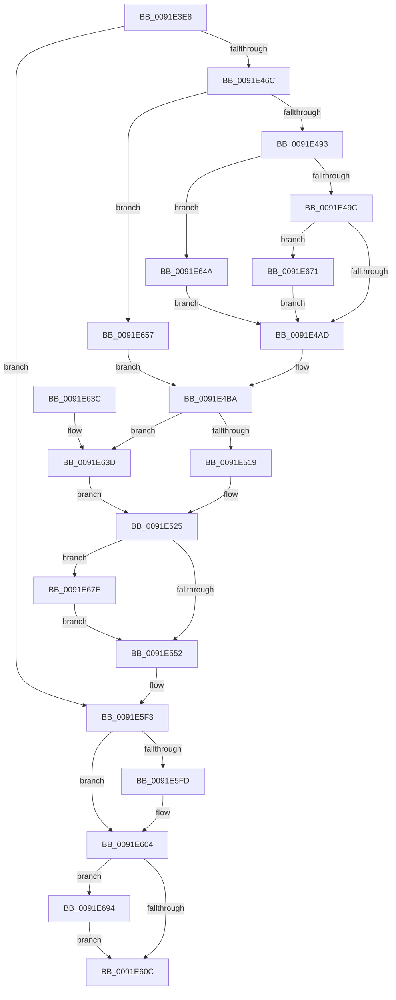

# SepAdtSecurityDescriptorChangedAuditAlarm

- RVA: `0x0091E3E8`–`0x0091E6A0` (길이 `696` bytes)
- VA: `0x000000014091E3E8`
- 실행 섹션: `PAGE`
- PDB 이름 있음: `예`; PDB Function 태그: `아니요`
- unwind 정보 RVA: `0x0008B444`
- 디코드: `156`개 명령, `696/696` bytes 표시
- 미해석 바이트: `0` (있으면 어셈블리에 `.byte`로 보존)

> 이 문서는 커널 이미지의 기계어와 PDB 기호를 분석해 생성했습니다. 4번과 5번은 함수 원형과 자료형을 바이너리 사용 방식에서 추정한 C 해석이며 원본 소스 복구 결과는 아닙니다.

## 1. Dependencies

- 직접 호출 지점: **10**; 고유 호출 대상: **9**
- 직접 호출자로 확인된 함수: **2**
- RIP 상대 이미지 참조: **1**

### Outgoing calls
- `0x0091E444` → [PsGetCurrentThreadProcess](../../text/47/PsGetCurrentThreadProcess_function_0047C7E0.md) (function, `0x0047C7E0`)
- `0x0091E45D` → [PsGetAllocatedFullProcessImageNameEx](PsGetAllocatedFullProcessImageNameEx_function_0091D6F0.md) (function, `0x0091D6F0`)
- `0x0091E479` → [memset](../../text/6C/memset_function_006C6C40.md) (function, `0x006C6C40`)
- `0x0091E567` → [ObNormalizeHandleValue](ObNormalizeHandleValue_function_0091E6A8.md) (function, `0x0091E6A8`)
- `0x0091E57A` → [SepSecurityDescriptorStrictLength](SepSecurityDescriptorStrictLength_function_0091E6E0.md) (function, `0x0091E6E0`)
- `0x0091E59A` → [SepSecurityDescriptorStrictLength](SepSecurityDescriptorStrictLength_function_0091E6E0.md) (function, `0x0091E6E0`)
- `0x0091E5EE` → [SepAdtLogAuditRecord](../../text/22/SepAdtLogAuditRecord_function_00224B6C.md) (function, `0x00224B6C`)
- `0x0091E5FF` → [ExFreePoolWithTag](../../poolcode/B8/ExFreePoolWithTag_function_00B82870.md) (function, `0x00B82870`)
- `0x0091E616` → [_security_check_cookie](../../text/6A/_security_check_cookie_function_006AC640.md) (function, `0x006AC640`)
- `0x0091E696` → [SepAuditFailed](../86/SepAuditFailed_function_0086EE20.md) (function, `0x0086EE20`)

### Direct callers
- [SeSecurityDescriptorChangedAuditAlarm](SeSecurityDescriptorChangedAuditAlarm_function_0091FC5C.md) at `0x009200A7`
- [SeSecurityDescriptorChangedAuditAlarm](SeSecurityDescriptorChangedAuditAlarm_function_0091FC5C.md) at `0x009200F0`
- [SeSecurityDescriptorChangedAuditAlarm](SeSecurityDescriptorChangedAuditAlarm_function_0091FC5C.md) at `0x009203C5`
- [SeSecurityDescriptorChangedAuditAlarm](SeSecurityDescriptorChangedAuditAlarm_function_0091FC5C.md) at `0x00920403`
- [SeTokenDefaultDaclChangedAuditAlarm](../92/SeTokenDefaultDaclChangedAuditAlarm_function_00920570.md) at `0x0092073E`

### Static image references
- `0x0091E40E` → RVA `0x00E0A740` (`.data`; read)

## 2. Other-region calls and transfers

- 다른 실행 섹션으로 향하는 call: **5**
  - `0x0091E444` → [PsGetCurrentThreadProcess](../../text/47/PsGetCurrentThreadProcess_function_0047C7E0.md) (`PAGE` → `.text`)
  - `0x0091E479` → [memset](../../text/6C/memset_function_006C6C40.md) (`PAGE` → `.text`)
  - `0x0091E5EE` → [SepAdtLogAuditRecord](../../text/22/SepAdtLogAuditRecord_function_00224B6C.md) (`PAGE` → `.text`)
  - `0x0091E5FF` → [ExFreePoolWithTag](../../poolcode/B8/ExFreePoolWithTag_function_00B82870.md) (`PAGE` → `POOLCODE`)
  - `0x0091E616` → [_security_check_cookie](../../text/6A/_security_check_cookie_function_006AC640.md) (`PAGE` → `.text`)
- 별도 외부 분기/꼬리 이동을 확인하지 못했습니다.

## 3. Assembly (complete function range)

```asm
0091E3E8  48 8B C4                        mov rax, rsp
0091E3EB  48 89 58 08                     mov qword ptr [rax + 8], rbx
0091E3EF  48 89 70 10                     mov qword ptr [rax + 0x10], rsi
0091E3F3  48 89 78 18                     mov qword ptr [rax + 0x18], rdi
0091E3F7  55                              push rbp
0091E3F8  41 54                           push r12
0091E3FA  41 55                           push r13
0091E3FC  41 56                           push r14
0091E3FE  41 57                           push r15
0091E400  48 8D A8 68 FC FF FF            lea rbp, [rax - 0x398]
0091E407  48 81 EC 70 04 00 00            sub rsp, 0x470
0091E40E  48 8B 05 2B C3 4E 00            mov rax, qword ptr [rip + 0x4ec32b]
0091E415  48 33 C4                        xor rax, rsp
0091E418  48 89 85 60 03 00 00            mov qword ptr [rbp + 0x360], rax
0091E41F  48 8B 85 E0 03 00 00            mov rax, qword ptr [rbp + 0x3e0]
0091E426  49 8B F1                        mov rsi, r9
0091E429  4C 8B AD D0 03 00 00            mov r13, qword ptr [rbp + 0x3d0]
0091E430  4D 8B E0                        mov r12, r8
0091E433  48 83 64 24 20 00               and qword ptr [rsp + 0x20], 0
0091E439  4C 8B F2                        mov r14, rdx
0091E43C  48 89 44 24 28                  mov qword ptr [rsp + 0x28], rax
0091E441  4C 8B F9                        mov r15, rcx
0091E444  E8 97 E3 B5 FF                  call 0x14047c7e0
0091E449  48 8D 54 24 20                  lea rdx, [rsp + 0x20]
0091E44E  48 8B 88 D0 01 00 00            mov rcx, qword ptr [rax + 0x1d0]
0091E455  48 89 4C 24 30                  mov qword ptr [rsp + 0x30], rcx
0091E45A  48 8B C8                        mov rcx, rax
0091E45D  E8 8E F2 FF FF                  call 0x14091d6f0
0091E462  8B F8                           mov edi, eax
0091E464  85 C0                           test eax, eax
0091E466  0F 88 87 01 00 00               js 0x14091e5f3
0091E46C  33 D2                           xor edx, edx
0091E46E  48 8D 4C 24 40                  lea rcx, [rsp + 0x40]
0091E473  41 B8 18 04 00 00               mov r8d, 0x418
0091E479  E8 C2 87 DA FF                  call 0x1406c6c40
0091E47E  8B 9D D8 03 00 00               mov ebx, dword ptr [rbp + 0x3d8]
0091E484  41 B8 08 00 00 00               mov r8d, 8
0091E48A  41 84 D8                        test r8b, bl
0091E48D  0F 85 C4 01 00 00               jne 0x14091e657
0091E493  F6 C3 20                        test bl, 0x20
0091E496  0F 85 AE 01 00 00               jne 0x14091e64a
0091E49C  C7 44 24 44 31 13 00 00         mov dword ptr [rsp + 0x44], 0x1331
0091E4A4  F6 C3 40                        test bl, 0x40
0091E4A7  0F 84 C4 01 00 00               je 0x14091e671
0091E4AD  C7 44 24 40 03 00 00 00         mov dword ptr [rsp + 0x40], 3
0091E4B5  B8 8E 00 00 00                  mov eax, 0x8e
0091E4BA  48 8B 8D C8 03 00 00            mov rcx, qword ptr [rbp + 0x3c8]
0091E4C1  41 B9 01 00 00 00               mov r9d, 1
0091E4C7  41 0F B7 16                     movzx edx, word ptr [r14]
0091E4CB  66 89 44 24 50                  mov word ptr [rsp + 0x50], ax
0091E4D0  83 C2 10                        add edx, 0x10
0091E4D3  66 44 89 44 24 52               mov word ptr [rsp + 0x52], r8w
0091E4D9  0F B6 41 01                     movzx eax, byte ptr [rcx + 1]
0091E4DD  C7 44 24 58 04 00 00 00         mov dword ptr [rsp + 0x58], 4
0091E4E5  48 89 4C 24 70                  mov qword ptr [rsp + 0x70], rcx
0091E4EA  44 89 4C 24 78                  mov dword ptr [rsp + 0x78], r9d
0091E4EF  8D 04 85 08 00 00 00            lea eax, [rax*4 + 8]
0091E4F6  89 54 24 7C                     mov dword ptr [rsp + 0x7c], edx
0091E4FA  89 44 24 5C                     mov dword ptr [rsp + 0x5c], eax
0091E4FE  49 8B 07                        mov rax, qword ptr [r15]
0091E501  4C 89 75 90                     mov qword ptr [rbp - 0x70], r14
0091E505  C7 45 98 05 00 00 00            mov dword ptr [rbp - 0x68], 5
0091E50C  44 89 45 9C                     mov dword ptr [rbp - 0x64], r8d
0091E510  48 85 C0                        test rax, rax
0091E513  0F 85 24 01 00 00               jne 0x14091e63d
0091E519  49 8B 47 10                     mov rax, qword ptr [r15 + 0x10]
0091E51D  48 8B 48 18                     mov rcx, qword ptr [rax + 0x18]
0091E521  48 89 4D A0                     mov qword ptr [rbp - 0x60], rcx
0091E525  41 0F B7 04 24                  movzx eax, word ptr [r12]
0091E52A  41 BF 02 00 00 00               mov r15d, 2
0091E530  83 C0 10                        add eax, 0x10
0091E533  44 89 4D B8                     mov dword ptr [rbp - 0x48], r9d
0091E537  89 55 BC                        mov dword ptr [rbp - 0x44], edx
0091E53A  4C 89 75 D0                     mov qword ptr [rbp - 0x30], r14
0091E53E  44 89 4D D8                     mov dword ptr [rbp - 0x28], r9d
0091E542  89 45 DC                        mov dword ptr [rbp - 0x24], eax
0091E545  4C 89 65 F0                     mov qword ptr [rbp - 0x10], r12
0091E549  48 85 F6                        test rsi, rsi
0091E54C  0F 85 2C 01 00 00               jne 0x14091e67e
0091E552  48 8B 8D C0 03 00 00            mov rcx, qword ptr [rbp + 0x3c0]
0091E559  41 BE 0B 00 00 00               mov r14d, 0xb
0091E55F  44 89 75 18                     mov dword ptr [rbp + 0x18], r14d
0091E563  44 89 45 1C                     mov dword ptr [rbp + 0x1c], r8d
0091E567  E8 3C 01 00 00                  call 0x14091e6a8
0091E56C  41 8D 76 0D                     lea esi, [r14 + 0xd]
0091E570  48 89 45 20                     mov qword ptr [rbp + 0x20], rax
0091E574  49 8B CD                        mov rcx, r13
0091E577  89 75 38                        mov dword ptr [rbp + 0x38], esi
0091E57A  E8 61 01 00 00                  call 0x14091e6e0
0091E57F  48 8B 4C 24 28                  mov rcx, qword ptr [rsp + 0x28]
0091E584  45 8D 66 F9                     lea r12d, [r14 - 7]
0091E588  4C 89 65 48                     mov qword ptr [rbp + 0x48], r12
0091E58C  89 45 3C                        mov dword ptr [rbp + 0x3c], eax
0091E58F  4C 89 6D 50                     mov qword ptr [rbp + 0x50], r13
0091E593  48 89 5D 40                     mov qword ptr [rbp + 0x40], rbx
0091E597  89 75 58                        mov dword ptr [rbp + 0x58], esi
0091E59A  E8 41 01 00 00                  call 0x14091e6e0
0091E59F  89 45 5C                        mov dword ptr [rbp + 0x5c], eax
0091E5A2  48 8B 44 24 30                  mov rax, qword ptr [rsp + 0x30]
0091E5A7  48 89 4D 70                     mov qword ptr [rbp + 0x70], rcx
0091E5AB  48 8B 4C 24 20                  mov rcx, qword ptr [rsp + 0x20]
0091E5B0  48 89 85 80 00 00 00            mov qword ptr [rbp + 0x80], rax
0091E5B7  48 89 8D B0 00 00 00            mov qword ptr [rbp + 0xb0], rcx
0091E5BE  48 89 5D 60                     mov qword ptr [rbp + 0x60], rbx
0091E5C2  0F B7 01                        movzx eax, word ptr [rcx]
0091E5C5  48 8D 4C 24 40                  lea rcx, [rsp + 0x40]
0091E5CA  83 C0 10                        add eax, 0x10
0091E5CD  4C 89 65 68                     mov qword ptr [rbp + 0x68], r12
0091E5D1  89 85 9C 00 00 00               mov dword ptr [rbp + 0x9c], eax
0091E5D7  44 89 75 78                     mov dword ptr [rbp + 0x78], r14d
0091E5DB  C7 45 7C 08 00 00 00            mov dword ptr [rbp + 0x7c], 8
0091E5E2  44 89 BD 98 00 00 00            mov dword ptr [rbp + 0x98], r15d
0091E5E9  44 89 74 24 48                  mov dword ptr [rsp + 0x48], r14d
0091E5EE  E8 79 65 90 FF                  call 0x140224b6c
0091E5F3  48 8B 4C 24 20                  mov rcx, qword ptr [rsp + 0x20]
0091E5F8  48 85 C9                        test rcx, rcx
0091E5FB  74 07                           je 0x14091e604
0091E5FD  33 D2                           xor edx, edx
0091E5FF  E8 6C 42 26 00                  call 0x140b82870
0091E604  85 FF                           test edi, edi
0091E606  0F 88 88 00 00 00               js 0x14091e694
0091E60C  48 8B 8D 60 03 00 00            mov rcx, qword ptr [rbp + 0x360]
0091E613  48 33 CC                        xor rcx, rsp
0091E616  E8 25 E0 D8 FF                  call 0x1406ac640
0091E61B  4C 8D 9C 24 70 04 00 00         lea r11, [rsp + 0x470]
0091E623  49 8B 5B 30                     mov rbx, qword ptr [r11 + 0x30]
0091E627  49 8B 73 38                     mov rsi, qword ptr [r11 + 0x38]
0091E62B  49 8B 7B 40                     mov rdi, qword ptr [r11 + 0x40]
0091E62F  49 8B E3                        mov rsp, r11
0091E632  41 5F                           pop r15
0091E634  41 5E                           pop r14
0091E636  41 5D                           pop r13
0091E638  41 5C                           pop r12
0091E63A  5D                              pop rbp
0091E63B  C3                              ret
0091E63C  CC                              int3
0091E63D  48 8B 40 18                     mov rax, qword ptr [rax + 0x18]
0091E641  48 89 45 A0                     mov qword ptr [rbp - 0x60], rax
0091E645  E9 DB FE FF FF                  jmp 0x14091e525
0091E64A  C7 44 24 44 2F 13 00 00         mov dword ptr [rsp + 0x44], 0x132f
0091E652  E9 56 FE FF FF                  jmp 0x14091e4ad
0091E657  C7 44 24 40 06 00 00 00         mov dword ptr [rsp + 0x40], 6
0091E65F  B8 8C 00 00 00                  mov eax, 0x8c
0091E664  C7 44 24 44 2B 13 00 00         mov dword ptr [rsp + 0x44], 0x132b
0091E66C  E9 49 FE FF FF                  jmp 0x14091e4ba
0091E671  C7 44 24 44 3E 12 00 00         mov dword ptr [rsp + 0x44], 0x123e
0091E679  E9 2F FE FF FF                  jmp 0x14091e4ad
0091E67E  0F B7 06                        movzx eax, word ptr [rsi]
0091E681  83 C0 10                        add eax, 0x10
0091E684  44 89 7D F8                     mov dword ptr [rbp - 8], r15d
0091E688  89 45 FC                        mov dword ptr [rbp - 4], eax
0091E68B  48 89 75 10                     mov qword ptr [rbp + 0x10], rsi
0091E68F  E9 BE FE FF FF                  jmp 0x14091e552
0091E694  8B CF                           mov ecx, edi
0091E696  E8 85 07 F5 FF                  call 0x14086ee20
0091E69B  E9 6C FF FF FF                  jmp 0x14091e60c
```

## 4. C-style interpretation (structured pseudocode)

```c
__int64 __fastcall SepAdtSecurityDescriptorChangedAuditAlarm(__int64 a1, __int64 a2, __int64 a3, __int64 a4)
{
    __int64 result;
    __int64 v_rsp;
    unsigned __int64 v_stack_m28;
    unsigned int v_stack_m41C;
    unsigned int v_stack_m420;
    unsigned __int64 v_stack_m428;
    unsigned int v_stack_m42C;
    unsigned int v_stack_m430;
    unsigned int v_stack_m43C;
    unsigned int v_stack_m440;
    unsigned __int16 v_stack_m446;
    unsigned __int16 v_stack_m448;
    unsigned int v_stack_m450;
    unsigned int v_stack_m454;
    unsigned __int64 v_stack_m458;
    unsigned __int64 v_stack_m468;
    unsigned __int64 v_stack_m470;
    unsigned __int64 v_stack_m478;

    *(unsigned __int64 *)(v_rsp + 8) = v_rbx;
    *(unsigned __int64 *)(v_rsp + 16) = v_rsi;
    *(unsigned __int64 *)(v_rsp + 24) = v_rdi;
    v_rsp = (v_rsp) - (0x470ULL);
    result = (*(unsigned __int64 *)(v_rip + 5161771)) ^ (v_rsp);
    *(unsigned __int64 *)(v_rsp - 920 + 864) = result;
    v_stack_m470 = *(unsigned __int64 *)(v_rsp - 920 + 992);
    result = PsGetCurrentThreadProcess(a1, a2, a3, a4);
    v_stack_m468 = *(unsigned __int64 *)(result + 464);
    result = PsGetAllocatedFullProcessImageNameEx(result, v_stack_m478, a3, a4);
    if (sign_flag) goto loc_0091E5F3;
    a2 = 0;
    result = memset(v_stack_m458, a2, (unsigned int)(0x418ULL), a4);
    if (((8) & ((unsigned __int8)((unsigned int)(*(unsigned int *)(v_rsp - 920 + 984))))) != 0) goto loc_0091E657;
    if ((((unsigned __int8)((unsigned int)(*(unsigned int *)(v_rsp - 920 + 984)))) & (32)) != 0) goto loc_0091E64A;
    v_stack_m454 = 0x1331ULL;
    if ((((unsigned __int8)((unsigned int)(*(unsigned int *)(v_rsp - 920 + 984)))) & (64)) == 0) goto loc_0091E671;
loc_0091E4AD:
    v_stack_m458 = 3;
loc_0091E4BA:
    v_stack_m448 = 142;
    a2 = (unsigned int)((*(unsigned __int16 *)(a2)) + (16));
    v_stack_m446 = 8;
    v_stack_m440 = 4;
    v_stack_m428 = *(unsigned __int64 *)(v_rsp - 920 + 968);
    v_stack_m420 = 1;
    v_stack_m41C = (unsigned int)(a2);
    v_stack_m43C = (unsigned int)(*(unsigned __int8 *)(*(unsigned __int64 *)(v_rsp - 920 + 968) + 1) * 4 + 8);
    *(unsigned __int64 *)(v_rsp - 920 - 112) = a2;
    *(unsigned int *)(v_rsp - 920 - 104) = 5;
    *(unsigned int *)(v_rsp - 920 - 100) = 8;
    if (*(unsigned __int64 *)(a1) != 0) goto loc_0091E63D;
    *(unsigned __int64 *)(v_rsp - 920 - 96) = *(unsigned __int64 *)(*(unsigned __int64 *)(a1 + 16) + 24);
loc_0091E525:
    result = (unsigned int)((*(unsigned __int16 *)(a3)) + (16));
    *(unsigned int *)(v_rsp - 920 - 72) = 1;
    *(unsigned int *)(v_rsp - 920 - 68) = (unsigned int)(a2);
    *(unsigned __int64 *)(v_rsp - 920 - 48) = a2;
    *(unsigned int *)(v_rsp - 920 - 40) = 1;
    *(unsigned int *)(v_rsp - 920 - 36) = (unsigned int)(result);
    *(unsigned __int64 *)(v_rsp - 920 - 16) = a3;
    if (a4 != 0) goto loc_0091E67E;
loc_0091E552:
    *(unsigned int *)(v_rsp - 920 + 24) = 11;
    *(unsigned int *)(v_rsp - 920 + 28) = 8;
    result = ObNormalizeHandleValue(*(unsigned __int64 *)(v_rsp - 920 + 960), a2, 8, 1);
    *(unsigned __int64 *)(v_rsp - 920 + 32) = result;
    *(unsigned int *)(v_rsp - 920 + 56) = (unsigned int)(11 + 13);
    result = SepSecurityDescriptorStrictLength(*(unsigned __int64 *)(v_rsp - 920 + 976), a2, 8, 1);
    *(unsigned __int64 *)(v_rsp - 920 + 72) = 11 - 7;
    *(unsigned int *)(v_rsp - 920 + 60) = (unsigned int)(result);
    *(unsigned __int64 *)(v_rsp - 920 + 80) = *(unsigned __int64 *)(v_rsp - 920 + 976);
    *(unsigned __int64 *)(v_rsp - 920 + 64) = (unsigned int)(*(unsigned int *)(v_rsp - 920 + 984));
    *(unsigned int *)(v_rsp - 920 + 88) = (unsigned int)(11 + 13);
    result = SepSecurityDescriptorStrictLength(v_stack_m470, a2, 8, 1);
    *(unsigned int *)(v_rsp - 920 + 92) = (unsigned int)(result);
    *(unsigned __int64 *)(v_rsp - 920 + 112) = v_stack_m470;
    *(unsigned __int64 *)(v_rsp - 920 + 128) = v_stack_m468;
    *(unsigned __int64 *)(v_rsp - 920 + 176) = v_stack_m478;
    *(unsigned __int64 *)(v_rsp - 920 + 96) = (unsigned int)(*(unsigned int *)(v_rsp - 920 + 984));
    result = (unsigned int)((*(unsigned __int16 *)(v_stack_m478)) + (16));
    *(unsigned __int64 *)(v_rsp - 920 + 104) = 11 - 7;
    *(unsigned int *)(v_rsp - 920 + 156) = (unsigned int)(result);
    *(unsigned int *)(v_rsp - 920 + 120) = 11;
    *(unsigned int *)(v_rsp - 920 + 124) = 8;
    *(unsigned int *)(v_rsp - 920 + 152) = 2;
    v_stack_m450 = 11;
    result = SepAdtLogAuditRecord(v_stack_m458, a2, 8, 1);
loc_0091E5F3:
    if (v_stack_m478 != 0) {
        a2 = 0;
        result = ExFreePoolWithTag(v_stack_m478, a2, 8, 1);
    }
    if (sign_flag) goto loc_0091E694;
loc_0091E60C:
    a1 = (*(unsigned __int64 *)(v_rsp - 920 + 864)) ^ (v_rsp);
    result = _security_check_cookie(a1, a2, 8, 1);
    return result;
loc_0091E63D:
    *(unsigned __int64 *)(v_rsp - 920 - 96) = *(unsigned __int64 *)(result + 24);
    goto loc_0091E525;
loc_0091E64A:
    v_stack_m42C = 0x132FULL;
    goto loc_0091E4AD;
loc_0091E657:
    v_stack_m430 = 6;
    v_stack_m42C = 0x132BULL;
    goto loc_0091E4BA;
loc_0091E671:
    v_stack_m42C = 0x123EULL;
    goto loc_0091E4AD;
loc_0091E67E:
    result = (unsigned int)((*(unsigned __int16 *)(*(unsigned __int64 *)(v_stack_m28 + 56))) + (16));
    *(unsigned int *)(v_rsp - 920 - 8) = 2;
    *(unsigned int *)(v_rsp - 920 - 4) = (unsigned int)(result);
    *(unsigned __int64 *)(v_rsp - 920 + 16) = *(unsigned __int64 *)(v_stack_m28 + 56);
    goto loc_0091E552;
loc_0091E694:
    result = SepAuditFailed((unsigned int)((unsigned int)(*(unsigned __int64 *)(v_stack_m28 + 64))), a2, 8, 1);
    goto loc_0091E60C;
}
```

## 5. (Beta) C Style

```c
int64_t SepAdtSecurityDescriptorChangedAuditAlarm(void *Arg1, void *Arg2, void *Arg3, int64_t Arg4)
{
    uint8_t *arg1 = (uint8_t *)Arg1;
    uint8_t *arg2 = (uint8_t *)Arg2;
    uint8_t *arg3 = (uint8_t *)Arg3;

    int64_t result;
    int64_t local_rsp;
    uint64_t v_stack_m28;
    uint32_t v_stack_m41C;
    uint32_t v_stack_m420;
    uint64_t v_stack_m428;
    uint32_t v_stack_m42C;
    uint32_t v_stack_m430;
    uint32_t v_stack_m43C;
    uint32_t v_stack_m440;
    uint16_t v_stack_m446;
    uint16_t v_stack_m448;
    uint32_t v_stack_m450;
    uint32_t v_stack_m454;
    uint64_t v_stack_m458;
    uint64_t v_stack_m468;
    uint64_t v_stack_m470;
    uint64_t v_stack_m478;

    *(uint64_t *)(local_rsp + 0x8) = local_rbx;
    *(uint64_t *)(local_rsp + 0x10) = local_rsi;
    *(uint64_t *)(local_rsp + 0x18) = local_rdi;
    local_rsp = (local_rsp) - (0x470ULL);
    result = (*(uint64_t *)(v_rip + 0x4EC32B)) ^ (local_rsp);
    *(uint64_t *)(local_rsp - 0x398 + 0x360) = result;
    v_stack_m470 = *(uint64_t *)(local_rsp - 0x398 + 0x3E0);
    result = PsGetCurrentThreadProcess(Arg1, Arg2, Arg3, Arg4);
    v_stack_m468 = *(uint64_t *)(result + 0x1D0);
    result = PsGetAllocatedFullProcessImageNameEx(result, v_stack_m478, Arg3, Arg4);
    if (sign_flag) goto loc_0091E5F3;
    Arg2 = 0;
    result = memset(v_stack_m458, Arg2, (uint32_t)(0x418ULL), Arg4);
    if (((8) & ((uint8_t)((uint32_t)(*(uint32_t *)(local_rsp - 0x398 + 0x3D8))))) != 0) goto loc_0091E657;
    if ((((uint8_t)((uint32_t)(*(uint32_t *)(local_rsp - 0x398 + 0x3D8)))) & (32)) != 0) goto loc_0091E64A;
    v_stack_m454 = 0x1331ULL;
    if ((((uint8_t)((uint32_t)(*(uint32_t *)(local_rsp - 0x398 + 0x3D8)))) & (64)) == 0) goto loc_0091E671;
loc_0091E4AD:
    v_stack_m458 = 3;
loc_0091E4BA:
    v_stack_m448 = 142;
    Arg2 = (uint32_t)((*(uint16_t *)(arg2)) + (16));
    v_stack_m446 = 8;
    v_stack_m440 = 4;
    v_stack_m428 = *(uint64_t *)(local_rsp - 0x398 + 0x3C8);
    v_stack_m420 = 1;
    v_stack_m41C = (uint32_t)(Arg2);
    v_stack_m43C = (uint32_t)(*(uint8_t *)(*(uint64_t *)(local_rsp - 0x398 + 0x3C8) + 0x1) * 4 + 8);
    *(void **)(local_rsp - 0x398 - 0x70) = Arg2;
    *(uint32_t *)(local_rsp - 0x398 - 0x68) = 5;
    *(uint32_t *)(local_rsp - 0x398 - 0x64) = 8;
    if (*(uint64_t *)(arg1) != 0) goto loc_0091E63D;
    *(uint64_t *)(local_rsp - 0x398 - 0x60) = *(uint64_t *)(*(uint64_t *)(arg1 + 0x10) + 0x18);
loc_0091E525:
    result = (uint32_t)((*(uint16_t *)(arg3)) + (16));
    *(uint32_t *)(local_rsp - 0x398 - 0x48) = 1;
    *(uint32_t *)(local_rsp - 0x398 - 0x44) = (uint32_t)(Arg2);
    *(void **)(local_rsp - 0x398 - 0x30) = Arg2;
    *(uint32_t *)(local_rsp - 0x398 - 0x28) = 1;
    *(uint32_t *)(local_rsp - 0x398 - 0x24) = (uint32_t)(result);
    *(void **)(local_rsp - 0x398 - 0x10) = Arg3;
    if (Arg4 != 0) goto loc_0091E67E;
loc_0091E552:
    *(uint32_t *)(local_rsp - 0x398 + 0x18) = 11;
    *(uint32_t *)(local_rsp - 0x398 + 0x1C) = 8;
    result = ObNormalizeHandleValue(*(uint64_t *)(local_rsp - 0x398 + 0x3C0), Arg2, 8, 1);
    *(uint64_t *)(local_rsp - 0x398 + 0x20) = result;
    *(uint32_t *)(local_rsp - 0x398 + 0x38) = (uint32_t)(11 + 13);
    result = SepSecurityDescriptorStrictLength(*(uint64_t *)(local_rsp - 0x398 + 0x3D0), Arg2, 8, 1);
    *(uint64_t *)(local_rsp - 0x398 + 0x48) = 11 - 7;
    *(uint32_t *)(local_rsp - 0x398 + 0x3C) = (uint32_t)(result);
    *(uint64_t *)(local_rsp - 0x398 + 0x50) = *(uint64_t *)(local_rsp - 0x398 + 0x3D0);
    *(uint64_t *)(local_rsp - 0x398 + 0x40) = (uint32_t)(*(uint32_t *)(local_rsp - 0x398 + 0x3D8));
    *(uint32_t *)(local_rsp - 0x398 + 0x58) = (uint32_t)(11 + 13);
    result = SepSecurityDescriptorStrictLength(v_stack_m470, Arg2, 8, 1);
    *(uint32_t *)(local_rsp - 0x398 + 0x5C) = (uint32_t)(result);
    *(uint64_t *)(local_rsp - 0x398 + 0x70) = v_stack_m470;
    *(uint64_t *)(local_rsp - 0x398 + 0x80) = v_stack_m468;
    *(uint64_t *)(local_rsp - 0x398 + 0xB0) = v_stack_m478;
    *(uint64_t *)(local_rsp - 0x398 + 0x60) = (uint32_t)(*(uint32_t *)(local_rsp - 0x398 + 0x3D8));
    result = (uint32_t)((*(uint16_t *)(v_stack_m478)) + (16));
    *(uint64_t *)(local_rsp - 0x398 + 0x68) = 11 - 7;
    *(uint32_t *)(local_rsp - 0x398 + 0x9C) = (uint32_t)(result);
    *(uint32_t *)(local_rsp - 0x398 + 0x78) = 11;
    *(uint32_t *)(local_rsp - 0x398 + 0x7C) = 8;
    *(uint32_t *)(local_rsp - 0x398 + 0x98) = 2;
    v_stack_m450 = 11;
    result = SepAdtLogAuditRecord(v_stack_m458, Arg2, 8, 1);
loc_0091E5F3:
    if (v_stack_m478 != 0) {
        Arg2 = 0;
        result = ExFreePoolWithTag(v_stack_m478, Arg2, 8, 1);
    }
    if (sign_flag) goto loc_0091E694;
loc_0091E60C:
    Arg1 = (*(uint64_t *)(local_rsp - 0x398 + 0x360)) ^ (local_rsp);
    result = _security_check_cookie(Arg1, Arg2, 8, 1);
    return result;
loc_0091E63D:
    *(uint64_t *)(local_rsp - 0x398 - 0x60) = *(uint64_t *)(result + 0x18);
    goto loc_0091E525;
loc_0091E64A:
    v_stack_m42C = 0x132FULL;
    goto loc_0091E4AD;
loc_0091E657:
    v_stack_m430 = 6;
    v_stack_m42C = 0x132BULL;
    goto loc_0091E4BA;
loc_0091E671:
    v_stack_m42C = 0x123EULL;
    goto loc_0091E4AD;
loc_0091E67E:
    result = (uint32_t)((*(uint16_t *)(*(uint64_t *)(v_stack_m28 + 0x38))) + (16));
    *(uint32_t *)(local_rsp - 0x398 - 0x8) = 2;
    *(uint32_t *)(local_rsp - 0x398 - 0x4) = (uint32_t)(result);
    *(uint64_t *)(local_rsp - 0x398 + 0x10) = *(uint64_t *)(v_stack_m28 + 0x38);
    goto loc_0091E552;
loc_0091E694:
    result = SepAuditFailed((uint32_t)((uint32_t)(*(uint64_t *)(v_stack_m28 + 0x40))), Arg2, 8, 1);
    goto loc_0091E60C;
}
```

### 관측된 메모리 오프셋

구조체 형식이 확인되지 않은 접근은 인자 기준의 오프셋으로만 기록했습니다.

| 기준 인자 | 오프셋 표현 | 폭 (bit) | 접근 |
|---|---:|---:|---|
| `Arg1` | `+ 0x0` | `64` | `R` |
| `Arg1` | `+ 0x10` | `64` | `R` |
| `Arg2` | `+ 0x0` | `16` | `R` |
| `Arg3` | `+ 0x0` | `16` | `R` |

## 6. Execution-region graph

[열기: 2D/3D 그래프와 함수 탐색 컨트롤 패널](../../../control-panel.html?section=page&rva=0x0091E3E8&view=graph)

- 2D 그래프는 위에서 아래로 흐르고, 3D 그래프는 빈 공간을 드래그해 회전합니다. Shift+드래그는 이동, 휠은 확대·축소, 함수 노드 선택은 대상 보고서 이동입니다.

### Static fallback


