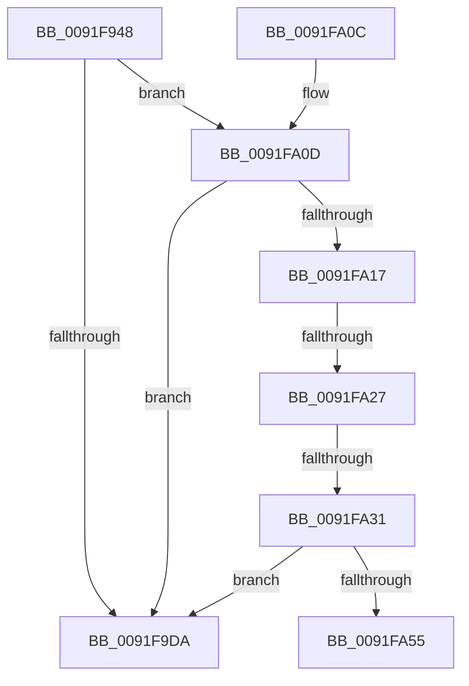

# SepAdtStagingEvent

- RVA: `0x0091F948`–`0x0091FA5A` (길이 `274` bytes)
- VA: `0x000000014091F948`
- 실행 섹션: `PAGE`
- PDB 이름 있음: `예`; PDB Function 태그: `예`
- unwind 정보 RVA: `0x0008B558`
- 디코드: `70`개 명령, `274/274` bytes 표시
- 미해석 바이트: `0` (있으면 어셈블리에 `.byte`로 보존)

> 이 문서는 커널 이미지의 기계어와 PDB 기호를 분석해 생성했습니다. 4번과 5번은 함수 원형과 자료형을 바이너리 사용 방식에서 추정한 C 해석이며 원본 소스 복구 결과는 아닙니다.

## 1. Dependencies

- 직접 호출 지점: **3**; 고유 호출 대상: **3**
- 직접 호출자로 확인된 함수: **3**
- RIP 상대 이미지 참조: **2**

### Outgoing calls
- `0x0091F9A4` → [memset](../../text/6C/memset_function_006C6C40.md) (function, `0x006C6C40`)
- `0x0091F9E6` → [_security_check_cookie](../../text/6A/_security_check_cookie_function_006AC640.md) (function, `0x006AC640`)
- `0x0091FA4C` → [RtlCompareUnicodeStrings](../97/RtlCompareUnicodeStrings_function_009727E0.md) (function, `0x009727E0`)

### Direct callers
- [ObpCreateHandle](../86/ObpCreateHandle_function_0086B950.md) at `0x0086D3BA`
- [sub_0086E95E](../86/Unknown_function_0086E95E.md) at `0x0086ED55`
- [sub_0091EFFE](Unknown_function_0091EFFE.md) at `0x0091F198`

### Static image references
- `0x0091F96E` → RVA `0x00E0A740` (`.data`; read)
- `0x0091FA3A` → RVA `0x00002030` (`.rdata`; read)

## 2. Other-region calls and transfers

- 다른 실행 섹션으로 향하는 call: **2**
  - `0x0091F9A4` → [memset](../../text/6C/memset_function_006C6C40.md) (`PAGE` → `.text`)
  - `0x0091F9E6` → [_security_check_cookie](../../text/6A/_security_check_cookie_function_006AC640.md) (`PAGE` → `.text`)
- call이 아닌 외부 분기/꼬리 이동: **3**
  - `0x0091FA21` → [sub_00B21E9E](../B2/Unknown_function_00B21E9E.md) (`tail-transfer`)
  - `0x0091FA2B` → [sub_00B21E9E](../B2/Unknown_function_00B21E9E.md) (`tail-transfer`)
  - `0x0091FA55` → [sub_00B21E9E](../B2/Unknown_function_00B21E9E.md) (`tail-transfer`)

## 3. Assembly (complete function range)

```asm
0091F948  48 8B C4                        mov rax, rsp
0091F94B  48 89 58 08                     mov qword ptr [rax + 8], rbx
0091F94F  48 89 70 10                     mov qword ptr [rax + 0x10], rsi
0091F953  48 89 78 18                     mov qword ptr [rax + 0x18], rdi
0091F957  55                              push rbp
0091F958  41 54                           push r12
0091F95A  41 55                           push r13
0091F95C  41 56                           push r14
0091F95E  41 57                           push r15
0091F960  48 8D A8 48 FC FF FF            lea rbp, [rax - 0x3b8]
0091F967  48 81 EC 90 04 00 00            sub rsp, 0x490
0091F96E  48 8B 05 CB AD 4E 00            mov rax, qword ptr [rip + 0x4eadcb]
0091F975  48 33 C4                        xor rax, rsp
0091F978  48 89 85 80 03 00 00            mov qword ptr [rbp + 0x380], rax
0091F97F  48 8B BD 18 04 00 00            mov rdi, qword ptr [rbp + 0x418]
0091F986  44 0F B7 F9                     movzx r15d, cx
0091F98A  4C 89 44 24 58                  mov qword ptr [rsp + 0x58], r8
0091F98F  33 D2                           xor edx, edx
0091F991  66 89 4C 24 32                  mov word ptr [rsp + 0x32], cx
0091F996  41 B8 18 04 00 00               mov r8d, 0x418
0091F99C  48 8D 4C 24 60                  lea rcx, [rsp + 0x60]
0091F9A1  4D 8B E9                        mov r13, r9
0091F9A4  E8 97 72 DA FF                  call 0x1406c6c40
0091F9A9  4C 8B 67 48                     mov r12, qword ptr [rdi + 0x48]
0091F9AD  33 C0                           xor eax, eax
0091F9AF  48 89 44 24 50                  mov qword ptr [rsp + 0x50], rax
0091F9B4  8B D8                           mov ebx, eax
0091F9B6  89 44 24 38                     mov dword ptr [rsp + 0x38], eax
0091F9BA  8B F0                           mov esi, eax
0091F9BC  89 44 24 34                     mov dword ptr [rsp + 0x34], eax
0091F9C0  44 8B F0                        mov r14d, eax
0091F9C3  48 89 44 24 40                  mov qword ptr [rsp + 0x40], rax
0091F9C8  48 89 44 24 48                  mov qword ptr [rsp + 0x48], rax
0091F9CD  88 44 24 30                     mov byte ptr [rsp + 0x30], al
0091F9D1  88 44 24 31                     mov byte ptr [rsp + 0x31], al
0091F9D5  4D 85 E4                        test r12, r12
0091F9D8  75 33                           jne 0x14091fa0d
0091F9DA  B0 01                           mov al, 1
0091F9DC  48 8B 8D 80 03 00 00            mov rcx, qword ptr [rbp + 0x380]
0091F9E3  48 33 CC                        xor rcx, rsp
0091F9E6  E8 55 CC D8 FF                  call 0x1406ac640
0091F9EB  4C 8D 9C 24 90 04 00 00         lea r11, [rsp + 0x490]
0091F9F3  49 8B 5B 30                     mov rbx, qword ptr [r11 + 0x30]
0091F9F7  49 8B 73 38                     mov rsi, qword ptr [r11 + 0x38]
0091F9FB  49 8B 7B 40                     mov rdi, qword ptr [r11 + 0x40]
0091F9FF  49 8B E3                        mov rsp, r11
0091FA02  41 5F                           pop r15
0091FA04  41 5E                           pop r14
0091FA06  41 5D                           pop r13
0091FA08  41 5C                           pop r12
0091FA0A  5D                              pop rbp
0091FA0B  C3                              ret
0091FA0C  CC                              int3
0091FA0D  41 38 84 24 D8 00 00 00         cmp byte ptr [r12 + 0xd8], al
0091FA15  74 C3                           je 0x14091f9da
0091FA17  B9 81 00 00 00                  mov ecx, 0x81
0091FA1C  66 41 83 FF 75                  cmp r15w, 0x75
0091FA21  0F 84 77 24 20 00               je 0x140b21e9e
0091FA27  66 44 3B F9                     cmp r15w, cx
0091FA2B  0F 84 6D 24 20 00               je 0x140b21e9e
0091FA31  41 0F B7 55 00                  movzx edx, word ptr [r13]
0091FA36  44 8D 49 83                     lea r9d, [rcx - 0x7d]
0091FA3A  4C 8B 05 EF 25 6E FF            mov r8, qword ptr [rip - 0x91da11]
0091FA41  49 8B 4D 08                     mov rcx, qword ptr [r13 + 8]
0091FA45  48 D1 EA                        shr rdx, 1
0091FA48  88 44 24 20                     mov byte ptr [rsp + 0x20], al
0091FA4C  E8 8F 2D 05 00                  call 0x1409727e0
0091FA51  85 C0                           test eax, eax
0091FA53  75 85                           jne 0x14091f9da
0091FA55  E9 44 24 20 00                  jmp 0x140b21e9e
```

## 4. C-style interpretation (structured pseudocode)

```c
__int64 __fastcall SepAdtStagingEvent(unsigned __int16 a1, int a2, __int64 a3, __int64 a4)
{
    __int64 result;
    __int64 v_rsp;
    unsigned __int64 v_stack_m28;
    unsigned __int64 v_stack_m458;
    unsigned __int64 v_stack_m460;
    unsigned __int64 v_stack_m468;
    unsigned __int64 v_stack_m470;
    unsigned __int64 v_stack_m478;
    unsigned int v_stack_m480;
    unsigned int v_stack_m484;
    unsigned __int16 v_stack_m486;
    unsigned __int8 v_stack_m487;
    unsigned __int8 v_stack_m488;

    *(unsigned __int64 *)(v_rsp + 8) = v_rbx;
    *(unsigned __int64 *)(v_rsp + 16) = v_rsi;
    *(unsigned __int64 *)(v_rsp + 24) = v_rdi;
    v_rsp = (v_rsp) - (0x490ULL);
    result = (*(unsigned __int64 *)(v_rip + 5156299)) ^ (v_rsp);
    *(unsigned __int64 *)(v_rsp - 952 + 896) = result;
    v_stack_m460 = a3;
    a2 = 0;
    v_stack_m486 = a1;
    result = memset(v_stack_m458, a2, (unsigned int)(0x418ULL), a4);
    result = 0;
    v_stack_m468 = 0;
    v_stack_m480 = 0;
    v_stack_m484 = 0;
    v_stack_m478 = 0;
    v_stack_m470 = 0;
    v_stack_m488 = 0;
    v_stack_m487 = 0;
    if (*(unsigned __int64 *)(*(unsigned __int64 *)(v_rsp - 952 + 1048) + 72) != 0) goto loc_0091FA0D;
loc_0091F9DA:
    a1 = (*(unsigned __int64 *)(v_rsp - 952 + 896)) ^ (v_rsp);
    result = _security_check_cookie(a1, a2, (unsigned int)(0x418ULL), a4);
    return result;
loc_0091FA0D:
    if ((*(unsigned __int8 *)(*(unsigned __int64 *)(*(unsigned __int64 *)(v_rsp - 952 + 1048) + 72) + 216)) == ((unsigned __int8)(result))) goto loc_0091F9DA;
    a2 = (*(unsigned __int16 *)(a4)) >> (1);
    v_stack_m470 = (unsigned __int8)(result);
    result = RtlCompareUnicodeStrings(*(unsigned __int64 *)(a4 + 8), a2, *(unsigned __int64 *)(v_rip - 9558545), 129 - 125);
    if ((unsigned int)(result) != 0) goto loc_0091F9DA;
}
```

## 5. (Beta) C Style

```c
int64_t SepAdtStagingEvent(uint16_t Arg1, int32_t Arg2, int64_t Arg3, void *Arg4)
{
    uint8_t *arg4 = (uint8_t *)Arg4;

    int64_t result;
    int64_t local_rsp;
    uint64_t v_stack_m28;
    uint64_t v_stack_m458;
    uint64_t v_stack_m460;
    uint64_t v_stack_m468;
    uint64_t v_stack_m470;
    uint64_t v_stack_m478;
    uint32_t v_stack_m480;
    uint32_t v_stack_m484;
    uint16_t v_stack_m486;
    uint8_t v_stack_m487;
    uint8_t v_stack_m488;

    *(uint64_t *)(local_rsp + 0x8) = local_rbx;
    *(uint64_t *)(local_rsp + 0x10) = local_rsi;
    *(uint64_t *)(local_rsp + 0x18) = local_rdi;
    local_rsp = (local_rsp) - (0x490ULL);
    result = (*(uint64_t *)(v_rip + 0x4EADCB)) ^ (local_rsp);
    *(uint64_t *)(local_rsp - 0x3B8 + 0x380) = result;
    v_stack_m460 = Arg3;
    Arg2 = 0;
    v_stack_m486 = Arg1;
    result = memset(v_stack_m458, Arg2, (uint32_t)(0x418ULL), Arg4);
    result = 0;
    v_stack_m468 = 0;
    v_stack_m480 = 0;
    v_stack_m484 = 0;
    v_stack_m478 = 0;
    v_stack_m470 = 0;
    v_stack_m488 = 0;
    v_stack_m487 = 0;
    if (*(uint64_t *)(*(uint64_t *)(local_rsp - 0x3B8 + 0x418) + 0x48) != 0) goto loc_0091FA0D;
loc_0091F9DA:
    Arg1 = (*(uint64_t *)(local_rsp - 0x3B8 + 0x380)) ^ (local_rsp);
    result = _security_check_cookie(Arg1, Arg2, (uint32_t)(0x418ULL), Arg4);
    return result;
loc_0091FA0D:
    if ((*(uint8_t *)(*(uint64_t *)(*(uint64_t *)(local_rsp - 0x3B8 + 0x418) + 0x48) + 0xD8)) == ((uint8_t)(result))) goto loc_0091F9DA;
    Arg2 = (*(uint16_t *)(arg4)) >> (1);
    v_stack_m470 = (uint8_t)(result);
    result = RtlCompareUnicodeStrings(*(uint64_t *)(arg4 + 0x8), Arg2, *(uint64_t *)(v_rip - 0x91DA11), 129 - 125);
    if ((uint32_t)(result) != 0) goto loc_0091F9DA;
}
```

### 관측된 메모리 오프셋

구조체 형식이 확인되지 않은 접근은 인자 기준의 오프셋으로만 기록했습니다.

| 기준 인자 | 오프셋 표현 | 폭 (bit) | 접근 |
|---|---:|---:|---|
| `Arg4` | `+ 0x0` | `16` | `R` |
| `Arg4` | `+ 0x8` | `64` | `R` |

## 6. Execution-region graph

[열기: 2D/3D 그래프와 함수 탐색 컨트롤 패널](../../../control-panel.html?section=page&rva=0x0091F948&view=graph)

- 2D 그래프는 위에서 아래로 흐르고, 3D 그래프는 빈 공간을 드래그해 회전합니다. Shift+드래그는 이동, 휠은 확대·축소, 함수 노드 선택은 대상 보고서 이동입니다.

### Static fallback


