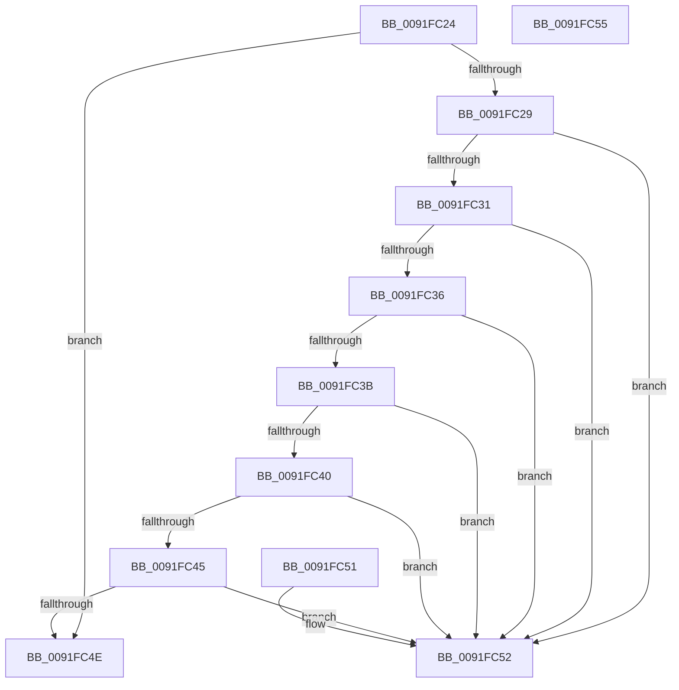

# SepIsRemovableStorageDevice

- RVA: `0x0091FC24`–`0x0091FC56` (길이 `50` bytes)
- VA: `0x000000014091FC24`
- 실행 섹션: `PAGE`
- PDB 이름 있음: `예`; PDB Function 태그: `아니요`
- unwind 정보 RVA: `0x000DB714`
- 디코드: `21`개 명령, `50/50` bytes 표시
- 미해석 바이트: `0` (있으면 어셈블리에 `.byte`로 보존)

> 이 문서는 커널 이미지의 기계어와 PDB 기호를 분석해 생성했습니다. 4번과 5번은 함수 원형과 자료형을 바이너리 사용 방식에서 추정한 C 해석이며 원본 소스 복구 결과는 아닙니다.

## 1. Dependencies

- 직접 호출 지점: **0**; 고유 호출 대상: **0**
- 직접 호출자로 확인된 함수: **2**
- RIP 상대 이미지 참조: **0**

### Outgoing calls
- 직접 디코드된 call 명령이 없습니다.

### Direct callers
- [SepAdtAuditObjectAccessWithContext](../86/SepAdtAuditObjectAccessWithContext_function_0086EEF0.md) at `0x0086F030`
- [SepAdtAuditObjectAccessWithContext](../86/SepAdtAuditObjectAccessWithContext_function_0086EEF0.md) at `0x0086F13F`
- [sub_0091FBAE](Unknown_function_0091FBAE.md) at `0x0091FBF4`
- [sub_0091FBAE](Unknown_function_0091FBAE.md) at `0x0091FC0A`

### Static image references
- 디코드된 RIP-relative 메모리 참조가 없습니다.

## 2. Other-region calls and transfers

- 다른 실행 섹션으로 향하는 call: **0**
- 별도 외부 분기/꼬리 이동을 확인하지 못했습니다.

## 3. Assembly (complete function range)

```asm
0091FC24  48 85 C9                        test rcx, rcx
0091FC27  74 25                           je 0x14091fc4e
0091FC29  8B 41 48                        mov eax, dword ptr [rcx + 0x48]
0091FC2C  83 F8 40                        cmp eax, 0x40
0091FC2F  74 21                           je 0x14091fc52
0091FC31  83 F8 02                        cmp eax, 2
0091FC34  74 1C                           je 0x14091fc52
0091FC36  83 F8 1F                        cmp eax, 0x1f
0091FC39  74 17                           je 0x14091fc52
0091FC3B  83 F8 2D                        cmp eax, 0x2d
0091FC3E  74 12                           je 0x14091fc52
0091FC40  83 F8 33                        cmp eax, 0x33
0091FC43  74 0D                           je 0x14091fc52
0091FC45  F7 41 34 01 00 04 00            test dword ptr [rcx + 0x34], 0x40001
0091FC4C  75 04                           jne 0x14091fc52
0091FC4E  32 C0                           xor al, al
0091FC50  C3                              ret
0091FC51  CC                              int3
0091FC52  B0 01                           mov al, 1
0091FC54  C3                              ret
0091FC55  CC                              int3
```

## 4. C-style interpretation (structured pseudocode)

```c
__int64 __fastcall SepIsRemovableStorageDevice(__int64 a1)
{
    __int64 result;

    if (a1 == 0) goto loc_0091FC4E;
    if (((unsigned int)((unsigned int)(*(unsigned int *)(a1 + 72)))) == 64) goto loc_0091FC52;
    if (((unsigned int)((unsigned int)(*(unsigned int *)(a1 + 72)))) == 2) goto loc_0091FC52;
    if (((unsigned int)((unsigned int)(*(unsigned int *)(a1 + 72)))) == 31) goto loc_0091FC52;
    if (((unsigned int)((unsigned int)(*(unsigned int *)(a1 + 72)))) == 45) goto loc_0091FC52;
    if (((unsigned int)((unsigned int)(*(unsigned int *)(a1 + 72)))) == 51) goto loc_0091FC52;
    if (((*(unsigned int *)(a1 + 52)) & (0x40001ULL)) != 0) goto loc_0091FC52;
loc_0091FC4E:
    result = 0;
    return result;
loc_0091FC52:
    return 1;
}
```

## 5. (Beta) C Style

```c
int64_t SepIsRemovableStorageDevice(int64_t Arg1)
{
    int64_t result;

    if (Arg1 == 0) goto loc_0091FC4E;
    if (((uint32_t)((uint32_t)(*(uint32_t *)(Arg1 + 0x48)))) == 64) goto loc_0091FC52;
    if (((uint32_t)((uint32_t)(*(uint32_t *)(Arg1 + 0x48)))) == 2) goto loc_0091FC52;
    if (((uint32_t)((uint32_t)(*(uint32_t *)(Arg1 + 0x48)))) == 31) goto loc_0091FC52;
    if (((uint32_t)((uint32_t)(*(uint32_t *)(Arg1 + 0x48)))) == 45) goto loc_0091FC52;
    if (((uint32_t)((uint32_t)(*(uint32_t *)(Arg1 + 0x48)))) == 51) goto loc_0091FC52;
    if (((*(uint32_t *)(Arg1 + 0x34)) & (0x40001ULL)) != 0) goto loc_0091FC52;
loc_0091FC4E:
    result = 0;
    return result;
loc_0091FC52:
    return 1;
}
```

## 6. Execution-region graph

[열기: 2D/3D 그래프와 함수 탐색 컨트롤 패널](../../../control-panel.html?section=page&rva=0x0091FC24&view=graph)

- 2D 그래프는 위에서 아래로 흐르고, 3D 그래프는 빈 공간을 드래그해 회전합니다. Shift+드래그는 이동, 휠은 확대·축소, 함수 노드 선택은 대상 보고서 이동입니다.

### Static fallback


