# SepSecurityDescriptorStrictLength

- RVA: `0x0091E6E0`–`0x0091E81E` (길이 `318` bytes)
- VA: `0x000000014091E6E0`
- 실행 섹션: `PAGE`
- PDB 이름 있음: `예`; PDB Function 태그: `아니요`
- unwind 정보 RVA: `0x0008B470`
- 디코드: `93`개 명령, `318/318` bytes 표시
- 미해석 바이트: `0` (있으면 어셈블리에 `.byte`로 보존)

> 이 문서는 커널 이미지의 기계어와 PDB 기호를 분석해 생성했습니다. 4번과 5번은 함수 원형과 자료형을 바이너리 사용 방식에서 추정한 C 해석이며 원본 소스 복구 결과는 아닙니다.

## 1. Dependencies

- 직접 호출 지점: **0**; 고유 호출 대상: **0**
- 직접 호출자로 확인된 함수: **5**
- RIP 상대 이미지 참조: **0**

### Outgoing calls
- 직접 디코드된 call 명령이 없습니다.

### Direct callers
- [RtlLengthSecurityDescriptorStrict](../../text/48/RtlLengthSecurityDescriptorStrict_function_0048B770.md) at `0x0048B774`
- [SepCheckAndCopySelfRelativeSD](../../text/4B/SepCheckAndCopySelfRelativeSD_function_004B596C.md) at `0x004B59A4`
- [SepAdtSecurityDescriptorChangedAuditAlarm](SepAdtSecurityDescriptorChangedAuditAlarm_function_0091E3E8.md) at `0x0091E57A`
- [SepAdtSecurityDescriptorChangedAuditAlarm](SepAdtSecurityDescriptorChangedAuditAlarm_function_0091E3E8.md) at `0x0091E59A`
- [SeOperationAuditAlarm](SeOperationAuditAlarm_function_0091EA78.md) at `0x0091EEB6`
- [sub_00B21BFA](../B2/Unknown_function_00B21BFA.md) at `0x00B21E60`

### Static image references
- 디코드된 RIP-relative 메모리 참조가 없습니다.

## 2. Other-region calls and transfers

- 다른 실행 섹션으로 향하는 call: **0**
- 별도 외부 분기/꼬리 이동을 확인하지 못했습니다.

## 3. Assembly (complete function range)

```asm
0091E6E0  48 89 5C 24 08                  mov qword ptr [rsp + 8], rbx
0091E6E5  48 89 7C 24 10                  mov qword ptr [rsp + 0x10], rdi
0091E6EA  44 0F B7 51 02                  movzx r10d, word ptr [rcx + 2]
0091E6EF  B8 14 00 00 00                  mov eax, 0x14
0091E6F4  45 0F B7 DA                     movzx r11d, r10w
0091E6F8  BF FC FF FF FF                  mov edi, 0xfffffffc
0091E6FD  66 41 C1 EB 0F                  shr r11w, 0xf
0091E702  41 80 FB 01                     cmp r11b, 1
0091E706  8D 50 14                        lea edx, [rax + 0x14]
0091E709  0F 45 C2                        cmovne eax, edx
0091E70C  44 8B C8                        mov r9d, eax
0091E70F  48 8D 14 01                     lea rdx, [rcx + rax]
0091E713  66 45 85 D2                     test r10w, r10w
0091E717  0F 89 E4 00 00 00               jns 0x14091e801
0091E71D  8B 41 04                        mov eax, dword ptr [rcx + 4]
0091E720  85 C0                           test eax, eax
0091E722  74 29                           je 0x14091e74d
0091E724  4C 8D 04 01                     lea r8, [rcx + rax]
0091E728  4D 85 C0                        test r8, r8
0091E72B  74 16                           je 0x14091e743
0091E72D  41 0F B6 40 01                  movzx eax, byte ptr [r8 + 1]
0091E732  8D 04 85 0B 00 00 00            lea eax, [rax*4 + 0xb]
0091E739  23 C7                           and eax, edi
0091E73B  44 03 C8                        add r9d, eax
0091E73E  8B D0                           mov edx, eax
0091E740  49 03 D0                        add rdx, r8
0091E743  66 45 85 D2                     test r10w, r10w
0091E747  0F 89 AB 00 00 00               jns 0x14091e7f8
0091E74D  8B 41 08                        mov eax, dword ptr [rcx + 8]
0091E750  85 C0                           test eax, eax
0091E752  74 24                           je 0x14091e778
0091E754  4C 8D 04 01                     lea r8, [rcx + rax]
0091E758  4D 85 C0                        test r8, r8
0091E75B  74 1B                           je 0x14091e778
0091E75D  41 0F B6 40 01                  movzx eax, byte ptr [r8 + 1]
0091E762  8D 04 85 0B 00 00 00            lea eax, [rax*4 + 0xb]
0091E769  23 C7                           and eax, edi
0091E76B  4C 03 C0                        add r8, rax
0091E76E  44 03 C8                        add r9d, eax
0091E771  4C 3B C2                        cmp r8, rdx
0091E774  49 0F 47 D0                     cmova rdx, r8
0091E778  41 F6 C2 04                     test r10b, 4
0091E77C  74 31                           je 0x14091e7af
0091E77E  66 45 85 D2                     test r10w, r10w
0091E782  0F 89 8D 00 00 00               jns 0x14091e815
0091E788  8B 41 10                        mov eax, dword ptr [rcx + 0x10]
0091E78B  85 C0                           test eax, eax
0091E78D  74 20                           je 0x14091e7af
0091E78F  4C 8D 04 01                     lea r8, [rcx + rax]
0091E793  4D 85 C0                        test r8, r8
0091E796  74 17                           je 0x14091e7af
0091E798  41 0F B7 40 02                  movzx eax, word ptr [r8 + 2]
0091E79D  83 C0 03                        add eax, 3
0091E7A0  23 C7                           and eax, edi
0091E7A2  4C 03 C0                        add r8, rax
0091E7A5  44 03 C8                        add r9d, eax
0091E7A8  4C 3B C2                        cmp r8, rdx
0091E7AB  49 0F 47 D0                     cmova rdx, r8
0091E7AF  41 F6 C2 10                     test r10b, 0x10
0091E7B3  74 2D                           je 0x14091e7e2
0091E7B5  66 45 85 D2                     test r10w, r10w
0091E7B9  79 4F                           jns 0x14091e80a
0091E7BB  8B 41 0C                        mov eax, dword ptr [rcx + 0xc]
0091E7BE  85 C0                           test eax, eax
0091E7C0  74 20                           je 0x14091e7e2
0091E7C2  4C 8D 04 01                     lea r8, [rcx + rax]
0091E7C6  4D 85 C0                        test r8, r8
0091E7C9  74 17                           je 0x14091e7e2
0091E7CB  41 0F B7 40 02                  movzx eax, word ptr [r8 + 2]
0091E7D0  83 C0 03                        add eax, 3
0091E7D3  23 C7                           and eax, edi
0091E7D5  4C 03 C0                        add r8, rax
0091E7D8  44 03 C8                        add r9d, eax
0091E7DB  4C 3B C2                        cmp r8, rdx
0091E7DE  49 0F 47 D0                     cmova rdx, r8
0091E7E2  41 80 FB 01                     cmp r11b, 1
0091E7E6  75 28                           jne 0x14091e810
0091E7E8  2B D1                           sub edx, ecx
0091E7EA  48 8B 5C 24 08                  mov rbx, qword ptr [rsp + 8]
0091E7EF  8B C2                           mov eax, edx
0091E7F1  48 8B 7C 24 10                  mov rdi, qword ptr [rsp + 0x10]
0091E7F6  C3                              ret
0091E7F7  CC                              int3
0091E7F8  4C 8B 41 10                     mov r8, qword ptr [rcx + 0x10]
0091E7FC  E9 57 FF FF FF                  jmp 0x14091e758
0091E801  4C 8B 41 08                     mov r8, qword ptr [rcx + 8]
0091E805  E9 1E FF FF FF                  jmp 0x14091e728
0091E80A  4C 8B 41 18                     mov r8, qword ptr [rcx + 0x18]
0091E80E  EB B6                           jmp 0x14091e7c6
0091E810  41 8B D1                        mov edx, r9d
0091E813  EB D5                           jmp 0x14091e7ea
0091E815  4C 8B 41 20                     mov r8, qword ptr [rcx + 0x20]
0091E819  E9 75 FF FF FF                  jmp 0x14091e793
```

## 4. C-style interpretation (structured pseudocode)

```c
__int64 __fastcall SepSecurityDescriptorStrictLength(__int64 a1)
{
    __int64 result;
    __int64 v_r11;
    unsigned __int64 v_stack_p10;
    unsigned __int64 v_stack_p8;

    v_stack_p8 = v_rbx;
    v_stack_p10 = v_rdi;
    v_r11 = (unsigned __int16)(((unsigned __int16)(*(unsigned __int16 *)(a1 + 2))) >> (15));
    result = 20;
    if (((unsigned __int8)(v_r11)) != 1) { result = (unsigned int)(20 + 20); }
    if (!sign_flag) goto loc_0091E801;
    if ((unsigned int)((unsigned int)(*(unsigned int *)(a1 + 4))) == 0) goto loc_0091E74D;
loc_0091E728:
    result = (unsigned int)(*(unsigned int *)(a1 + 4));
    if (a1 + (unsigned int)(*(unsigned int *)(a1 + 4)) * 1 != 0) {
        result = *(unsigned __int8 *)(a1 + (unsigned int)(*(unsigned int *)(a1 + 4)) * 1 + 1);
        result = result * 4 + 11;
        result = (unsigned int)((result) & ((unsigned int)((unsigned int)(0xFFFFFFFCULL))));
        a4 = (unsigned int)(((unsigned int)((unsigned int)(result))) + ((unsigned int)(result)));
        a2 = (unsigned int)(result);
        a2 = (a2) + (a1 + (unsigned int)(*(unsigned int *)(a1 + 4)) * 1);
    }
    if (!sign_flag) goto loc_0091E7F8;
loc_0091E74D:
    if ((unsigned int)((unsigned int)(*(unsigned int *)(a1 + 8))) == 0) goto loc_0091E778;
loc_0091E758:
    result = (unsigned int)(*(unsigned int *)(a1 + 8));
    if (a1 + (unsigned int)(*(unsigned int *)(a1 + 8)) * 1 != 0) {
        result = *(unsigned __int8 *)(a1 + (unsigned int)(*(unsigned int *)(a1 + 8)) * 1 + 1);
        result = result * 4 + 11;
        result = (unsigned int)((result) & ((unsigned int)((unsigned int)(0xFFFFFFFCULL))));
        a3 = (a1 + (unsigned int)(*(unsigned int *)(a1 + 8)) * 1) + (result);
        a4 = (unsigned int)((a4) + ((unsigned int)(result)));
        if (a3 > a2) { a2 = a3; }
    }
    if ((((unsigned __int8)(*(unsigned __int16 *)(a1 + 2))) & (4)) == 0) goto loc_0091E7AF;
    if (!sign_flag) goto loc_0091E815;
    if ((unsigned int)((unsigned int)(*(unsigned int *)(a1 + 16))) == 0) goto loc_0091E7AF;
loc_0091E793:
    result = (unsigned int)(*(unsigned int *)(a1 + 16));
    if (a1 + (unsigned int)(*(unsigned int *)(a1 + 16)) * 1 != 0) {
        result = *(unsigned __int16 *)(a1 + (unsigned int)(*(unsigned int *)(a1 + 16)) * 1 + 2);
        result = (unsigned int)((result) + (3));
        result = (unsigned int)((result) & ((unsigned int)((unsigned int)(0xFFFFFFFCULL))));
        a3 = (a1 + (unsigned int)(*(unsigned int *)(a1 + 16)) * 1) + (result);
        a4 = (unsigned int)((a4) + ((unsigned int)(result)));
        if (a3 > a2) { a2 = a3; }
    }
    if ((((unsigned __int8)(*(unsigned __int16 *)(a1 + 2))) & (16)) == 0) goto loc_0091E7E2;
    if (!sign_flag) goto loc_0091E80A;
    if ((unsigned int)((unsigned int)(*(unsigned int *)(a1 + 12))) == 0) goto loc_0091E7E2;
loc_0091E7C6:
    result = (unsigned int)(*(unsigned int *)(a1 + 12));
    if (a1 + (unsigned int)(*(unsigned int *)(a1 + 12)) * 1 != 0) {
        result = *(unsigned __int16 *)(a1 + (unsigned int)(*(unsigned int *)(a1 + 12)) * 1 + 2);
        result = (unsigned int)((result) + (3));
        result = (unsigned int)((result) & ((unsigned int)((unsigned int)(0xFFFFFFFCULL))));
        a3 = (a1 + (unsigned int)(*(unsigned int *)(a1 + 12)) * 1) + (result);
        a4 = (unsigned int)((a4) + ((unsigned int)(result)));
        if (a3 > a2) { a2 = a3; }
    }
    if (((unsigned __int8)(v_r11)) != 1) goto loc_0091E810;
    a2 = (unsigned int)((a2) - ((unsigned int)(a1)));
loc_0091E7EA:
    return (unsigned int)((unsigned int)(a2));
loc_0091E7F8:
    goto loc_0091E758;
loc_0091E801:
    goto loc_0091E728;
loc_0091E80A:
    goto loc_0091E7C6;
loc_0091E810:
    goto loc_0091E7EA;
loc_0091E815:
    goto loc_0091E793;
}
```

## 5. (Beta) C Style

```c
int64_t SepSecurityDescriptorStrictLength(void *Arg1)
{
    uint8_t *arg1 = (uint8_t *)Arg1;

    int64_t result;
    int64_t local_r11;
    uint64_t v_stack_p10;
    uint64_t v_stack_p8;

    v_stack_p8 = local_rbx;
    v_stack_p10 = local_rdi;
    local_r11 = (uint16_t)(((uint16_t)(*(uint16_t *)(arg1 + 0x2))) >> (15));
    result = 20;
    if (((uint8_t)(local_r11)) != 1) { result = (uint32_t)(20 + 20); }
    if (!sign_flag) goto loc_0091E801;
    if ((uint32_t)((uint32_t)(*(uint32_t *)(arg1 + 0x4))) == 0) goto loc_0091E74D;
loc_0091E728:
    result = (uint32_t)(*(uint32_t *)(arg1 + 0x4));
    if (Arg1 + (uint32_t)(*(uint32_t *)(arg1 + 0x4)) * 1 != 0) {
        result = *(uint8_t *)(arg1 + (uint32_t)(*(uint32_t *)(arg1 + 0x4)) * 1 + 0x1);
        result = result * 4 + 11;
        result = (uint32_t)((result) & ((uint32_t)((uint32_t)(0xFFFFFFFCULL))));
        a4 = (uint32_t)(((uint32_t)((uint32_t)(result))) + ((uint32_t)(result)));
        a2 = (uint32_t)(result);
        a2 = (a2) + (Arg1 + (uint32_t)(*(uint32_t *)(arg1 + 0x4)) * 1);
    }
    if (!sign_flag) goto loc_0091E7F8;
loc_0091E74D:
    if ((uint32_t)((uint32_t)(*(uint32_t *)(arg1 + 0x8))) == 0) goto loc_0091E778;
loc_0091E758:
    result = (uint32_t)(*(uint32_t *)(arg1 + 0x8));
    if (Arg1 + (uint32_t)(*(uint32_t *)(arg1 + 0x8)) * 1 != 0) {
        result = *(uint8_t *)(arg1 + (uint32_t)(*(uint32_t *)(arg1 + 0x8)) * 1 + 0x1);
        result = result * 4 + 11;
        result = (uint32_t)((result) & ((uint32_t)((uint32_t)(0xFFFFFFFCULL))));
        a3 = (Arg1 + (uint32_t)(*(uint32_t *)(arg1 + 0x8)) * 1) + (result);
        a4 = (uint32_t)((a4) + ((uint32_t)(result)));
        if (a3 > a2) { a2 = a3; }
    }
    if ((((uint8_t)(*(uint16_t *)(arg1 + 0x2))) & (4)) == 0) goto loc_0091E7AF;
    if (!sign_flag) goto loc_0091E815;
    if ((uint32_t)((uint32_t)(*(uint32_t *)(arg1 + 0x10))) == 0) goto loc_0091E7AF;
loc_0091E793:
    result = (uint32_t)(*(uint32_t *)(arg1 + 0x10));
    if (Arg1 + (uint32_t)(*(uint32_t *)(arg1 + 0x10)) * 1 != 0) {
        result = *(uint16_t *)(arg1 + (uint32_t)(*(uint32_t *)(arg1 + 0x10)) * 1 + 0x2);
        result = (uint32_t)((result) + (3));
        result = (uint32_t)((result) & ((uint32_t)((uint32_t)(0xFFFFFFFCULL))));
        a3 = (Arg1 + (uint32_t)(*(uint32_t *)(arg1 + 0x10)) * 1) + (result);
        a4 = (uint32_t)((a4) + ((uint32_t)(result)));
        if (a3 > a2) { a2 = a3; }
    }
    if ((((uint8_t)(*(uint16_t *)(arg1 + 0x2))) & (16)) == 0) goto loc_0091E7E2;
    if (!sign_flag) goto loc_0091E80A;
    if ((uint32_t)((uint32_t)(*(uint32_t *)(arg1 + 0xC))) == 0) goto loc_0091E7E2;
loc_0091E7C6:
    result = (uint32_t)(*(uint32_t *)(arg1 + 0xC));
    if (Arg1 + (uint32_t)(*(uint32_t *)(arg1 + 0xC)) * 1 != 0) {
        result = *(uint16_t *)(arg1 + (uint32_t)(*(uint32_t *)(arg1 + 0xC)) * 1 + 0x2);
        result = (uint32_t)((result) + (3));
        result = (uint32_t)((result) & ((uint32_t)((uint32_t)(0xFFFFFFFCULL))));
        a3 = (Arg1 + (uint32_t)(*(uint32_t *)(arg1 + 0xC)) * 1) + (result);
        a4 = (uint32_t)((a4) + ((uint32_t)(result)));
        if (a3 > a2) { a2 = a3; }
    }
    if (((uint8_t)(local_r11)) != 1) goto loc_0091E810;
    a2 = (uint32_t)((a2) - ((uint32_t)(Arg1)));
loc_0091E7EA:
    return (uint32_t)((uint32_t)(a2));
loc_0091E7F8:
    goto loc_0091E758;
loc_0091E801:
    goto loc_0091E728;
loc_0091E80A:
    goto loc_0091E7C6;
loc_0091E810:
    goto loc_0091E7EA;
loc_0091E815:
    goto loc_0091E793;
}
```

### 관측된 메모리 오프셋

구조체 형식이 확인되지 않은 접근은 인자 기준의 오프셋으로만 기록했습니다.

| 기준 인자 | 오프셋 표현 | 폭 (bit) | 접근 |
|---|---:|---:|---|
| `Arg1` | `+ 0x0 + rax*1` | `64` | `R` |
| `Arg1` | `+ 0x2` | `16` | `R` |
| `Arg1` | `+ 0x4` | `32` | `R` |
| `Arg1` | `+ 0x8` | `32` | `R` |
| `Arg1` | `+ 0x8` | `64` | `R` |
| `Arg1` | `+ 0xC` | `32` | `R` |
| `Arg1` | `+ 0x10` | `32` | `R` |
| `Arg1` | `+ 0x10` | `64` | `R` |
| `Arg1` | `+ 0x18` | `64` | `R` |
| `Arg1` | `+ 0x20` | `64` | `R` |

## 6. Execution-region graph

[열기: 2D/3D 그래프와 함수 탐색 컨트롤 패널](../../../control-panel.html?section=page&rva=0x0091E6E0&view=graph)

- 2D 그래프는 위에서 아래로 흐르고, 3D 그래프는 빈 공간을 드래그해 회전합니다. Shift+드래그는 이동, 휠은 확대·축소, 함수 노드 선택은 대상 보고서 이동입니다.

### Static fallback

```mermaid
flowchart TD
  bb_0091E6E0[BB_0091E6E0]
  bb_0091E71D[BB_0091E71D]
  bb_0091E724[BB_0091E724]
  bb_0091E728[BB_0091E728]
  bb_0091E72D[BB_0091E72D]
  bb_0091E743[BB_0091E743]
  bb_0091E74D[BB_0091E74D]
  bb_0091E754[BB_0091E754]
  bb_0091E758[BB_0091E758]
  bb_0091E75D[BB_0091E75D]
  bb_0091E778[BB_0091E778]
  bb_0091E77E[BB_0091E77E]
  bb_0091E788[BB_0091E788]
  bb_0091E78F[BB_0091E78F]
  bb_0091E793[BB_0091E793]
  bb_0091E798[BB_0091E798]
  bb_0091E7AF[BB_0091E7AF]
  bb_0091E7B5[BB_0091E7B5]
  bb_0091E7BB[BB_0091E7BB]
  bb_0091E7C2[BB_0091E7C2]
  bb_0091E7C6[BB_0091E7C6]
  bb_0091E7CB[BB_0091E7CB]
  bb_0091E7E2[BB_0091E7E2]
  bb_0091E7E8[BB_0091E7E8]
  bb_0091E7EA[BB_0091E7EA]
  bb_0091E7F7[BB_0091E7F7]
  bb_0091E7F8[BB_0091E7F8]
  bb_0091E801[BB_0091E801]
  bb_0091E80A[BB_0091E80A]
  bb_0091E810[BB_0091E810]
  bb_0091E815[BB_0091E815]
  bb_0091E6E0 -->|branch| bb_0091E801
  bb_0091E6E0 -->|fallthrough| bb_0091E71D
  bb_0091E71D -->|branch| bb_0091E74D
  bb_0091E71D -->|fallthrough| bb_0091E724
  bb_0091E724 -->|flow| bb_0091E728
  bb_0091E728 -->|branch| bb_0091E743
  bb_0091E728 -->|fallthrough| bb_0091E72D
  bb_0091E72D -->|flow| bb_0091E743
  bb_0091E743 -->|branch| bb_0091E7F8
  bb_0091E743 -->|fallthrough| bb_0091E74D
  bb_0091E74D -->|branch| bb_0091E778
  bb_0091E74D -->|fallthrough| bb_0091E754
  bb_0091E754 -->|flow| bb_0091E758
  bb_0091E758 -->|branch| bb_0091E778
  bb_0091E758 -->|fallthrough| bb_0091E75D
  bb_0091E75D -->|flow| bb_0091E778
  bb_0091E778 -->|branch| bb_0091E7AF
  bb_0091E778 -->|fallthrough| bb_0091E77E
  bb_0091E77E -->|branch| bb_0091E815
  bb_0091E77E -->|fallthrough| bb_0091E788
  bb_0091E788 -->|branch| bb_0091E7AF
  bb_0091E788 -->|fallthrough| bb_0091E78F
  bb_0091E78F -->|flow| bb_0091E793
  bb_0091E793 -->|branch| bb_0091E7AF
  bb_0091E793 -->|fallthrough| bb_0091E798
  bb_0091E798 -->|flow| bb_0091E7AF
  bb_0091E7AF -->|branch| bb_0091E7E2
  bb_0091E7AF -->|fallthrough| bb_0091E7B5
  bb_0091E7B5 -->|branch| bb_0091E80A
  bb_0091E7B5 -->|fallthrough| bb_0091E7BB
  bb_0091E7BB -->|branch| bb_0091E7E2
  bb_0091E7BB -->|fallthrough| bb_0091E7C2
  bb_0091E7C2 -->|flow| bb_0091E7C6
  bb_0091E7C6 -->|branch| bb_0091E7E2
  bb_0091E7C6 -->|fallthrough| bb_0091E7CB
  bb_0091E7CB -->|flow| bb_0091E7E2
  bb_0091E7E2 -->|branch| bb_0091E810
  bb_0091E7E2 -->|fallthrough| bb_0091E7E8
  bb_0091E7E8 -->|flow| bb_0091E7EA
  bb_0091E7F7 -->|flow| bb_0091E7F8
  bb_0091E7F8 -->|branch| bb_0091E758
  bb_0091E801 -->|branch| bb_0091E728
  bb_0091E80A -->|branch| bb_0091E7C6
  bb_0091E810 -->|branch| bb_0091E7EA
  bb_0091E815 -->|branch| bb_0091E793
```


