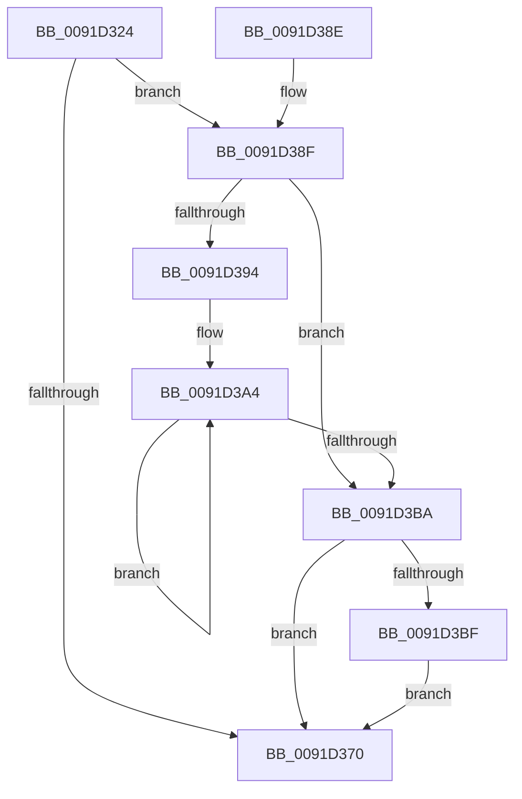

# SmProcessQueryStoreStats

- RVA: `0x0091D324`–`0x0091D3CC` (길이 `168` bytes)
- VA: `0x000000014091D324`
- 실행 섹션: `PAGE`
- PDB 이름 있음: `예`; PDB Function 태그: `아니요`
- unwind 정보 RVA: `0x0008B1D8`
- 디코드: `49`개 명령, `168/168` bytes 표시
- 미해석 바이트: `0` (있으면 어셈블리에 `.byte`로 보존)

> 이 문서는 커널 이미지의 기계어와 PDB 기호를 분석해 생성했습니다. 4번과 5번은 함수 원형과 자료형을 바이너리 사용 방식에서 추정한 C 해석이며 원본 소스 복구 결과는 아닙니다.

## 1. Dependencies

- 직접 호출 지점: **3**; 고유 호출 대상: **3**
- 직접 호출자로 확인된 함수: **1**
- RIP 상대 이미지 참조: **1**

### Outgoing calls
- `0x0091D357` → [memset](../../text/6C/memset_function_006C6C40.md) (function, `0x006C6C40`)
- `0x0091D364` → [SmpProcessQueryStoreStats](../../text/34/SmpProcessQueryStoreStats_function_00349D6C.md) (function, `0x00349D6C`)
- `0x0091D37E` → [_security_check_cookie](../../text/6A/_security_check_cookie_function_006AC640.md) (function, `0x006AC640`)

### Direct callers
- [PfpPrivSourceEnum](PfpPrivSourceEnum_function_0091BF00.md) at `0x0091C47E`

### Static image references
- `0x0091D32F` → RVA `0x00E0A740` (`.data`; read)

## 2. Other-region calls and transfers

- 다른 실행 섹션으로 향하는 call: **3**
  - `0x0091D357` → [memset](../../text/6C/memset_function_006C6C40.md) (`PAGE` → `.text`)
  - `0x0091D364` → [SmpProcessQueryStoreStats](../../text/34/SmpProcessQueryStoreStats_function_00349D6C.md) (`PAGE` → `.text`)
  - `0x0091D37E` → [_security_check_cookie](../../text/6A/_security_check_cookie_function_006AC640.md) (`PAGE` → `.text`)
- 별도 외부 분기/꼬리 이동을 확인하지 못했습니다.

## 3. Assembly (complete function range)

```asm
0091D324  40 53                           push rbx
0091D326  56                              push rsi
0091D327  57                              push rdi
0091D328  48 81 EC 30 06 00 00            sub rsp, 0x630
0091D32F  48 8B 05 0A D4 4E 00            mov rax, qword ptr [rip + 0x4ed40a]
0091D336  48 33 C4                        xor rax, rsp
0091D339  48 89 84 24 20 06 00 00         mov qword ptr [rsp + 0x620], rax
0091D341  49 8B F8                        mov rdi, r8
0091D344  48 8B F2                        mov rsi, rdx
0091D347  48 8B D9                        mov rbx, rcx
0091D34A  33 D2                           xor edx, edx
0091D34C  41 B8 00 06 00 00               mov r8d, 0x600
0091D352  48 8D 4C 24 20                  lea rcx, [rsp + 0x20]
0091D357  E8 E4 98 DA FF                  call 0x1406c6c40
0091D35C  48 8D 54 24 20                  lea rdx, [rsp + 0x20]
0091D361  48 8B CB                        mov rcx, rbx
0091D364  E8 03 CA A2 FF                  call 0x140349d6c
0091D369  44 8B C8                        mov r9d, eax
0091D36C  85 C0                           test eax, eax
0091D36E  79 1F                           jns 0x14091d38f
0091D370  41 8B C1                        mov eax, r9d
0091D373  48 8B 8C 24 20 06 00 00         mov rcx, qword ptr [rsp + 0x620]
0091D37B  48 33 CC                        xor rcx, rsp
0091D37E  E8 BD F2 D8 FF                  call 0x1406ac640
0091D383  48 81 C4 30 06 00 00            add rsp, 0x630
0091D38A  5F                              pop rdi
0091D38B  5E                              pop rsi
0091D38C  5B                              pop rbx
0091D38D  C3                              ret
0091D38E  CC                              int3
0091D38F  48 85 F6                        test rsi, rsi
0091D392  74 26                           je 0x14091d3ba
0091D394  44 8B 54 24 2C                  mov r10d, dword ptr [rsp + 0x2c]
0091D399  48 8D 54 24 4C                  lea rdx, [rsp + 0x4c]
0091D39E  33 C9                           xor ecx, ecx
0091D3A0  44 8D 41 08                     lea r8d, [rcx + 8]
0091D3A4  8B 02                           mov eax, dword ptr [rdx]
0091D3A6  48 8D 52 08                     lea rdx, [rdx + 8]
0091D3AA  49 0F AF C2                     imul rax, r10
0091D3AE  48 03 C8                        add rcx, rax
0091D3B1  48 89 0E                        mov qword ptr [rsi], rcx
0091D3B4  49 83 E8 01                     sub r8, 1
0091D3B8  75 EA                           jne 0x14091d3a4
0091D3BA  48 85 FF                        test rdi, rdi
0091D3BD  74 B1                           je 0x14091d370
0091D3BF  8B 44 24 40                     mov eax, dword ptr [rsp + 0x40]
0091D3C3  48 C1 E0 0C                     shl rax, 0xc
0091D3C7  48 89 07                        mov qword ptr [rdi], rax
0091D3CA  EB A4                           jmp 0x14091d370
```

## 4. C-style interpretation (structured pseudocode)

```c
__int64 __fastcall SmProcessQueryStoreStats(__int64 a1, __int64 a2, __int64 a3)
{
    __int64 result;
    __int64 v_rsp;
    unsigned __int64 v_stack_m28;
    unsigned __int64 v_stack_m628;
    unsigned int v_stack_p2C;
    unsigned int v_stack_p40;
    unsigned __int64 v_stack_p4C;

    v_rsp = (v_rsp) - (0x630ULL);
    result = (*(unsigned __int64 *)(v_rip + 5166090)) ^ (v_rsp);
    v_stack_m28 = result;
    a2 = 0;
    result = memset(v_stack_m628, a2, (unsigned int)(0x600ULL), a4);
    result = SmpProcessQueryStoreStats(a1, v_stack_m628, (unsigned int)(0x600ULL), a4);
    if (!sign_flag) goto loc_0091D38F;
loc_0091D370:
    a1 = (v_stack_m28) ^ (v_rsp);
    result = _security_check_cookie(a1, v_stack_m628, (unsigned int)(0x600ULL), (unsigned int)((unsigned int)(result)));
    v_rsp = (v_rsp) + (0x630ULL);
    return result;
loc_0091D38F:
    if (0 == 0) goto loc_0091D3BA;
    a1 = 0;
loc_0091D3A4:
    result = ((unsigned int)(*(unsigned int *)(v_stack_p4C))) * ((unsigned int)(v_stack_p2C));
    a1 = (a1) + (result);
    *(unsigned __int64 *)(a2) = a1;
    a3 = (a1 + 8) - (1);
    if (condition_is_not_equal) goto loc_0091D3A4;
loc_0091D3BA:
    if (a3 == 0) goto loc_0091D370;
    result = ((unsigned int)(v_stack_p40)) << (12);
    *(unsigned __int64 *)(a3) = result;
    goto loc_0091D370;
}
```

## 5. (Beta) C Style

```c
int64_t SmProcessQueryStoreStats(int64_t Arg1, int64_t Arg2, int64_t Arg3)
{
    int64_t result;
    int64_t local_rsp;
    uint64_t v_stack_m28;
    uint64_t v_stack_m628;
    uint32_t v_stack_p2C;
    uint32_t v_stack_p40;
    uint64_t v_stack_p4C;

    local_rsp = (local_rsp) - (0x630ULL);
    result = (*(uint64_t *)(v_rip + 0x4ED40A)) ^ (local_rsp);
    v_stack_m28 = result;
    Arg2 = 0;
    result = memset(v_stack_m628, Arg2, (uint32_t)(0x600ULL), a4);
    result = SmpProcessQueryStoreStats(Arg1, v_stack_m628, (uint32_t)(0x600ULL), a4);
    if (!sign_flag) goto loc_0091D38F;
loc_0091D370:
    Arg1 = (v_stack_m28) ^ (local_rsp);
    result = _security_check_cookie(Arg1, v_stack_m628, (uint32_t)(0x600ULL), (uint32_t)((uint32_t)(result)));
    local_rsp = (local_rsp) + (0x630ULL);
    return result;
loc_0091D38F:
    if (0 == 0) goto loc_0091D3BA;
    Arg1 = 0;
loc_0091D3A4:
    result = ((uint32_t)(*(uint32_t *)(v_stack_p4C))) * ((uint32_t)(v_stack_p2C));
    Arg1 = (Arg1) + (result);
    *(uint64_t *)(Arg2) = Arg1;
    Arg3 = (Arg1 + 8) - (1);
    if (condition_is_not_equal) goto loc_0091D3A4;
loc_0091D3BA:
    if (Arg3 == 0) goto loc_0091D370;
    result = ((uint32_t)(v_stack_p40)) << (12);
    *(uint64_t *)(Arg3) = result;
    goto loc_0091D370;
}
```

## 6. Execution-region graph

[열기: 2D/3D 그래프와 함수 탐색 컨트롤 패널](../../../control-panel.html?section=page&rva=0x0091D324&view=graph)

- 2D 그래프는 위에서 아래로 흐르고, 3D 그래프는 빈 공간을 드래그해 회전합니다. Shift+드래그는 이동, 휠은 확대·축소, 함수 노드 선택은 대상 보고서 이동입니다.

### Static fallback


