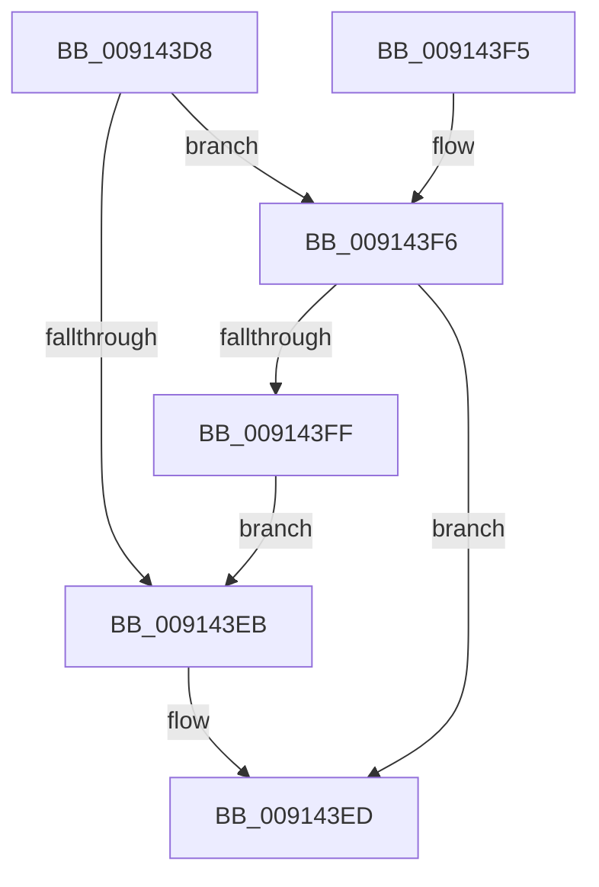

# TtmIsEnabled

- RVA: `0x009143D8`–`0x00914401` (길이 `41` bytes)
- VA: `0x00000001409143D8`
- 실행 섹션: `PAGE`
- PDB 이름 있음: `예`; PDB Function 태그: `아니요`
- unwind 정보 RVA: `0x0007FBDC`
- 디코드: `15`개 명령, `41/41` bytes 표시
- 미해석 바이트: `0` (있으면 어셈블리에 `.byte`로 보존)

> 이 문서는 커널 이미지의 기계어와 PDB 기호를 분석해 생성했습니다. 4번과 5번은 함수 원형과 자료형을 바이너리 사용 방식에서 추정한 C 해석이며 원본 소스 복구 결과는 아닙니다.

## 1. Dependencies

- 직접 호출 지점: **1**; 고유 호출 대상: **1**
- 직접 호출자로 확인된 함수: **19**
- RIP 상대 이미지 참조: **1**

### Outgoing calls
- `0x009143F6` → [PsIsCurrentThreadInServerSilo](../../text/43/PsIsCurrentThreadInServerSilo_function_004362E0.md) (function, `0x004362E0`)

### Direct callers
- [PopPowerRequestCreateUserModeRequest](../../text/22/PopPowerRequestCreateUserModeRequest_function_0022F91C.md) at `0x0022F9AF`
- [PopPowerSourceChangeCallback](../../text/4C/PopPowerSourceChangeCallback_function_004C3A60.md) at `0x004C3C25`
- [PopExecutePowerAction](../75/PopExecutePowerAction_function_0075E6B4.md) at `0x0075EAA8`
- [PopPowerAggregatorHandleSystemTransitionEndIntent](../76/PopPowerAggregatorHandleSystemTransitionEndIntent_function_00764B30.md) at `0x00764B58`
- [TtmiInitTerminals](../77/TtmiInitTerminals_function_0077CA40.md) at `0x0077CA65`
- [TtmiInitQueues](../77/TtmiInitQueues_function_0077DB68.md) at `0x0077DB8D`
- [PopPowerRequestDelete](PopPowerRequestDelete_function_00913030.md) at `0x00913113`
- [PopNotifyConsoleUserPresent](PopNotifyConsoleUserPresent_function_00913C50.md) at `0x00913CC6`
- [PopAdaptiveGetConsoleSessionState](PopAdaptiveGetConsoleSessionState_function_00913FB4.md) at `0x00913FF1`
- [PopProcessSessionDisplayStateChange](PopProcessSessionDisplayStateChange_function_00914380.md) at `0x0091439F`
- [NtPowerInformation](../95/NtPowerInformation_function_00955D80.md) at `0x00956E9E`
- [NtPowerInformation](../95/NtPowerInformation_function_00955D80.md) at `0x00956EAA`
- [NtPowerInformation](../95/NtPowerInformation_function_00955D80.md) at `0x0095754F`
- [NtPowerInformation](../95/NtPowerInformation_function_00955D80.md) at `0x009578B8`
- [PopPowerAggregatorNotifyCsStateExited](../98/PopPowerAggregatorNotifyCsStateExited_function_0098A434.md) at `0x0098A4B1`
- [PopControlMonitor](../98/PopControlMonitor_function_0098A7F0.md) at `0x0098A809`
- [TtmDispatchApi](../98/TtmDispatchApi_function_0098AD08.md) at `0x0098AD58`
- [TtmpAcquireSessionById](../98/TtmpAcquireSessionById_function_0098B4F4.md) at `0x0098B50D`
- [PopPowerRequestCallbackDisplayRequired](../98/PopPowerRequestCallbackDisplayRequired_function_0098C820.md) at `0x0098C85A`
- [PopIssueActionRequest](../A9/PopIssueActionRequest_function_00A9CE54.md) at `0x00A9D1F4`
- [PopPowerRequestNotifyUserSessionAttributed](../AD/PopPowerRequestNotifyUserSessionAttributed_function_00ADF48C.md) at `0x00ADF518`
- [PopPowerRequestInitialize](../../init/C3/PopPowerRequestInitialize_function_00C3E2AC.md) at `0x00C3E483`

### Static image references
- `0x009143E3` → RVA `0x00FD9E34` (`PAGEDATA`; read)

## 2. Other-region calls and transfers

- 다른 실행 섹션으로 향하는 call: **1**
  - `0x009143F6` → [PsIsCurrentThreadInServerSilo](../../text/43/PsIsCurrentThreadInServerSilo_function_004362E0.md) (`PAGE` → `.text`)
- 별도 외부 분기/꼬리 이동을 확인하지 못했습니다.

## 3. Assembly (complete function range)

```asm
009143D8  40 53                           push rbx
009143DA  48 83 EC 20                     sub rsp, 0x20
009143DE  BB 01 00 00 00                  mov ebx, 1
009143E3  39 1D 4B 5A 6C 00               cmp dword ptr [rip + 0x6c5a4b], ebx
009143E9  74 0B                           je 0x1409143f6
009143EB  32 DB                           xor bl, bl
009143ED  8A C3                           mov al, bl
009143EF  48 83 C4 20                     add rsp, 0x20
009143F3  5B                              pop rbx
009143F4  C3                              ret
009143F5  CC                              int3
009143F6  E8 E5 1E B2 FF                  call 0x1404362e0
009143FB  84 C0                           test al, al
009143FD  74 EE                           je 0x1409143ed
009143FF  EB EA                           jmp 0x1409143eb
```

## 4. C-style interpretation (structured pseudocode)

```c
__int64 __fastcall TtmIsEnabled(void)
{
    __int64 result;
    __int64 v_rbx;
    __int64 v_rsp;

    v_rsp = (v_rsp) - (32);
    if ((*(unsigned int *)(v_rip + 7101003)) == 1) goto loc_009143F6;
loc_009143EB:
    v_rbx = 0;
loc_009143ED:
    v_rsp = (v_rsp) + (32);
    return 0;
loc_009143F6:
    result = PsIsCurrentThreadInServerSilo(a1, a2, a3, a4);
    if ((unsigned __int8)(result) == 0) goto loc_009143ED;
    goto loc_009143EB;
}
```

## 5. (Beta) C Style

```c
void TtmIsEnabled(void)
{
    int64_t result;
    int64_t local_rbx;
    int64_t local_rsp;

    local_rsp = (local_rsp) - (32);
    if ((*(uint32_t *)(v_rip + 0x6C5A4B)) == 1) goto loc_009143F6;
loc_009143EB:
    local_rbx = 0;
loc_009143ED:
    local_rsp = (local_rsp) + (32);
    return 0;
loc_009143F6:
    result = PsIsCurrentThreadInServerSilo(a1, a2, a3, a4);
    if ((uint8_t)(result) == 0) goto loc_009143ED;
    goto loc_009143EB;
}
```

## 6. Execution-region graph

[열기: 2D/3D 그래프와 함수 탐색 컨트롤 패널](../../../control-panel.html?section=page&rva=0x009143D8&view=graph)

- 2D 그래프는 위에서 아래로 흐르고, 3D 그래프는 빈 공간을 드래그해 회전합니다. Shift+드래그는 이동, 휠은 확대·축소, 함수 노드 선택은 대상 보고서 이동입니다.

### Static fallback


