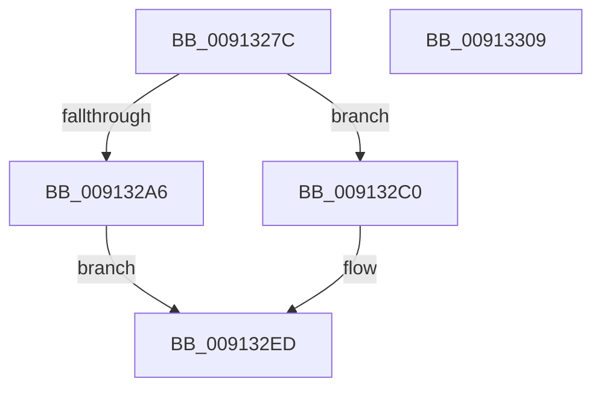

# TtmNotifyConsoleUserPresent

- RVA: `0x0091327C`–`0x0091330A` (길이 `142` bytes)
- VA: `0x000000014091327C`
- 실행 섹션: `PAGE`
- PDB 이름 있음: `예`; PDB Function 태그: `아니요`
- unwind 정보 RVA: `0x000733E4`
- 디코드: `39`개 명령, `142/142` bytes 표시
- 미해석 바이트: `0` (있으면 어셈블리에 `.byte`로 보존)

> 이 문서는 커널 이미지의 기계어와 PDB 기호를 분석해 생성했습니다. 4번과 5번은 함수 원형과 자료형을 바이너리 사용 방식에서 추정한 C 해석이며 원본 소스 복구 결과는 아닙니다.

## 1. Dependencies

- 직접 호출 지점: **6**; 고유 호출 대상: **6**
- 직접 호출자로 확인된 함수: **1**
- RIP 상대 이미지 참조: **2**

### Outgoing calls
- `0x0091329B` → [TtmpAcquireSessionById](../98/TtmpAcquireSessionById_function_0098B4F4.md) (function, `0x0098B4F4`)
- `0x009132B9` → [TtmiLogError](../98/TtmiLogError_function_0098B39C.md) (function, `0x0098B39C`)
- `0x009132D7` → [TtmiResetTerminalTimeouts](../77/TtmiResetTerminalTimeouts_function_0077CD90.md) (function, `0x0077CD90`)
- `0x009132E3` → [ExReleaseResourceLite](../../text/25/ExReleaseResourceLite_function_0025FA10.md) (function, `0x0025FA10`)
- `0x009132E8` → [KeLeaveCriticalRegion](../../text/25/KeLeaveCriticalRegion_function_0025D8B0.md) (function, `0x0025D8B0`)
- `0x009132F4` → [TtmiLogConsoleUserPresent](../AD/TtmiLogConsoleUserPresent_function_00ADAF9C.md) (function, `0x00ADAF9C`)

### Direct callers
- [PopNotifyConsoleUserPresent](PopNotifyConsoleUserPresent_function_00913C50.md) at `0x00913EBB`

### Static image references
- `0x009132AA` → RVA `0x00B04350` (` ?? ::NNGAKEGL::`string'`; read)
- `0x009132DC` → RVA `0x00F06940` (`.data`; read)

## 2. Other-region calls and transfers

- 다른 실행 섹션으로 향하는 call: **2**
  - `0x009132E3` → [ExReleaseResourceLite](../../text/25/ExReleaseResourceLite_function_0025FA10.md) (`PAGE` → `.text`)
  - `0x009132E8` → [KeLeaveCriticalRegion](../../text/25/KeLeaveCriticalRegion_function_0025D8B0.md) (`PAGE` → `.text`)
- 별도 외부 분기/꼬리 이동을 확인하지 못했습니다.

## 3. Assembly (complete function range)

```asm
0091327C  48 8B C4                        mov rax, rsp
0091327F  48 89 58 08                     mov qword ptr [rax + 8], rbx
00913283  48 89 70 10                     mov qword ptr [rax + 0x10], rsi
00913287  57                              push rdi
00913288  48 83 EC 30                     sub rsp, 0x30
0091328C  48 83 60 18 00                  and qword ptr [rax + 0x18], 0
00913291  8B FA                           mov edi, edx
00913293  8B D1                           mov edx, ecx
00913295  8B F1                           mov esi, ecx
00913297  48 8D 48 18                     lea rcx, [rax + 0x18]
0091329B  E8 54 82 07 00                  call 0x14098b4f4
009132A0  8B D8                           mov ebx, eax
009132A2  85 C0                           test eax, eax
009132A4  79 1A                           jns 0x1409132c0
009132A6  41 83 C9 FF                     or r9d, 0xffffffff
009132AA  48 8D 0D 9F 10 1F 00            lea rcx, [rip + 0x1f109f]
009132B1  44 8B C0                        mov r8d, eax
009132B4  BA E3 0C 00 00                  mov edx, 0xce3
009132B9  E8 DE 80 07 00                  call 0x14098b39c
009132BE  EB 2D                           jmp 0x1409132ed
009132C0  48 8B 4C 24 50                  mov rcx, qword ptr [rsp + 0x50]
009132C5  41 B9 4E 43 55 50               mov r9d, 0x5055434e
009132CB  44 8B C7                        mov r8d, edi
009132CE  C6 44 24 20 01                  mov byte ptr [rsp + 0x20], 1
009132D3  48 8B 51 20                     mov rdx, qword ptr [rcx + 0x20]
009132D7  E8 B4 9A E6 FF                  call 0x14077cd90
009132DC  48 8D 0D 5D 36 5F 00            lea rcx, [rip + 0x5f365d]
009132E3  E8 28 C7 94 FF                  call 0x14025fa10
009132E8  E8 C3 A5 94 FF                  call 0x14025d8b0
009132ED  44 8B C3                        mov r8d, ebx
009132F0  8B D7                           mov edx, edi
009132F2  8B CE                           mov ecx, esi
009132F4  E8 A3 7C 1C 00                  call 0x140adaf9c
009132F9  48 8B 5C 24 40                  mov rbx, qword ptr [rsp + 0x40]
009132FE  48 8B 74 24 48                  mov rsi, qword ptr [rsp + 0x48]
00913303  48 83 C4 30                     add rsp, 0x30
00913307  5F                              pop rdi
00913308  C3                              ret
00913309  CC                              int3
```

## 4. C-style interpretation (structured pseudocode)

```c
__int64 __fastcall TtmNotifyConsoleUserPresent(int a1, int a2, __int64 a3, int a4)
{
    __int64 result;
    __int64 v_rsp;
    unsigned __int8 v_stack_m18;
    unsigned __int64 v_stack_p10;
    unsigned __int64 v_stack_p18;
    unsigned __int64 v_stack_p8;

    *(unsigned __int64 *)(v_rsp + 8) = v_rbx;
    *(unsigned __int64 *)(v_rsp + 16) = v_rsi;
    v_rsp = (v_rsp) - (48);
    result = TtmpAcquireSessionById(v_rsp + 24, (unsigned int)(a1), a3, a4);
    if (!sign_flag) goto loc_009132C0;
    a4 = (unsigned int)((a4) | (0xFFFFFFFFULL));
    result = TtmiLogError(v_rip + 2035871, (unsigned int)(0xCE3ULL), (unsigned int)((unsigned int)(result)), a4);
    goto loc_009132ED;
loc_009132C0:
    v_stack_m18 = 1;
    result = TtmiResetTerminalTimeouts(v_stack_p18, *(unsigned __int64 *)(v_stack_p18 + 32), (unsigned int)((unsigned int)((unsigned int)(a2))), (unsigned int)(0x5055434EULL));
    result = ExReleaseResourceLite(v_rip + 6239837, *(unsigned __int64 *)(v_stack_p18 + 32), (unsigned int)((unsigned int)((unsigned int)(a2))), (unsigned int)(0x5055434EULL));
    result = KeLeaveCriticalRegion(v_rip + 6239837, *(unsigned __int64 *)(v_stack_p18 + 32), (unsigned int)((unsigned int)((unsigned int)(a2))), (unsigned int)(0x5055434EULL));
loc_009132ED:
    result = TtmiLogConsoleUserPresent((unsigned int)((unsigned int)((unsigned int)(a1))), (unsigned int)((unsigned int)((unsigned int)(a2))), (unsigned int)((unsigned int)((unsigned int)((unsigned int)(result)))), (unsigned int)(0x5055434EULL));
    v_rsp = (v_rsp) + (48);
    return result;
}
```

## 5. (Beta) C Style

```c
int64_t TtmNotifyConsoleUserPresent(int32_t Arg1, int32_t Arg2, int64_t Arg3, int32_t Arg4)
{
    int64_t result;
    int64_t local_rsp;
    uint8_t v_stack_m18;
    uint64_t v_stack_p10;
    uint64_t v_stack_p18;
    uint64_t v_stack_p8;

    *(uint64_t *)(local_rsp + 0x8) = local_rbx;
    *(uint64_t *)(local_rsp + 0x10) = local_rsi;
    local_rsp = (local_rsp) - (48);
    result = TtmpAcquireSessionById(local_rsp + 24, (uint32_t)(Arg1), Arg3, Arg4);
    if (!sign_flag) goto loc_009132C0;
    Arg4 = (uint32_t)((Arg4) | (0xFFFFFFFFULL));
    result = TtmiLogError(v_rip + 2035871, (uint32_t)(0xCE3ULL), (uint32_t)((uint32_t)(result)), Arg4);
    goto loc_009132ED;
loc_009132C0:
    v_stack_m18 = 1;
    result = TtmiResetTerminalTimeouts(v_stack_p18, *(uint64_t *)(v_stack_p18 + 0x20), (uint32_t)((uint32_t)((uint32_t)(Arg2))), (uint32_t)(0x5055434EULL));
    result = ExReleaseResourceLite(v_rip + 6239837, *(uint64_t *)(v_stack_p18 + 0x20), (uint32_t)((uint32_t)((uint32_t)(Arg2))), (uint32_t)(0x5055434EULL));
    result = KeLeaveCriticalRegion(v_rip + 6239837, *(uint64_t *)(v_stack_p18 + 0x20), (uint32_t)((uint32_t)((uint32_t)(Arg2))), (uint32_t)(0x5055434EULL));
loc_009132ED:
    result = TtmiLogConsoleUserPresent((uint32_t)((uint32_t)((uint32_t)(Arg1))), (uint32_t)((uint32_t)((uint32_t)(Arg2))), (uint32_t)((uint32_t)((uint32_t)((uint32_t)(result)))), (uint32_t)(0x5055434EULL));
    local_rsp = (local_rsp) + (48);
    return result;
}
```

## 6. Execution-region graph

[열기: 2D/3D 그래프와 함수 탐색 컨트롤 패널](../../../control-panel.html?section=page&rva=0x0091327C&view=graph)

- 2D 그래프는 위에서 아래로 흐르고, 3D 그래프는 빈 공간을 드래그해 회전합니다. Shift+드래그는 이동, 휠은 확대·축소, 함수 노드 선택은 대상 보고서 이동입니다.

### Static fallback


