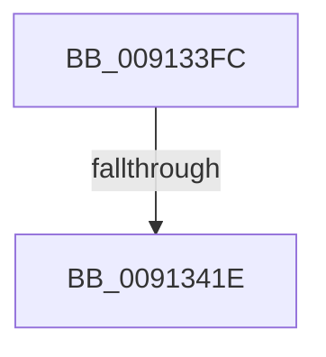

# sub_009133FC

- RVA: `0x009133FC`–`0x0091344A` (길이 `78` bytes)
- VA: `0x00000001409133FC`
- 실행 섹션: `PAGE`
- PDB 이름 있음: `아니요`; PDB Function 태그: `아니요`
- unwind 정보 RVA: `0x0008A424`
- 디코드: `21`개 명령, `78/78` bytes 표시
- 미해석 바이트: `0` (있으면 어셈블리에 `.byte`로 보존)

> 이 문서는 커널 이미지의 기계어와 PDB 기호를 분석해 생성했습니다. 4번과 5번은 함수 원형과 자료형을 바이너리 사용 방식에서 추정한 C 해석이며 원본 소스 복구 결과는 아닙니다.

## 1. Dependencies

- 직접 호출 지점: **4**; 고유 호출 대상: **4**
- 직접 호출자로 확인된 함수: **0**
- RIP 상대 이미지 참조: **0**

### Outgoing calls
- `0x00913406` → [PsSessionGetWin32Callouts](../../text/47/PsSessionGetWin32Callouts_function_00474F98.md) (function, `0x00474F98`)
- `0x00913411` → [ExReferenceCallBackBlock](../../text/2F/ExReferenceCallBackBlock_function_002F0040.md) (function, `0x002F0040`)
- `0x0091342C` → [guard_dispatch_icall](../../text/6B/guard_dispatch_icall_function_006BAAD0.md) (function, `0x006BAAD0`)
- `0x00913439` → [ExDereferenceCallBackBlock](../../text/44/ExDereferenceCallBackBlock_function_0044D730.md) (function, `0x0044D730`)

### Direct callers
- 이 함수 시작 RVA로 연결되는 직접 call은 확인되지 않았습니다. 간접 호출은 완전히 역산할 수 없습니다.

### Static image references
- 디코드된 RIP-relative 메모리 참조가 없습니다.

## 2. Other-region calls and transfers

- 다른 실행 섹션으로 향하는 call: **4**
  - `0x00913406` → [PsSessionGetWin32Callouts](../../text/47/PsSessionGetWin32Callouts_function_00474F98.md) (`PAGE` → `.text`)
  - `0x00913411` → [ExReferenceCallBackBlock](../../text/2F/ExReferenceCallBackBlock_function_002F0040.md) (`PAGE` → `.text`)
  - `0x0091342C` → [guard_dispatch_icall](../../text/6B/guard_dispatch_icall_function_006BAAD0.md) (`PAGE` → `.text`)
  - `0x00913439` → [ExDereferenceCallBackBlock](../../text/44/ExDereferenceCallBackBlock_function_0044D730.md) (`PAGE` → `.text`)
- call이 아닌 외부 분기/꼬리 이동: **1**
  - `0x0091341C` → [sub_00913456](Unknown_function_00913456.md) (`tail-transfer`)

## 3. Assembly (complete function range)

```asm
009133FC  48 89 74 24 40                  mov qword ptr [rsp + 0x40], rsi
00913401  48 89 7C 24 48                  mov qword ptr [rsp + 0x48], rdi
00913406  E8 8D 1B B6 FF                  call 0x140474f98
0091340B  48 8B C8                        mov rcx, rax
0091340E  48 8B F0                        mov rsi, rax
00913411  E8 2A CC 9D FF                  call 0x1402f0040
00913416  48 8B F8                        mov rdi, rax
00913419  48 85 C0                        test rax, rax
0091341C  74 38                           je 0x140913456
0091341E  48 8B 40 08                     mov rax, qword ptr [rax + 8]
00913422  48 8B D5                        mov rdx, rbp
00913425  48 8B 4F 10                     mov rcx, qword ptr [rdi + 0x10]
00913429  4C 8B C3                        mov r8, rbx
0091342C  E8 9F 76 DA FF                  call 0x1406baad0
00913431  48 8B D7                        mov rdx, rdi
00913434  48 8B CE                        mov rcx, rsi
00913437  8B D8                           mov ebx, eax
00913439  E8 F2 A2 B3 FF                  call 0x14044d730
0091343E  48 8B 7C 24 48                  mov rdi, qword ptr [rsp + 0x48]
00913443  8B C3                           mov eax, ebx
00913445  48 8B 74 24 40                  mov rsi, qword ptr [rsp + 0x40]
```

## 4. C-style interpretation (structured pseudocode)

```c
__int64 __fastcall sub_009133FC(__int64 a1, __int64 a2, __int64 a3, __int64 a4, __int64 a5, __int64 a6, __int64 a7, __int64 a8, __int64 a9)
{
    __int64 result;
    unsigned __int64 v_stack_p40;
    unsigned __int64 v_stack_p48;

    v_stack_p40 = v_rsi;
    v_stack_p48 = v_rdi;
    result = PsSessionGetWin32Callouts(a1, a2, a3, a4);
    result = ExReferenceCallBackBlock(result, a2, a3, a4);
    result = guard_dispatch_icall(*(unsigned __int64 *)(result + 16), v_rbp, v_rbx, a4);
    result = ExDereferenceCallBackBlock(result, result, v_rbx, a4);
    return (unsigned int)((unsigned int)((unsigned int)((unsigned int)(result))));
}
```

## 5. (Beta) C Style

```c
int64_t sub_009133FC(int64_t Arg1, int64_t Arg2, int64_t Arg3, int64_t Arg4, uint64_t Arg5, uint64_t Arg6, uint64_t Arg7, int64_t Arg8, int64_t Arg9)
{
    int64_t result;
    uint64_t v_stack_p40;
    uint64_t v_stack_p48;

    v_stack_p40 = local_rsi;
    v_stack_p48 = local_rdi;
    result = PsSessionGetWin32Callouts(Arg1, Arg2, Arg3, Arg4);
    result = ExReferenceCallBackBlock(result, Arg2, Arg3, Arg4);
    result = guard_dispatch_icall(*(uint64_t *)(result + 0x10), local_rbp, local_rbx, Arg4);
    result = ExDereferenceCallBackBlock(result, result, local_rbx, Arg4);
    return (uint32_t)((uint32_t)((uint32_t)((uint32_t)(result))));
}
```

## 6. Execution-region graph

[열기: 2D/3D 그래프와 함수 탐색 컨트롤 패널](../../../control-panel.html?section=page&rva=0x009133FC&view=graph)

- 2D 그래프는 위에서 아래로 흐르고, 3D 그래프는 빈 공간을 드래그해 회전합니다. Shift+드래그는 이동, 휠은 확대·축소, 함수 노드 선택은 대상 보고서 이동입니다.

### Static fallback


