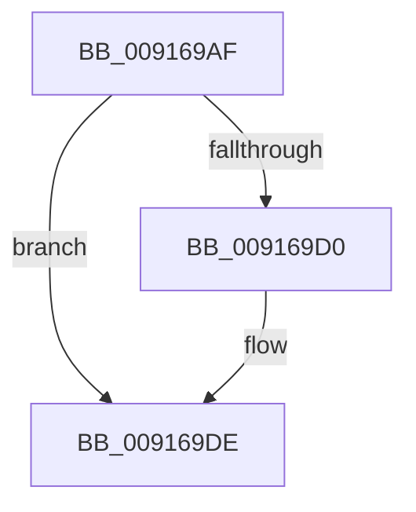

# sub_009169AF

- RVA: `0x009169AF`–`0x009169E8` (길이 `57` bytes)
- VA: `0x00000001409169AF`
- 실행 섹션: `PAGE`
- PDB 이름 있음: `아니요`; PDB Function 태그: `아니요`
- unwind 정보 RVA: `0x0008A89C`
- 디코드: `15`개 명령, `57/57` bytes 표시
- 미해석 바이트: `0` (있으면 어셈블리에 `.byte`로 보존)

> 이 문서는 커널 이미지의 기계어와 PDB 기호를 분석해 생성했습니다. 4번과 5번은 함수 원형과 자료형을 바이너리 사용 방식에서 추정한 C 해석이며 원본 소스 복구 결과는 아닙니다.

## 1. Dependencies

- 직접 호출 지점: **2**; 고유 호출 대상: **2**
- 직접 호출자로 확인된 함수: **0**
- RIP 상대 이미지 참조: **0**

### Outgoing calls
- `0x009169C0` → [KeAbPreAcquire](../../text/21/KeAbPreAcquire_function_00210230.md) (function, `0x00210230`)
- `0x009169D9` → [ExfAcquirePushLockExclusiveEx](../../text/20/ExfAcquirePushLockExclusiveEx_function_0020FC90.md) (function, `0x0020FC90`)

### Direct callers
- 이 함수 시작 RVA로 연결되는 직접 call은 확인되지 않았습니다. 간접 호출은 완전히 역산할 수 없습니다.

### Static image references
- 디코드된 RIP-relative 메모리 참조가 없습니다.

## 2. Other-region calls and transfers

- 다른 실행 섹션으로 향하는 call: **2**
  - `0x009169C0` → [KeAbPreAcquire](../../text/21/KeAbPreAcquire_function_00210230.md) (`PAGE` → `.text`)
  - `0x009169D9` → [ExfAcquirePushLockExclusiveEx](../../text/20/ExfAcquirePushLockExclusiveEx_function_0020FC90.md) (`PAGE` → `.text`)
- call이 아닌 외부 분기/꼬리 이동: **1**
  - `0x009169E6` → [sub_009169E8 + 0x4](Unknown_function_009169E8.md) (`tail-transfer`)

## 3. Assembly (complete function range)

```asm
009169AF  48 89 7C 24 20                  mov qword ptr [rsp + 0x20], rdi
009169B4  33 D2                           xor edx, edx
009169B6  48 8D B9 F0 04 00 00            lea rdi, [rcx + 0x4f0]
009169BD  48 8B CF                        mov rcx, rdi
009169C0  E8 6B 98 8F FF                  call 0x140210230
009169C5  F0 48 0F BA 2F 00               lock bts qword ptr [rdi], 0
009169CB  48 8B D8                        mov rbx, rax
009169CE  73 0E                           jae 0x1409169de
009169D0  4C 8B C7                        mov r8, rdi
009169D3  48 8B D0                        mov rdx, rax
009169D6  48 8B CF                        mov rcx, rdi
009169D9  E8 B2 92 8F FF                  call 0x14020fc90
009169DE  48 8B 7C 24 20                  mov rdi, qword ptr [rsp + 0x20]
009169E3  48 85 DB                        test rbx, rbx
009169E6  74 04                           je 0x1409169ec
```

## 4. C-style interpretation (structured pseudocode)

```c
__int64 __fastcall sub_009169AF(__int64 a1, int a2)
{
    __int64 result;
    unsigned __int64 v_stack_p20;

    v_stack_p20 = v_rdi;
    a2 = 0;
    result = KeAbPreAcquire(a1 + 1264, a2, a3, a4);
    if (!(condition_is_above_or_equal)) {
        a3 = a1 + 1264;
        a2 = result;
        a1 = a1 + 1264;
        result = ExfAcquirePushLockExclusiveEx(a1, a2, a3, a4);
    }
}
```

## 5. (Beta) C Style

```c
int64_t sub_009169AF(void *Arg1, int32_t Arg2)
{
    uint8_t *arg1 = (uint8_t *)Arg1;

    int64_t result;
    uint64_t v_stack_p20;

    v_stack_p20 = local_rdi;
    Arg2 = 0;
    result = KeAbPreAcquire(Arg1 + 1264, Arg2, a3, a4);
    if (!(condition_is_above_or_equal)) {
        a3 = Arg1 + 1264;
        Arg2 = result;
        Arg1 = Arg1 + 1264;
        result = ExfAcquirePushLockExclusiveEx(Arg1, Arg2, a3, a4);
    }
}
```

### 관측된 메모리 오프셋

구조체 형식이 확인되지 않은 접근은 인자 기준의 오프셋으로만 기록했습니다.

| 기준 인자 | 오프셋 표현 | 폭 (bit) | 접근 |
|---|---:|---:|---|
| `Arg1` | `+ 0x0` | `64` | `R/W` |
| `Arg1` | `+ 0x4F0` | `64` | `R` |

## 6. Execution-region graph

[열기: 2D/3D 그래프와 함수 탐색 컨트롤 패널](../../../control-panel.html?section=page&rva=0x009169AF&view=graph)

- 2D 그래프는 위에서 아래로 흐르고, 3D 그래프는 빈 공간을 드래그해 회전합니다. Shift+드래그는 이동, 휠은 확대·축소, 함수 노드 선택은 대상 보고서 이동입니다.

### Static fallback


