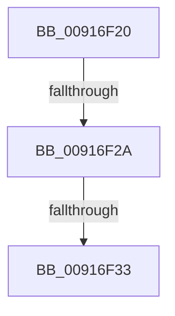

# sub_00916F20

- RVA: `0x00916F20`–`0x00916F65` (길이 `69` bytes)
- VA: `0x0000000140916F20`
- 실행 섹션: `PAGE`
- PDB 이름 있음: `아니요`; PDB Function 태그: `아니요`
- unwind 정보 RVA: `0x0008A930`
- 디코드: `21`개 명령, `69/69` bytes 표시
- 미해석 바이트: `0` (있으면 어셈블리에 `.byte`로 보존)

> 이 문서는 커널 이미지의 기계어와 PDB 기호를 분석해 생성했습니다. 4번과 5번은 함수 원형과 자료형을 바이너리 사용 방식에서 추정한 C 해석이며 원본 소스 복구 결과는 아닙니다.

## 1. Dependencies

- 직접 호출 지점: **1**; 고유 호출 대상: **1**
- 직접 호출자로 확인된 함수: **0**
- RIP 상대 이미지 참조: **0**

### Outgoing calls
- `0x00916F38` → [memset](../../text/6C/memset_function_006C6C40.md) (function, `0x006C6C40`)

### Direct callers
- 이 함수 시작 RVA로 연결되는 직접 call은 확인되지 않았습니다. 간접 호출은 완전히 역산할 수 없습니다.

### Static image references
- 디코드된 RIP-relative 메모리 참조가 없습니다.

## 2. Other-region calls and transfers

- 다른 실행 섹션으로 향하는 call: **1**
  - `0x00916F38` → [memset](../../text/6C/memset_function_006C6C40.md) (`PAGE` → `.text`)
- call이 아닌 외부 분기/꼬리 이동: **2**
  - `0x00916F28` → [sub_00916F66](Unknown_function_00916F66.md) (`tail-transfer`)
  - `0x00916F31` → [sub_00916F66](Unknown_function_00916F66.md) (`tail-transfer`)

## 3. Assembly (complete function range)

```asm
00916F20  48 89 6C 24 30                  mov qword ptr [rsp + 0x30], rbp
00916F25  83 F8 02                        cmp eax, 2
00916F28  77 3C                           ja 0x140916f66
00916F2A  BD FC FF 00 00                  mov ebp, 0xfffc
00916F2F  3B DD                           cmp ebx, ebp
00916F31  77 33                           ja 0x140916f66
00916F33  44 8B C3                        mov r8d, ebx
00916F36  33 D2                           xor edx, edx
00916F38  E8 03 FD DA FF                  call 0x1406c6c40
00916F3D  66 23 DD                        and bx, bp
00916F40  40 88 37                        mov byte ptr [rdi], sil
00916F43  33 C0                           xor eax, eax
00916F45  C6 47 01 00                     mov byte ptr [rdi + 1], 0
00916F49  89 47 04                        mov dword ptr [rdi + 4], eax
00916F4C  66 89 5F 02                     mov word ptr [rdi + 2], bx
00916F50  48 8B 6C 24 30                  mov rbp, qword ptr [rsp + 0x30]
00916F55  48 8B 5C 24 38                  mov rbx, qword ptr [rsp + 0x38]
00916F5A  48 8B 74 24 40                  mov rsi, qword ptr [rsp + 0x40]
00916F5F  48 83 C4 20                     add rsp, 0x20
00916F63  5F                              pop rdi
00916F64  C3                              ret
```

## 4. C-style interpretation (structured pseudocode)

```c
__int64 __fastcall sub_00916F20(__int64 a1, int a2, __int64 a3, __int64 a4, __int64 a5, __int64 a6, __int64 a7, __int64 a8)
{
    __int64 result;
    __int64 v_rbx;
    __int64 v_rsp;
    unsigned __int64 v_stack_p30;

    v_stack_p30 = v_rbp;
    a2 = 0;
    result = memset(a1, a2, (unsigned int)((unsigned int)(v_rbx)), a4);
    v_rbx = (unsigned __int16)((v_rbx) & ((unsigned __int16)((unsigned int)(0xFFFCULL))));
    *(unsigned __int8 *)(v_rdi) = (unsigned __int8)(v_rsi);
    result = 0;
    *(unsigned __int8 *)(v_rdi + 1) = 0;
    *(unsigned int *)(v_rdi + 4) = 0;
    *(unsigned __int16 *)(v_rdi + 2) = (unsigned __int16)(v_rbx);
    v_rsp = (v_rsp) + (32);
    return result;
}
```

## 5. (Beta) C Style

```c
int64_t sub_00916F20(int64_t Arg1, int32_t Arg2, int64_t Arg3, int64_t Arg4, uint64_t Arg5, int64_t Arg6, int64_t Arg7, int64_t Arg8)
{
    int64_t result;
    int64_t local_rbx;
    int64_t local_rsp;
    uint64_t v_stack_p30;

    v_stack_p30 = local_rbp;
    Arg2 = 0;
    result = memset(Arg1, Arg2, (uint32_t)((uint32_t)(local_rbx)), Arg4);
    local_rbx = (uint16_t)((local_rbx) & ((uint16_t)((uint32_t)(0xFFFCULL))));
    *(uint8_t *)(local_rdi) = (uint8_t)(local_rsi);
    result = 0;
    *(uint8_t *)(local_rdi + 0x1) = 0;
    *(uint32_t *)(local_rdi + 0x4) = 0;
    *(uint16_t *)(local_rdi + 0x2) = (uint16_t)(local_rbx);
    local_rsp = (local_rsp) + (32);
    return result;
}
```

## 6. Execution-region graph

[열기: 2D/3D 그래프와 함수 탐색 컨트롤 패널](../../../control-panel.html?section=page&rva=0x00916F20&view=graph)

- 2D 그래프는 위에서 아래로 흐르고, 3D 그래프는 빈 공간을 드래그해 회전합니다. Shift+드래그는 이동, 휠은 확대·축소, 함수 노드 선택은 대상 보고서 이동입니다.

### Static fallback


