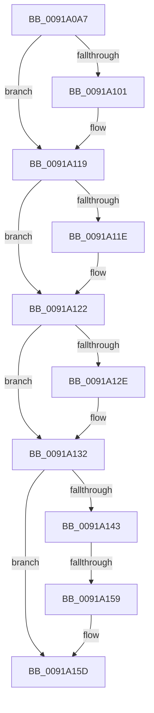

# sub_0091A0A7

- RVA: `0x0091A0A7`–`0x0091A184` (길이 `221` bytes)
- VA: `0x000000014091A0A7`
- 실행 섹션: `PAGE`
- PDB 이름 있음: `아니요`; PDB Function 태그: `아니요`
- unwind 정보 RVA: `0x0008AD8C`
- 디코드: `50`개 명령, `221/221` bytes 표시
- 미해석 바이트: `0` (있으면 어셈블리에 `.byte`로 보존)

> 이 문서는 커널 이미지의 기계어와 PDB 기호를 분석해 생성했습니다. 4번과 5번은 함수 원형과 자료형을 바이너리 사용 방식에서 추정한 C 해석이며 원본 소스 복구 결과는 아닙니다.

## 1. Dependencies

- 직접 호출 지점: **3**; 고유 호출 대상: **3**
- 직접 호출자로 확인된 함수: **0**
- RIP 상대 이미지 참조: **2**

### Outgoing calls
- `0x0091A0E6` → [KeAbPreAcquire](../../text/21/KeAbPreAcquire_function_00210230.md) (function, `0x00210230`)
- `0x0091A114` → [ExfAcquirePushLockSharedEx](../../text/21/ExfAcquirePushLockSharedEx_function_0021044C.md) (function, `0x0021044C`)
- `0x0091A14C` → [ObReferenceObjectSafeWithTag](../../text/21/ObReferenceObjectSafeWithTag_function_00210EE0.md) (function, `0x00210EE0`)

### Direct callers
- 이 함수 시작 RVA로 연결되는 직접 call은 확인되지 않았습니다. 간접 호출은 완전히 역산할 수 없습니다.

### Static image references
- `0x0091A0B4` → RVA `0x00FD9DA8` (`PAGEDATA`; read)
- `0x0091A122` → RVA `0x00FDA078` (`PAGEDATA`; read)

## 2. Other-region calls and transfers

- 다른 실행 섹션으로 향하는 call: **3**
  - `0x0091A0E6` → [KeAbPreAcquire](../../text/21/KeAbPreAcquire_function_00210230.md) (`PAGE` → `.text`)
  - `0x0091A114` → [ExfAcquirePushLockSharedEx](../../text/21/ExfAcquirePushLockSharedEx_function_0021044C.md) (`PAGE` → `.text`)
  - `0x0091A14C` → [ObReferenceObjectSafeWithTag](../../text/21/ObReferenceObjectSafeWithTag_function_00210EE0.md) (`PAGE` → `.text`)
- call이 아닌 외부 분기/꼬리 이동: **2**
  - `0x0091A153` → [sub_0091A1DB](Unknown_function_0091A1DB.md) (`tail-transfer`)
  - `0x0091A182` → [sub_0091A184 + 0xC](Unknown_function_0091A184.md) (`tail-transfer`)

## 3. Assembly (complete function range)

```asm
0091A0A7  48 89 74 24 50                  mov qword ptr [rsp + 0x50], rsi
0091A0AC  48 8B D9                        mov rbx, rcx
0091A0AF  48 89 7C 24 60                  mov qword ptr [rsp + 0x60], rdi
0091A0B4  48 8D 0D ED FC 6B 00            lea rcx, [rip + 0x6bfced]
0091A0BB  65 48 8B 3C 25 88 01 00 00      mov rdi, qword ptr gs:[0x188]
0091A0C4  45 33 C0                        xor r8d, r8d
0091A0C7  4C 89 64 24 68                  mov qword ptr [rsp + 0x68], r12
0091A0CC  33 D2                           xor edx, edx
0091A0CE  4C 89 6C 24 30                  mov qword ptr [rsp + 0x30], r13
0091A0D3  45 33 ED                        xor r13d, r13d
0091A0D6  4C 89 7C 24 20                  mov qword ptr [rsp + 0x20], r15
0091A0DB  41 8B ED                        mov ebp, r13d
0091A0DE  66 FF 8F E6 01 00 00            dec word ptr [rdi + 0x1e6]
0091A0E5  90                              nop
0091A0E6  E8 45 61 8F FF                  call 0x140210230
0091A0EB  48 8B F0                        mov rsi, rax
0091A0EE  41 BC 11 00 00 00               mov r12d, 0x11
0091A0F4  33 C0                           xor eax, eax
0091A0F6  F0 4C 0F B1 25 A9 FC 6B 00      lock cmpxchg qword ptr [rip + 0x6bfca9], r12
0091A0FF  74 18                           je 0x14091a119
0091A101  4C 8D 0D A0 FC 6B 00            lea r9, [rip + 0x6bfca0]
0091A108  4C 8B C6                        mov r8, rsi
0091A10B  33 D2                           xor edx, edx
0091A10D  48 8D 0D 94 FC 6B 00            lea rcx, [rip + 0x6bfc94]
0091A114  E8 33 63 8F FF                  call 0x14021044c
0091A119  48 85 F6                        test rsi, rsi
0091A11C  74 04                           je 0x14091a122
0091A11E  C6 46 0A 01                     mov byte ptr [rsi + 0xa], 1
0091A122  48 8B 35 4F FF 6B 00            mov rsi, qword ptr [rip + 0x6bff4f]
0091A129  48 85 DB                        test rbx, rbx
0091A12C  74 04                           je 0x14091a132
0091A12E  48 8B 73 18                     mov rsi, qword ptr [rbx + 0x18]
0091A132  4C 8D 3D 3F FF 6B 00            lea r15, [rip + 0x6bff3f]
0091A139  4C 89 74 24 28                  mov qword ptr [rsp + 0x28], r14
0091A13E  49 3B F7                        cmp rsi, r15
0091A141  74 1A                           je 0x14091a15d
0091A143  BA 50 73 45 6E                  mov edx, 0x6e457350
0091A148  48 8D 4E E8                     lea rcx, [rsi - 0x18]
0091A14C  E8 8F 6D 8F FF                  call 0x140210ee0
0091A151  84 C0                           test al, al
0091A153  0F 84 82 00 00 00               je 0x14091a1db
0091A159  48 8D 6E E8                     lea rbp, [rsi - 0x18]
0091A15D  4C 8B 7C 24 20                  mov r15, qword ptr [rsp + 0x20]
0091A162  49 8B C4                        mov rax, r12
0091A165  4C 8B 64 24 68                  mov r12, qword ptr [rsp + 0x68]
0091A16A  4C 8B 74 24 28                  mov r14, qword ptr [rsp + 0x28]
0091A16F  48 8B 74 24 50                  mov rsi, qword ptr [rsp + 0x50]
0091A174  F0 4C 0F B1 2D 2B FC 6B 00      lock cmpxchg qword ptr [rip + 0x6bfc2b], r13
0091A17D  4C 8B 6C 24 30                  mov r13, qword ptr [rsp + 0x30]
0091A182  74 0C                           je 0x14091a190
```

## 4. C-style interpretation (structured pseudocode)

```c
__int64 __fastcall sub_0091A0A7(__int64 a1, int a2, int a3, __int64 a4, __int64 a5, __int64 a6, __int64 a7, __int64 a8, __int64 a9, __int64 a10, __int64 a11, __int64 a12, __int64 a13)
{
    __int64 result;
    __int64 v_r13;
    __int64 v_rsi;
    unsigned __int64 v_stack_p20;
    unsigned __int64 v_stack_p28;
    unsigned __int64 v_stack_p30;
    unsigned __int64 v_stack_p50;
    unsigned __int64 v_stack_p60;
    unsigned __int64 v_stack_p68;

    v_stack_p50 = v_rsi;
    v_stack_p60 = v_rdi;
    a3 = 0;
    v_stack_p68 = v_r12;
    a2 = 0;
    v_stack_p30 = v_r13;
    v_r13 = 0;
    v_stack_p20 = v_r15;
    result = KeAbPreAcquire(v_rip + 7077101, a2, a3, a4);
    result = 0;
    if (!(condition_is_equal)) {
        a4 = v_rip + 7077024;
        a3 = 0;
        a2 = 0;
        a1 = v_rip + 7077012;
        result = ExfAcquirePushLockSharedEx(a1, a2, a3, a4);
    }
    if (result != 0) {
        *(unsigned __int8 *)(result + 10) = 1;
    }
    v_rsi = *(unsigned __int64 *)(v_rip + 7077711);
    if (a1 != 0) {
        v_rsi = *(unsigned __int64 *)(a1 + 24);
    }
    v_stack_p28 = v_r14;
    if (v_rsi == (v_rip + 7077695)) goto loc_0091A15D;
    result = ObReferenceObjectSafeWithTag(v_rsi - 24, (unsigned int)(0x6E457350ULL), a3, a4);
loc_0091A15D:
}
```

## 5. (Beta) C Style

```c
int64_t sub_0091A0A7(int64_t Arg1, int32_t Arg2, int32_t Arg3, int64_t Arg4, int64_t Arg5, int64_t Arg6, uint64_t Arg7, uint64_t Arg8, uint64_t Arg9, int64_t Arg10, uint64_t Arg11, uint64_t Arg12, int64_t Arg13)
{
    int64_t result;
    int64_t local_r13;
    int64_t local_rsi;
    uint64_t v_stack_p20;
    uint64_t v_stack_p28;
    uint64_t v_stack_p30;
    uint64_t v_stack_p50;
    uint64_t v_stack_p60;
    uint64_t v_stack_p68;

    v_stack_p50 = local_rsi;
    v_stack_p60 = local_rdi;
    Arg3 = 0;
    v_stack_p68 = local_r12;
    Arg2 = 0;
    v_stack_p30 = local_r13;
    local_r13 = 0;
    v_stack_p20 = local_r15;
    result = KeAbPreAcquire(v_rip + 7077101, Arg2, Arg3, Arg4);
    result = 0;
    if (!(condition_is_equal)) {
        Arg4 = v_rip + 7077024;
        Arg3 = 0;
        Arg2 = 0;
        Arg1 = v_rip + 7077012;
        result = ExfAcquirePushLockSharedEx(Arg1, Arg2, Arg3, Arg4);
    }
    if (result != 0) {
        *(uint8_t *)(result + 0xA) = 1;
    }
    local_rsi = *(uint64_t *)(v_rip + 0x6BFF4F);
    if (Arg1 != 0) {
        local_rsi = *(uint64_t *)(Arg1 + 0x18);
    }
    v_stack_p28 = local_r14;
    if (local_rsi == (v_rip + 7077695)) goto loc_0091A15D;
    result = ObReferenceObjectSafeWithTag(local_rsi - 24, (uint32_t)(0x6E457350ULL), Arg3, Arg4);
loc_0091A15D:
}
```

## 6. Execution-region graph

[열기: 2D/3D 그래프와 함수 탐색 컨트롤 패널](../../../control-panel.html?section=page&rva=0x0091A0A7&view=graph)

- 2D 그래프는 위에서 아래로 흐르고, 3D 그래프는 빈 공간을 드래그해 회전합니다. Shift+드래그는 이동, 휠은 확대·축소, 함수 노드 선택은 대상 보고서 이동입니다.

### Static fallback


