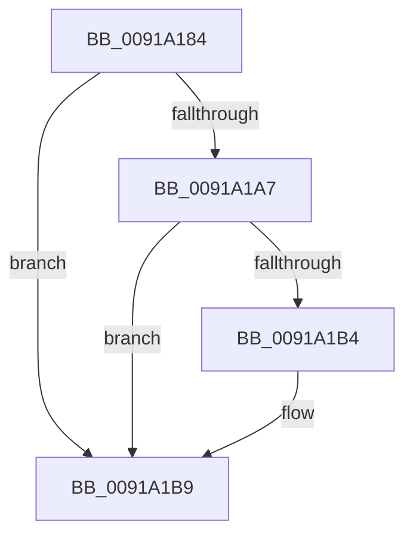

# sub_0091A184

- RVA: `0x0091A184`–`0x0091A1C3` (길이 `63` bytes)
- VA: `0x000000014091A184`
- 실행 섹션: `PAGE`
- PDB 이름 있음: `아니요`; PDB Function 태그: `아니요`
- unwind 정보 RVA: `0x0008ADB4`
- 디코드: `15`개 명령, `63/63` bytes 표시
- 미해석 바이트: `0` (있으면 어셈블리에 `.byte`로 보존)

> 이 문서는 커널 이미지의 기계어와 PDB 기호를 분석해 생성했습니다. 4번과 5번은 함수 원형과 자료형을 바이너리 사용 방식에서 추정한 C 해석이며 원본 소스 복구 결과는 아닙니다.

## 1. Dependencies

- 직접 호출 지점: **3**; 고유 호출 대상: **3**
- 직접 호출자로 확인된 함수: **0**
- RIP 상대 이미지 참조: **1**

### Outgoing calls
- `0x0091A18B` → [ExfReleasePushLockShared](../../text/26/ExfReleasePushLockShared_function_00263440.md) (function, `0x00263440`)
- `0x0091A197` → [KeAbPostRelease](../../text/2E/KeAbPostRelease_function_002E1600.md) (function, `0x002E1600`)
- `0x0091A1B4` → [KiCheckForKernelApcDelivery](../../text/2E/KiCheckForKernelApcDelivery_function_002E2C80.md) (function, `0x002E2C80`)

### Direct callers
- 이 함수 시작 RVA로 연결되는 직접 call은 확인되지 않았습니다. 간접 호출은 완전히 역산할 수 없습니다.

### Static image references
- `0x0091A184` → RVA `0x00FD9DA8` (`PAGEDATA`; read)

## 2. Other-region calls and transfers

- 다른 실행 섹션으로 향하는 call: **3**
  - `0x0091A18B` → [ExfReleasePushLockShared](../../text/26/ExfReleasePushLockShared_function_00263440.md) (`PAGE` → `.text`)
  - `0x0091A197` → [KeAbPostRelease](../../text/2E/KeAbPostRelease_function_002E1600.md) (`PAGE` → `.text`)
  - `0x0091A1B4` → [KiCheckForKernelApcDelivery](../../text/2E/KiCheckForKernelApcDelivery_function_002E2C80.md) (`PAGE` → `.text`)
- call이 아닌 외부 분기/꼬리 이동: **1**
  - `0x0091A1C1` → [sub_0091A1C3 + 0xD](Unknown_function_0091A1C3.md) (`tail-transfer`)

## 3. Assembly (complete function range)

```asm
0091A184  48 8D 0D 1D FC 6B 00            lea rcx, [rip + 0x6bfc1d]
0091A18B  E8 B0 92 94 FF                  call 0x140263440
0091A190  48 8D 0D 11 FC 6B 00            lea rcx, [rip + 0x6bfc11]
0091A197  E8 64 74 9C FF                  call 0x1402e1600
0091A19C  90                              nop
0091A19D  66 83 87 E6 01 00 00 01         add word ptr [rdi + 0x1e6], 1
0091A1A5  75 12                           jne 0x14091a1b9
0091A1A7  48 8D 8F 98 00 00 00            lea rcx, [rdi + 0x98]
0091A1AE  90                              nop
0091A1AF  48 39 09                        cmp qword ptr [rcx], rcx
0091A1B2  74 05                           je 0x14091a1b9
0091A1B4  E8 C7 8A 9C FF                  call 0x1402e2c80
0091A1B9  48 8B 7C 24 60                  mov rdi, qword ptr [rsp + 0x60]
0091A1BE  48 85 DB                        test rbx, rbx
0091A1C1  74 0D                           je 0x14091a1d0
```

## 4. C-style interpretation (structured pseudocode)

```c
__int64 __fastcall sub_0091A184(__int64 a1, __int64 a2, __int64 a3, __int64 a4, __int64 a5, __int64 a6, __int64 a7, __int64 a8, __int64 a9, __int64 a10, __int64 a11, __int64 a12)
{
    __int64 result;

    result = ExfReleasePushLockShared(v_rip + 7076893, a2, a3, a4);
    result = KeAbPostRelease(v_rip + 7076881, a2, a3, a4);
    if (condition_is_not_equal) goto loc_0091A1B9;
    if ((*(unsigned __int64 *)(v_rdi + 152)) != (v_rdi + 152)) {
        result = KiCheckForKernelApcDelivery(v_rdi + 152, a2, a3, a4);
    }
}
```

## 5. (Beta) C Style

```c
int64_t sub_0091A184(int64_t Arg1, int64_t Arg2, int64_t Arg3, int64_t Arg4, uint64_t Arg5, uint64_t Arg6, uint64_t Arg7, uint64_t Arg8, uint64_t Arg9, uint64_t Arg10, uint64_t Arg11, int64_t Arg12)
{
    int64_t result;

    result = ExfReleasePushLockShared(v_rip + 7076893, Arg2, Arg3, Arg4);
    result = KeAbPostRelease(v_rip + 7076881, Arg2, Arg3, Arg4);
    if (condition_is_not_equal) goto loc_0091A1B9;
    if ((*(uint64_t *)(local_rdi + 0x98)) != (local_rdi + 152)) {
        result = KiCheckForKernelApcDelivery(local_rdi + 152, Arg2, Arg3, Arg4);
    }
}
```

## 6. Execution-region graph

[열기: 2D/3D 그래프와 함수 탐색 컨트롤 패널](../../../control-panel.html?section=page&rva=0x0091A184&view=graph)

- 2D 그래프는 위에서 아래로 흐르고, 3D 그래프는 빈 공간을 드래그해 회전합니다. Shift+드래그는 이동, 휠은 확대·축소, 함수 노드 선택은 대상 보고서 이동입니다.

### Static fallback


