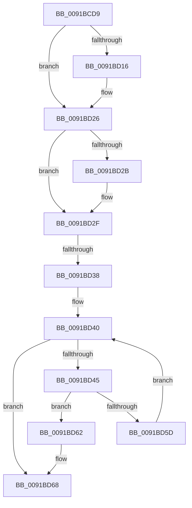

# sub_0091BCD9

- RVA: `0x0091BCD9`–`0x0091BD7D` (길이 `164` bytes)
- VA: `0x000000014091BCD9`
- 실행 섹션: `PAGE`
- PDB 이름 있음: `아니요`; PDB Function 태그: `아니요`
- unwind 정보 RVA: `0x0008B018`
- 디코드: `41`개 명령, `164/164` bytes 표시
- 미해석 바이트: `0` (있으면 어셈블리에 `.byte`로 보존)

> 이 문서는 커널 이미지의 기계어와 PDB 기호를 분석해 생성했습니다. 4번과 5번은 함수 원형과 자료형을 바이너리 사용 방식에서 추정한 C 해석이며 원본 소스 복구 결과는 아닙니다.

## 1. Dependencies

- 직접 호출 지점: **3**; 고유 호출 대상: **3**
- 직접 호출자로 확인된 함수: **0**
- RIP 상대 이미지 참조: **0**

### Outgoing calls
- `0x0091BD00` → [KeAbPreAcquire](../../text/21/KeAbPreAcquire_function_00210230.md) (function, `0x00210230`)
- `0x0091BD21` → [ExfAcquirePushLockSharedEx](../../text/21/ExfAcquirePushLockSharedEx_function_0021044C.md) (function, `0x0021044C`)
- `0x0091BD54` → [ObReferenceObjectSafeWithTag](../../text/21/ObReferenceObjectSafeWithTag_function_00210EE0.md) (function, `0x00210EE0`)

### Direct callers
- 이 함수 시작 RVA로 연결되는 직접 call은 확인되지 않았습니다. 간접 호출은 완전히 역산할 수 없습니다.

### Static image references
- 디코드된 RIP-relative 메모리 참조가 없습니다.

## 2. Other-region calls and transfers

- 다른 실행 섹션으로 향하는 call: **3**
  - `0x0091BD00` → [KeAbPreAcquire](../../text/21/KeAbPreAcquire_function_00210230.md) (`PAGE` → `.text`)
  - `0x0091BD21` → [ExfAcquirePushLockSharedEx](../../text/21/ExfAcquirePushLockSharedEx_function_0021044C.md) (`PAGE` → `.text`)
  - `0x0091BD54` → [ObReferenceObjectSafeWithTag](../../text/21/ObReferenceObjectSafeWithTag_function_00210EE0.md) (`PAGE` → `.text`)
- call이 아닌 외부 분기/꼬리 이동: **2**
  - `0x0091BD32` → [sub_0091BDC6](Unknown_function_0091BDC6.md) (`tail-transfer`)
  - `0x0091BD77` → [sub_0091BE05](Unknown_function_0091BE05.md) (`tail-transfer`)

## 3. Assembly (complete function range)

```asm
0091BCD9  4C 89 74 24 28                  mov qword ptr [rsp + 0x28], r14
0091BCDE  44 8B E5                        mov r12d, ebp
0091BCE1  4C 8D B1 70 03 00 00            lea r14, [rcx + 0x370]
0091BCE8  4C 89 7C 24 20                  mov qword ptr [rsp + 0x20], r15
0091BCED  4C 8D B9 C8 01 00 00            lea r15, [rcx + 0x1c8]
0091BCF4  66 41 FF 8D E4 01 00 00         dec word ptr [r13 + 0x1e4]
0091BCFC  49 8B CF                        mov rcx, r15
0091BCFF  90                              nop
0091BD00  E8 2B 45 8F FF                  call 0x140210230
0091BD05  48 8B D8                        mov rbx, rax
0091BD08  B9 11 00 00 00                  mov ecx, 0x11
0091BD0D  33 C0                           xor eax, eax
0091BD0F  F0 49 0F B1 0F                  lock cmpxchg qword ptr [r15], rcx
0091BD14  74 10                           je 0x14091bd26
0091BD16  4D 8B CF                        mov r9, r15
0091BD19  4C 8B C3                        mov r8, rbx
0091BD1C  33 D2                           xor edx, edx
0091BD1E  49 8B CF                        mov rcx, r15
0091BD21  E8 26 47 8F FF                  call 0x14021044c
0091BD26  48 85 DB                        test rbx, rbx
0091BD29  74 04                           je 0x14091bd2f
0091BD2B  C6 43 0A 01                     mov byte ptr [rbx + 0xa], 1
0091BD2F  48 85 F6                        test rsi, rsi
0091BD32  0F 84 8E 00 00 00               je 0x14091bdc6
0091BD38  48 8B 9E 78 05 00 00            mov rbx, qword ptr [rsi + 0x578]
0091BD3F  90                              nop
0091BD40  49 3B DE                        cmp rbx, r14
0091BD43  74 23                           je 0x14091bd68
0091BD45  48 8D BB 88 FA FF FF            lea rdi, [rbx - 0x578]
0091BD4C  BA 50 73 45 6E                  mov edx, 0x6e457350
0091BD51  48 8B CF                        mov rcx, rdi
0091BD54  E8 87 51 8F FF                  call 0x140210ee0
0091BD59  84 C0                           test al, al
0091BD5B  75 05                           jne 0x14091bd62
0091BD5D  48 8B 1B                        mov rbx, qword ptr [rbx]
0091BD60  EB DE                           jmp 0x14091bd40
0091BD62  41 BC 01 00 00 00               mov r12d, 1
0091BD68  4C 8B 74 24 28                  mov r14, qword ptr [rsp + 0x28]
0091BD6D  B8 11 00 00 00                  mov eax, 0x11
0091BD72  F0 49 0F B1 2F                  lock cmpxchg qword ptr [r15], rbp
0091BD77  0F 85 88 00 00 00               jne 0x14091be05
```

## 4. C-style interpretation (structured pseudocode)

```c
__int64 __fastcall sub_0091BCD9(__int64 a1, int a2, __int64 a3, __int64 a4, __int64 a5)
{
    __int64 result;
    unsigned __int64 v_stack_p20;
    unsigned __int64 v_stack_p28;

    v_stack_p28 = v_r14;
    v_stack_p20 = v_r15;
    result = KeAbPreAcquire(a1 + 456, a2, a3, a4);
    result = 0;
    if (!(condition_is_equal)) {
        a4 = a1 + 456;
        a3 = 0;
        a2 = 0;
        a1 = a1 + 456;
        result = ExfAcquirePushLockSharedEx(a1, a2, a3, a4);
    }
    if (result != 0) {
        *(unsigned __int8 *)(result + 10) = 1;
    }
loc_0091BD40:
    if ((*(unsigned __int64 *)(v_rsi + 1400)) == (a1 + 880)) goto loc_0091BD68;
    result = ObReferenceObjectSafeWithTag(*(unsigned __int64 *)(v_rsi + 1400) - 1400, (unsigned int)(0x6E457350ULL), a3, a4);
    if ((unsigned __int8)(result) != 0) goto loc_0091BD62;
    goto loc_0091BD40;
loc_0091BD62:
loc_0091BD68:
}
```

## 5. (Beta) C Style

```c
int64_t sub_0091BCD9(void *Arg1, int32_t Arg2, int64_t Arg3, int64_t Arg4, int64_t Arg5)
{
    uint8_t *arg1 = (uint8_t *)Arg1;

    int64_t result;
    uint64_t v_stack_p20;
    uint64_t v_stack_p28;

    v_stack_p28 = local_r14;
    v_stack_p20 = local_r15;
    result = KeAbPreAcquire(Arg1 + 456, Arg2, Arg3, Arg4);
    result = 0;
    if (!(condition_is_equal)) {
        Arg4 = Arg1 + 456;
        Arg3 = 0;
        Arg2 = 0;
        Arg1 = Arg1 + 456;
        result = ExfAcquirePushLockSharedEx(Arg1, Arg2, Arg3, Arg4);
    }
    if (result != 0) {
        *(uint8_t *)(result + 0xA) = 1;
    }
loc_0091BD40:
    if ((*(uint64_t *)(local_rsi + 0x578)) == (Arg1 + 880)) goto loc_0091BD68;
    result = ObReferenceObjectSafeWithTag(*(uint64_t *)(local_rsi + 0x578) - 1400, (uint32_t)(0x6E457350ULL), Arg3, Arg4);
    if ((uint8_t)(result) != 0) goto loc_0091BD62;
    goto loc_0091BD40;
loc_0091BD62:
loc_0091BD68:
}
```

### 관측된 메모리 오프셋

구조체 형식이 확인되지 않은 접근은 인자 기준의 오프셋으로만 기록했습니다.

| 기준 인자 | 오프셋 표현 | 폭 (bit) | 접근 |
|---|---:|---:|---|
| `Arg1` | `+ 0x0` | `64` | `R` |
| `Arg1` | `+ 0x1C8` | `64` | `R` |
| `Arg1` | `+ 0x370` | `64` | `R` |

## 6. Execution-region graph

[열기: 2D/3D 그래프와 함수 탐색 컨트롤 패널](../../../control-panel.html?section=page&rva=0x0091BCD9&view=graph)

- 2D 그래프는 위에서 아래로 흐르고, 3D 그래프는 빈 공간을 드래그해 회전합니다. Shift+드래그는 이동, 휠은 확대·축소, 함수 노드 선택은 대상 보고서 이동입니다.

### Static fallback


