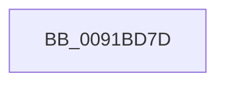

# sub_0091BD7D

- RVA: `0x0091BD7D`–`0x0091BD9C` (길이 `31` bytes)
- VA: `0x000000014091BD7D`
- 실행 섹션: `PAGE`
- PDB 이름 있음: `아니요`; PDB Function 태그: `아니요`
- unwind 정보 RVA: `0x0008B030`
- 디코드: `8`개 명령, `31/31` bytes 표시
- 미해석 바이트: `0` (있으면 어셈블리에 `.byte`로 보존)

> 이 문서는 커널 이미지의 기계어와 PDB 기호를 분석해 생성했습니다. 4번과 5번은 함수 원형과 자료형을 바이너리 사용 방식에서 추정한 C 해석이며 원본 소스 복구 결과는 아닙니다.

## 1. Dependencies

- 직접 호출 지점: **2**; 고유 호출 대상: **2**
- 직접 호출자로 확인된 함수: **0**
- RIP 상대 이미지 참조: **0**

### Outgoing calls
- `0x0091BD80` → [KeAbPostRelease](../../text/2E/KeAbPostRelease_function_002E1600.md) (function, `0x002E1600`)
- `0x0091BD88` → [KeLeaveCriticalRegionThread](../../text/25/KeLeaveCriticalRegionThread_function_0025EFF0.md) (function, `0x0025EFF0`)

### Direct callers
- 이 함수 시작 RVA로 연결되는 직접 call은 확인되지 않았습니다. 간접 호출은 완전히 역산할 수 없습니다.

### Static image references
- 디코드된 RIP-relative 메모리 참조가 없습니다.

## 2. Other-region calls and transfers

- 다른 실행 섹션으로 향하는 call: **2**
  - `0x0091BD80` → [KeAbPostRelease](../../text/2E/KeAbPostRelease_function_002E1600.md) (`PAGE` → `.text`)
  - `0x0091BD88` → [KeLeaveCriticalRegionThread](../../text/25/KeLeaveCriticalRegionThread_function_0025EFF0.md) (`PAGE` → `.text`)
- call이 아닌 외부 분기/꼬리 이동: **1**
  - `0x0091BD9A` → [sub_0091BD9C + 0xD](Unknown_function_0091BD9C.md) (`tail-transfer`)

## 3. Assembly (complete function range)

```asm
0091BD7D  49 8B CF                        mov rcx, r15
0091BD80  E8 7B 58 9C FF                  call 0x1402e1600
0091BD85  49 8B CD                        mov rcx, r13
0091BD88  E8 63 32 94 FF                  call 0x14025eff0
0091BD8D  4C 8B 7C 24 20                  mov r15, qword ptr [rsp + 0x20]
0091BD92  4C 8B 6C 24 68                  mov r13, qword ptr [rsp + 0x68]
0091BD97  48 85 F6                        test rsi, rsi
0091BD9A  74 0D                           je 0x14091bda9
```

## 4. C-style interpretation (structured pseudocode)

```c
__int64 __fastcall sub_0091BD7D(__int64 a1, __int64 a2, __int64 a3, __int64 a4, __int64 a5, __int64 a6, __int64 a7, __int64 a8, __int64 a9, __int64 a10, __int64 a11, __int64 a12, __int64 a13)
{
    __int64 result;
    unsigned __int64 v_stack_p20;

    result = KeAbPostRelease(v_r15, a2, a3, a4);
    result = KeLeaveCriticalRegionThread(v_r13, a2, a3, a4);
}
```

## 5. (Beta) C Style

```c
int64_t sub_0091BD7D(int64_t Arg1, int64_t Arg2, int64_t Arg3, int64_t Arg4, uint64_t Arg5, uint64_t Arg6, uint64_t Arg7, uint64_t Arg8, uint64_t Arg9, uint64_t Arg10, uint64_t Arg11, uint64_t Arg12, int64_t Arg13)
{
    int64_t result;
    uint64_t v_stack_p20;

    result = KeAbPostRelease(local_r15, Arg2, Arg3, Arg4);
    result = KeLeaveCriticalRegionThread(local_r13, Arg2, Arg3, Arg4);
}
```

## 6. Execution-region graph

[열기: 2D/3D 그래프와 함수 탐색 컨트롤 패널](../../../control-panel.html?section=page&rva=0x0091BD7D&view=graph)

- 2D 그래프는 위에서 아래로 흐르고, 3D 그래프는 빈 공간을 드래그해 회전합니다. Shift+드래그는 이동, 휠은 확대·축소, 함수 노드 선택은 대상 보고서 이동입니다.

### Static fallback


