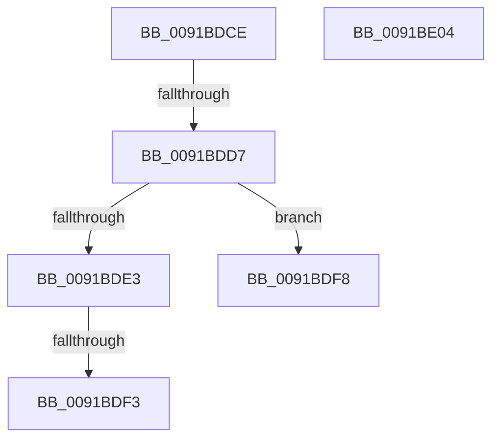

# sub_0091BDCE

- RVA: `0x0091BDCE`–`0x0091BE05` (길이 `55` bytes)
- VA: `0x000000014091BDCE`
- 실행 섹션: `PAGE`
- PDB 이름 있음: `아니요`; PDB Function 태그: `아니요`
- unwind 정보 RVA: `0x0008B08C`
- 디코드: `19`개 명령, `55/55` bytes 표시
- 미해석 바이트: `0` (있으면 어셈블리에 `.byte`로 보존)

> 이 문서는 커널 이미지의 기계어와 PDB 기호를 분석해 생성했습니다. 4번과 5번은 함수 원형과 자료형을 바이너리 사용 방식에서 추정한 C 해석이며 원본 소스 복구 결과는 아닙니다.

## 1. Dependencies

- 직접 호출 지점: **0**; 고유 호출 대상: **0**
- 직접 호출자로 확인된 함수: **0**
- RIP 상대 이미지 참조: **1**

### Outgoing calls
- 직접 디코드된 call 명령이 없습니다.

### Direct callers
- 이 함수 시작 RVA로 연결되는 직접 call은 확인되지 않았습니다. 간접 호출은 완전히 역산할 수 없습니다.

### Static image references
- `0x0091BDE3` → RVA `0x00FC6AA4` (`ALMOSTRO`; read)

## 2. Other-region calls and transfers

- 다른 실행 섹션으로 향하는 call: **0**
- call이 아닌 외부 분기/꼬리 이동: **3**
  - `0x0091BDD5` → [sub_0091BE12](Unknown_function_0091BE12.md) (`tail-transfer`)
  - `0x0091BDF1` → [sub_0091BE12 + 0x5](Unknown_function_0091BE12.md) (`tail-transfer`)
  - `0x0091BDF6` → [sub_0091BDBD](Unknown_function_0091BDBD.md) (`tail-transfer`)

## 3. Assembly (complete function range)

```asm
0091BDCE  48 83 C1 30                     add rcx, 0x30
0091BDD2  48 85 F6                        test rsi, rsi
0091BDD5  74 3B                           je 0x14091be12
0091BDD7  48 8B 82 F8 02 00 00            mov rax, qword ptr [rdx + 0x2f8]
0091BDDE  48 3B C1                        cmp rax, rcx
0091BDE1  74 15                           je 0x14091bdf8
0091BDE3  80 3D BA AC 6A 00 00            cmp byte ptr [rip + 0x6aacba], 0
0091BDEA  48 8D 98 08 FD FF FF            lea rbx, [rax - 0x2f8]
0091BDF1  75 24                           jne 0x14091be17
0091BDF3  48 8B C3                        mov rax, rbx
0091BDF6  EB C5                           jmp 0x14091bdbd
0091BDF8  33 ED                           xor ebp, ebp
0091BDFA  8B C5                           mov eax, ebp
0091BDFC  48 83 C4 30                     add rsp, 0x30
0091BE00  5E                              pop rsi
0091BE01  5D                              pop rbp
0091BE02  5B                              pop rbx
0091BE03  C3                              ret
0091BE04  CC                              int3
```

## 4. C-style interpretation (structured pseudocode)

```c
__int64 __fastcall sub_0091BDCE(__int64 a1, __int64 a2)
{
    __int64 v_rbp;
    __int64 v_rsp;

    a1 = (a1) + (48);
    if ((*(unsigned __int64 *)(a2 + 760)) == a1) goto loc_0091BDF8;
loc_0091BDF8:
    v_rbp = 0;
    v_rsp = (v_rsp) + (48);
    return 0;
}
```

## 5. (Beta) C Style

```c
int64_t sub_0091BDCE(int64_t Arg1, void *Arg2)
{
    uint8_t *arg2 = (uint8_t *)Arg2;

    int64_t local_rbp;
    int64_t local_rsp;

    Arg1 = (Arg1) + (48);
    if ((*(uint64_t *)(arg2 + 0x2F8)) == Arg1) goto loc_0091BDF8;
loc_0091BDF8:
    local_rbp = 0;
    local_rsp = (local_rsp) + (48);
    return 0;
}
```

### 관측된 메모리 오프셋

구조체 형식이 확인되지 않은 접근은 인자 기준의 오프셋으로만 기록했습니다.

| 기준 인자 | 오프셋 표현 | 폭 (bit) | 접근 |
|---|---:|---:|---|
| `Arg2` | `+ 0x2F8` | `64` | `R` |

## 6. Execution-region graph

[열기: 2D/3D 그래프와 함수 탐색 컨트롤 패널](../../../control-panel.html?section=page&rva=0x0091BDCE&view=graph)

- 2D 그래프는 위에서 아래로 흐르고, 3D 그래프는 빈 공간을 드래그해 회전합니다. Shift+드래그는 이동, 휠은 확대·축소, 함수 노드 선택은 대상 보고서 이동입니다.

### Static fallback


