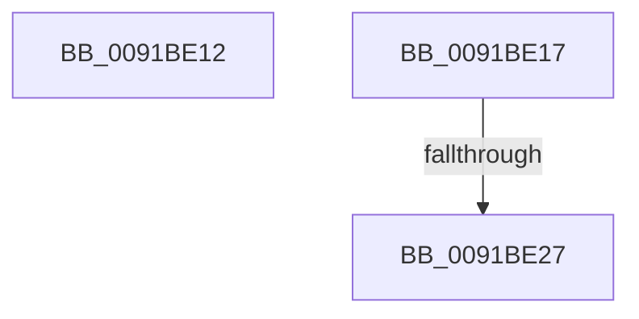

# sub_0091BE12

- RVA: `0x0091BE12`–`0x0091BE41` (길이 `47` bytes)
- VA: `0x000000014091BE12`
- 실행 섹션: `PAGE`
- PDB 이름 있음: `아니요`; PDB Function 태그: `아니요`
- unwind 정보 RVA: `0x0008B0C0`
- 디코드: `11`개 명령, `47/47` bytes 표시
- 미해석 바이트: `0` (있으면 어셈블리에 `.byte`로 보존)

> 이 문서는 커널 이미지의 기계어와 PDB 기호를 분석해 생성했습니다. 4번과 5번은 함수 원형과 자료형을 바이너리 사용 방식에서 추정한 C 해석이며 원본 소스 복구 결과는 아닙니다.

## 1. Dependencies

- 직접 호출 지점: **2**; 고유 호출 대상: **2**
- 직접 호출자로 확인된 함수: **0**
- RIP 상대 이미지 참조: **1**

### Outgoing calls
- `0x0091BE2E` → [ExAcquireFastMutex](../../text/20/ExAcquireFastMutex_function_0020E5A0.md) (function, `0x0020E5A0`)
- `0x0091BE3A` → [ExReleaseFastMutex](../../text/25/ExReleaseFastMutex_function_002519C0.md) (function, `0x002519C0`)

### Direct callers
- 이 함수 시작 RVA로 연결되는 직접 call은 확인되지 않았습니다. 간접 호출은 완전히 역산할 수 없습니다.

### Static image references
- `0x0091BE1C` → RVA `0x00F22B80` (`.data`; read)

## 2. Other-region calls and transfers

- 다른 실행 섹션으로 향하는 call: **2**
  - `0x0091BE2E` → [ExAcquireFastMutex](../../text/20/ExAcquireFastMutex_function_0020E5A0.md) (`PAGE` → `.text`)
  - `0x0091BE3A` → [ExReleaseFastMutex](../../text/25/ExReleaseFastMutex_function_002519C0.md) (`PAGE` → `.text`)
- call이 아닌 외부 분기/꼬리 이동: **3**
  - `0x0091BE15` → [sub_0091BDCE + 0x10](Unknown_function_0091BDCE.md) (`tail-transfer`)
  - `0x0091BE25` → [sub_0091BDCE + 0x25](Unknown_function_0091BDCE.md) (`tail-transfer`)
  - `0x0091BE3F` → [sub_0091BDCE + 0x25](Unknown_function_0091BDCE.md) (`tail-transfer`)

## 3. Assembly (complete function range)

```asm
0091BE12  48 8B 01                        mov rax, qword ptr [rcx]
0091BE15  EB C7                           jmp 0x14091bdde
0091BE17  F0 83 0C 24 00                  lock or dword ptr [rsp], 0
0091BE1C  8B 0D 5E 6D 60 00               mov ecx, dword ptr [rip + 0x606d5e]
0091BE22  F6 C1 01                        test cl, 1
0091BE25  75 CC                           jne 0x14091bdf3
0091BE27  48 8D 0D 52 6D 60 00            lea rcx, [rip + 0x606d52]
0091BE2E  E8 6D 27 8F FF                  call 0x14020e5a0
0091BE33  48 8D 0D 46 6D 60 00            lea rcx, [rip + 0x606d46]
0091BE3A  E8 81 5B 93 FF                  call 0x1402519c0
0091BE3F  EB B2                           jmp 0x14091bdf3
```

## 4. C-style interpretation (structured pseudocode)

```c
__int64 __fastcall sub_0091BE12(__int64 a1)
{
    unsigned int v_stack_p0;
}
```

## 5. (Beta) C Style

```c
int64_t sub_0091BE12(void *Arg1)
{
    uint8_t *arg1 = (uint8_t *)Arg1;

    uint32_t v_stack_p0;
}
```

### 관측된 메모리 오프셋

구조체 형식이 확인되지 않은 접근은 인자 기준의 오프셋으로만 기록했습니다.

| 기준 인자 | 오프셋 표현 | 폭 (bit) | 접근 |
|---|---:|---:|---|
| `Arg1` | `+ 0x0` | `64` | `R` |

## 6. Execution-region graph

[열기: 2D/3D 그래프와 함수 탐색 컨트롤 패널](../../../control-panel.html?section=page&rva=0x0091BE12&view=graph)

- 2D 그래프는 위에서 아래로 흐르고, 3D 그래프는 빈 공간을 드래그해 회전합니다. Shift+드래그는 이동, 휠은 확대·축소, 함수 노드 선택은 대상 보고서 이동입니다.

### Static fallback


